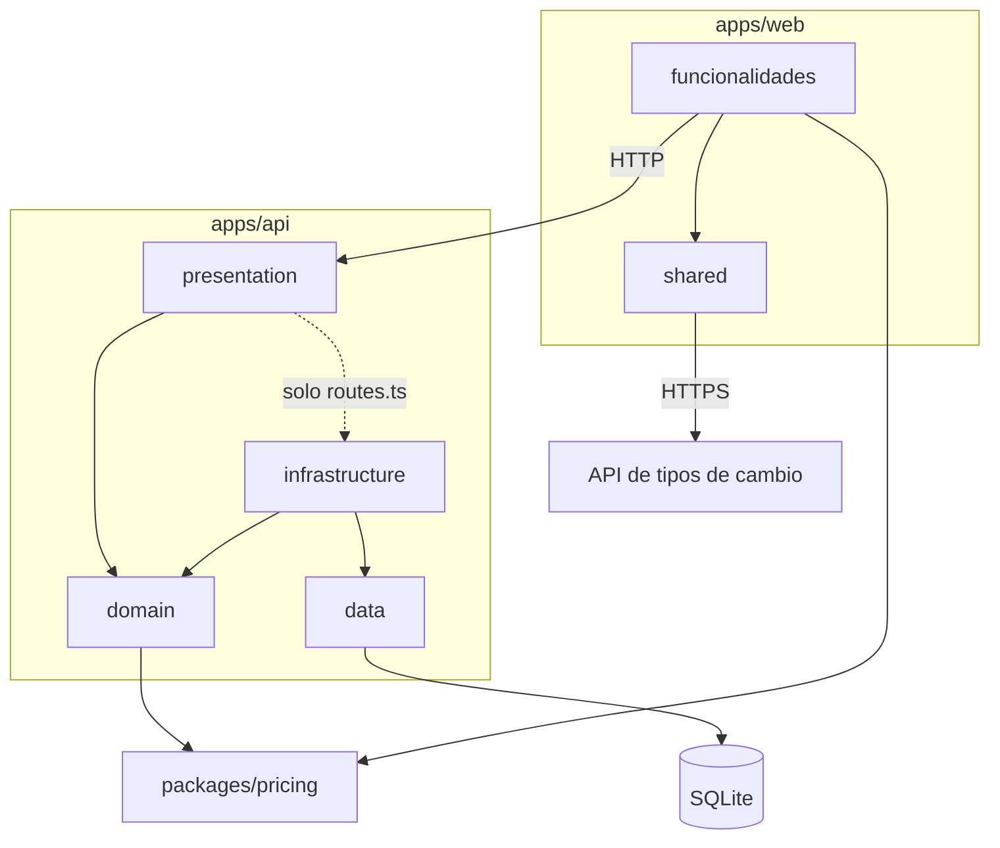

# Arquitectura

Stack: ADR-009 · Cálculo compartido: ADR-010 · Datos: database.md

## Carpetas
```text
packages/pricing/                  # cálculo por tramos: TS puro, importes enteros
apps/api/
├─ migrations/                     # SQL del esquema (database.md)
└─ src/
   ├─ app.ts                       # entrada: arranca Server
   ├─ config/envs.ts               # process.env validado con Zod
   ├─ data/sqlite/index.ts         # conexión better-sqlite3
   ├─ domain/
   │  ├─ datasources/              # customer.datasource.ts, simulation.datasource.ts
   │  ├─ dtos/{customers,simulations}/   # create-*.dto.ts (validan con Zod)
   │  ├─ entities/                 # customer.entity.ts, simulation.entity.ts
   │  ├─ errors/custom.error.ts    # CustomError
   │  ├─ repository/               # customer.repository.ts, simulation.repository.ts
   │  └─ use-cases/{customer,simulation}/create-*.ts
   ├─ infrastructure/
   │  ├─ sqlite-connection.ts      # abre la conexión (data); solo la compone presentation/routes.ts
   │  ├─ datasource/               # sqlite-customer.datasource.ts, sqlite-simulation.datasource.ts
   │  └─ repository/               # *.repository.imp.ts
   └─ presentation/
      ├─ server.ts · routes.ts
      ├─ middlewares/error-handler.ts  # solo errores que no llegan a un controlador
      └─ {customers,simulations}/  # controller.ts · routes.ts
apps/web/src/
├─ styles.scss                     # solo importa los parciales de scss/
├─ scss/
│  ├─ themes/_tokens.scss          # colores y medidas con nombre
│  └─ _shared.scss · _customers.scss · _simulations.scss · _health.scss   # un parcial por funcionalidad
└─ app/
   ├─ app.ts · app.html · app.routes.ts · app.config.ts
   ├─ customers/                   # buscador, dashboard y detalle con historial (§2.B)
   │  ├─ pages/customers-page/ · customer-detail-page/
   │  ├─ components/customer-card/ · customer-search/ · simulation-history/
   │  ├─ interfaces/
   │  └─ services/customers-api.ts
   ├─ simulations/                 # simulación interactiva (§2.B)
   │  ├─ pages/simulation-page/
   │  ├─ components/simulation-form/
   │  ├─ interfaces/
   │  └─ services/simulations-api.ts
   ├─ health/                      # estado de la API (spec 000)
   │  ├─ pages/health-page/
   │  ├─ interfaces/
   │  └─ services/health-api.ts
   └─ shared/
      ├─ components/currency-selector/
      ├─ interfaces/customer.ts · simulation.ts
      ├─ schemas/exchange-rates.ts
      └─ services/exchange-rates-api.ts · currency-selection.ts
```
Tests `*.spec.ts` junto a cada archivo. Un componente o página = una carpeta con `.ts`, `.html` y `.spec.ts`. Nombres de páginas y componentes provisionales: los fija cada spec.

## Capas
Clean Architecture en la API, sin capa `application` (decisión del autor): los casos de uso viven en `domain`.
- **domain**: entidades, DTO (validan con Zod y devuelven `[error, dto]`), casos de uso, errores y puertos (`datasources/`, `repository/`).
- **data** e **infrastructure**: conexión SQLite e implementación de los puertos con SQL directo.
- **presentation**: Express; controladores (con `handleError`), rutas y middleware de errores; traduce HTTP a casos de uso.
- **web**: una carpeta por funcionalidad, cada una con `pages/`, `interfaces/`, `components/` y `services/`; lo que usan varias va a `shared/`. `services/` es el único lugar con `HttpClient`; sin `.scss` en componentes.

## Reglas de dependencia
| Capa | Puede importar | No puede importar |
|---|---|---|
| domain | packages/pricing, Zod | data, infrastructure, presentation, Express, SQLite |
| data | better-sqlite3 | el resto |
| infrastructure | domain, data | presentation |
| presentation | domain | infrastructure y data, salvo `routes.ts` y `<recurso>/routes.ts` (infrastructure, solo para componer) |
| app.ts | config, presentation | — |
| config | Zod | el resto |
| web: funcionalidad | shared, packages/pricing | otra funcionalidad, apps/api |
| web: shared | packages/pricing | las funcionalidades |
| web: app (`app.ts`, `app.routes.ts`, `app.config.ts`) | funcionalidades (solo sus páginas, para las rutas diferidas), shared | `components/` y `services/` de las funcionalidades, apps/api |
| packages/pricing | nada | todo lo demás |
Lo comprueba el revisor (fase 5).

## Formato único de errores
Cada controlador tiene `handleError`: convierte `CustomError` (`domain/errors/`) a este formato. `middlewares/error-handler.ts` solo recoge lo que no llega a un controlador (ruta inexistente, JSON ilegible):
```json
{ "error": { "code": "VALIDATION_ERROR", "message": "El correo no es válido.", "details": [{ "field": "email", "code": "INVALID_FORMAT", "message": "El correo no es válido." }] } }
```
- `code` y `field`: identificadores en inglés y estables (ADR-006). `message`: español breve, apto para mostrar.
- `VALIDATION_ERROR` 400 (DTO inválido, lo responde el controlador) · `NOT_FOUND` 404 · `CONFLICT` 409 · `INTERNAL_ERROR` 500 · `INVALID_JSON` 400 (cuerpo ilegible, sin `details`, lo responde el middleware). Los códigos de dominio, en cada spec.
- Un error que no sea `CustomError` sale como `INTERNAL_ERROR`, sin trazas ni detalles internos.

## Tipos de cambio (§2.B)
- `shared/services/exchange-rates-api.ts` llama con `HttpClient` a `https://open.er-api.com/v6/latest/EUR` y valida la respuesta con `shared/schemas/` antes de usarla (principio 5).
- `currency-selection.ts` guarda la divisa elegida; estado con señales: cargando, datos o error (principio 7).
- La divisa solo cambia lo que se muestra; los tramos los calcula `packages/pricing`. Casos de error: en la spec del simulador.

## Diagrama de capas

