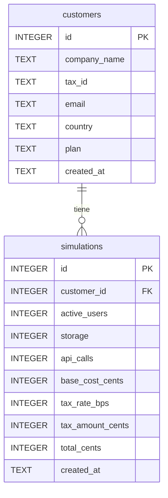

# Base de datos

SQLite con `better-sqlite3` y SQL directo (ADR-009) · Qué se guarda de cada simulación: ADR-011 · Capas y carpetas: architecture.md

Los importes se guardan en céntimos de euro (enteros, principio 6): §2.A define las tarifas en €. La divisa de visualización (§2.B) no se guarda: es solo del frontend. Dónde se calcula el IVA y el redondeo se decide en la spec de `POST /simulations` (ADR-010).
Ambas tablas son `STRICT`. Cada conexión ejecuta `PRAGMA foreign_keys = ON` y `PRAGMA journal_mode = WAL`.

## Tablas

### customers (§2.A, `POST /customers`)
| Columna | Tipo | NOT NULL | Restricciones |
|---|---|---|---|
| `id` | INTEGER | sí | PRIMARY KEY |
| `company_name` | TEXT | sí | CHECK (length(trim(company_name)) > 0) |
| `tax_id` | TEXT | sí | CHECK (length(trim(tax_id)) > 0). Sin UNIQUE |
| `email` | TEXT | sí | CHECK (length(trim(email)) > 0); el formato lo valida el DTO |
| `country` | TEXT | sí | CHECK (length(trim(country)) > 0). Sin lista de valores |
| `plan` | TEXT | sí | CHECK (length(trim(plan)) > 0). Sin lista de valores |
| `created_at` | TEXT | sí | DEFAULT `strftime('%Y-%m-%dT%H:%M:%fZ','now')` (UTC, ISO 8601) |

### simulations (§2.A, `POST /simulations`)
| Columna | Tipo | NOT NULL | Restricciones |
|---|---|---|---|
| `id` | INTEGER | sí | PRIMARY KEY |
| `customer_id` | INTEGER | sí | FOREIGN KEY → `customers(id)`, sin `ON DELETE` |
| `active_users` | INTEGER | sí | CHECK (active_users >= 0) |
| `storage` | INTEGER | sí | CHECK (storage >= 0). Unidad sin definir |
| `api_calls` | INTEGER | sí | CHECK (api_calls >= 0) |
| `base_cost_cents` | INTEGER | sí | CHECK (base_cost_cents >= 0) |
| `tax_rate_bps` | INTEGER | sí | CHECK (tax_rate_bps >= 0). Puntos básicos: 21 % = 2100 |
| `tax_amount_cents` | INTEGER | sí | CHECK (tax_amount_cents >= 0) |
| `total_cents` | INTEGER | sí | CHECK (total_cents = base_cost_cents + tax_amount_cents) |
| `created_at` | TEXT | sí | Igual que en `customers` |

Índice `idx_simulations_customer_created` sobre `simulations(customer_id, created_at)`: el historial de un cliente (§2.B) sale ya ordenado. Sin índices de búsqueda hasta que la spec de lectura defina el buscador.
Propuestas del asistente aprobadas: `id`, `created_at`, `STRICT`, el índice, el CHECK del total y `tax_rate_bps` en puntos básicos.

## Creación y migración
- `apps/api/migrations/0001_init.sql`, `0002_…`: SQL numerado, una migración por fichero.
- Al arrancar, un ejecutor en `data/sqlite/` aplica en orden las que faltan, cada una en una transacción, y guarda la versión en `PRAGMA user_version`. Sin librería ni paso extra en el README (§4).
- El ejecutor tiene su propio test sobre una base `:memory:` (principio 3).
- Seed opcional (`npm run seed`): se escribe tras las specs de `customers` y `simulations`; no lo hace el arranque.
- Fase 6: cómo localiza el ejecutor `migrations/` en la API compilada, y la ruta del fichero de la base (`config/envs.ts`).
- `.gitignore`: `*.db-wal`, `*.db-shm` y `*.sqlite3` (WAL).

## Diagrama entidad-relación

## Dudas para las specs (sin resolver)
| # | Duda | Spec |
|---|---|---|
| 1 | Países admitidos y su formato (nombre, código ISO…) | `POST /customers` |
| 2 | Planes válidos; si el plan influye en el cálculo o solo se guarda | `POST /customers` y `POST /simulations` |
| 3 | Unicidad del identificador fiscal (global o por país) y qué hacer si se repite | `POST /customers` |
| 4 | Normalización del identificador fiscal (mayúsculas, guiones, espacios) y si se guarda normalizado | `POST /customers` |
| 5 | Qué documentos acepta la validación en España (DNI, NIE, NIF, CIF) y qué se valida si el país no es España (§2.A) | `POST /customers` |
| 6 | Unicidad y normalización del email | `POST /customers` |
| 7 | Tipos de IVA por país, países sin tipo definido (Roams: ES, PT, FR, IT) y sobre qué importe se aplica | `POST /simulations` |
| 8 | Redondeo del IVA y de los importes (un único punto, principio 6) | `POST /simulations` |
| 9 | Límites de `active_users` (¿0 es válido?, máximo), `storage` (unidad, decimales, máximo) y `api_calls` (periodo, máximo) | `POST /simulations` |
| 10 | Si `storage` y `api_calls` influyen en el coste: §2.A solo define tramos por usuarios | `POST /simulations` |
| 11 | Buscador: mayúsculas, tildes, coincidencia parcial, orden, paginación e índices | Lectura (buscador e historial) |
| 12 | Endpoints de lectura de clientes y simulaciones (ambigüedad #8) | Lectura (buscador e historial) |
