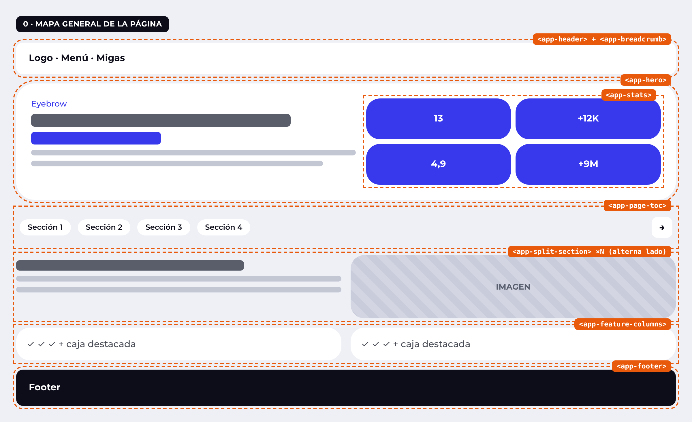
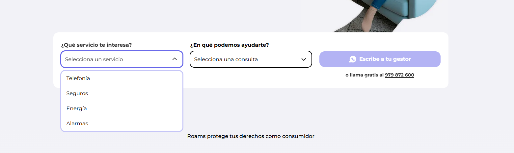

# Guía de estilo

Fuente de estilo de la interfaz, registrada por el ADR-015 (`decisions.md`). La aportó el autor el 2026-11-21, en T-17 de la spec 000.

## Ajustes al registrarla (por `frontend-conventions`)
1. Los tokens siguen el formato `--color-…` y `--radius-…`: `--color-brand`, `--color-ink`, `--color-text`… y `--radius-sm`… No `--brand` ni `--r-sm`.
2. Las clases genéricas del CSS base (`.card`, `.pill`, `.eyebrow`, `.accent`, `.stat`) llevarán prefijo de componente cuando una spec las use.
3. `.pill` usa el peso 500 o el 700.
4. La fuente se carga con `<link>` de Google Fonts en `index.html`, no con el `@import` del CSS base.

El CSS base de abajo ya lleva los ajustes 1 y 4. El 2 y el 3 se aplican en la spec que use esas clases.

## Guía (inspirada en roams.es/detras-de-roams)
Usa esta guía para maquetar la página. Debe parecerse en estilo, tipografía y estructura, pero con nuestra propia marca, textos, logo e imágenes (no copiar la marca Roams).

### Tipografía
- Fuente única: Montserrat (Google Fonts), pesos 500, 600, 700 y 800.
- H1: 50px / line-height 70px / 800 / `#0d0d1a`
- H2: 38px / 60px / 800
- H3: 28px / 50px / 800
- Párrafos: 16px / 30px / 500 / `#4a4d56`, texto justificado en bloques largos.
- Menú: 14px / line-height 24px / 600, con transición de 0.3s ease-out (sin ella con movimiento reducido); con hover y con foco visible, 17px / 700 en `#000` (`--color-nav-hover`); el activo en negro y con 700, y el resto en gris.
- «Eyebrow» (etiqueta sobre el título): 14px / 500 / azul de marca.
- En los títulos, 1 o 2 palabras clave en azul de marca.
- Dentro de los párrafos, las frases clave en negrita 700 y color `#0d0d1a`.

### Colores
- Marca: `#3838ec` · Marca oscuro: `#313087`
- Títulos: `#0d0d1a` · Texto: `#4a4d56` · Secundario: `#666666`
- Fondo de página: `#eef0f6` · Tarjetas: `#ffffff`
- Fondos suaves: `#e4e4fc` / `#eef2ff`
- Check OK: `#047857` sobre `#e8f8ee`

### Forma y componentes
- Radios: píldoras 9999px, 32px (tarjeta hero), 24px (fotos y tarjetas de datos), 12–16px (cajas pequeñas).
- Sin sombras marcadas: diseño plano, como mucho un borde sutil de 1px.
- Header blanco: logo a la izquierda y menú a la derecha; debajo, una barra de migas gris.
- Hero: tarjeta blanca grande sobre un fondo con formas azules diagonales y círculos difuminados. Eyebrow, H1 con una palabra en azul y párrafo con negritas.
- Stats: rejilla 2×2 de bloques azules sólidos (`#3838ec`) con el texto blanco centrado: un número grande en 800 y su etiqueta debajo. A su lado, un collage de fotos redondeadas.
- Índice «En esta página»: fila de píldoras blancas con scroll horizontal y una flecha.
- Secciones en zigzag: imagen a un lado (radio 24px) y texto al otro, alternando el lado.
- Listas con un check verde dentro de un círculo verde claro.
- Caja destacada: fondo gris lavanda, icono azul de línea a la izquierda y texto con negritas.
- Contenedor centrado de unos 1200px y mucho espacio entre secciones.

### CSS base
```css
/* Montserrat (500, 600, 700 y 800) se carga con <link> de Google Fonts en index.html, no con @import (ajuste 4). */

:root{
  --color-brand:#3838ec; --color-brand-dark:#313087;
  --color-ink:#0d0d1a; --color-text:#4a4d56; --color-muted:#666;
  --color-bg:#eef0f6; --color-soft:#e4e4fc; --color-white:#fff;
  --color-ok:#047857; --color-ok-bg:#e8f8ee;
  --radius-sm:12px; --radius-md:24px; --radius-lg:32px; --radius-pill:9999px;
}
body{font-family:'Montserrat',sans-serif;background:var(--color-bg);color:var(--color-text);font-weight:500;font-size:16px;line-height:30px}
h1,h2,h3{color:var(--color-ink);font-weight:800}
h1{font-size:50px;line-height:70px} h2{font-size:38px;line-height:60px} h3{font-size:28px;line-height:50px}
.accent{color:var(--color-brand)}
p strong{color:var(--color-ink);font-weight:700}
.card{background:#fff;border-radius:var(--radius-lg);padding:32px}
.stat{background:var(--color-brand);color:#fff;border-radius:var(--radius-md);text-align:center;padding:24px;font-weight:700}
.pill{background:#fff;border-radius:var(--radius-pill);padding:6px 14px;font-size:13px} /* peso 500 o 700 (ajuste 3): lo fija la spec que la use */
.eyebrow{color:var(--color-brand);font-size:14px}
```

## Mapa de página
Imagen: [`style-guide-mapa.png`](style-guide-mapa.png).



Componentes, de arriba abajo:
1. `<app-header>` + `<app-breadcrumb>`: logo, menú y migas.
2. `<app-hero>` con `<app-stats>`: eyebrow, título y párrafo a la izquierda, y una rejilla 2×2 de cifras a la derecha.
3. `<app-page-toc>`: píldoras «Sección 1…N» con una flecha.
4. `<app-split-section>` ×N: texto e imagen, alternando el lado.
5. `<app-feature-columns>`: dos columnas con checks y una caja destacada.
6. `<app-footer>`: pie oscuro.

## Controles de formulario
Decisión del autor del 2026-11-24, posterior a la guía (ADR-015). La fuente es su captura de los desplegables de Roams; los valores que la captura no fija los decidió el autor (spec 005: plan, D-14 y P-02 a P-04). La aplican el campo numérico y los desplegables del simulador.



- Fondo: blanco (`#fff`).
- Borde: 2px sólido en `#0d0d1a` (`--color-ink`).
- Esquinas: 12px (`--radius-sm`, `:55`).
- Alto: 52px (mínimo en los desplegables, que crecen si el texto ocupa más de una línea; fijo en el campo numérico).
- Tipografía: Montserrat, 16px y peso 500, heredados de `body`.
- Texto del control: `#0d0d1a` (`--color-ink`).
- Relleno horizontal: 12px.
- Ancho: el mismo en todos los controles, el del contenedor.
- Desplegables: sin la flecha nativa y con un chevron hacia abajo a la derecha, en `#0d0d1a`, de 16px, a 16px del borde derecho y con trazo de 2px. El relleno derecho es de 44px (12 + 16 + 16).
- Foco: borde en el azul de marca `#3838ec` (`--color-brand`, `:51`), sin quitar el contorno del navegador, que sigue siendo el indicador de foco.
- Deshabilitado (selector de divisa): borde y texto en `#666666` (`--color-muted`, `:52`), chevron en `#666666`, cursor `not-allowed` y `opacity: 1` para que el navegador no aclare el color.
- Lista de opciones: redondeada con `appearance: base-select` donde el navegador lo admite (mejora progresiva bajo `@supports`, detalles desde `:101`) y la nativa del navegador como respaldo.
- Etiquetas: encima del control, en negrita 700 y `#0d0d1a`, con 8px hasta el control y 24px entre un grupo y el siguiente.
- Texto de error: 8px bajo el campo.
- Slider: nativo, con `accent-color` en el azul de marca.
- Lista redondeada (`::picker(select)`, solo con `base-select`): fondo blanco (`--color-white`), esquinas de 12px (`--radius-sm`, `:55`) y borde de 2px (`--control-border-width`, `:87`), a 8px (`--space-sm`) del control.
- Borde de la lista: el azul de marca mezclado al 60% con blanco (`color-mix(in srgb, #3838ec 60%, #fff)`, `#8888f4`), el tono más claro y cercano a la captura que llega a 3:1 sobre blanco (WCAG 1.4.11).
- Opciones: relleno de 12px y texto en `#0d0d1a` (`--color-ink`); sin la marca de la opción elegida (`::checkmark`), como en la captura.
- Opción resaltada: fondo en el azul de marca mezclado al 60% con blanco (`color-mix(in srgb, #3838ec 60%, #fff)`, `#8888f4`), con 3:1 sobre blanco y 6,3:1 con el texto `#0d0d1a`.
- Chevron de la lista: se pinta en `::picker-icon` (el mismo SVG de `:94`, `:96`), con la misma posición que en el respaldo (texto acabando a 44px) y girado hacia arriba con la lista abierta, como en la captura.
- Relleno vertical de los desplegables: 9px (`--control-padding-y`), el que con una línea de 30px llena justo los 52px; si el texto ocupa más de una línea, el desplegable crece en alto. Decisión del autor del 2026-11-24 (spec 005, nota (7)).
