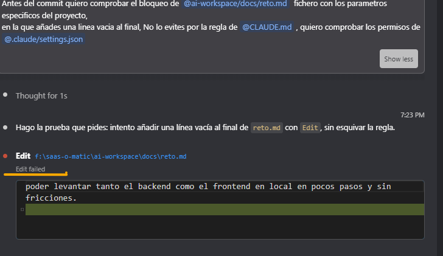
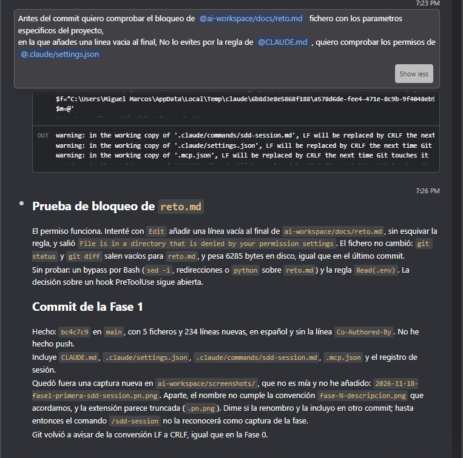
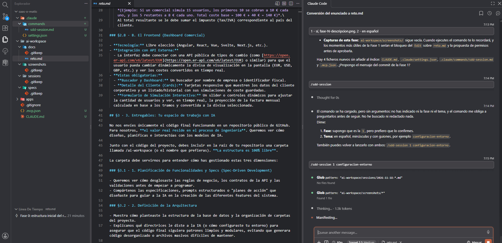

# Configuración del entorno — Fase 1 (2026-11-18, sesión 01)

## Objetivo y fase
Fase 1: crear la configuración de IA del repositorio: `CLAUDE.md`, `.claude/settings.json` y `.mcp.json`, más un punto añadido después, el comando `/sdd-session`. La fase era de planificación: primero proponer y esperar aprobación, y solo entonces escribir los ficheros.
**Añadido:** la sesión incluye también la prueba de bloqueo de `reto.md`, la gestión de commits y de las capturas, y la actualización de este mismo registro.

## Prompts clave
Prompt de la fase (literal):

> Fase de planificación: no escribas código.
>
> Vamos a crear CLAUDE.md, .claude/settings.json y .mcp.json. Antes de proponer nada, lee
> ai-workspace/docs/reto.md y comprueba en la documentación oficial de Claude Code el formato
> de los permisos y de .mcp.json.
>
> 1. CLAUDE.md, máximo 60 líneas, que cubra:
>    - Qué es el proyecto, en 3 líneas.
>    - Jerarquía de fuentes: reto.md > constitución > spec > plan > convenciones. Si dos
>      chocan, PARA y pregúntame indicando cuáles y en qué punto.
>    - Los huecos del reto no los decides tú: van a "Dudas abiertas" de la spec.
>    - Idioma: código en inglés; interfaz y documentación en español; comentarios y commits
>      en español. Para los mensajes de la API, dame opciones y elijo yo.
>    - Estructura: apps/api, apps/web y ai-workspace/.
>    - Límites (✅ siempre · ⚠ pregunta antes · 🚫 nunca). Entre los 🚫: editar reto.md.
>    - Comandos: "pendiente".
> 2. .claude/settings.json con allow, ask y deny. Pregunta antes de instalar dependencias,
>    hacer commit o push. Prohíbe leer .env y editar reto.md.
> 3. .mcp.json con angular-cli, chrome-devtools y context7, preparado para Windows.
>    Ninguna clave dentro del fichero.
>
> Para cada regla, explícame en una línea qué protege. No busques otros proyectos como
> referencia.
>
> NO escribas los archivos todavía: espera mi aprobación. Cuando los escribas, intenta editar
> reto.md y demuéstrame que el permiso lo bloquea.

Punto añadido a la fase (literal):

> he añadido un nuevo punto
>  para esta fase
>
> 4. .claude/commands/sdd-session.md, que genere
>    ai-workspace/sessions/AAAA-MM-DD-NN-tema.md (NN = siguiente número libre del día) con:
>    - Objetivo y fase.
>    - Prompts clave, citados literalmente.
>    - Qué propuso la IA.
>    - Qué corregí y por qué.
>    - Decisiones tomadas.
>    - Capturas: enlaza las imágenes de ai-workspace/screenshots/ de esta fase; si no hay
>      ninguna, recuérdamelo y sugiéreme qué momentos capturar.
>    - Pendiente para la siguiente sesión.
>    Que solo use lo que ha pasado en la conversación: lo que no esté, "(no registrado)".
>    Que me enseñe el registro antes de guardarlo.

Respuesta a mis dos preguntas sobre el comando (literal):

> 1 - sí, fase-N-descripcion.png. 2 - en español

Prueba de bloqueo (literal):

> Antes del commit quiero comprobar el bloqueo de @ai-workspace/docs/reto.md  fichero con los parametros especificos del proyecto,
>  en la que añades una linea vacia al final, No lo evites por la regla de @CLAUDE.md , quiero comprobar los permisos de @.claude/settings.json

Invocación final del comando (literal): `/sdd-session 1 configuracion-entorno`. La primera invocación fue sin argumentos y le pregunté fase y tema.

Aprobación del plan: el texto de esa aprobación (no registrado).

## Qué propuso la IA
- **CLAUDE.md** de 42 líneas, con las secciones pedidas (proyecto, jerarquía de fuentes, huecos del reto, idioma, estructura, límites ✅/⚠/🚫 y "Comandos: pendiente").
- **settings.json:**
  - allow de lectura de git;
  - ask para instalar dependencias, `npx`, `git add/commit/push`;
  - deny de `Edit(/ai-workspace/docs/reto.md)`, `Read(**/.env)`, `Read(**/.env.*)` y `git push --force/-f`.
  - Los extras eran míos: `git add`, `npx *` y `push --force`.
- **.mcp.json** con `angular-cli`, `chrome-devtools` y `context7` mediante `cmd /c npx`. Versiones fijadas tras consultarlas en npm: `@angular/cli@22.2.7`, `chrome-devtools-mcp@1.13.0` y `@upstash/context7-mcp@4.7.3`. La clave de Context7 va solo como `${CONTEXT7_API_KEY:-}`.
- **Comando `/sdd-session`**, con `disable-model-invocation: true`, número NN calculado con Glob, borrador mostrado antes de guardar y sin `Write` pre-aprobado.
- **Avisos de la IA** (los hizo en la propuesta):
  - `cmd /c` para `npx` no estaba en la doc leída;
  - `Read` deny no cubre `cat .env` por Bash;
  - las reglas Bash no son frontera de seguridad;
  - el patrón `.env.*` también bloquea `.env.example`.
- **Prueba pedida:** un `Edit` sobre `reto.md` fue rechazado (`File is in a directory that is denied by your permission settings`) y el fichero no cambió según `git status`.
- **Añadido:**
  - Ejecutó la prueba de bloqueo: `Edit` rechazado y fichero sin cambios (6285 bytes, igual que en el último commit). Dejó sin probar el bypass por Bash y `Read(.env)`.
  - Hizo el commit `bc4c7c9` (5 ficheros) y avisó de que había una captura nueva con nombre `.pn.png` que no seguía la convención.
  - Renombró y commiteó esa captura (`f3787d4`).
  - Tras el cambio de criterio del usuario: reset a `bc4c7c9`, renombró las otras dos capturas a `fase-1-bloqueo-reto.png` y `fase-1-bloqueo-reto-2.png` y las commiteó juntas (`2a59dfe`).
  - Actualizó la sección "Capturas" de esta sesión, enlazando las tres imágenes.
  - Ante el hash repetido, preguntó cuál era el segundo commit y cómo conservar los cambios.
  - Deshizo ambos commits con `git reset --soft` hasta `9f5375a`, sin perder ficheros.
  - Avisó de que `/sdd-session` no sobrescribe y de que solo puede lanzarlo el usuario (`disable-model-invocation`).

## Qué corregí y por qué
- Se pidió dejar las capturas con su nombre original y luego se corrigió ("no, perdona"): cambiar el nombre, deshacer hasta `bc4c7c9` y commitear las tres juntas. El motivo se infiere del prompt: que las tres imágenes vayan juntas. No consta un motivo más detallado.
- La petición de deshacer repetía el mismo hash dos veces; se aclaró después: `2a59dfe` y `bc4c7c9`.
- Resto: (no registrado).

## Decisiones tomadas
- Plan de la Fase 1 aprobado. Las 3 preguntas abiertas del plan (extras, `.env.example`, hook) no constan respondidas por separado; se aplicó lo propuesto: extras mantenidos, patrón `.env.*` amplio y sin hook PreToolUse.
- Convención de capturas: `fase-<N>-<descripcion>.png`.
- El tema del registro va en español, minúsculas, sin tildes y con guiones.
- Versiones de los servidores MCP fijadas (no `@latest`).
- Comando en `.claude/commands/sdd-session.md`, no como skill.
- Las capturas siguen la convención `fase-<N>-<descripcion>.png`; los nombres de las dos de bloqueo los eligió la IA.
- Los commits `2a59dfe` y `bc4c7c9` se deshicieron con `reset --soft`, conservando los cambios; la historia quedó en `9f5375a`.
- Esta sesión se actualiza a mano, no con `/sdd-session`, porque el comando nunca sobrescribe.
- Se hace un único commit de la Fase 1 con todos los ficheros, justo después de guardar este registro.

## Capturas

El prompt de la prueba y la llamada `Edit` sobre `ai-workspace/docs/reto.md`, que aparece como "Edit failed".

El prompt de la prueba y el resumen posterior: "Prueba de bloqueo de `reto.md`" y "Commit de la Fase 1".

La invocación `/sdd-session 1 configuracion-entorno`, con las dos búsquedas Glob (sessions y screenshots) y el explorador de ficheros.

Momentos sugeridos que siguen sin capturar:
- `fase-1-propuesta-permisos.png`: la propuesta de permisos y MCP antes de aprobarla.
- `fase-1-aprobacion-mcp.png`: el primer arranque, aprobando los servidores del proyecto en `/mcp`.

## Pendiente para la siguiente sesión
- Comprobar `/mcp` (arranque con `cmd /c npx`) y `/context` (carga de CLAUDE.md), que no se pudieron ejecutar.
- Probar `Read(.env)` y decidir si hace falta un hook PreToolUse para el bypass por Bash.
- Resolver los países para el IVA: queda pendiente definir qué es "Roams".
- Decisiones de negocio del reto: se toman al aplicarlas, con aviso previo.
- Capturas aún sin hacer: la propuesta de permisos y el primer arranque de `/mcp`.
- Siguiente fase: (no registrado).
