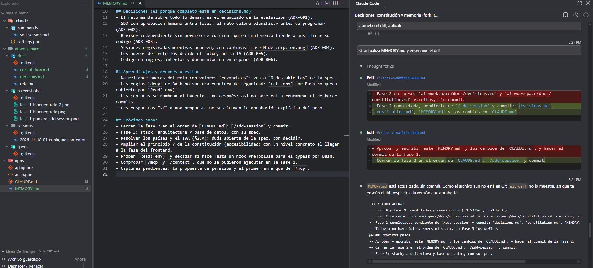
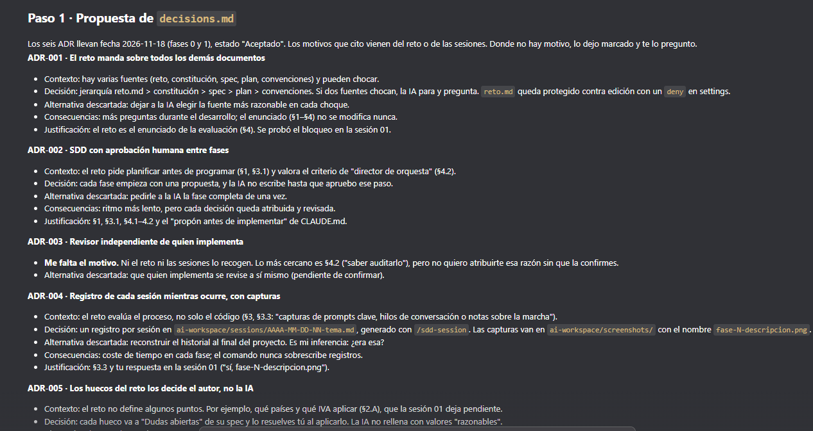
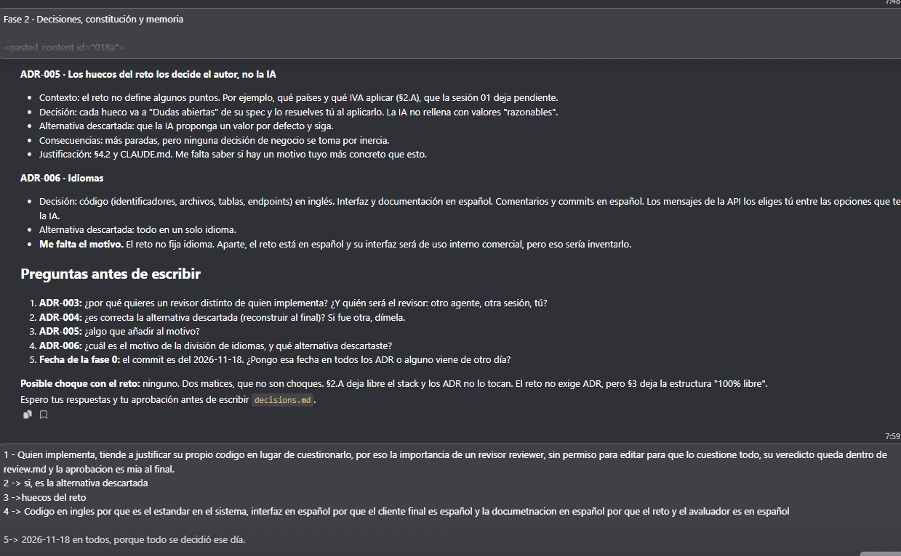
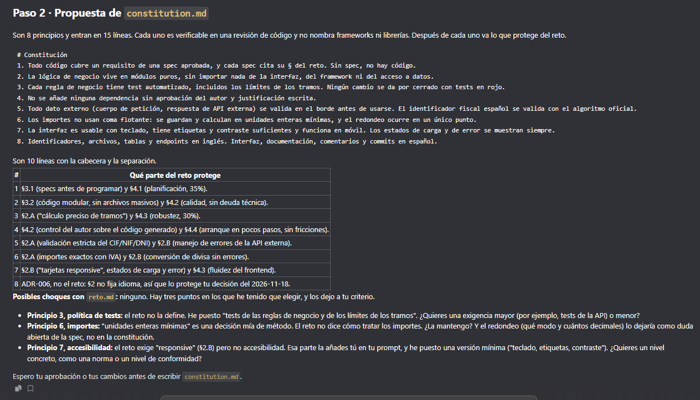
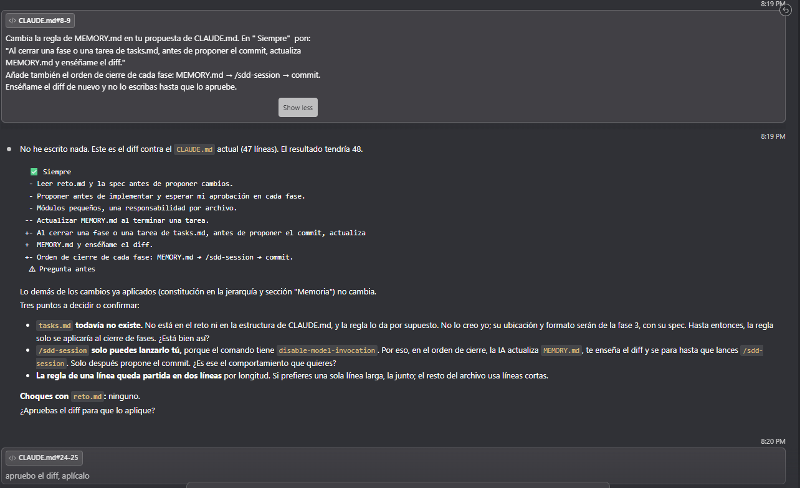

# Decisiones, constitución y memoria — Fase 2 (2026-11-18, sesión 02)

## Objetivo y fase
Fase 2: crear `ai-workspace/docs/decisions.md` (ADR de proceso), `ai-workspace/docs/constitution.md` y `MEMORY.md`, más los cambios en `CLAUDE.md` para importarlos. Fase de planificación, en tres pasos con parada y aprobación después de cada uno. Sin código.
**Añadido:** durante la sesión se cambió una regla de `CLAUDE.md` (cierre de fase) y se fijó el orden de cierre `MEMORY.md → /sdd-session → commit`.

## Prompts clave
Prompt de la fase (literal):

> Fase 2 · Decisiones, constitución y memoria
>
> Fase de planificación: no escribas código.
>
> Vamos a crear ai-workspace/docs/decisions.md, ai-workspace/docs/constitution.md y MEMORY.md.
> Antes de proponer nada, lee CLAUDE.md, ai-workspace/docs/reto.md y los registros de
> ai-workspace/sessions/.
>
> Hazlo en tres pasos y PÁRATE después de cada uno para que lo apruebe:
>
> 1. decisions.md, registro de decisiones (ADR).
>    - Formato de cada ADR: Fecha · Estado · Contexto · Decisión · Alternativa descartada ·
>      Consecuencias. Un ADR no se borra: si cambia, se marca "Sustituido por ADR-NNN".
>    - Solo decisiones de PROCESO, ya tomadas en las fases 0 y 1:
>      · El reto manda sobre todos los demás documentos.
>      · SDD con aprobación humana entre fases.
>      · Revisor independiente de quien implementa.
>      · Registro de cada sesión mientras ocurre, con capturas (fase-N-descripcion.png).
>      · Los huecos del reto los decide el autor, no la IA.
>      · Idiomas.
>    - Cada ADR se justifica con el reto (cita la §) o con lo que decidí en las sesiones.
>      Si te falta el motivo de alguna, pregúntamelo: no lo inventes.
>    - Nada de stack, arquitectura ni base de datos: eso es la fase 3.
>
> 2. constitution.md: entre 6 y 8 principios innegociables, cortos y verificables en una
>    revisión de código. Máximo 15 líneas. Que cubran: relación entre spec y código, lógica de
>    negocio separada de la interfaz y del framework, política de tests, dependencias,
>    validación de datos, tratamiento de importes, accesibilidad y responsive, e idioma.
>    Sin nombrar frameworks ni librerías: el stack se decide en la fase 3.
>    Para cada principio, dime en una línea qué parte del reto protege.
>
> 3. MEMORY.md en la raíz, máximo 50 líneas, con: estado actual, decisiones (con su porqué),
>    aprendizajes y errores a evitar, y próximos pasos. Nunca datos sensibles.
>    Después, propón los cambios en CLAUDE.md para:
>    - Importar @ai-workspace/docs/constitution.md y @MEMORY.md.
>    - Añadir a "✅ Siempre": actualizar MEMORY.md al terminar una tarea.
>    - Marcar la constitución como existente en la jerarquía de fuentes.
>    Enséñamelos como diff. CLAUDE.md sigue en 60 líneas como máximo.
>
> No busques otros proyectos como referencia. Si algo choca con reto.md, para y dímelo.
>
> NO escribas ningún archivo hasta que apruebe su paso.

Respuestas al paso 1 (literales):

> 1 - Quien implementa, tiende a justificar su propio codigo en lugar de cuestironarlo, por eso la importancia de un revisor reviewer, sin permiso para editar para que lo cuestione todo, su veredicto queda dentro de review.md y la aprobacion es mia al final.
> 2 -> si, es la alternativa descartada
> 3 ->huecos del reto
> 4 -> Codigo en ingles por que es el estandar en el sistema, interfaz en español por que el cliente final es español y la documetnacion en español por que el reto y el avaluador es en español
>
> 5-> 2026-11-18 en todos, porque todo se decidió ese día.

> paso 1 aprobad

Respuestas al paso 2 (literales):

> 3 - si tambien test de la api
> 6 - si, mantenlo
> 7 - estaria bastante bien, apintalo para cuando lleguemos expandir este principio

> si, perfecto añadelo a memory, apruebo el paso 2

Respuestas al paso 3 (literales):

> - Quitalo
> - confirmo
> -confirmo
> -Quitalo

> lo apruebo

Cambio de la regla de cierre (literal):

> Cambia la regla de MEMORY.md en tu propuesta de CLAUDE.md. En " Siempre"  pon:
> "Al cerrar una fase o una tarea de tasks.md, antes de proponer el commit, actualiza
> MEMORY.md y enséñame el diff."
> Añade también el orden de cierre de cada fase: MEMORY.md → /sdd-session → commit.
> Enséñame el diff de nuevo y no lo escribas hasta que lo apruebe.

> apruebo el diff, aplícalo

> sí, actualiza MEMORY.md y enséñame el diff

Invocación final del comando (literal): `/sdd-session 2 decisiones-constitucion-memoria`.

## Qué propuso la IA
- **Paso 1:** seis ADR (reto manda, SDD con aprobación, revisor independiente, registro de sesiones, huecos del reto, idiomas), todos con fecha 2026-11-18 y estado "Aceptado". Para tres de ellos preguntó el motivo porque no constaba en el reto ni en las sesiones (revisor, huecos, idiomas). También marcó como inferencias suyas la alternativa descartada de ADR-004, de ADR-005 y de ADR-006.
- **Paso 2:** constitución de 8 principios, con la línea de qué parte del reto protege cada uno. Señaló tres puntos que dejaba a criterio del autor (política de tests, método de importes y nivel de accesibilidad) y propuso apuntar la ampliación del principio 7 en `MEMORY.md`.
- **Paso 3:** `MEMORY.md` de 33 líneas y el diff de `CLAUDE.md` (constitución importada, sección "Memoria", regla en "✅ Siempre"). Preguntó cuatro puntos: hash repetido, capturas "al hacerlas", "las respuestas 'sí' no sustituyen la aprobación" y "Roams".
- **Cambio de regla:** propuso el diff con la regla nueva y el orden de cierre. Avisó de tres cosas: `tasks.md` aún no existe, `/sdd-session` solo lo puede lanzar el autor, y la regla queda partida en dos líneas.
- **Archivos escritos:** `decisions.md` (6 ADR), `constitution.md` (9 líneas), `MEMORY.md` (31 líneas), tres ediciones en `CLAUDE.md` y la edición de la regla de cierre. Sin commit.
- **Cierre:** actualizó `MEMORY.md` (fase 2 completada, pendiente de `/sdd-session` y commit) y mostró el diff.

## Qué corregí y por qué
- **Motivos que faltaban (ADR-003, ADR-005, ADR-006):** los di yo, porque la IA los había dejado marcados como no inventados. El de ADR-003 es que quien implementa tiende a justificar su código.
- **Alternativa de ADR-004:** confirmé que la descartada era "reconstruir el historial al final".
- **Principio 3 de la constitución:** amplié la política de tests para incluir los de la API ("si tambien test de la api").
- **Principio 7:** pedí que se apuntara la ampliación para más adelante, en lugar de ampliarlo ahora.
- **`MEMORY.md`:** pedí quitar dos puntos (el hash repetido y "Roams") y confirmé los otros dos.
- **Regla de `CLAUDE.md`:** pedí cambiar "Actualizar MEMORY.md al terminar una tarea" por una regla de cierre de fase o de tarea de `tasks.md`, con diff y orden de cierre. El motivo concreto no consta.
- **Errores de la IA señalados por ella misma:** contó mal las líneas de `CLAUDE.md` (dijo 46 y eran 47, dijo 48 y eran 49). No afectó al límite de 60.
- **Resto:** (no registrado).

## Decisiones tomadas
- Los seis ADR del paso 1 quedan aprobados con el texto mostrado en el chat. Las alternativas descartadas de ADR-005 y ADR-006 las propuso la IA; consta la aprobación del paso, pero no una confirmación separada de cada una.
- `review.md`, donde queda el veredicto del revisor: sin ubicación fijada.
- Constitución de 8 principios aprobada. En el principio 3 entran los tests de cada endpoint.
- Importes en unidades enteras mínimas (principio 6): se mantiene. El modo de redondeo y los decimales quedan como duda abierta de la spec.
- Accesibilidad (principio 7): versión mínima, y la ampliación queda apuntada en "próximos pasos" de `MEMORY.md`.
- `MEMORY.md` sin el aprendizaje del hash repetido y sin "Roams". Se mantienen "las capturas se nombran al hacerlas" y "las respuestas 'sí' no sustituyen la aprobación explícita".
- Cambios en `CLAUDE.md`: constitución marcada como existente, `@MEMORY.md` en una sección "Memoria", y regla de cierre de fase o de tarea de `tasks.md` con el orden `MEMORY.md → /sdd-session → commit`.
- Las tres dudas que planteó la IA sobre la regla de cierre (`tasks.md` inexistente, `/sdd-session` solo lanzable por el autor y el salto de línea): consta la aprobación del diff, pero no una respuesta separada a cada una.
- El entorno entró en modo plan antes de cada paso. La causa no consta: (no registrado).

## Capturas

`MEMORY.md` abierto en el editor, con "Decisiones", "Aprendizajes y errores a evitar" y "Próximos pasos". A la derecha, mis mensajes "apruebo el diff, aplícalo" y "sí, actualiza MEMORY.md y enséñame el diff", las dos ediciones de `MEMORY.md` (estado actual y próximos pasos) y el diff mostrado. La captura se hizo después de generar este registro y se enlazó a mano.

La propuesta del paso 1, de ADR-001 hasta el inicio de ADR-005. En ADR-003 aparece "Me falta el motivo" y en ADR-004 la alternativa marcada como inferencia ("¿era esa?").

El final de la propuesta (ADR-005 y ADR-006), las cinco preguntas antes de escribir y mi respuesta a ellas.

Los 8 principios en su primera versión, antes de aprobarlos, con la tabla de qué parte del reto protege cada uno y las tres dudas finales (tests, importes y accesibilidad).

Mi petición de cambiar la regla de `MEMORY.md`, el diff propuesto con la regla de cierre y el orden `MEMORY.md → /sdd-session → commit`, y mi respuesta "apruebo el diff, aplícalo".

## Pendiente para la siguiente sesión
- Fijar dónde va `review.md`, y qué es y dónde vive `tasks.md` (hoy no existe).
- Ampliar el principio 7 de la constitución (accesibilidad) al llegar a la fase del frontend.
- Fase 3: stack, arquitectura y base de datos, con su spec.
- Resolver los países y el IVA (§2.A), como duda abierta de la spec.
- Probar `Read(.env)` y decidir si hace falta un hook PreToolUse para el bypass por Bash.
- Comprobar `/mcp` y `/context`, pendientes desde la fase 1.
