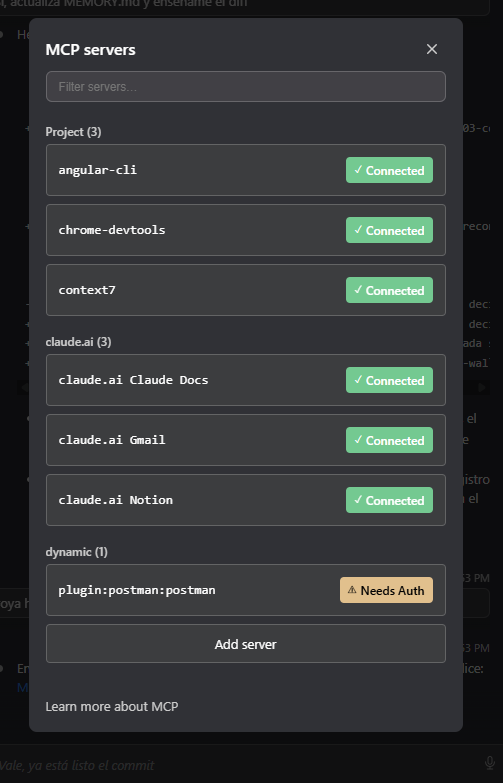
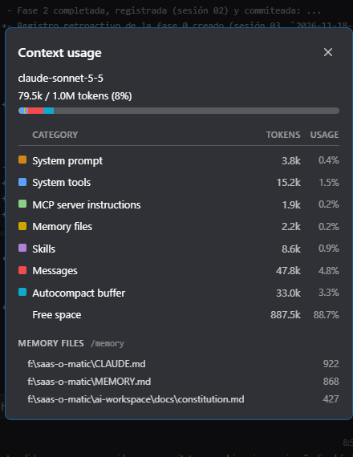

# Permisos y comprobaciones — Fase 2 (2026-11-18, sesión 03)

## Objetivo y fase
Cerrar el tramo pendiente de la fase 2 sobre los permisos de `.claude/settings.json`:
- Las comprobaciones de `/mcp` y `/context`, que hizo el autor.
- La protección de `reto.md` contra escrituras por terminal.
- Una prueba del bloqueo de `.env` sin claves reales.

Esta conversación empezó antes, con trabajo de documentación de la fase 0 que cabe en este registro por haber ocurrido aquí:
- La extracción del resumen de la fase 0 desde su transcripción.
- Su registro retroactivo, que quedó guardado como sesión 00.
- Una primera actualización de `MEMORY.md`.

Tras las pruebas de permisos, una nueva petición de `/sdd-session` provocó una búsqueda de transcripciones para localizar "la parte que falta del chat". Esa búsqueda terminó con la decisión de registrar toda esta conversación. Después se hicieron las pruebas pendientes que se podían resolver en el momento.

Parte del trabajo se ejecutó en modo plan, impuesto por el entorno en tres momentos: al aplicar las reglas, al rehacer este registro y al lanzar las últimas pruebas. En todos los casos el plan se escribió y el autor lo aprobó antes de ejecutar.

## Prompts clave
> Fase de documentación: no modifiques nada salvo el registro que te pediré.
>
> La fase 0 (conversión del enunciado a reto.md, estructura del repositorio y lista de
> ambigüedades) no tiene registro de sesión. Su conversación está en
> C:\Users\Miguel Marcos\.claude\projects\f--saas-o-matic\a578d6de-fee4-471e-8c9b-9f4048eb9b22.jsonl,
> desde el principio hasta el prompt que empieza por "Fase de planificación: no escribas código"
> (ahí empieza la fase 1).
>
> El fichero es muy grande: no lo leas entero. Extrae solo los mensajes del usuario y las
> respuestas de texto de la IA de ese tramo, y enséñame un resumen de:
> - los prompts clave (literales),
> - qué propuso la IA (en especial dónde puso las § y la lista de ambigüedades),
> - qué corregí,
> - las decisiones tomadas.
>
> PÁRATE ahí: después lanzaré yo /sdd-session.

> /sdd-session 0 conversion-reto

> Indica al principio del registro que es retroactivo: se reconstruyó el 2026-11-18 a partir de
> la transcripción, porque el registro 01 solo recogía la fase 1. La lista de ambigüedades
> de la fase 0 cópiala literal: la usaremos en las specs.

> Sí, guárdalo

> Sí, actualiza MEMORY.md y enséñame el diff

> voya hacer mas, todavia noesta el commit listo

> /sdd-session 2 permisos-y-comprobaciones

> he comprobado los permisos de /mcp y de /context
>
> falta esto
> Luego la IA te da opciones para proteger reto.md también contra Write y contra escrituras por terminal, y para probar el bloqueo de .env sin usar claves reales. Eliges tú.
> Al final del bloque están los dos retoques opcionales: el principio 5 de la constitución y “con su spec” en MEMORY.md.

Respuestas a las dos preguntas con opciones (el texto de las opciones lo redactó la IA):
> "Deny de Bash por patrón"
> "Fichero falso .env.prueba (Recomendado)"

> Sí, aplica las reglas y haz la prueba

> Sí, borra los ficheros y prefiero dejarlo como limite

> Sí, actualiza MEMORY.md y enséñame el diff

> Sí, lanzo /sdd-session

> /sdd-session 2 permisos-y-comprobaciones

> ejecuta otra vez /sdd-session 2 permisos-y-comprobaciones desde el principio, falta parte del chat

## Qué propuso la IA
**Extracto de la fase 0**
- Un script en el scratchpad (`extract.py`) extrajo 22 mensajes de texto de la transcripción, desde el principio hasta el prompt de la fase 1. Lo leyó y no tocó nada del repositorio.
- Resumió el tramo en cuatro bloques:
  - **Prompts clave.**
  - **Qué propuso la IA:** las § añadidas (§1, §2, §2.A, §2.B, §3, §3.1 a §3.3 y §4), los avisos de conversión y las 10 ambigüedades con sus propuestas de resolución.
  - **Qué corregí.**
  - **Decisiones tomadas.**
- Señaló dos matices: el extracto solo incluye texto (no llamadas a herramientas) y la fase 0 empezó en modo plan.

**Registro 00 (fase 0, retroactivo)**
- Tras `/sdd-session 0 conversion-reto` redactó el registro y preguntó antes de guardar.
- Con los dos cambios pedidos, añadió:
  - La nota de registro retroactivo al inicio.
  - La lista de 10 ambigüedades copiada literal.
  - Las propuestas de resolución resumidas.
- Lo guardó en [2026-11-18-00-conversion-reto.md](2026-11-18-00-conversion-reto.md).

**`MEMORY.md`, primera actualización**
- Estado: registro retroactivo de la fase 0 pendiente de commit, con la lista literal de ambigüedades.
- Aprendizaje: registrar cada fase al cerrarla.
- Próximos pasos:
  - Pasar las 10 ambigüedades a las "Dudas abiertas" de cada spec.
  - Valorar un `.gitattributes` y los sufijos WAL en `.gitignore`.
- Enseñó el diff y no propuso commit, por el aviso de que aún no estaba listo.

**Primera invocación de `/sdd-session 2 permisos-y-comprobaciones`**
- Avisó de que esta conversación no trataba de permisos y no redactó el registro.
- Ofreció tres alternativas: registrar la fase 2 desde otra conversación, registrar lo ocurrido aquí con otra fase y tema, o redactarlo con "(no registrado)".

**Protección de `reto.md` y prueba de `.env`**
- Miró `.claude/settings.json`, que solo tenía `Edit(/ai-workspace/docs/reto.md)`, y localizó el principio 5 de la constitución y la línea 27 de `MEMORY.md`.
- Ofreció cuatro opciones para `reto.md`: deny de `Write`, deny de Bash por patrón, hook `PreToolUse` y solo lectura del sistema.
- Ofreció tres opciones para `.env`: fichero falso `.env.prueba`, pruebas del autor en su terminal, o solo repasar las reglas.
- Propuso 12 reglas deny de Bash sobre `*reto.md*`: `rm`, `mv`, `cp`, `sed -i`, `tee`, `>`, `>>`, `Set-Content`, `Add-Content`, `Out-File`, `git checkout` y `git restore`.
  - Señaló que `Write` no quedaba cubierto.
  - Propuso probar con un `prueba-reto.md` temporal, nunca con `reto.md`.
  - Pidió aprobación antes de editar `.claude/`.
- Ejecutó el plan aprobado y obtuvo estos resultados:

  | Prueba | Resultado |
  |---|---|
  | `sed -i` sobre `prueba-reto.md` | Denegado |
  | `tee` | Denegado |
  | `mv` | Denegado |
  | `echo x >> prueba-reto.md` | Pasó (no esperado) |
  | `echo y > prueba-reto.md` | Pasó (no esperado) |
  | `Write` de `.env.prueba` | Denegado por la regla de lectura de `.env.*` |
  | `Read` de `.env.prueba` | Denegado |
  | `cat .env.prueba` por Bash | Denegado (no esperado) |

- `.env.prueba` se creó con `echo 'FALSO=[omitido]' > .env.prueba`. Se verificó que `reto.md` no cambió.
- Señaló dos hallazgos:
  - Las redirecciones `>` y `>>` no quedan cubiertas, y tampoco hay deny de `Write` sobre `reto.md`.
  - `cat .env.prueba` se denegó, contra lo anotado antes en `MEMORY.md`. Con una sola prueba no se sabía por qué.
- Propuso como siguiente paso del hueco de las redirecciones cambiar las reglas o pasar a un hook.
- Borró `prueba-reto.md` con `git clean` y `.env.prueba` con `rm`. Explicó que su propia regla `rm *reto.md*` le impedía usar `rm` en el primero.

**`MEMORY.md`, segunda actualización**
- Estado: las 12 reglas, pendientes de commit.
- Aprendizajes:
  - El límite aceptado de las reglas de Bash.
  - El resultado de la prueba de `.env`.
- Próximos pasos:
  - Repetir la prueba de `.env` por Bash con otras formas.
  - Probar las reglas de PowerShell, `cp` y `git checkout/restore`.
  - Dejar los dos retoques sin definir.
  - Registrar `/mcp` y `/context` como comprobados.
  - Dejar la captura de la propuesta de permisos como pendiente.
- Enseñó el diff junto al de `settings.json` y no hizo commit.

**Primer borrador del registro 03 (no guardado) y búsqueda de la "parte que falta"**
- El primer borrador solo cubría el tramo de permisos.
- Listó las 7 transcripciones del proyecto con un script de solo lectura y leyó mensajes clave de las de la fase 2. Concluyó que ninguna anterior contiene las opciones de permisos: la fase 2 previa trata de decisiones, constitución y memoria.
- Preguntó qué parte faltaba y si rehacer o ampliar el borrador. Plan aprobado: rehacer el registro entero con toda la conversación.
- Mostró el registro rehecho y preguntó si guardarlo. El autor respondió que antes quería eliminar pendientes.

**Qué se puede resolver ahora**
- Clasificó los pendientes en tres grupos:
  - **Puede hacerlos la IA con visto bueno:**
    - La prueba de `.env` con otras formas de lectura.
    - La prueba de `cp` y `git checkout/restore`.
    - El `.gitattributes`.
    - Los sufijos de `.gitignore`.
    - Guardar el registro 03.
  - **Decide el autor:** los dos retoques opcionales y las redirecciones.
  - **No se pueden cerrar ahora:** la captura de la propuesta de permisos, las ambigüedades en las specs, el commit.
- Advirtió que las reglas de PowerShell (`Set-Content`, `Add-Content`, `Out-File`) no se pueden probar con fiabilidad desde su terminal Bash.

**Pruebas de esta última pasada** (con `.env.prueba` y `prueba-reto.md` falsos, creados de nuevo y borrados después; `reto.md` no cambió)

| Prueba | Resultado |
|---|---|
| `cmd /c type .env.prueba` | **Pasó:** mostró el contenido falso `[omitido]` |
| `powershell Get-Content .env.prueba` | **Pasó:** mostró el contenido falso |
| `head .env.prueba` | Denegado |
| `cp prueba-reto.md copia-reto.md` | Denegado |
| `git checkout -- prueba-reto.md` | Denegado |
| `git restore prueba-reto.md` | Denegado |

- La primera orden de creación de los ficheros fue rechazada por el clasificador del modo automático ("no verdict"). Se reintentó una vez, tal cual, y funcionó.
- Con `cat` y `head` denegados y `type` y `Get-Content` permitidos, la lectura de un `.env` por terminal depende de la herramienta usada. Hay un bypass real con `cmd /c type` y `Get-Content`.

## Qué corregí y por qué
- **Registro retroactivo de la fase 0:** pedí dejar constancia al inicio de que es retroactivo (el registro 01 solo recogía la fase 1) y copiar literal la lista de ambigüedades "porque la usaremos en las specs".
- **Commit:** pedí no preparar todavía el commit ("todavia no esta el commit listo"), porque iba a hacer más cambios.
- **Deny de `Write`:** elegí solo el deny de Bash por patrón, sin `Write`. El motivo no consta (no registrado).
- **Redirecciones sin cubrir:** preferí dejarlas como límite conocido, en lugar de cambiar las reglas o pasar a un hook. El motivo no consta (no registrado).
- **Primera invocación de `/sdd-session 2`:** la IA señaló que no coincidía con el contenido. Corregí aportando lo que faltaba (la comprobación de `/mcp` y `/context` y las opciones de permisos) y, más tarde, que faltaba "parte del chat".
- **Alcance del registro:** elegí que cubra toda esta conversación, desde el primer mensaje, y que se rehaga entero.
- **Guardado del registro:** rechacé guardarlo en ese momento ("no, quiero eliminar todos lo pendiente antes de segior") y pedí antes resolver los pendientes. Después aprobé las pruebas 1 y 2 y el guardado ("Sí, empieza con 1, 2 y 5").

## Decisiones tomadas
- Registrar la fase 0 de forma retroactiva (sesión 00), con la lista de ambigüedades literal para las specs.
- Añadir 12 reglas deny de Bash para `reto.md` en `.claude/settings.json`, sin deny de `Write`.
- Probar el bloqueo de `.env` con un fichero falso (`FALSO=[omitido]`) y las reglas sobre `prueba-reto.md`, nunca sobre `reto.md` real ni lecturas del `.env` verdadero.
- Dejar las redirecciones `>` y `>>` y la falta de deny de `Write` como **límite conocido**, anotado en `MEMORY.md`.
- Borrar `prueba-reto.md` y `.env.prueba` tras cada ronda de pruebas.
- Registrar `/mcp` y `/context` como comprobados por el autor.
- Actualizar `MEMORY.md` y enseñar el diff, siguiendo el orden de cierre.
- No hacer commit todavía.
- Registrar toda la conversación en un solo registro y resolver antes los pendientes que se pueden cerrar ahora (pruebas 1 y 2 y guardado del registro).

## Capturas
Capturas de esta fase, hechas por el autor en las comprobaciones de `/mcp` y `/context`:
- 
- 

`fase-2-mcp.png` y `fase-2-context.png` cierran la comprobación de `/mcp` y `/context` que quedó pendiente en la sesión 01 (ver [su apartado "Pendiente para la siguiente sesión"](2026-11-18-01-configuracion-entorno.md)).

Estas dos capturas sustituyen a las dos que seguían sin hacer de la fase 1 (`fase-1-propuesta-permisos.png` y `fase-1-aprobacion-mcp.png`): por decisión del autor, ya no se harán.

## Pendiente para la siguiente sesión
- Hacer el commit, pendiente por decisión del autor. Archivos afectados: [.claude/settings.json](../../.claude/settings.json), [MEMORY.md](../../MEMORY.md), los registros 00 y 03 y las capturas `fase-2-mcp.png` y `fase-2-context.png`. Orden de cierre: `MEMORY.md` → `/sdd-session` → commit.
- Decidir si hace falta un hook `PreToolUse` para cerrar el bypass de lectura de `.env` con `cmd /c type` y `Get-Content`, que pasaron en la prueba.
- Probar las reglas deny de PowerShell (`Set-Content`, `Add-Content`, `Out-File`), que no se pueden probar con fiabilidad desde Bash. Puede hacerlo el autor desde PowerShell o dejarse como límite conocido.
- Decidir los dos retoques opcionales (principio 5 de la constitución y "con su spec" en la fase 3), una vez el autor diga el contenido.
- Pasar las 10 ambigüedades de la fase 0 a "Dudas abiertas" de cada spec y resolver los países y el IVA ("Roams" sigue sin identificar).
- Valorar el `.gitattributes` por el aviso LF a CRLF y los sufijos `*.db-wal`, `*.db-shm`, `*.sqlite3` en `.gitignore`.
- Continuar con la fase 3: stack, arquitectura y base de datos, con su spec.
