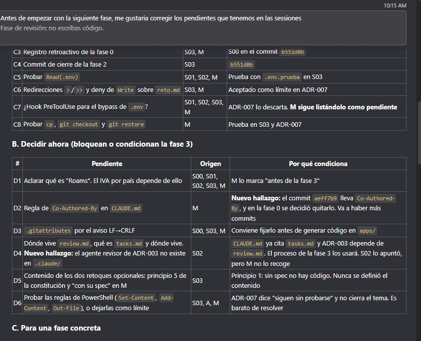
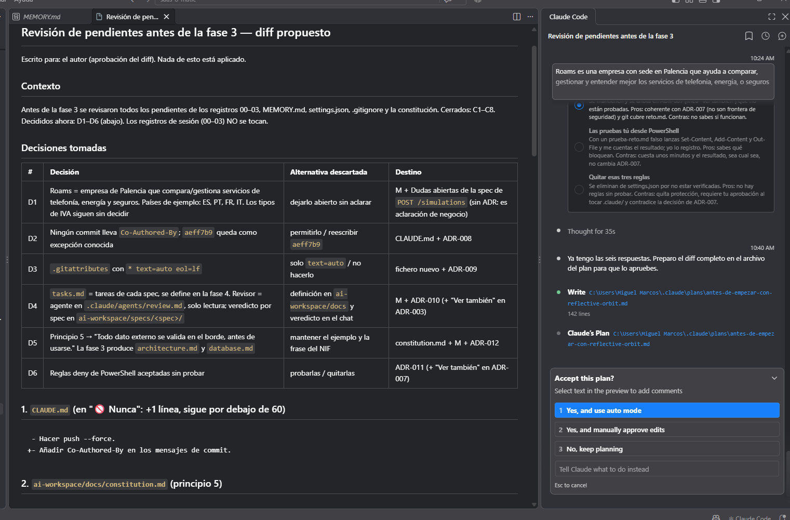

# Revisión de pendientes — Fase 2 (2026-11-19, sesión 01)

## Objetivo y fase
Revisión de todos los pendientes del proyecto antes de empezar la fase 3, sin escribir código: leer `MEMORY.md`, el apartado "Pendiente para la siguiente sesión" de cada registro de `ai-workspace/sessions/`, `.claude/settings.json`, `.gitignore` y la constitución. El flujo pedido tenía tres pasos con parada: (1) tabla de pendientes, (2) preguntas una a una del grupo "Decidir ahora", (3) cambios propuestos como diff, sin escribir nada hasta aprobarlo.
Fase indicada por el autor: 2 (cierre de la fase 2 y preparación de la 3). La fase 3 no ha empezado.
La conversación se ejecutó en modo plan, impuesto por el entorno. El plan se escribió en un archivo del plan y el autor lo aprobó antes de aplicar nada (qué opción de aprobación se eligió: no registrado).
Esta revisión parte del commit `b551d0b` (renombrado de registros y ADR-007), hecho antes en otra conversación sin registro propio.

## Prompts clave
Prompt inicial (literal):

> Antes de empezar con la siguiente fase, me gustaria corregir los pendientes que tenemos en las sessiones

Instrucciones pegadas con el prompt (literal):

> Fase de revisión: no escribas código.
>
> Antes de la fase 3 quiero revisar todos los pendientes del proyecto. Lee MEMORY.md, el
> apartado "Pendiente para la siguiente sesión" de cada registro de ai-workspace/sessions/,
> .claude/settings.json, .gitignore y la constitución.
>
> 1. Haz una tabla única con cada pendiente distinto (junta los repetidos) y su origen
>    (qué sesión o MEMORY.md). Clasifícalos en tres grupos:
>    - Cerrados: ya hechos. Indica la prueba (commit, captura o registro).
>    - Decidir ahora: bloquean o condicionan la fase 3.
>    - Para una fase concreta: indica la fase y por qué va ahí.
>    Si al revisar los ficheros ves un pendiente nuevo que nadie ha anotado, añádelo y
>    márcalo como nuevo.
>    PÁRATE y enséñame la tabla.
>
> 2. Hazme las preguntas del grupo "Decidir ahora" de UNA en UNA. En cada una dame las
>    opciones con sus pros y contras y tu recomendación, y espera a que elija. No decidas
>    ninguna por mí.
>
> 3. Con mis respuestas, propón los cambios como diff:
>    - MEMORY.md: sin los cerrados, y "Próximos pasos" con cada pendiente asociado a su fase.
>    - decisions.md: un ADR nuevo por cada decisión que tenga una alternativa descartada.
>      Si una decisión matiza un ADR anterior, el anterior no se toca: añade solo una línea
>      "Ver también ADR-NNN".
>    - constitution.md, settings.json u otros ficheros, solo si alguna decisión lo requiere.
>
> NO escribas ningún archivo hasta que apruebe el diff.

Respuestas del autor (literales):

> La Tabla parece correcta

D1 (Roams): eligió "Te lo aclaro ahora (Recomendado)" y escribió:

> Roams es una empresa con sede en Palencia que ayuda a comparar, gestionar y entender mejor los servicios de telefonia, energia, o seguros
>
>
> los paises de ejemplo pueden ser: España, Portugal, Francia e Italia

D2 (`Co-Authored-By`): eligió "Prohibirlo y dejar aeff7b9 (Recomendado)".

D3 (`.gitattributes`): eligió "Sí, `* text=auto eol=lf` (Recomendado)".

D4 (ubicación de `tasks.md` y `review.md`), respuesta escrita en lugar de elegir opción:

> task.md es el fichero de tareas de cada spec, se define en la fase 4, resuelve las preguntas qué y por qué
> review es la definicon del uso del agente, este agente es quien revisa el codigo y si es correcto, poniendolo en duda, (carificacion y validacion)

D4 (agente y veredicto): eligió "Agente en .claude/agents/reviewer.md (Recomendado)".

D5 (los dos retoques), respuesta escrita:

> Te aclaro los dos retoques, por que las opciones no las recoen bien
> 1- Principio 5: quedatia como " Todo dato externo se valida en el borde, antes de usarese "
> 2 - Memory.md quita con su spec de la lineade la fase 3 , esta fase produce architecture.md y database.md no una spec
>
> enseñamelo en un diff antes de apllicarlo

D6 (reglas de PowerShell): eligió "Aceptarlas como límite sin probar (Recomendado)".

Tras ver el diff aplicado:

> Resolvamos las pregunas antes

Preguntas abiertas del plan:

> En la fase 5 junto con los otros agentes

> Tienes que tratarlas por separado:
> #9 cierrala, esta reuelta como (ai-workspace/  y las tres dimensiones se citan como 3.1-3-3 indicalo asi en memory
>
> #10- asigamalo a la fase final (readme y validadcion): repaso del proyecto con los 4 criterios de 4con la evidencia de cada uno

ADR de las reglas de PowerShell: eligió "Quitar el ADR y dejar solo ADR-007".

Fase del registro: eligió "Fase 2 (Recomendado)".

Invocación del comando (literal): `/sdd-session 4 revision-pendientes`

## Qué propuso la IA
- **Tabla de pendientes:** 8 cerrados (C1–C8, con su prueba), 6 por decidir ahora (D1–D6) y 8 para una fase concreta (F1–F8).
  - **Hallazgos nuevos:**
    - El commit `aeff7b9` lleva `Co-Authored-By`, contra lo decidido en la fase 0.
    - El agente revisor de ADR-003 no existe en `.claude/`.
    - La numeración de ambigüedades de las "Decisiones" de la sesión 00 (#2, #9, #10) no coincide con su lista literal.
    - El redondeo de importes, `Comandos` de `CLAUDE.md` y el bloqueo de `.env.example` por `Read(**/.env.*)` no estaban anotados como pendientes.
  - **Observación de limpieza:** `MEMORY.md` seguía listando el hook de `.env` como pendiente, aunque ADR-007 lo descartaba.
  - Se paró ahí y esperó la confirmación de la tabla.
- **Preguntas D1 a D6**, una a una, con opciones, pros, contras y recomendación. En D4 reconoció que su pregunta no encajaba con lo que el autor quería decir y replanteó la segunda pregunta tras la respuesta escrita.
- **Plan con diff** (en el archivo del plan, aprobado) para `CLAUDE.md`, la constitución, `.gitattributes`, `decisions.md` (ADR-008) y `MEMORY.md`. Avisó de que la nueva redacción del principio 5 hacía desaparecer la frase del algoritmo oficial del NIF.
- **Aplicación del diff:**
  - `CLAUDE.md`: línea en "Nunca", hasta 50 líneas.
  - `constitution.md`: principio 5.
  - `.gitattributes`: creado.
  - `decisions.md`: ADR-008 y dos líneas "Ver también".
  - `MEMORY.md`: nuevo contenido, 41 líneas.
  - **Verificación de `reto.md`:** su hash coincide con el de `HEAD` (`1b0f549…`) y Git lo ve como `lf` en el índice y en el disco, con las dos comprobaciones hechas tras aplicar `.gitattributes`.
- **Aplicación de las tres respuestas finales:** quitó el ADR de las reglas de PowerShell, renumeró el del principio 5 (aún sin commit), añadió al ADR del revisor que el agente se crea en la fase 5, y ajustó `MEMORY.md` (fase 5, #9 cerrada, #10 a la fase final). Quitó también "crear `.gitattributes`" de los próximos pasos porque ya estaba creado; ese reparo no tuvo respuesta del autor.
- **Errores de la IA:**
  - Al pedirle que lanzara `/sdd-session`, sugirió `4 revision-pendientes`, pensando en el número de sesión; el primer argumento del comando es la fase. Al ejecutarlo lo señaló y preguntó.
  - La salida de `git add --renormalize --dry-run` listaba todos los ficheros y no probaba nada; la verificación válida fue la del hash y `git ls-files --eol`.

## Qué corregí y por qué
- **D4, primera pregunta:** descarté las opciones y expliqué qué son `tasks.md` (tareas de cada spec, se define en la fase 4) y `review.md` (definición del agente que cuestiona el código). Esto desmentía la hipótesis de ADR-003, donde `review.md` era el veredicto. El motivo de fondo: no registrado más allá de la respuesta.
- **D5:** las opciones no recogían lo que quería. Dictó él el texto del principio 5 y pidió quitar "con su spec" de la fase 3, porque esa fase produce `architecture.md` y `database.md`, no una spec. Pidió ver el diff antes de aplicarlo.
- **Orden de cierre:** antes de lanzar `/sdd-session` pidió resolver las tres preguntas abiertas del plan.
- **Agente revisor:** lo pasó a la fase 5, no a la 4 que recomendó la IA.
- **#9 y #10:** pidió tratarlas por separado, no juntas.
- **ADR de las reglas de PowerShell:** prefirió quitarlo y dejar solo ADR-007.
- **Fase del registro:** eligió fase 2, no la 4 que figuraba en el argumento.
- **Motivos de D6, de las respuestas de D2 y D3 y de los cambios de fase** (agente revisor, ADR de las reglas de PowerShell): (no registrado).

## Decisiones tomadas
- **Cerrados (C1–C8):** `/mcp` y `/context`, las capturas descartadas, el registro retroactivo de la fase 0, el commit de cierre de la fase 2, la prueba de `Read(.env)`, el límite de las redirecciones, el hook de `.env` (descartado por ADR-007) y la prueba de `cp`, `git checkout` y `git restore`.
- **D1:** Roams es una empresa de Palencia que ayuda a comparar, gestionar y entender servicios de telefonía, energía y seguros. Países de ejemplo: España, Portugal, Francia e Italia. Los tipos de IVA siguen sin decidir y van a "Dudas abiertas" de la spec de `POST /simulations`. Sin ADR.
- **D2:** ningún commit lleva `Co-Authored-By` (regla en "Nunca" de `CLAUDE.md`, ADR-008). `aeff7b9` queda como excepción conocida; no se reescribe.
- **D3:** `.gitattributes` con `* text=auto eol=lf` (ADR-008), creado y verificado sin cambios en `reto.md`.
- **D4:** `tasks.md` es el fichero de tareas de cada spec y se define en la fase 4. El revisor será un agente `.claude/agents/reviewer.md`, sin `Edit` ni `Write`, que se crea en la fase 5 con los demás agentes. Su veredicto se guarda por spec en `ai-workspace/specs/<spec>/` (nombre del fichero por decidir). ADR-003 recoge este cambio.
- **D5:** principio 5 = "Todo dato externo se valida en el borde, antes de usarse." La validación del NIF español (§2.A) pasa a la spec de `POST /customers`. La fase 3 produce `architecture.md` y `database.md`.
- **D6:** las reglas deny de PowerShell se aceptan sin probar, como límite de ADR-007. Sin ADR propio.
- **#9 cerrada:** la estructura es `ai-workspace/` y las tres dimensiones de §3 se citan como §3.1 a §3.3.
- **#10:** va a la fase final (README y validación): repaso del proyecto con los 4 criterios de §4 y la evidencia de cada uno.
- Los registros 00–03, `settings.json`, `.gitignore` y `.mcp.json` no se han tocado.
- Aún no hay commit. Cuando lo haya, no llevará `Co-Authored-By` (regla de ADR-008).

## Capturas

La primera tabla de la revisión: los cerrados C3 a C8 y el grupo "Decidir ahora" con D1 a D6 y su porqué.

El archivo del plan abierto en el editor, con la tabla de decisiones D1 a D6 y el diff de `CLAUDE.md`. A la derecha, el chat con la aclaración de Roams, las opciones de PowerShell y el cuadro "Accept this plan?".

## Pendiente para la siguiente sesión
- Actualizar `MEMORY.md`: ahora dice "pendiente de `/sdd-session` y commit", y tras guardar este registro solo queda el commit.
- Hacer el commit (sin `Co-Authored-By`), pendiente de tu orden. Archivos afectados: `CLAUDE.md`, `MEMORY.md`, `.gitattributes`, `ai-workspace/docs/constitution.md`, `ai-workspace/docs/decisions.md`, este registro y las capturas `fase-2-tabla-pendientes*.png`. Orden de cierre: `MEMORY.md` → `/sdd-session` → commit.
- Fase 3: `architecture.md` y `database.md` (stack, arquitectura y base de datos); sufijos `*.db-wal`, `*.db-shm` y `*.sqlite3` en `.gitignore`; rellenar "Comandos" de `CLAUDE.md`; revisar el bloqueo de `.env.example` por `Read(**/.env.*)`.
- Fase 4: definir `tasks.md`.
- Fase 5: crear los agentes, incluido `.claude/agents/reviewer.md` (requiere tu aprobación).
- Spec de `POST /customers`: ambigüedad #2 y validación algorítmica del NIF/DNI/CIF.
- Spec de `POST /simulations`: ambigüedades #1, #3 a #7, IVA y países, y redondeo y decimales.
- Spec de lectura (buscador e historial): ambigüedad #8.
- Frontend: ampliar el principio 7 (accesibilidad).
- Fase final (README y validación): ambigüedad #10.
- Pasar cada ambigüedad a "Dudas abiertas" de su spec y decidirla al aplicarla, avisándote antes.

## Consolidación de ADR
Tras deshacer el commit de la revisión (`git reset --soft`, sin perder cambios), se consolidaron los ADR por una tarea de documentación aparte. Motivo: había demasiados ADR (11), y se aplicó este criterio, citado literalmente:

> Criterio: un ADR solo es para una decisión con alternativa real, que afecta a la estructura o al proceso y que cuesta deshacer. Lo demás es una regla de CLAUDE.md o queda en el registro de la sesión.

Cada paso se mostró como diff y se aplicó solo tras la aprobación del autor ("Apruebo el paso 1, aplícalo y sigue con el 2", y lo mismo con el 2 y el 3).

**Qué se hizo**
- **Paso 1, `decisions.md`:** criterio añadido al principio, ADR-003 ampliado ("Ampliado el 2026-11-19": el agente se define en `.claude/agents/reviewer.md`, sin `Edit` ni `Write`, y `review.md` es su informe por spec en `ai-workspace/specs/<spec>/review.md`), nuevo ADR-008 "Convenciones del repositorio" y eliminados los ADR-010 y ADR-011. Quedan 8 ADR.
- **Paso 2, `Co-Authored-By`:** consultada la documentación oficial de Claude Code. Existe el ajuste `attribution`, y `includeCoAuthoredBy` está obsoleto. Se añadió `attribution` con `commit` y `pr` vacíos y `sessionUrl: false` a `.claude/settings.json`, y se citó en ADR-008. Varios informes de terceros dicen que el ajuste no siempre basta; la regla de `CLAUDE.md` sigue como respaldo y se comprobará en el próximo commit.
- **Paso 3, `MEMORY.md`:** una línea para el revisor, una para las convenciones (ADR-008), sin la del principio 5, y la fase 6 (esqueleto técnico) para "Comandos" y el conflicto de `.env.example`. Quedan 40 líneas.

**Correspondencia**
| Antes | Ahora |
|---|---|
| ADR-010 (revisor como agente y veredicto por spec) | ADR-003 ampliado |
| ADR-008 (sin Co-Authored-By) y ADR-009 (.gitattributes) | ADR-008 "Convenciones del repositorio" |
| ADR-011 (principio 5 de la constitución) | Retirado: el retoque queda en este registro y en git |

Los textos de arriba de este registro narran el estado de la revisión en ese momento, antes de la consolidación. Donde citaban ADR eliminados, se han quitado los números o actualizado los nombres; esta tabla da la correspondencia.

**Capturas:** sin capturas nuevas en esta parte.
