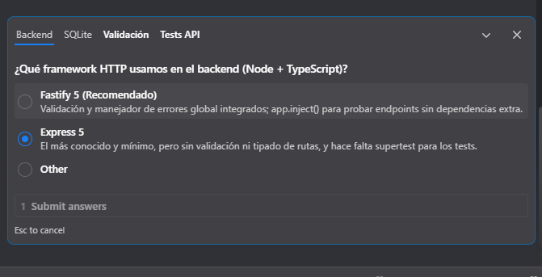
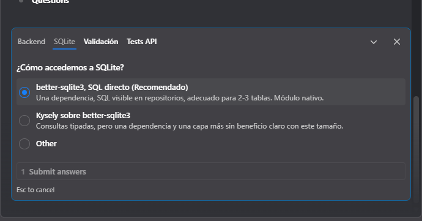
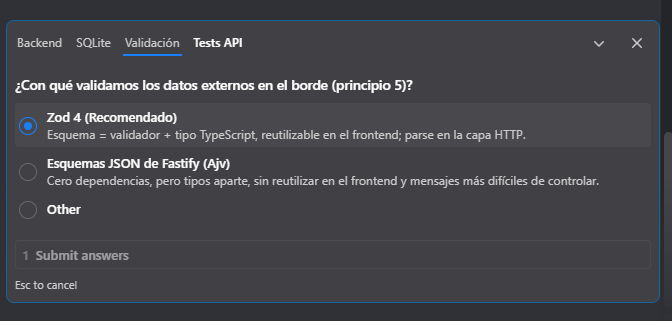
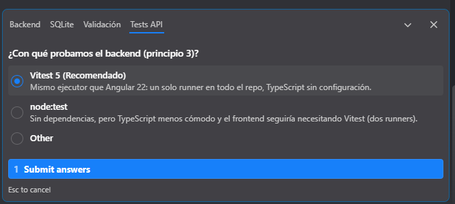
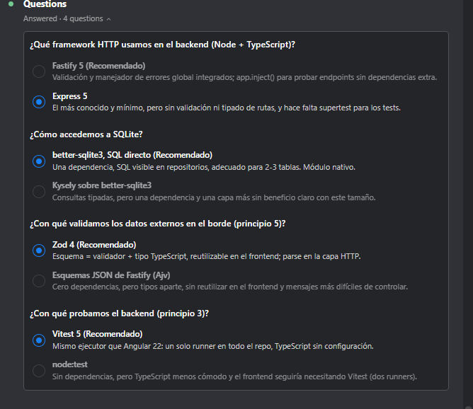
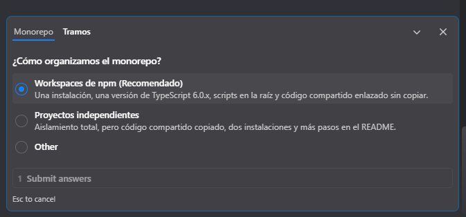
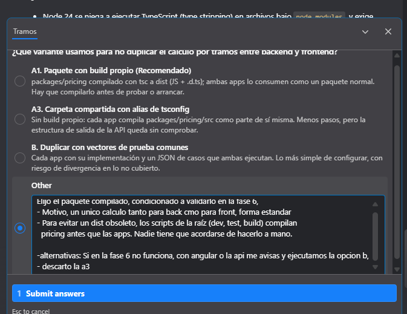
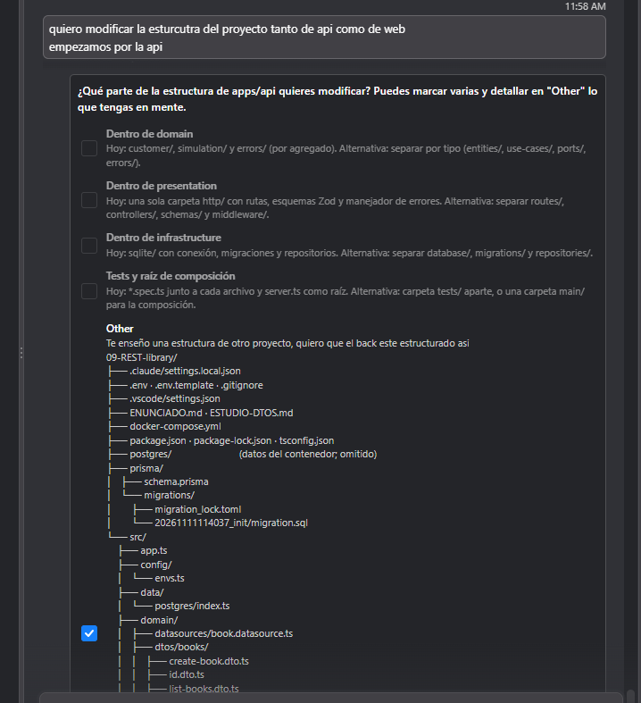
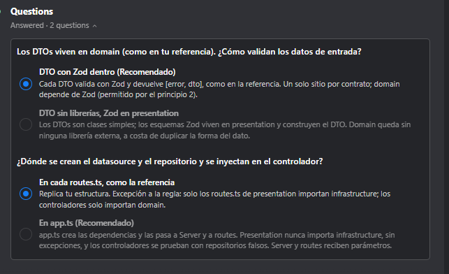
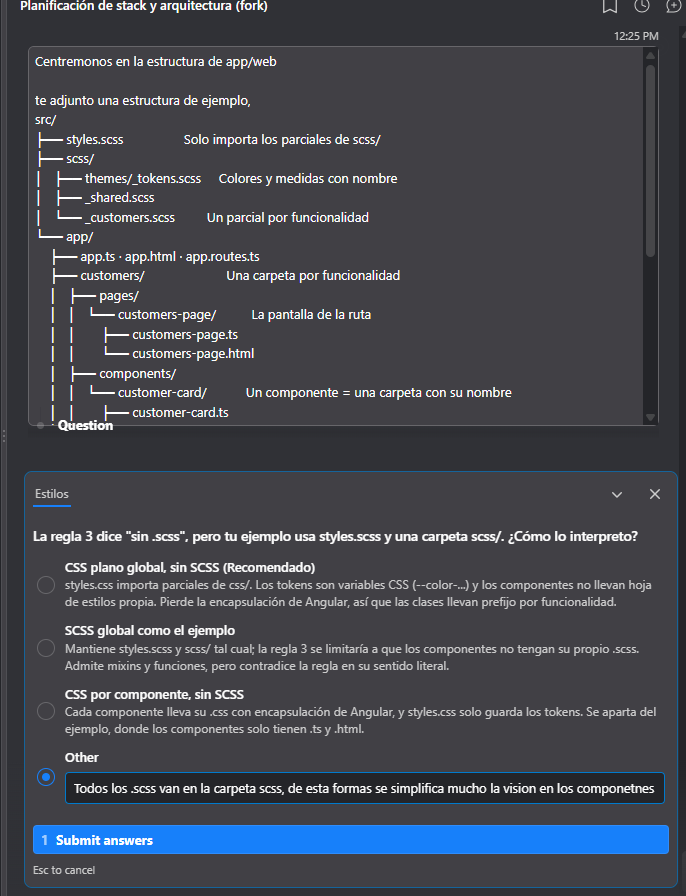

# Stack y arquitectura — Fase 3 (2026-11-19, sesión 02)

## Objetivo y fase
Fase 3: elegir el stack y producir `architecture.md`, y dejar los ADR de producto. La instrucción pedía cinco pasos con parada y aprobación después de cada uno: (0) dos ajustes previos, (1) stack, (2) `architecture.md`, (3) `database.md`, (4) cierre con ADR y diffs de `CLAUDE.md` y `MEMORY.md`.
En esta sesión se completaron los pasos 0, 1 y 2, y del paso 4 se hicieron los ADR-009 y ADR-010 y los diffs de `CLAUDE.md` y `MEMORY.md`. El autor decidió que el paso 3 (`database.md`) va en otra sesión; el ADR-011 queda sin escribir.
El entorno puso la conversación en modo plan varias veces; los planes se escribieron en un archivo de plan y el autor los aprobó antes de aplicar nada. Los MCP de Angular CLI y Context7 se desconectaron y volvieron a conectarse durante la sesión.

## Prompts clave
Prompt inicial de la fase (literal):

> Fase de planificación: no escribas código ni instales nada.
>
> Antes de proponer nada, lee reto.md (§2 y §4), decisions.md y los registros de
> ai-workspace/sessions/. Consulta las versiones actuales con los MCP (Context7,
> Angular CLI) o en npm: no las des de memoria.
>
> Hazlo en cinco pasos y PÁRATE después de cada uno para que lo apruebe.
>
> 0. Dos ajustes previos, como diff:
>    - MEMORY.md vuelve a decir "solo falta el commit" y no cita 04bac26. Pasa en cada
>      cierre: el commit que incluye MEMORY.md no puede citarse a sí mismo. Corrige el
>      estado sin hashes ("Fase 2 cerrada: revisión de pendientes y consolidación de ADR")
>      y propón una línea para la sección "Memoria" de CLAUDE.md: en MEMORY.md el estado
>      se escribe como quedará tras el commit, sin "pendiente de commit" ni hashes.
>    - decisions.md, línea 3: dice "Solo decisiones de proceso", pero el ADR-008 es de
>      convenciones y en esta fase llegan los de producto. Cámbiala para que no lo limite.
>
> 1. Stack. Para cada elección, dame 2 alternativas con pros y contras, tu recomendación y
>    espera a que elija:
>    - Backend: framework HTTP sobre Node.js + TypeScript (el reto lo prefiere, §2.A).
>    - Acceso a SQLite: driver directo, query builder u ORM.
>    - Validación de datos en el borde (principio 5).
>    - Tests del backend.
>    - Frontend: Angular, versión estable actual. Confírmala con el MCP de Angular CLI.
>    - Monorepo: workspaces de npm o proyectos independientes con scripts en la raíz.
>    - El cálculo por tramos lo necesitan el backend (al guardar) y el frontend (simulador en
>      tiempo real, §2.B). Dame opciones para no duplicar la lógica o, si se duplica, cómo
>      garantizar que ambos dan el mismo resultado.
>    No hagas un ADR por elección. Al final serán solo tres ADR de producto, aplicando el
>    criterio de decisions.md: "Stack" (una tabla: pieza · elegida · alternativa
>    descartada · motivo), "Cálculo por tramos compartido" y "Qué se guarda de cada
>    simulación".
>
> 2. architecture.md, máximo 80 líneas:
>    - Árbol de carpetas de apps/api y apps/web (y del código compartido, si lo hay).
>    - Capas de cada app y qué hace cada una. La lógica de negocio queda aislada (principio 2).
>    - Reglas de dependencia entre capas: qué puede importar qué.
>    - Formato único de errores de la API. Los textos de los mensajes, dame opciones y elijo yo.
>    - Cómo consume el frontend la API de tipos de cambio (§2.B), sin decidir aún los casos de
>      error: eso irá en su spec.
>    - Un diagrama Mermaid de capas.
>
> 3. database.md, máximo 60 líneas:
>    - Tablas, columnas, tipos, claves y restricciones, usando solo los datos que pide §2.A.
>    - Importes en unidades enteras (principio 6).
>    - Qué se guarda de cada simulación: solo los datos de entrada, o también el resultado y
>      el impuesto aplicado. Dame las opciones y elijo yo.
>    - Cómo se crea y se migra el esquema.
>    - Si el acceso elegido genera ficheros *.db-wal, *.db-shm o *.sqlite3, propón añadirlos
>      al .gitignore.
>    - Un diagrama entidad-relación en Mermaid.
>    - Todo lo que el reto no defina (países, IVA, planes, unicidad del identificador
>      fiscal…) va a una lista "Dudas para las specs", sin resolver.
>
> 4. Cierre: los tres ADR de producto (ADR-009 a ADR-011), el diff de CLAUDE.md (stack en
>    "Qué es" o "Estructura", sin pasar de 60 líneas) y el diff de MEMORY.md.
>
> No busques otros proyectos como referencia. Si algo choca con reto.md o con la
> constitución, para y dímelo.
>
> NO escribas ningún archivo hasta que apruebe su paso.

Resto de mensajes del autor, en orden (literales):

> Apruebo el paso 0, sigue con el paso 1

> El back entendo que es node.js + expres 5

> explicame el motivo y se gestiona

> apruebalo, pero añade ademas node.js
> y la arquitectura para el back tiene que ser clean architecture, con capas de dominio, infraestructura y presentacion como las principales

> apruebo el paso 1, no quiero la capa de application

> quiero modificar la esturcutra del proyecto tanto de api como de web
> empezamos por la api

Estructura de ejemplo aportada para la API (respuesta literal a una pregunta de opciones):

> Te enseño una estructura de otro proyecto, quiero que el back este estructurado asi
> 09-REST-library/
> ├── .claude/settings.local.json
> ├── .env · .env.template · .gitignore
> ├── .vscode/settings.json
> ├── ENUNCIADO.md · ESTUDIO-DTOS.md
> ├── docker-compose.yml
> ├── package.json · package-lock.json · tsconfig.json
> ├── postgres/                         (datos del contenedor; omitido)
> ├── prisma/
> │   ├── schema.prisma
> │   └── migrations/
> │       ├── migration_lock.toml
> │       └── 20261111114037_init/migration.sql
> └── src/
>     ├── app.ts
>     ├── config/
>     │   └── envs.ts
>     ├── data/
>     │   └── postgres/index.ts
>     ├── domain/
>     │   ├── datasources/book.datasource.ts
>     │   ├── dtos/books/
>     │   │   ├── create-book.dto.ts
>     │   │   ├── id.dto.ts
>     │   │   ├── list-books.dto.ts
>     │   │   └── update-book.dto.ts
>     │   ├── entities/book.entity.ts
>     │   ├── errors/custom.error.ts
>     │   ├── repository/book.repository.ts
>     │   └── use-cases/book/
>     │       ├── borrow-book.ts · create-book.ts · delete-book.ts
>     │       ├── get-book.ts · get-books.ts
>     │       └── return-book.ts · update-book.ts
>     ├── infrastructure/
>     │   ├── datasource/postgres-book.datasource.ts
>     │   └── repository/book.repository.imp.ts
>     ├── presentation/
>     │   ├── server.ts
>     │   ├── routes.ts
>     │   └── books/
>     │       ├── controller.ts
>     │       └── routes.ts

Estructura de ejemplo y reglas para la web (literal):

> Centremonos en la estructura de app/web
>
> te adjunto una estructura de ejemplo,
>
> src/
> ├── styles.scss                 Solo importa los parciales de scss/
> ├── scss/
> │   ├── themes/_tokens.scss     Colores y medidas con nombre
> │   ├── _shared.scss
> │   └── _customers.scss         Un parcial por funcionalidad
> └── app/
>     ├── app.ts · app.html · app.routes.ts
>     ├── customers/                       Una carpeta por funcionalidad
>     │   ├── pages/
>     │   │   └── customers-page/          La pantalla de la ruta
>     │   │       ├── customers-page.ts
>     │   │       └── customers-page.html
>     │   ├── components/
>     │   │   └── customer-card/           Un componente = una carpeta con su nombre
>     │   │       ├── customer-card.ts
>     │   │       └── customer-card.html
>     │   └── services/
>     │       └── customers-api.ts         Llamadas HTTP
>     └── shared/                          Lo que usan varias funcionalidades
>         ├── components/
>         ├── interfaces/
>         │   └── customer.ts
>         └── services/
>
> 4 reglas
> - una carpeta por funcinalidad
> -cada componente en su propia carpeta
> - sin .scss
> - lo que usen varias funcinalidades en shared

> Todos los .scss van en la carpeta scss, de esta formas se simplifica mucho la vision en los componetnes

> Confirmo las adiciones, opción 2 de mensajes y 422/404/409/500

Revisión de `architecture.md` (literal):

> Revisando @ai-workspace/docs/architecture.md
> Revisando architecture.md, antes de aprobarlo:
> 1. customer-detail-page (customers) necesitaría simulation-history (simulations), y una duncionalidad no puede depender de otra, ademas simulations o tiene page,
>
> cada compoentne tiene que tener 4 carpetas, page, interface, componentes y service

> mas errores dentro de architecture, cada controlador y con con handleError y CustomError  y 400 en  los DTO no 422 , el middelware solo para lo que no llega al controlador, . Cambia la línea "Todo error sale por el middleware".

> En @ai-workspace/docs/architecture.md ,la linea 80 añade INVALID_JSON 400 (cuerpo ilegible, sin details, lo responde el middleware). y añade en @MEMORY.md la configuracion del proxy  de desarrollo de Angular para que llame el frontend llame a api

> apruebo el paso 2 y voy a ejecutar /sdd-sesion, el siguiente fichero database.md va en otra sesion

> Sí, aplícalo

> crea estas ADR-009 a ADR-011

> Prepara los diffs de CLAUDE.md y MEMORY.md

> aplicalo

> actualiza @MEMORY.md  y luego haz  /sdd-session  3 stack-y-arquitectura

Respuestas del autor a preguntas con opciones (el texto de las opciones lo redactó la IA):
- Backend: "Express 5".
- Acceso a SQLite: "better-sqlite3, SQL directo (Recomendado)".
- Validación: "Zod 4 (Recomendado)".
- Tests del backend: "Vitest 5 (Recomendado)".
- Monorepo: "Workspaces de npm (Recomendado)".
- Cálculo por tramos, primera respuesta: "Necestio investigar mas sobre esto".
- Cálculo por tramos, segunda respuesta (texto escrito por el autor, literal): "Elijo el paquete compilado, condicionado a validarlo en la fase 6, - Motivo, un unico calculo tanto para back cmo para front, forma estandar - Para evitar un dist obsoleto, los scripts de la raíz (dev, test, build) compilan pricing antes que las apps. Nadie tiene que acordarse de hacerlo a mano. -alternativas: Si en la fase 6 no funciona, con angular o con la API me avisas y ejecutamos la opcion b, - descarto la a3".
- DTOs: "DTO con Zod dentro (Recomendado)".
- Composición: "En cada routes.ts, como la referencia".
- Longitud de `architecture.md`: "Subir el límite a unas 105 líneas".
- Historial de simulaciones: "A. En customers/ (Recomendado)".

## Qué propuso la IA
- **Paso 0.** Dos ajustes en forma de diff, aprobados:
  - `MEMORY.md`: estado sin hashes ("Fases 0, 1 y 2 cerradas y commiteadas. Fase 2 cerrada: revisión de pendientes y consolidación de ADR").
  - `CLAUDE.md`, sección "Memoria": una línea que dice que el estado se escribe como quedará tras el commit.
  - `decisions.md`, línea 3: "Decisiones de proceso, convenciones y producto."
- **Paso 1, versiones.** Consultadas en npm el 2026-11-19: Angular y Angular CLI 22.3.0, Express 5.3.0, better-sqlite3 13.2.0, Kysely 0.29.9, Zod 4.6.7, Vitest 5.1.1, supertest 7.3.2, TypeScript 7.0.2 (la última). Node local 24.17.0; Angular 22.3 exige `^22.22.3 || ^24.15.0`.
  - **Hallazgo:** Angular 22.3 exige TypeScript `>=6.0 <6.1` (en `@angular/compiler-cli` y `@angular/build`), no la 7. Todo el repo usa 6.0.x.
  - Vitest 5 es compatible con el builder de Angular 22.
  - La documentación de angular.dev v22 respondió a las búsquedas (`searchedVersion` 22). `list_projects` no se pudo usar porque aún no hay workspace.
- **Paso 1, opciones.** Para cada elección dio dos alternativas con pros, contras y recomendación: Fastify 5 o Express 5; driver directo con `better-sqlite3` o Kysely (sin ORM); Zod 4 o esquemas JSON de Fastify; Vitest 5 o `node:test`; workspaces o proyectos independientes.
  - **Express 5.** Avisó de que implica `supertest` o `fetch` nativo para probar endpoints, y de que la validación y el manejador de errores se escriben a mano.
  - **Cálculo compartido.** Ofreció A (paquete compartido), B (duplicar con vectores de prueba comunes) y descartó una C (endpoint de previsualización). Tras la respuesta "necesito investigar", investigó con Context7 y con la documentación de Angular:
    - Node 24 se niega a ejecutar TypeScript bajo `node_modules` y exige extensiones `.ts` en los `import`.
    - La guía de Angular "Using your own library in applications" existe, pero no se pudo leer su contenido.
    - Presentó las variantes A1 (paquete con build propio), A3 (carpeta compartida con alias de `tsconfig`) y B, y avisó de que ninguna se puede validar sin el esqueleto (fase 6).
  - **Motivo de Express.** Propuso una redacción, aclarando que las razones eran suyas, no del autor; el autor la aprobó. El motivo de Python como alternativa a Node.js lo puso la IA.
- **Paso 2, `architecture.md`.**
  - Primer borrador de 80 líneas con árboles compactos y tres opciones de textos de error (solo códigos, mensaje breve en español, mensaje con detalle).
  - Tras recibir la estructura de ejemplo, adaptó la API: sin Prisma, Postgres ni Docker; solo los recursos `customer` y `simulation`; añadió `middlewares/error-handler.ts`; `config/envs.ts` sin dependencias nuevas.
  - Avisó de que la composición en cada `routes.ts` hace que `presentation` importe `infrastructure`, contra su regla anterior, y de que los DTOs con Zod dentro de `domain` no chocan con el principio 2. Recomendó la composición en `app.ts`; el autor eligió la otra.
  - Adaptó la web con `customers/` y `simulations/`, propuso `app.config.ts` y `shared/schemas/` como adiciones y planteó la contradicción entre "sin .scss" y el ejemplo con `styles.scss`.
  - Avisó de que no cabía en 80 líneas; el autor subió el límite a unas 105. Escribió `ai-workspace/docs/architecture.md` (102 líneas, luego 105).
- **Corrección tras la revisión del autor.** Reconoció el fallo de dependencia (el historial de simulaciones en `simulations/` usado por el detalle del cliente), ofreció las opciones A, B y C con vista previa y aplicó la A. También añadió `pages/` e `interfaces/` a cada funcionalidad.
- **Errores y proxy.** Cambió el estado de `VALIDATION_ERROR` de 422 a 400 y añadió `INVALID_JSON`. Al editar, el archivo ya había cambiado (alguien había reescrito la sección de errores y la línea de `presentation`); releyó el archivo, aplicó solo lo que faltaba y recontó las líneas. Añadió a `MEMORY.md` el proxy de desarrollo de Angular, dejando sin decidir el puerto de la API y el prefijo de rutas.
- **ADR y diffs.** Escribió ADR-009 (tabla de stack con nueve filas) y ADR-010 en `decisions.md`; no escribió el ADR-011 porque depende de una elección del autor en `database.md`. Preparó y aplicó los diffs de `CLAUDE.md` (sección "Estructura", 53 líneas) y de `MEMORY.md` (44 líneas, después 47).
- **Errores de la IA, señalados por ella o por el autor:**
  - El historial de simulaciones violaba la regla "una funcionalidad no importa otra" y `simulations/` no tenía página (lo detectó el autor).
  - Contó mal las líneas dos veces: dijo 54 para `CLAUDE.md` (eran 53) y 43 para `MEMORY.md` (eran 44).
  - Su primera edición de `MEMORY.md` dejó una línea de aprendizaje separada de su lista por una línea en blanco.
  - Un `Edit` falló porque `architecture.md` había cambiado fuera de sus ediciones.
  - Para el proxy de Angular no pudo leer el contenido de la guía (solo localizarla): dejó la sintaxis marcada para comprobar.

## Qué corregí y por qué
- **Backend y Node.js.** Pedí Express 5 en lugar de Fastify y que Node.js figure en la tabla del stack. Motivo de Express: aprobé la redacción de la IA (el más conocido y mínimo); motivo propio: (no registrado).
- **Clean Architecture sin `application`.** Pedí capas domain, infrastructure y presentation, y rechacé la capa `application` que proponía la IA. Motivo: (no registrado).
- **Estructura de la API.** La sustituí por la de otro proyecto que aporté. Con ello elegí DTOs con Zod en `domain` (recomendado) y la composición en cada `routes.ts` (no recomendado por la IA). Motivo de la segunda: "como la referencia"; el resto, (no registrado).
- **Estructura de la web.** Aporté un ejemplo y cuatro reglas. La IA vio una contradicción entre "sin .scss" y el ejemplo; la resolví: todos los `.scss` van en la carpeta `scss/`, porque "se simplifica mucho la visión en los componentes".
- **Longitud.** Subí el límite de `architecture.md` de 80 a unas 105 líneas, contra la recomendación de mantener 80. Motivo: (no registrado).
- **Cálculo compartido.** Pedí investigar más antes de elegir. Elegí el paquete compilado con una condición (validarlo en la fase 6; si falla, opción B), exigí que los scripts de la raíz lo compilen antes que las apps y descarté la A3. Motivo: un único cálculo y forma estándar.
- **Revisión de `architecture.md`.** Corregí el fallo de dependencia entre funcionalidades y exigí cuatro carpetas por funcionalidad (pages, interfaces, components, services).
- **Errores.** Pedí que cada controlador tenga `handleError` con `CustomError`, 400 para los DTO (no 422) y que el middleware recoja solo lo que no llega al controlador. Pedí también `INVALID_JSON` 400 y la configuración del proxy en `MEMORY.md`. Motivos: (no registrado).
- **Orden del cierre.** Pedí que el `database.md` quede para otra sesión y que se escriban los ADR y se actualice `MEMORY.md` antes de este registro.

## Decisiones tomadas
- **Stack (ADR-009).** Angular 22.3.0; Node.js 24; TypeScript 6.0.x; Express 5; `better-sqlite3` con SQL directo; Zod 4; Vitest 5; workspaces de npm. API con Clean Architecture sin capa `application`.
- **Cálculo compartido (ADR-010).** Paquete `packages/pricing` compilado a `dist`; los scripts de la raíz lo compilan antes que las apps; condicionado a validarlo en la fase 6, con la opción B como respaldo; A3 descartada.
- **ADR-011.** No escrito; depende de qué se guarda de cada simulación.
- **API.** Estructura copiada de la referencia y adaptada (`data/`, `domain/{datasources,dtos,entities,errors,repository,use-cases}`, `infrastructure/{datasource,repository}`, `presentation`). DTOs con Zod en `domain`. Composición en cada `routes.ts`. Se añade `middlewares/error-handler.ts`.
- **Web.** Una carpeta por funcionalidad (`customers/`, `simulations/`), cada una con `pages/`, `interfaces/`, `components/` y `services/`; `shared/` para lo común, con `schemas/`; todo el `.scss` en `scss/`; `app.config.ts` añadido. El historial de simulaciones vive en `customers/`; `simulations/` tiene `simulation-page`.
- **Errores.** Formato único con `error.code`, `message` y `details`; mensajes en español breve (opción 2); `VALIDATION_ERROR` 400 (DTO, lo responde el controlador), `NOT_FOUND` 404, `CONFLICT` 409, `INTERNAL_ERROR` 500 e `INVALID_JSON` 400 (lo responde el middleware).
- **Tipos de cambio.** Servicio compartido que llama a `https://open.er-api.com/v6/latest/EUR` y valida la respuesta con un esquema Zod; casos de error en la spec del simulador.
- **Archivos escritos o cambiados (sin commit):** `ai-workspace/docs/architecture.md` (105 líneas), ADR-009 y ADR-010 en `decisions.md`, línea 3 de `decisions.md`, sección "Memoria" y "Estructura" de `CLAUDE.md` (53 líneas) y `MEMORY.md` (47 líneas).
- No se ha instalado ninguna dependencia ni escrito código.

## Capturas
Capturas de esta fase (nombre `fase-3-alternativas-stack-N.png`). No he revisado su contenido; por el nombre corresponden a la propuesta de alternativas del stack (paso 1):
- 
- 
- 
- 
- 
- 
- 
- 
- 
- 

No hay capturas de la parte de arquitectura. Momentos que valdría la pena capturar si se repiten: la revisión donde se detectó que el historial de simulaciones violaba la regla de dependencias, y la pregunta de la composición (`routes.ts` frente a `app.ts`) con su vista previa.

## Pendiente para la siguiente sesión
- **`database.md`** (paso 3, otra sesión): tablas, columnas, claves y restricciones solo con los datos de §2.A, importes en unidades enteras, cómo se crea y se migra el esquema, diagrama ER y "Dudas para las specs". El autor elige qué se guarda de cada simulación (solo la entrada, o también el resultado y el impuesto), y con esa elección se escribe el **ADR-011**.
- **`.gitignore`:** proponer `*.db-wal`, `*.db-shm` y `*.sqlite3`.
- **Tests de endpoints:** decidir `supertest` o `fetch` nativo y aprobar la lista de dependencias con su justificación (principio 4); incluye Zod en el frontend.
- **Primera spec de la API:** dónde se traduce `CustomError` a estado HTTP (propuesta de la IA: `handleError` de `presentation`).
- **Fase 6:** validar `packages/pricing` compilado con Angular y la API (si falla, opción B); comprobar `better-sqlite3` en Windows con Node 24; rellenar "Comandos"; resolver `.env.example` frente a `Read(**/.env.*)`; proxy de desarrollo de Angular (puerto de la API y prefijo de rutas por decidir; comprobar la sintaxis en la guía de angular.dev).
- **Interpretación a confirmar:** "cada componente tiene 4 carpetas" se entendió como cada funcionalidad; el autor eligió la opción A de la pregunta posterior sin corregirlo.
- **Commit** (sin `Co-Authored-By`, pendiente de tu orden). Archivos afectados: `CLAUDE.md`, `MEMORY.md`, `ai-workspace/docs/decisions.md`, `ai-workspace/docs/architecture.md`, este registro y las capturas `fase-3-alternativas-stack-*.png`. Orden de cierre: `MEMORY.md` → `/sdd-session` → commit.
- Las ambigüedades del reto siguen yendo a "Dudas abiertas" de cada spec (ver `MEMORY.md`).
