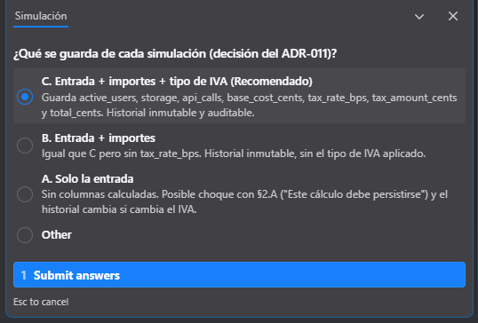
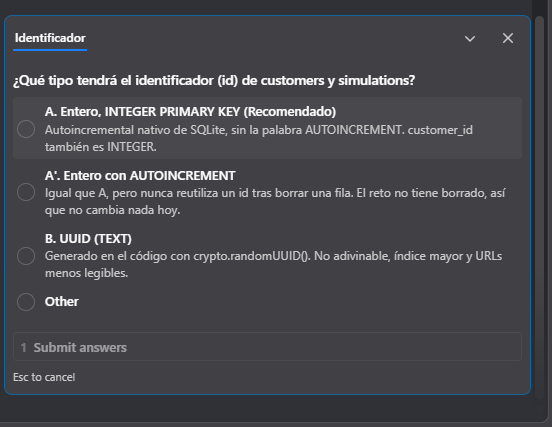
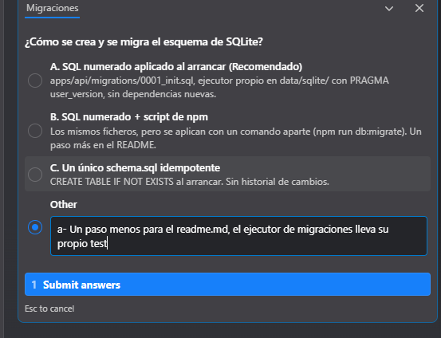

# Base de datos — Fase 3 (2026-11-19, sesión 03)

## Objetivo y fase
Fase 3: cerrar con `ai-workspace/docs/database.md`, el paso que la sesión 02 (`stack-y-arquitectura`) dejó para otra sesión. La instrucción pedía cuatro pasos con parada y aprobación después de cada uno: (1) esquema, (2) cinco decisiones planteadas de una en una, (3) `database.md`, (4) cierre con ADR-011, diff de `.gitignore`, de `MEMORY.md` y de `CLAUDE.md`.
Se completaron los cuatro. Después, el autor pidió dejar abierto dónde se calcula el IVA. El entorno puso la conversación en modo plan en cada paso que escribía archivos; los planes se guardaron en un archivo de plan y el autor los aprobó antes de aplicar nada.
Fuentes leídas antes de proponer: `reto.md` (§1 a §4), `architecture.md`, ADR-009 y ADR-010 de `decisions.md`, el registro `2026-11-19-02-stack-y-arquitectura.md` y el `.gitignore`. La constitución y `MEMORY.md` llegaron por el contexto del proyecto, no por una lectura aparte.

## Prompts clave
Prompt inicial de la fase (literal):

> Fase de planificación: no escribas código ni instales nada.
>
> Vamos a cerrar la fase 3 con ai-workspace/docs/database.md. Antes de proponer nada, lee
> reto.md (§2.A y §2.B), la constitución, architecture.md, decisions.md (ADR-009 y ADR-010)
> y el registro 2026-11-19-02-stack-y-arquitectura.md.
>
> Hazlo en cuatro pasos y PÁRATE después de cada uno para que lo apruebe.
>
> 1. Esquema. Propón las tablas usando solo los datos que pide §2.A:
>    - Cliente: nombre de empresa, identificador fiscal, email, país y plan elegido.
>    - Simulación: cliente, usuarios activos, almacenamiento y llamadas a la API estimadas,
>      y el cálculo que el reto dice que se persiste.
>    Para cada columna: nombre en inglés, tipo SQLite, NOT NULL, claves y restricciones
>    (CHECK, FOREIGN KEY). Los importes, en unidades enteras (principio 6).
>    Todo lo que añadas y el reto no pida (identificador, fecha de creación, índices),
>    márcalo como propuesta tuya y dime para qué sirve.
>
> 2. Decisiones que me tienes que plantear de UNA en UNA, con opciones, pros, contras y
>    tu recomendación:
>    - Qué se guarda de cada simulación: solo los datos de entrada, o también el coste
>      base, el IVA aplicado y el total. Piensa en el historial (§2.B): ¿qué pasa si cambia
>      la tabla de IVA?
>    - Tipo de identificador: entero autoincremental o UUID.
>    - Cómo se crea y se migra el esquema: ficheros SQL en apps/api/migrations aplicados
>      al arrancar, con un script de npm o de otra forma. Ten en cuenta el README (§4):
>      arrancar en pocos pasos.
>    - Si se activa el modo WAL de SQLite y, por tanto, si hay que añadir *.db-wal,
>      *.db-shm y *.sqlite3 al .gitignore.
>    - Si hacen falta datos de ejemplo (seed) para probar el buscador.
>    Solo "qué se guarda de cada simulación" será un ADR (ADR-011), si tiene una
>    alternativa real. Las demás quedan en database.md y en el registro.
>
> 3. database.md, sin repetir lo que ya está en architecture.md (enlázalo):
>    - Tablas, columnas, tipos y restricciones.
>    - Cómo se crea y se migra.
>    - Un diagrama entidad-relación en Mermaid.
>    - Una lista "Dudas para las specs" con todo lo que el reto no define, sin resolver:
>      países e IVA, planes válidos, unicidad y normalización del identificador fiscal,
>      búsqueda (mayúsculas, tildes, parcial), límites de usuarios, redondeo.
>    Indica en cada duda a qué spec va.
>
> 4. Cierre: el ADR-011, el diff de .gitignore si procede, el de MEMORY.md (fase 3 cerrada)
>    y el de CLAUDE.md si cambia algo.
>
> No busques otros proyectos como referencia. Si algo choca con reto.md o con la
> constitución, para y dímelo. NO escribas ningún archivo hasta que apruebe su paso.

Resto de mensajes del autor, en orden (literales):

> apruebo el paso 2, segimos

> apruebo el paso 3, sigue con el paso 4

> En database.md (línea 5) y en el ADR-011, cambia "el IVA y el redondeo los calcula
> domain" por "dónde se calcula el IVA y el redondeo se decide en la spec de
> POST /simulations (ADR-010)". No quiero dejarlo cerrado todavía.

Respuestas del autor a preguntas con opciones (el texto de las opciones lo redactó la IA):
- Qué se guarda de cada simulación: "C. Entrada + importes + tipo de IVA (Recomendado)".
- Tipo de identificador: "A. Entero, INTEGER PRIMARY KEY (Recomendado)".
- Migraciones (texto escrito por el autor, literal): "a- Un paso menos para el readme.md, el ejecutor de migraciones lleva su propio test".
- WAL: "A. Activar WAL (Recomendado)".
- Seed: "B. Seed opcional con script, escrito después de las specs (Recomendado)".

## Qué propuso la IA
- **Paso 1, esquema.** Tablas `customers` y `simulations` solo con los datos de §2.A. Marcó como propuestas suyas: `id`, `created_at`, el índice sobre `simulations(customer_id)`, `STRICT` y `PRAGMA foreign_keys = ON`. Dejó sin `UNIQUE` el identificador fiscal y sin lista de valores el país y el plan, y marcó como dudas el formato de `country`, la unidad de `storage` y el significado de `api_calls`. Propuso las columnas del cálculo (`base_cost_cents`, `tax_rate_bps`, `tax_amount_cents`, `total_cents`) como condicionales a la decisión 1.
- **Paso 2, cinco decisiones de una en una**, cada una con opciones, pros, contras y recomendación:
  1. *Qué se guarda.* Opciones A (solo entrada), B (entrada + importes) y C (entrada + importes + tipo de IVA). Avisó de que A podía chocar con §2.A ("Este cálculo debe persistirse"). Recomendó C.
  2. *Identificador.* Entero (`INTEGER PRIMARY KEY`) o UUID; añadió que `AUTOINCREMENT` solo evita reutilizar ids tras borrar. Recomendó el entero sin `AUTOINCREMENT`.
  3. *Migraciones.* A (SQL numerado aplicado al arrancar, con `PRAGMA user_version`), B (SQL numerado + script de npm), C (un `schema.sql` idempotente) y D (librería, como `umzug`). Recomendó A.
  4. *WAL.* Activar o dejar el modo por defecto; antes de plantearla leyó el `.gitignore` (ya ignoraba `*.db`, `*.sqlite` y `*.db-journal`). Recomendó activar WAL y añadir `*.db-wal`, `*.db-shm` y `*.sqlite3`.
  5. *Seed.* A (sin seed), B (script opcional) y C (automático al arrancar). Avisó de que el contenido no se puede fijar hasta que las specs cierren NIF, planes e IVA. Recomendó B, escrito después de las specs.
- **Paso 3, borrador de `database.md`** en el chat, sin escribirlo. Añadió dos propuestas nuevas respecto al paso 1: un `CHECK (total_cents = base_cost_cents + tax_amount_cents)` y un índice compuesto `(customer_id, created_at)`. Añadió la duda 10 (si `storage` y `api_calls` influyen en el coste; §2.A solo define tramos por usuarios). Recordó que la sesión anterior había fijado 60 líneas y que el borrador pasaba de eso.
- **Paso 4, cierre.** Escribió `database.md` (87 líneas), el ADR-011 (decisions.md 117 → 132 líneas), tres líneas en `.gitignore` (17 → 20), cambios en `MEMORY.md` (47 → 51 líneas tras la revisión final) y una línea en `CLAUDE.md` (sigue en 53). Pasó a la fase 6 los pendientes `supertest` o `fetch` nativo y la lista de dependencias, avisando de que eran de la fase 3 y que el autor podía preferir cerrarlos antes. Renombró `fase-3-identificador tabla.png` a `fase-3-identificador-tabla.png`.
- **Errores y avisos de la IA, señalados por ella o por el autor:**
  - Escribió en `database.md` y en el ADR-011 que "el IVA y el redondeo los calcula `domain`". Era un valor que el reto no define y que presentó dentro de un borrador sin marcarlo como decisión pendiente, contra la regla de huecos del reto de `CLAUDE.md`. Lo detectó el autor (ver abajo).
  - Dijo que `better-sqlite3` recomienda WAL ("es lo que aconseja la librería") sin consultar su documentación en esta sesión. No verificado.
  - `database.md` salió con 87 líneas, por encima de las 60 de la sesión anterior; lo avisó antes de escribirlo y el autor aprobó el borrador.

## Qué corregí y por qué
- **Migraciones.** Elegí la opción A y añadí dos cosas por mi cuenta: el motivo ("un paso menos para el README") y que "el ejecutor de migraciones lleva su propio test". La IA lo recogió en `database.md` (sección "Creación y migración") con referencia al principio 3.
- **Dónde se calcula el IVA y el redondeo.** Pedí cambiar "el IVA y el redondeo los calcula `domain`" por "dónde se calcula el IVA y el redondeo se decide en la spec de `POST /simulations` (ADR-010)", en `database.md` (línea 5) y en el ADR-011. Motivo: "No quiero dejarlo cerrado todavía". La IA lo aplicó y comprobó que no quedaba otra frase que lo cerrara. Al copiar mi redacción literal, `(ADR-010)` quedó dos veces en la misma frase del ADR-011; la IA ofreció quitar la segunda y decidí quitarla.
- **Aprobaciones.** Aprobé cada paso por separado (pasos 1 a 4); no hubo correcciones al esquema, a las decisiones 1, 2, 4 y 5 ni al borrador de `database.md`. No registré el motivo de elegir las opciones recomendadas en esas decisiones (no registrado).

## Decisiones tomadas
- **ADR-011, qué se guarda de cada simulación.** Opción C: entrada (`active_users`, `storage`, `api_calls`) y resultado (`base_cost_cents`, `tax_rate_bps`, `tax_amount_cents`, `total_cents`), en céntimos de euro enteros. Una simulación es una foto: no se recalcula si cambian tarifas o IVA. Alternativas descartadas: solo la entrada; entrada e importes sin el tipo.
- **Identificador.** `INTEGER PRIMARY KEY` sin `AUTOINCREMENT`; `customer_id` también `INTEGER`.
- **Migraciones.** SQL numerado en `apps/api/migrations/`, aplicado al arrancar por un ejecutor en `data/sqlite/` con `PRAGMA user_version`, cada fichero en una transacción. El ejecutor lleva su propio test sobre `:memory:`.
- **WAL.** Activado (`PRAGMA journal_mode = WAL` al abrir la conexión); `*.db-wal`, `*.db-shm` y `*.sqlite3` añadidos a `.gitignore`.
- **Seed.** Script opcional (`npm run seed`), escrito después de las specs de `customers` y `simulations`; el arranque no lo ejecuta.
- **IVA y redondeo.** Dónde se calculan queda abierto; lo decide la spec de `POST /simulations` (ADR-010).
- **Propuestas de la IA aprobadas:** `id`, `created_at`, `STRICT`, `PRAGMA foreign_keys = ON`, índice `idx_simulations_customer_created`, el `CHECK` del total y `tax_rate_bps` en puntos básicos.
- **Sin resolver (a propósito):** unicidad y normalización del identificador fiscal, países, planes, tipos de IVA, redondeo, límites de `active_users`, `storage` y `api_calls`, y búsqueda. Doce dudas en `database.md`, cada una con su spec.
- **Pendientes movidos a la fase 6:** `supertest` o `fetch` nativo para los tests de endpoints y lista de dependencias con su justificación (principio 4).
- **Archivos escritos o cambiados (sin commit):** `ai-workspace/docs/database.md` (87 líneas, nuevo), `ai-workspace/docs/decisions.md` (132), `.gitignore` (20), `MEMORY.md` (51), `CLAUDE.md` (53) y el renombrado de una captura. No se ha instalado ninguna dependencia ni escrito código.

## Capturas
Las tres capturas son preguntas con opciones del paso 2, tal como las vio el autor antes de responder:
- 
  Decisión 1 (ADR-011). Muestra las tres opciones: C (entrada + importes + tipo de IVA, marcada como recomendada y seleccionada), B (sin `tax_rate_bps`) y A (solo la entrada, con el aviso de posible choque con §2.A: "Este cálculo debe persistirse"). Es la elección que acabó en el ADR-011.
- 
  Decisión 2. Muestra las opciones A (entero, `INTEGER PRIMARY KEY`, recomendada), A' (entero con `AUTOINCREMENT`) y B (UUID). En la captura no hay ninguna seleccionada y el botón de enviar sigue desactivado: es el momento previo a responder.
- 
  Decisión 3. Muestra las opciones A (SQL numerado aplicado al arrancar, recomendada), B (con script de npm) y C (un único `schema.sql`). El autor no eligió ninguna de las tres tal cual: marcó "Other" y escribió "a- Un paso menos para el readme.md, el ejecutor de migraciones lleva su propio test", es decir, la opción A con el motivo y la condición del test propio.

## Pendiente para la siguiente sesión
- **Fase 4:** definir `tasks.md` (qué es y por qué, uno por spec).
- **Fase 5:** crear los agentes, incluido `.claude/agents/reviewer.md` (requiere tu aprobación).
- **Fase 6:** `supertest` o `fetch` nativo, lista de dependencias con justificación, comprobar `better-sqlite3` en Windows con Node 24 y que su SQLite admita `STRICT` (3.37 o superior), ejecutor de migraciones con su test, ruta de `migrations/` en la API compilada, ruta del fichero de la base en `config/envs.ts`, proxy de desarrollo de Angular y validación de `packages/pricing` (ADR-010).
- **Specs:** las 12 dudas de `database.md` van a `POST /customers`, `POST /simulations` y la spec de lectura; el seed opcional va después de las dos primeras.
- **Por verificar:** que `better-sqlite3` recomienda WAL (no consultado en esta sesión) y que el diagrama Mermaid de `database.md` renderiza.
