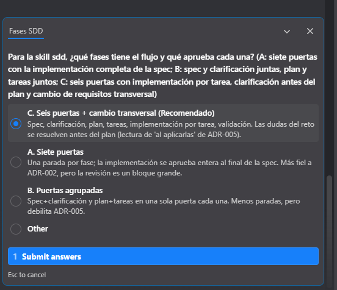
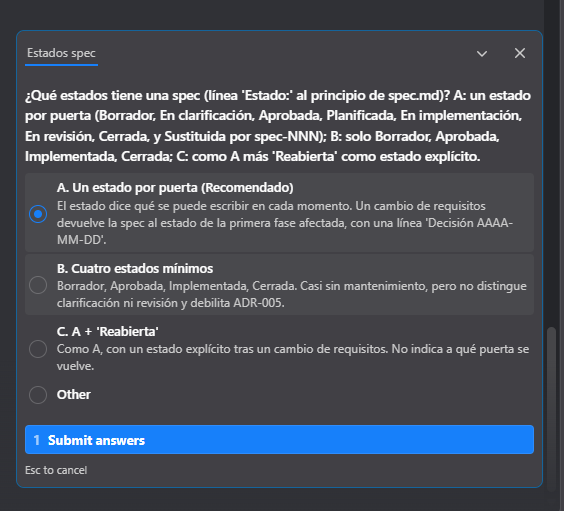
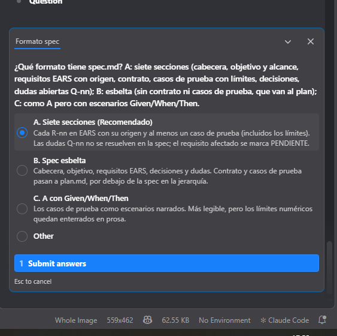
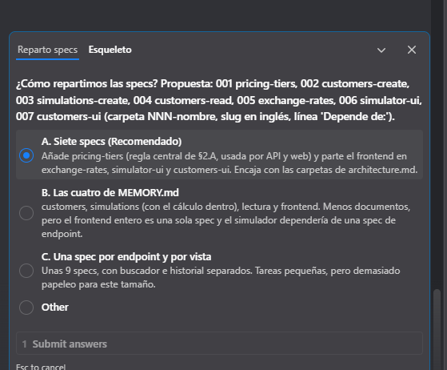
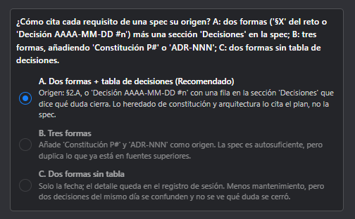
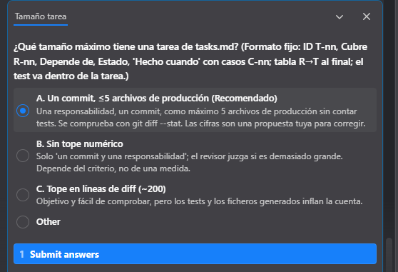
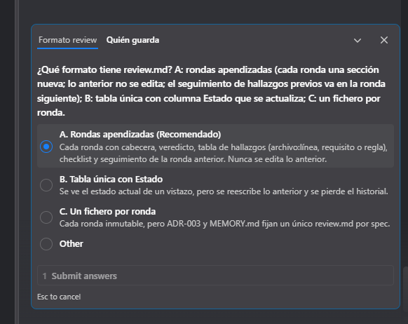
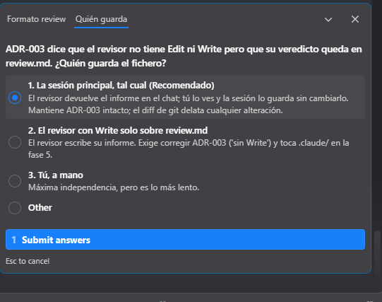

# Skill sdd — Fase 4 (2026-11-19, sesión 04)

Esta sesión se dividió en tres registros (04 `skill-sdd`, 05 `skill-backend-conventions`, 06 `skill-frontend-conventions`) a petición del autor, aunque `/sdd-session` genera uno por sesión. Los tres se redactaron fuera del comando, a mano por la IA, y se guardaron tras la confirmación del autor.

## Objetivo y fase
Fase 4. Crear tres skills en `.claude/skills/` (`sdd`, `backend-conventions` y `frontend-conventions`) en cuatro pasos con parada y aprobación después de cada uno. Este registro cubre el paso 1 (skill `sdd`) y lo que se le añadió después: la regla de capturas, la corrección de la cabecera YAML y las correcciones del README de specs. El paso 2 está en el registro 05; el 3 y el 4, en el 06.
Fuentes leídas antes de proponer: `CLAUDE.md`, la constitución, `architecture.md`, `database.md`, `decisions.md`, `MEMORY.md`, `reto.md`, `sdd-session.md`, `settings.json` y los registros `2026-11-18-02`, `2026-11-18-03`, `2026-11-19-01`, `2026-11-19-02` y `2026-11-19-03`. No se leyeron `2026-11-18-00` ni `2026-11-18-01`, aunque el prompt pedía los de `sessions/`. Documentación oficial de skills de Claude Code (code.claude.com/docs/en/skills); no se leyeron los últimos ~20.000 caracteres de esa página.
El entorno puso la conversación en modo plan en varios pasos; el plan se escribió en un archivo de plan y el autor lo aprobó antes de aplicar nada.

## Prompts clave
Prompt inicial de la fase (literal):

> Fase de planificación: no escribas código.
>
> Vamos a crear tres skills en .claude/skills/: sdd, backend-conventions y
> frontend-conventions. Antes de proponer nada, lee CLAUDE.md, la constitución,
> architecture.md, database.md, decisions.md (sobre todo ADR-002, ADR-003 y ADR-005), MEMORY.md
> y los registros de ai-workspace/sessions/. Comprueba en la documentación oficial de Claude
> Code los campos de la cabecera de una skill, cuándo se carga cada parte y los límites de
> tamaño.
>
> Hazlo en cuatro pasos y PÁRATE después de cada uno para que lo apruebe.
>
> 1. Skill sdd (el MÉTODO, no el producto: ningún requisito, importe ni país del reto).
>    Cabecera con una description que haga que se cargue sola al trabajar en
>    ai-workspace/specs/. SKILL.md corto; las plantillas, en ficheros de apoyo.
>    Plantéame de UNA en UNA, con opciones, pros, contras y tu recomendación:
>    - Fases del flujo y qué aprueba cada una (spec, clarificación, plan, tareas,
>      implementación, validación, cambio de requisitos).
>    - Estados de una spec.
>    - Numeración y reparto de las specs. Parte de MEMORY.md (POST /customers,
>      POST /simulations, lectura, frontend) y dime si lo cambiarías.
>    - Cómo cita cada requisito su origen: "§ del reto" o "Decisión AAAA-MM-DD".
>    - Formato de spec.md: secciones y requisitos en EARS; los huecos del reto van a
>      "Dudas abiertas" y no se resuelven (ADR-005).
>    - Qué es tasks.md y por qué existe; formato de cada tarea (tamaño máximo, requisito que
>      cubre, "hecho cuando"). Pendiente desde la fase 2.
>    - Formato de review.md: el informe del revisor por spec (ADR-003), con veredicto,
>      hallazgos con archivo:línea y requisito, y rondas que se acumulan sin borrar.
>    - Qué se hace con las capturas y el registro al cerrar una spec.
>
> 2. Skill backend-conventions, a partir de architecture.md y database.md. El patrón que
>    quiero fijar:
>    - DTO con create(): [error, dto] validado con Zod; casos de uso en domain; el controlador
>      crea el caso de uso en cada petición y gestiona los errores con handleError y
>      CustomError; la composición (datasource, repositorio, controlador) en cada
>      presentation/<recurso>/routes.ts, como única excepción a las reglas de capas.
>    - SQL parametrizado, nunca concatenado. Importes en céntimos enteros.
>    - Tests: unitarios en domain, de integración por endpoint con SQLite en memoria.
>    - Lista de revisión (checklist) que usará el revisor.
>    Dime qué falta por decidir en lugar de suponerlo.
>
> 3. Skill frontend-conventions, a partir de architecture.md:
>    - Estructura por funcionalidad (pages, components, interfaces, services), una carpeta
>      por componente, sin sufijos en los nombres, y estilos solo en src/scss con tokens.
>    - Las páginas inyectan servicios; los componentes son presentacionales.
>    - HttpClient solo en services/. Los estados de carga, error y vacío se muestran siempre
>      (principio 7). Una respuesta externa se valida antes de usarse (principio 5).
>    - A shared/ solo pasa lo que usa una segunda funcionalidad.
>    - Angular moderno: consulta la documentación actual de la versión del ADR-009 antes de
>      fijar reglas sobre signals, zoneless o control flow. No las des de memoria.
>    - Lista de revisión (checklist).
>
> 4. Cierre: el diff de CLAUDE.md (cuándo usar cada skill, sin pasar de 60 líneas), el de
>    MEMORY.md y un ADR solo si alguna decisión cumple el criterio de decisions.md.
>
> Reglas:
> - Las skills definen el método y las convenciones, no el producto. Cada una explica qué
>   protege cada regla.
> - Si una convención choca con architecture.md, database.md o la constitución, para y dímelo.
> - Explícame qué carga Claude y cuándo: la cabecera, SKILL.md y los ficheros de apoyo.
> - No crees todavía agentes ni comandos: eso es la fase 5.
> - No busques otros proyectos como referencia.
>
> NO escribas ningún archivo hasta que apruebe su paso.

Resto de mensajes del autor relativos a este registro, en orden (literales):

> Reintenta crear SKILL.md

> No se pudo analizar frontmatter
> Nested mappings are not allowed in compact mappings at line 2, column 14:
>
> description: Método Spec-Driven Development de este proyecto. Úsala siempre q

(Lo introdujo con el texto "Da este error la visualizacion de la sckill".)

> Quiero ademas que en esta skill añadas una regla para las capturas.
> en cada puerta, cando ocurra uno de estos momentos termina tu respuesta con una línea "CAPTURA: fase-N-NNN-descripcion.png — qué debe verse"
> -cuando: una pregunta con opciones y mi eleccion, una correccion a una propuesta, el veredicto del revisor, un choque entre fuentes.
>
> el resto de momentos no me avises
>
> al cerrar la spec, /sdd-session  comprueba que las capturas aununciadas existan en la carpeta screenshots/ y dime cual falta

> 1- dejalo en la skill, en la fase 5 se revisan los comandos
> 2 - sin archivo nuevo, la comprobacioin se hace al cerrar cualquier sesion, no solo con la spec
> 3- una linea por momento

> Capturas: el NNN solo se pone cuando la captura es de una spec (fases 6 y 7). En las demás
> fases el nombre es fase-N-descripcion.png, como hasta ahora (ADR-004). Las capturas ya
> existentes no se renombran.

> Apruebo el paso 1, sigue con el paso 2

> revisamos los pendientes

Respuestas del autor a preguntas con opciones (el texto de las opciones lo redactó la IA):
- Fases del flujo: "C. Seis puertas + cambio transversal (Recomendado)".
- Estados de una spec: "A. Un estado por puerta (Recomendado)".
- Reparto de specs: "A. Siete specs (Recomendado)". Esqueleto de la fase 6: "Spec 000-skeleton (Recomendado)".
- Origen del requisito: "A. Dos formas + tabla de decisiones (Recomendado)".
- Formato de `spec.md`: "A. Siete secciones (Recomendado)".
- Tamaño de una tarea: "A. Un commit, ≤5 archivos de producción (Recomendado)".
- Formato de `review.md`: "A. Rondas apendizadas (Recomendado)". Quién guarda el fichero: "1. La sesión principal, tal cual (Recomendado)".
- Fase y capturas: "A. Fase 7 para todas las specs (Recomendado)".
- Errores del README de specs: "Sí, corregir ambos (Recomendado)". Fase de este trabajo: "Fase 4".

## Qué propuso la IA
- **Documentación de skills.** Cabecera: `name`; `description` (tope de 1.536 caracteres junto con `when_to_use`); `paths`, `disable-model-invocation`, `allowed-tools`, `metadata`, entre otros. Qué carga Claude y cuándo: siempre `name` y `description`; al activarse, el `SKILL.md` entero, que se queda en la conversación (recomendado, menos de 500 líneas); los ficheros de apoyo, solo cuando `SKILL.md` los cita y se necesitan. Tras compactar, cada skill conserva sus primeros 5.000 tokens, con 25.000 en total. Con `paths` la carga automática solo se dispara al leer o editar archivos que coinciden; al crear la primera spec ese archivo no existe, por eso se recomendó no usar `paths` y confiar en la `description`.
- **Tensión señalada.** El principio 1 de la constitución ("sin spec, no hay código") choca con la fase 6 (esqueleto técnico sin spec). No la resolvió: la planteó como pregunta.
- **Ocho decisiones**, una a una, con opciones, pros, contras y recomendación (las del apartado de respuestas). Anotó que la lectura de "al aplicarlas" (ADR-005) como "al empezar el trabajo de esa spec" era suya y pidió confirmarla. Propuso el reparto de siete specs más `000-skeleton`, y señaló que "§4.4" no era una referencia del enunciado (lo descubrió después, ver errores).
- **Plan aprobado y archivos escritos** (al aprobarlo el autor): `.claude/skills/sdd/SKILL.md` (49 líneas la primera vez), `templates/spec.md` (48), `templates/tasks.md` (25), `templates/review.md` (26) y `ai-workspace/specs/README.md` (15). Comprobó que la `description` tenía 362 caracteres y que no había términos del producto.
- **Regla de capturas.** Añadió la sección "Capturas" con la línea `CAPTURA: …` y la comprobación al cerrar; avisó de tres huecos: que la comprobación está en la skill y no en `/sdd-session` (tocar el comando exige aprobación), que la cuenta de capturas anunciadas solo vive en la conversación y qué hacer cuando coinciden varios momentos. Tras las respuestas del autor la dejó en 58 líneas, y con la corrección del `NNN`, en 59.
- **Revisión de pendientes.** Clasificó los pendientes en cuatro grupos y encontró dos errores en el README de specs (ver errores).
- **Errores de la IA, señalados por ella o por el autor:**
  - El primer `Write` de `SKILL.md` lo denegó el clasificador del modo automático sin explicar el motivo, aunque las plantillas de la misma carpeta se escribieron. Se reintentó por orden del autor y funcionó.
  - La `description` sin comillas contenía `specs/: redactar` y rompía el análisis de la cabecera YAML (lo vio el autor al abrir la skill). Se entrecomilló.
  - El README de specs citaba "§4.4", una forma que no existe (CLAUDE.md solo admite §4), y presentaba los endpoints de lectura como cubiertos por §2.B, cuando el reto no los define (ambigüedad #8). Lo detectó la propia IA al revisar los pendientes.
  - Desde que existe la regla de capturas no emitió ninguna línea `CAPTURA:`, ni en las preguntas con opciones ni en las correcciones del autor. Lo reconoció después.
  - No leyó dos de los siete registros de sesión.

## Qué corregí y por qué
- **Reintento y YAML.** Ordené reintentar la escritura denegada y aporté el error de visualización de la cabecera. Motivo: (no registrado).
- **Regla de capturas.** Pedí yo una regla nueva en `sdd` con cuatro momentos (pregunta con opciones y mi elección, corrección a una propuesta, veredicto del revisor, choque entre fuentes) y que el resto no se avise. Después fijé: la comprobación se queda en la skill (los comandos se revisan en la fase 5), no hay archivo nuevo, la comprobación se hace al cerrar cualquier sesión y una línea por momento. Acoté el `NNN`: solo en las capturas de una spec (fases 6 y 7); las demás, `fase-N-descripcion.png`; las existentes no se renombran.
- **Aprobé el reparto de siete specs más `000-skeleton`** y la fase 7 para las specs, tal como recomendaba la IA. Motivo: (no registrado).
- **Errores del README.** Aprobé corregir ambos y asigné este trabajo a la fase 4 (la IA ofrecía 4, 5 o una fase nueva).

## Decisiones tomadas
- **Fases y puertas:** spec, clarificación, plan, tareas, implementación por tarea y validación; cambio de requisitos transversal. Todas las aprueba el autor.
- **Estados de la spec:** Borrador, En clarificación, Aprobada, Planificada, En implementación, En revisión, Cerrada y Sustituida por spec-NNN.
- **Reparto:** `000-skeleton` (fase 6), `001 pricing-tiers`, `002 customers-create`, `003 simulations-create`, `004 customers-read`, `005 exchange-rates`, `006 simulator-ui` y `007 customers-ui`. Carpeta `NNN-nombre`, slug en inglés, línea `Depende de:`. Esto acabó en el ADR-012 (ver registro 06).
- **Origen de los requisitos:** `§` del reto o `Decisión AAAA-MM-DD #n`, con tabla "Decisiones" en la spec.
- **`spec.md`:** siete secciones; requisitos EARS en español; los huecos del reto a "Dudas abiertas" (`Q-nn`), sin resolver.
- **`tasks.md`:** una tarea cabe en un commit y toca como máximo 5 archivos de producción sin contar tests (cifras propuestas por la IA, a corregir por el autor); el test va dentro de la tarea; tabla R→T al final.
- **`review.md`:** rondas apendizadas, nunca se edita lo anterior; el revisor devuelve el informe y la sesión principal lo guarda tal cual, tras enseñarlo.
- **Capturas y registro:** las specs 001 a 007 son la fase 7 (`fase-7-NNN-descripcion.png`) y la 000, la fase 6; en las demás fases, `fase-N-descripcion.png`. Aviso `CAPTURA:` en cuatro momentos; comprobación con Glob al cerrar cualquier sesión.
- **Cabecera:** `description` entre comillas dobles y sin `paths`. `plan.md` no tiene plantilla todavía: la decide el autor.
- **Archivos escritos o cambiados (sin commit):** `.claude/skills/sdd/` (`SKILL.md`, 59 líneas, y tres plantillas) y `ai-workspace/specs/README.md`, con las dos correcciones de §4 y de la fila 004.

## Capturas
Las ocho son preguntas con opciones del paso 1, tal como las vio el autor:
- 
  Decisión de fases ("Fases SDD"): las opciones C (seis puertas, recomendada y seleccionada), A (siete puertas) y B (puertas agrupadas).
- 
  Pregunta "Estados spec": la opción A (un estado por puerta, recomendada y seleccionada), B (cuatro estados mínimos) y C (A más "Reabierta").
- 
  Pese al nombre del archivo, muestra la pregunta "Formato spec": A (siete secciones, seleccionada), B (spec esbelta) y C (con Given/When/Then).
- 
  Pregunta "Reparto specs", con la pestaña "Esqueleto" a su lado: A (siete specs, seleccionada), B (las cuatro de MEMORY.md) y C (una por endpoint y vista).
- 
  Opción A (dos formas más tabla de decisiones, seleccionada), B (tres formas) y C (dos formas sin tabla).
- 
  Pregunta "Tamaño tarea": A (un commit, ≤5 archivos de producción, seleccionada), B (sin tope) y C (tope en líneas de diff).
- 
  Pregunta "Formato review", con la pestaña "Quién guarda": A (rondas apendizadas, seleccionada), B (tabla única) y C (un fichero por ronda).
- 
  Opción 1 (la sesión principal, tal cual, seleccionada), 2 (el revisor con `Write` solo sobre `review.md`) y 3 (el autor, a mano).

No hay capturas de la decisión "fase y capturas", de la regla de capturas, del error de la cabecera YAML ni de las correcciones del README.

## Pendiente para la siguiente sesión
- Probar en una sesión nueva que `sdd` se carga sola ("redacta la spec 001") y que la cabecera corregida ya no da error (el autor no lo ha confirmado).
- Fase 5: revisar `/sdd-session` para que compruebe las capturas anunciadas (hoy la comprobación está solo en la skill); crear los agentes; el revisor devuelve el informe y la sesión principal lo guarda en `review.md`.
- `plan.md` no tiene plantilla: la decide el autor cuando haga falta.
- La cuenta de capturas anunciadas vive solo en la conversación; si una spec ocupa varias sesiones se pierde.
- Leer los registros `2026-11-18-00` y `2026-11-18-01`, que no se leyeron.
- Commit, sin `Co-Authored-By` y solo con la orden del autor. Orden de cierre: `MEMORY.md` → registros → commit.
