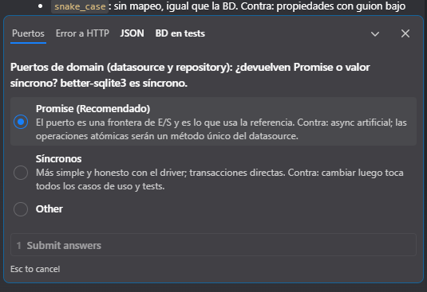
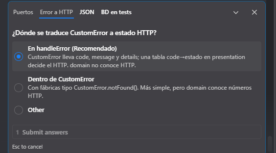
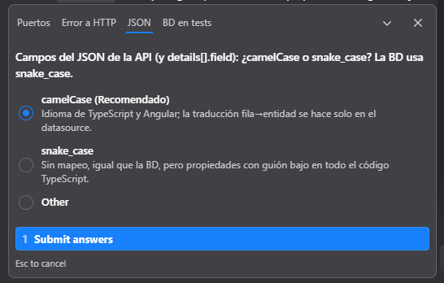
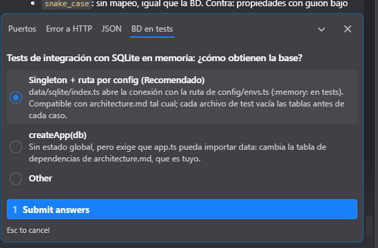
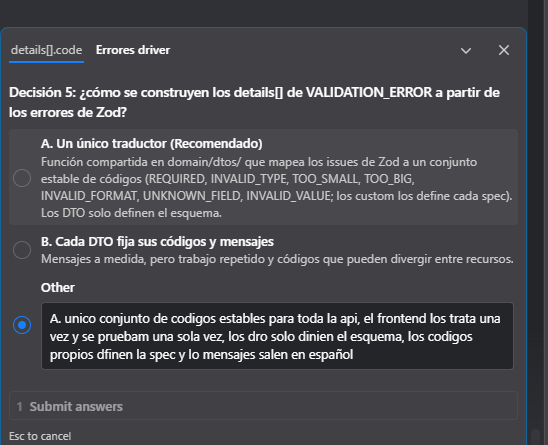
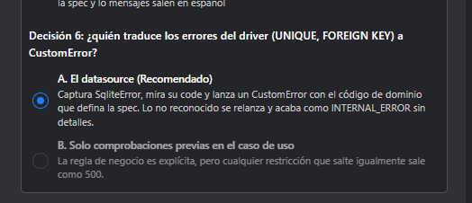

# Skill backend-conventions — Fase 4 (2026-11-19, sesión 05)

Una de las tres partes de una misma conversación (04 `skill-sdd`, 05, 06 `skill-frontend-conventions`), separadas a petición del autor. El prompt completo de la fase está literal en el registro 04.

## Objetivo y fase
Fase 4, paso 2 de 4: crear `.claude/skills/backend-conventions/` a partir de `architecture.md` y `database.md`, con el patrón que fijó el autor y una lista de revisión para el revisor.
Fuentes: las del registro 04, más la documentación de Zod 4 (v4.6.7) y de `better-sqlite3` (v13.2.0) consultada con Context7: códigos de issue de Zod y `reportInput`; `SqliteError` con su propiedad `code`.

## Prompts clave
Paso 2 del prompt (literal):

> 2. Skill backend-conventions, a partir de architecture.md y database.md. El patrón que
>    quiero fijar:
>    - DTO con create(): [error, dto] validado con Zod; casos de uso en domain; el controlador
>      crea el caso de uso en cada petición y gestiona los errores con handleError y
>      CustomError; la composición (datasource, repositorio, controlador) en cada
>      presentation/<recurso>/routes.ts, como única excepción a las reglas de capas.
>    - SQL parametrizado, nunca concatenado. Importes en céntimos enteros.
>    - Tests: unitarios en domain, de integración por endpoint con SQLite en memoria.
>    - Lista de revisión (checklist) que usará el revisor.
>    Dime qué falta por decidir en lugar de suponerlo.

Resto de mensajes del autor, en orden (literales):

> Apruebo el paso 1, sigue con el paso 2

> Apruebo el paso 2, escríbelo

Respuestas a preguntas con opciones (el texto de las opciones lo redactó la IA):
- Puertos de `domain`: "Promise (Recomendado)".
- Dónde se traduce `CustomError` a estado HTTP: "En handleError (Recomendado)".
- JSON de la API: "camelCase (Recomendado)".
- Base de datos en los tests de integración: "Singleton + ruta por config (Recomendado)".
- Decisión 5, `details[].code` (el autor eligió "Other" y escribió, literal): "A. unico conjunto de codigos estables para toda la api, el frontend los trata una vez y se pruebam una sola vez, los dro solo dinien el esquema, los codigos propios dfinen la spec y lo mensajes salen en español".
- Decisión 6, errores del driver: "A. El datasource (Recomendado)".

## Qué propuso la IA
- **Contraste con las fuentes.** El patrón del autor no choca con `architecture.md`, `database.md` ni la constitución. Señaló ocho huecos que ninguna fuente cierra: puertos síncronos o con `Promise`; dónde se traduce `CustomError` a HTTP; `camelCase` o `snake_case`; cómo obtiene la base un test de integración; códigos de `details[].code`; quién traduce los errores del driver; cliente HTTP de los tests (`supertest` o `fetch`); quién invoca el ejecutor de migraciones.
- **Dos rondas de decisiones.** Primera: los cuatro huecos que condicionan la forma del patrón (puertos, error a HTTP, JSON, base en tests). Segunda, tras consultar la documentación de Zod y de `better-sqlite3`: códigos de `details` (un traductor único, con siete códigos estables) y errores del driver. Los puntos 7 y 8 se dejaron a la fase 6 y a la spec 000.
- **Borrador de la skill** con una tabla de 12 filas (pieza, dónde, regla, qué protege) y cuatro puntos para confirmar: `error` de `[error, dto]` es un `CustomError` `VALIDATION_ERROR`; la tabla `code → estado` se exporta desde `presentation/middlewares/error-handler.ts` para no cambiar `architecture.md`; el test de endpoint se llama `presentation/<recurso>/routes.spec.ts` (convención propia, no de ninguna fuente); y los pendientes declarados.
- **Archivos escritos tras la aprobación:** `.claude/skills/backend-conventions/SKILL.md` (42 líneas), `patterns.md` (161) y `checklist.md` (43). La `description` tiene 311 caracteres, entre comillas dobles.
- **Cambio sobre lo aprobado, avisado al terminar.** Al escribir `patterns.md` comprobó que los issues de Zod no traen `input`, y el traductor lo necesita para distinguir `REQUIRED` de `INVALID_TYPE`. Añadió `safeParse(body, { reportInput: true })` y una regla de privacidad: ese `input` solo clasifica y nunca sale a la respuesta ni a un log. Está en `SKILL.md`, `patterns.md` y `checklist.md`.
- **Errores y avisos de la IA, señalados por ella:**
  - `reportInput` está documentado con `parse`; no lo comprobó con `safeParse`.
  - No comprobó dónde queda el nombre del campo en `unrecognized_keys` ni cómo pasa un `refine` su código propio a `details[].code`.
  - `patterns.md` es ilustrativo y no está compilado.
  - La búsqueda de términos del producto dio falsos positivos ("private", "desactivado" contienen "iva"); la única coincidencia real es un puntero a la spec 003.

## Qué corregí y por qué
- **Decisión 5.** Descarté el texto de las opciones y escribí el mío: un único conjunto de códigos estables para toda la API, que el frontend trata y se prueba una sola vez; los DTO solo definen el esquema; los códigos propios los define cada spec; los mensajes salen en español. Motivo: (no registrado más allá del texto).
- **Resto de decisiones:** elegí la opción recomendada en las demás. Motivos: (no registrado).
- **Aprobación del paso 2:** la di con "escríbelo", antes de conocer el cambio de `reportInput`, que la IA incorporó y me comunicó al terminar.

## Decisiones tomadas
- **Puertos** de `domain` con `Promise`; una operación atómica es un único método del datasource.
- **Errores:** `CustomError` lleva `code`, `message` y `details`, sin HTTP; la tabla `code → estado` está en `presentation`, exportada desde `middlewares/error-handler.ts`; lo que no es `CustomError` sale como `INTERNAL_ERROR`, sin trazas.
- **JSON** en `camelCase`; el datasource convierte la fila `snake_case` en entidad (único sitio).
- **Tests de integración:** conexión singleton en `data/sqlite/index.ts` con ruta por `config/envs.ts` (`:memory:` en tests), tablas vaciadas antes de cada caso. Compatible con `architecture.md` tal cual.
- **`details[].code`:** `REQUIRED`, `INVALID_TYPE`, `TOO_SMALL`, `TOO_BIG`, `INVALID_FORMAT`, `UNKNOWN_FIELD` e `INVALID_VALUE`; los `custom` los define cada spec; un traductor único en `domain/dtos/`.
- **Errores del driver:** el datasource traduce `SqliteError` por su `code` a `CustomError`; lo no reconocido se relanza.
- **Pendientes declarados en la skill:** cliente HTTP de tests (fase 6), quién invoca el ejecutor de migraciones (spec 000), dónde se calcula el IVA y el redondeo (spec 003), textos de los mensajes de error (los elige el autor en la primera spec) y tres detalles de Zod sin comprobar.
- **Archivos escritos (sin commit):** los tres de `.claude/skills/backend-conventions/`.

## Capturas
Las seis son preguntas con opciones, tal como las vio el autor:
- 
  Pestañas "Puertos", "Error a HTTP", "JSON" y "BD en tests"; opción "Promise (Recomendado)" seleccionada frente a "Síncronos". El archivo se creó con el nombre `fase-4-puertos-promise.pn.png` y se renombró antes del commit.
- 
  "En handleError (Recomendado)" seleccionada frente a "Dentro de CustomError".
- 
  "camelCase (Recomendado)" seleccionada frente a "snake_case".
- 
  "Singleton + ruta por config (Recomendado)" seleccionada frente a `createApp(db)`.
- 
  Pestañas "details[].code" y "Errores driver". Las opciones A y B no están seleccionadas: el autor eligió "Other" y escribió su texto.
- 
  "A. El datasource (Recomendado)" seleccionada frente a "Solo comprobaciones previas en el caso de uso".

## Pendiente para la siguiente sesión
- Fase 6: cliente HTTP de los tests (`supertest` o `fetch`); tipado de `patterns.md` con la versión instalada; comprobar `reportInput` con `safeParse`, el nombre del campo en `unrecognized_keys` y cómo pasa un `refine` su código propio a `details[].code`.
- Spec 000: quién invoca el ejecutor de migraciones (`app.ts` solo importa `config` y `presentation`).
- Spec 003: dónde se calcula el IVA y el redondeo.
- Primera spec de la API: textos de los mensajes de error, con opciones para el autor.
- Commit, solo con la orden del autor. Orden de cierre: `MEMORY.md` → registros → commit.
