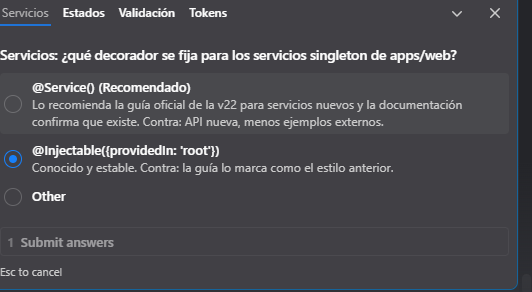
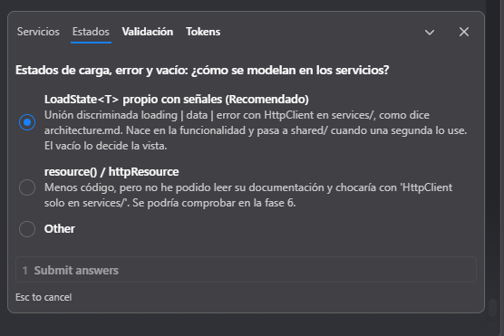
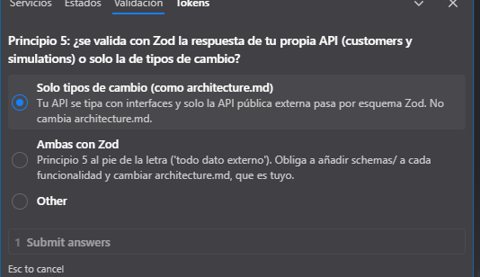
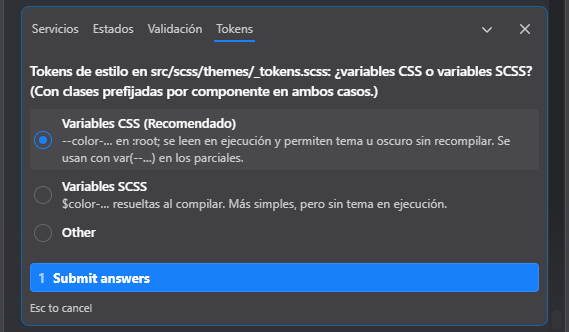

# Skill frontend-conventions y cierre de la fase 4 — Fase 4 (2026-11-19, sesión 06)

Tercera parte de la misma conversación (04 `skill-sdd`, 05 `skill-backend-conventions`). Recoge el paso 3, la resolución de sus pendientes, cuatro correcciones del autor y el paso 4 (cierre), que afecta a las tres skills. El prompt completo está literal en el registro 04.

## Objetivo y fase
Fase 4, pasos 3 y 4: crear `.claude/skills/frontend-conventions/` a partir de `architecture.md`; resolver los pendientes que la skill declaraba; y cerrar la fase con el diff de `CLAUDE.md`, el de `MEMORY.md` y los ADR que correspondan.
Fuentes: las del registro 04, más la documentación de Angular 22 consultada con el MCP de Angular CLI: la guía de buenas prácticas (la genérica reciente, porque aún no hay `angular.json`), zoneless, `@Service`, la guía de estilo, `httpResource`, Signal Forms y selectores.

## Prompts clave
Paso 3 del prompt (literal):

> 3. Skill frontend-conventions, a partir de architecture.md:
>    - Estructura por funcionalidad (pages, components, interfaces, services), una carpeta
>      por componente, sin sufijos en los nombres, y estilos solo en src/scss con tokens.
>    - Las páginas inyectan servicios; los componentes son presentacionales.
>    - HttpClient solo en services/. Los estados de carga, error y vacío se muestran siempre
>      (principio 7). Una respuesta externa se valida antes de usarse (principio 5).
>    - A shared/ solo pasa lo que usa una segunda funcionalidad.
>    - Angular moderno: consulta la documentación actual de la versión del ADR-009 antes de
>      fijar reglas sobre signals, zoneless o control flow. No las des de memoria.
>    - Lista de revisión (checklist).

Paso 4 (literal):

> 4. Cierre: el diff de CLAUDE.md (cuándo usar cada skill, sin pasar de 60 líneas), el de
>    MEMORY.md y un ADR solo si alguna decisión cumple el criterio de decisions.md.

Resto de mensajes del autor, en orden (literales):

> Apruebo el paso 2, sigue con el paso 3

> Pendientes declarados en la skill, sin decidir
> resolvamoslos

Bloque de cuatro correcciones (literal; el autor pidió ver el diff):

> Tres correcciones a frontend-conventions, enséñame el diff:
> 1. Estados: en el buscador, cada búsqueda cancela la anterior (el servicio guarda la
>    suscripción previa y la da de baja antes de lanzar la nueva). Añádelo a la regla de
>    Estados, a la checklist y al ejemplo del servicio de patterns.md.
> 2. Cambia "fase 6" por "primera spec con formulario (006-simulator-ui)" en lo pendiente de
>    toSignal con Reactive Forms.
> 3. Datos externos: aclara que la respuesta de mi propia API se considera de confianza, con
>    el contrato cubierto por los tests de integración de la API (principio 3) y la sección
>    Contrato de cada spec. Es una interpretación mía del principio 5; la checklist no debe
>    marcarla como hallazgo.
> 4. En architecture.md, en la fila de app, rellena "No puede importar" con components/ y
>    services/ de las funcionalidades.

> por que vas a quitar apps/api?

> Apruebo los cuatro diffs, aplícalos

> Apruebo el paso 3, sigue con el paso 4

> - revisa memory, y elimina las que creas que ya no hacen falta
> - ge guardaddo las capturas ya
> aprueba los difs despues

> Apruebo los 4 puntos, aplícalos

> quiero que se hagas 3 ficheros de sesiones, aunque rompa el comando uno para cada skill

Respuestas a preguntas con opciones (el texto de las opciones lo redactó la IA):
- Servicios: "@Injectable({providedIn: 'root'})" (la IA recomendaba `@Service()`).
- Estados (primera vez): "LoadState<T> propio con señales (Recomendado)".
- Principio 5: "Solo tipos de cambio (como architecture.md)".
- Tokens de estilo: "Variables CSS (Recomendado)".
- Estados de las lecturas (segunda vez, tras la corrección de la IA): "Mantener loadstate para todo, no quiero usar dos mecanismos".
- Formularios: "Reactive Forms" (la IA recomendaba Signal Forms).
- Accesibilidad: "WCAG 2.2 AA, con checklist + Lighthouse (Recomendado)".
- Conversión de divisa: "Solo la estructura ahora (Recomendado)".
- Prefijo de selectores: "app (por defecto) (Recomendado)".
- Fila de `app` en `architecture.md`: "Añadir fila (Recomendado)".
- Reactive Forms en zoneless: "Señales con toSignal (Recomendado)".

## Qué propuso la IA
- **Documentación de Angular 22.** Zoneless es el valor por defecto desde la v21; `OnPush` lo es en la v22; la guía recomienda `@Service()`, Signal Forms, `inject()`, control flow nativo, `class` y `style` en lugar de `ngClass` y `ngStyle`, y `host` en lugar de `@HostBinding`. No encontró entonces `resource()` ni `httpResource`.
- **Tensiones con las fuentes, sin resolverlas:** la guía oficial desaconseja carpetas por tipo y propone estilos junto al componente y plantillas inline (se siguió `architecture.md`); el principio 5 ("todo dato externo") frente a `architecture.md`, que solo valida con esquema la API de tipos de cambio; el principio 7 solo nombra carga y error, y el prompt añade "vacío".
- **Cuatro decisiones** (servicios, estados, validación de la API propia, tokens) y la skill: `SKILL.md` (47 líneas), `checklist.md` (45) y `patterns.md` (112); `description` de 356 caracteres entre comillas dobles.
- **Pendientes.** Al pedir el autor resolverlos, la IA encontró la documentación de `httpResource` (envoltorio de `HttpClient`, con `parse` y Zod, no recomendado para `POST`) y de Signal Forms (`validateStandardSchema`), y **corrigió su afirmación anterior**: `httpResource` sí podía vivir en `services/`. Volvió a plantear la decisión de estados. Planteó formularios, accesibilidad, conversión de divisa, prefijo de selectores, fila `app` y `toSignal`. Dos de esos cambios tocaban documentos del autor, así que mostró sus diffs antes: la fila `app` en `architecture.md` y el principio 7 de la constitución (WCAG 2.2 AA).
- **Cuatro correcciones del autor.** Mostró el diff, avisó de que ninguna prueba garantiza que las interfaces del frontend coincidan con el contrato de la API, y de que no había verificado que `HttpClient` cancele la petición al darse de baja. Aplicó los cuatro tras la aprobación.
- **Paso 4.** Diff de `CLAUDE.md` (sección "Skills", 59 líneas); tabla con cinco decisiones y recomendación de dos ADR (ADR-012, reparto de specs y spec de esqueleto; ADR-013, la API propia es de confianza); diff de `MEMORY.md`. Tras la petición del autor de depurar `MEMORY.md`, propuso quitar 11 líneas que ya viven en `CLAUDE.md`, en un ADR o en un comando, y añadir una de índice.
- **Errores y avisos de la IA, señalados por ella o por el autor:**
  - Dijo que `httpResource` "chocaría con HttpClient solo en services/"; no era exacto. El autor había elegido `LoadState<T>` con esa información incompleta.
  - Su aviso sobre `apps/api` en la fila `app` ("Dime si quieres quitar `apps/api`") hizo creer al autor que lo iba a quitar. Lo aclaró: el diff lo conservaba.
  - No emitió líneas `CAPTURA:` desde que existía la regla; la segunda ronda del frontend y las correcciones quedaron sin captura.
  - `patterns.md` es ilustrativo y no está compilado; no verificó que `HttpClient` cancele al darse de baja ni `toSignal` con `valueChanges`.
  - Avisó de que `MEMORY.md` pasaba el límite de 50 líneas del prompt de la fase 2 (ya estaba en 51); el límite no consta en `CLAUDE.md`.

## Qué corregí y por qué
- **Servicios.** Elegí `@Injectable` en lugar del `@Service()` recomendado. Motivo: (no registrado).
- **Estados.** Mantuve `LoadState<T>` para todo y rechacé `httpResource`: "no quiero usar dos mecanismos".
- **Formularios.** Elegí Reactive Forms en lugar de Signal Forms. Motivo: (no registrado).
- **Cuatro correcciones a la skill.** Pedí que cada búsqueda cancele la anterior; que el pendiente de `toSignal` pase a la spec 006; que la respuesta de mi propia API se considere de confianza (interpretación mía del principio 5, que la checklist no debe marcar); y rellenar "No puede importar" de la fila `app` con `components/` y `services/`.
- **`apps/api`.** Pregunté por qué iba a quitarlo; la IA aclaró que no, y aprobé los cuatro diffs.
- **Cierre.** Pedí depurar `MEMORY.md` quitando lo que ya no hace falta, y aprobé después `CLAUDE.md`, los dos ADR, el diff de `MEMORY.md` y renombrar una captura mal nombrada. Pedí tres registros, uno por skill, aunque rompa el comando.

## Decisiones tomadas
- **Estructura y nombres:** `<funcionalidad>/{pages,components,interfaces,services}`, una carpeta por componente, sin sufijos y en kebab-case.
- **Estilos:** solo `src/scss`; tokens como variables CSS (`--color-…`); clases con prefijo de componente.
- **Servicios y HTTP:** `HttpClient` solo en `services/`; `@Injectable({providedIn: 'root'})`; selectores con prefijo `app`.
- **Estados:** `LoadState<T>` propio con señales, en lecturas y escrituras; sin `httpResource`; el vacío lo decide la vista; en el buscador, cada búsqueda cancela la anterior (el servicio guarda la `Subscription` previa y la da de baja).
- **Formularios:** Reactive Forms tipados; en zoneless se convierten `value` y `status` en señales con `toSignal`; sin `markForCheck()`.
- **Datos externos:** solo la API de tipos de cambio pasa por esquema Zod; la API propia es de confianza (ADR-013).
- **Accesibilidad:** WCAG 2.2 AA, con la checklist y una auditoría Lighthouse, sin dependencias nuevas. El principio 7 de la constitución se amplía.
- **Importes:** enteros en céntimos; una única función pura de conversión con un solo redondeo, al mostrar. Decimales, modo de redondeo y formato, a las specs 005 y 006.
- **`architecture.md`:** fila `web: app` que puede importar las páginas de las funcionalidades y `shared`, y no `components/` ni `services/` de las funcionalidades ni `apps/api`.
- **Cierre:** `CLAUDE.md` con sección "Skills" (59 líneas); ADR-012 (reparto de specs) y ADR-013 (API propia de confianza); `MEMORY.md` depurado a 45 líneas, con 11 supresiones y una línea de índice.
- **Archivos escritos o cambiados (sin commit):** `.claude/skills/frontend-conventions/` (`SKILL.md` 48 líneas, `checklist.md` 55 y `patterns.md` 138, tras las correcciones), `ai-workspace/docs/architecture.md` (106), `ai-workspace/docs/constitution.md` (principio 7), `ai-workspace/docs/decisions.md` (150), `CLAUDE.md` (59), `MEMORY.md` (45) y el renombrado de `fase-4-puertos-promise.pn.png` a `fase-4-puertos-promise.png`.

## Capturas
Las cuatro son preguntas con opciones del paso 3, tal como las vio el autor:
- 
  Pestañas "Servicios", "Estados", "Validación" y "Tokens". "@Injectable({providedIn: 'root'})" seleccionada, no la recomendada `@Service()`.
- 
  "LoadState<T> propio con señales (Recomendado)" seleccionada frente a `resource()` / `httpResource`; en el texto de la IA, su afirmación inexacta de que chocaría con "HttpClient solo en services/".
- 
  "Solo tipos de cambio (como architecture.md)" seleccionada frente a "Ambas con Zod".
- 
  "Variables CSS (Recomendado)" seleccionada frente a "Variables SCSS", con clases prefijadas por componente en ambos casos.

Sin captura: la segunda ronda de decisiones del frontend (formularios, accesibilidad, conversión de divisa, prefijo, fila `app` y `toSignal`), las cuatro correcciones, la pregunta sobre `apps/api` y la corrección de la IA sobre `httpResource`.

## Pendiente para la siguiente sesión
- Specs 005 y 006: decimales, modo de redondeo y formato del importe al convertir divisa; en la 006, `toSignal` con Reactive Forms tipados y comprobar que `HttpClient` cancela la petición al darse de baja.
- Fase 6: comprobar la guía de Angular con el workspace real; aprobar Zod en el frontend (principio 4); el tipado de `patterns.md`.
- Fase 5: crear los agentes y el revisor; revisar `/sdd-session`; probar en una sesión nueva que `sdd` se carga sola.
- Riesgo asumido en ADR-013: nada comprueba que las interfaces del frontend coincidan con el contrato de la API.
- Si se quiere "vacío" en la constitución: el principio 7 solo nombra carga y error.
- Commit, sin `Co-Authored-By` y solo con la orden del autor. Orden de cierre: `MEMORY.md` → registros → commit. Entrarían `CLAUDE.md`, `MEMORY.md`, `decisions.md`, `constitution.md`, `architecture.md`, `.claude/skills/`, `ai-workspace/specs/README.md`, estos tres registros y las 18 capturas `fase-4-*`.
