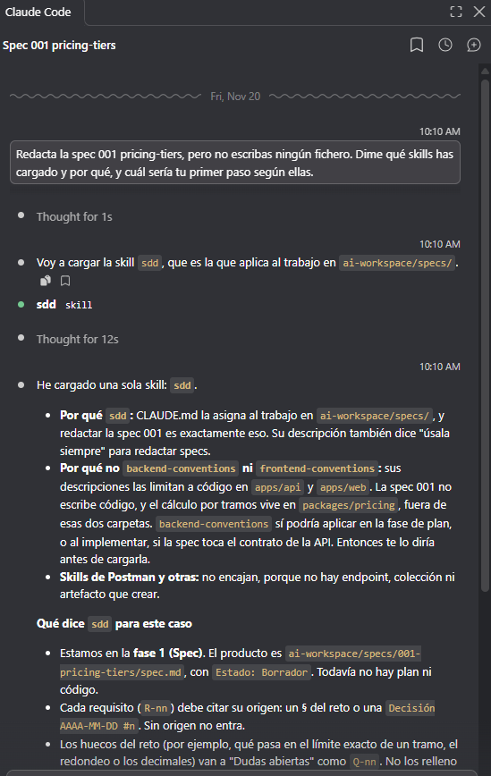
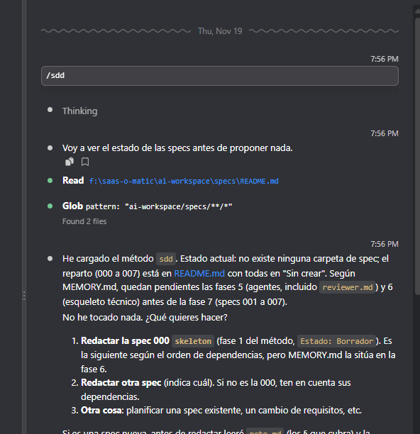

# Prueba de carga de skills — Fase 4 (2026-11-20, sesión 01)

## Objetivo y fase
Fase 4 (del proyecto). Cerrar la comprobación pendiente de esa fase: que la skill `sdd` se carga sola en una sesión nueva, sin invocarla a mano, y que `backend-conventions` y `frontend-conventions` no se cargan cuando no hay código en `apps/`. La prueba se hizo pidiendo redactar la spec 001 `pricing-tiers` sin escribir ficheros. Después se actualizó MEMORY.md y se preparó el registro.

## Prompts clave
> Redacta la spec 001 pricing-tiers, pero no escribas ningún fichero. Dime qué skills has
> cargado y por qué, y cuál sería tu primer paso según ellas.

> Esta conversacion es la comprobacion pendiente de la fase 4, que la skill sdd carga sola, 
> antes de eregistrarlo tienes que:
>
> 1 - Memory: Quita"Probar en una sesion nueva que sdd carga" y se anota que esta comrpacion esta hecha
> 2 -  Para el registro: antes se hizo otra prueba  en otra sesion invocando solol /sdd a ¡mano "fase 5 (implementación)" del método con la fase 5 del proyecto
>    (captura fase-4-colision-fases.png). En esta, cargó sola sdd y no cargó backend ni   frontend (captura fase-4-skills-cargan.png).

> Apruebo el diff, lanzo /sdd-session

> si, quiero que este en memory

> Apruebo la línea

## Qué propuso la IA
- Cargó solo `sdd` y explicó por qué: CLAUDE.md la asigna a `ai-workspace/specs/`. No cargó `backend-conventions` ni `frontend-conventions` porque sus descripciones las limitan a código en `apps/api` y `apps/web`, y la spec 001 no escribe código.
- Indicó que su primer paso sería de solo lectura: leer `reto.md`, `ai-workspace/specs/README.md`, la constitución, el ADR-010 y `architecture.md`. La plantilla `templates/spec.md` solo al crear el fichero. Los huecos del reto irían a "Dudas abiertas".
- Comprobó con Glob que existían `fase-4-colision-fases.png` y `fase-4-skills-cargan.png`.
- Editó MEMORY.md: quitó la frase "Probar en una sesión nueva que `sdd` se carga sola" de "Próximos pasos" y añadió en "Estado actual" que la comprobación está hecha. Mostró el diff.
- Interpretó el punto 2 de tu petición como material para el registro y no lo metió en MEMORY.md; te preguntó si querías anotarlo también.
- Redactó la línea del aprendizaje sobre la colisión de fases (método 1 a 6 frente a proyecto 0 a 7), con la regla de decir siempre "del método" o "del proyecto" y sin renombrar nada hasta que decidas la nomenclatura.
- Con `git status` vio solo MEMORY.md modificado y las dos capturas sin añadir, y ningún registro de sesión nuevo.
- Lanzado `/sdd-session` sin argumentos, no siguió y te pidió fase y tema.

## Qué corregí y por qué
- La IA no anotó la colisión de fases en MEMORY.md porque entendió el punto 2 como solo para el registro. Pediste que también estuviera en MEMORY.md ("si, quiero que este en memory"). Una vez aprobado el primer diff, la línea nueva requirió tu aprobación aparte.
- La IA advirtió de que el diff aprobado ya no coincidía con MEMORY.md tras añadir la línea, y de que `/sdd-session` debía lanzarse con la versión final.

## Decisiones tomadas
- La comprobación queda hecha: `sdd` se carga sola; `backend-conventions` y `frontend-conventions` no se cargan al no haber código en `apps/`.
- Se quita de MEMORY.md el pendiente de probar la carga de `sdd` y se anota que está hecho.
- Se aprueba el diff de MEMORY.md y, después, la línea sobre la colisión de fases.
- La nomenclatura de fases (método y proyecto) no se cambia hasta que el autor la decida.
- Fase `4` y tema `prueba-carga-skills` para este registro (indicados por el autor).
- Commit: (no registrado; pendiente de tu aprobación).

## Capturas
- 
- 

Quién hizo cada captura y cuándo: (no registrado).

## Pendiente para la siguiente sesión
- Aprobar el commit (MEMORY.md, las dos capturas y este registro), con mensaje en español y sin `Co-Authored-By`.
- Decidir la nomenclatura de fases del método y del proyecto para evitar la colisión.
- La spec 001 `pricing-tiers` no se ha redactado en ningún fichero: solo se describió el primer paso y la lectura previa.
- Fase 5: crear los agentes, incluido `.claude/agents/reviewer.md`, y revisar `/sdd-session`.
