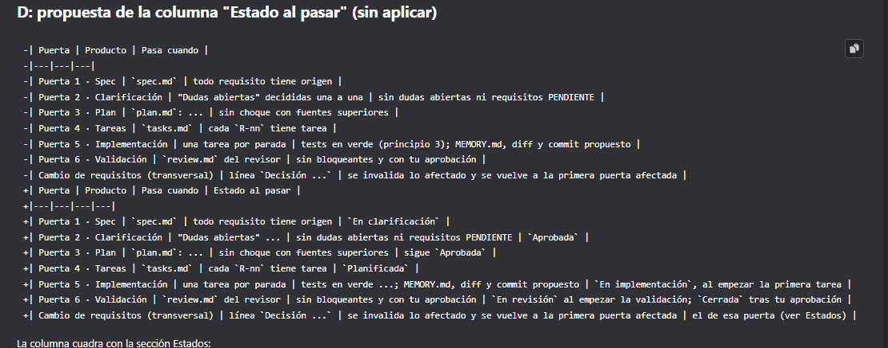
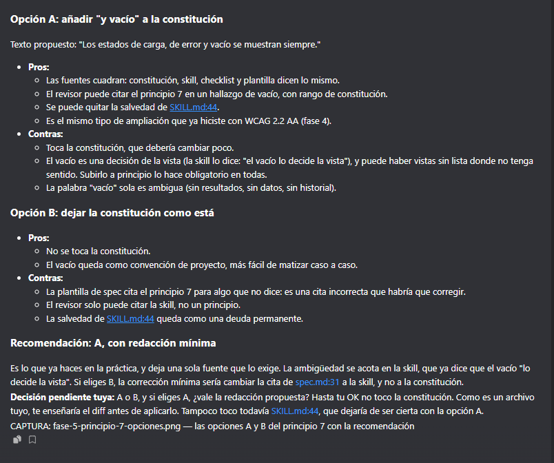

# Correcciones de sdd — Fase 5 (2026-11-20, sesión 02)

Sesión 1 de 3 de la fase 5 (del proyecto). Las sesiones 2 (agentes) y 3 (comandos) están pendientes.

## Objetivo y fase
Fase 5. Corregir la skill `sdd` antes de crear los agentes y los comandos, porque dependen de sus nombres. Tres pasos con parada y aprobación tras cada uno: siete correcciones de la skill; el principio 7 de la constitución (estado "vacío"); y comprobación con grep más diff de MEMORY.md.
Fuentes leídas antes de proponer: `CLAUDE.md`, `.claude/skills/sdd/` (SKILL.md y las tres plantillas), ADR-002, ADR-003 y ADR-012 de `decisions.md`, y los registros `2026-11-19-04`, `05`, `06` y `2026-11-20-01`. Además, por iniciativa de la IA: `sdd-session.md`, `database.md`, `specs/README.md` y las skills `frontend-conventions`. El entorno puso la conversación en modo plan en dos momentos; el autor aprobó el plan antes de aplicar nada.

## Prompts clave
Prompt inicial (literal):

> Fase de planificación: no escribas código.
>
> Vamos a corregir la skill sdd antes de crear los agentes y los comandos, porque dependen de
> sus nombres. Antes de proponer nada, lee CLAUDE.md, .claude/skills/sdd/ (SKILL.md y las tres
> plantillas), decisions.md (ADR-002, ADR-003 y ADR-012), el registro de la prueba de carga de
> las skills y los de la fase 4 (2026-11-19-04 a 06).
>
> Hazlo en tres pasos y PÁRATE después de cada uno para que lo apruebe.
>
> 1. Siete correcciones, en un solo diff. No cambies nada más de la skill; si ves otra
>    incoherencia, dímela aparte.
>    1. Tabla de fases: quita "o cada aplazamiento es expreso". Una spec no pasa a Aprobada
>       con requisitos PENDIENTE: la clarificación termina cuando no queda ninguno.
>    2. Cierre, punto 4: el comando es /sdd-session N NNN-nombre, con N = 6 para la spec 000
>       y 7 para las demás.
>    3. review.md: veredictos Conforme | Conforme con reservas | Cambios requeridos, para que
>       no choquen con el estado "Aprobada" de la spec. Ajusta SKILL.md y la plantilla.
>    4. spec.md: las secciones que no apliquen se marcan "No aplica", no se borran.
>    5. Llama "Puerta 1 a 6" a los pasos del flujo, no "Fase": la prueba de carga mezcló
>       "fase 5 (implementación)" del método con la fase 5 del proyecto. Cámbialo en SKILL.md
>       y en las plantillas.
>    6. tasks.md: no cuentan los ficheros generados (lockfile, migraciones); cada recurso se
>       divide por capa; si una tarea necesita más de 5 y no se puede dividir, lo justifica
>       por escrito y el revisor lo comprueba.
>    7. El revisor comprueba en la validación que el estado de la spec coincide con la
>       realidad.
>
> 2. Principio 7 de la constitución. La skill frontend-conventions exige mostrar carga, error
>    y vacío, pero el principio 7 solo nombra carga y error. Dame las opciones con pros y
>    contras (añadir "y vacío" en la constitución, o dejarlo como está) y tu recomendación.
>    No cambies la constitución sin mi OK.
>
> 3. Comprobación y cierre:
>    - Con grep, demuestra que ya no queda "aplazamiento" ni "Fase 1 … 6" en la skill, que
>      aparecen "Puerta", "No aplica" y los tres veredictos, y que la cabecera de SKILL.md
>      sigue siendo válida (name y description, sin romper el formato).
>    - Propón el diff de MEMORY.md: Fase 5 en curso (sesión 1 de 3: correcciones de sdd
>      hechas) y los próximos pasos de la sesión 2 (agentes). Máximo 50 líneas.
>
> Reglas:
> - No busques otros proyectos como referencia.
> - Si algo choca con un ADR o con la constitución, para y dímelo antes de proponer.
> - No crees agentes ni comandos todavía: son las sesiones 2 y 3.
>
> NO escribas ningún archivo hasta que apruebe su paso.

Resto de mensajes del autor, en orden (literales):

> volvamos a implementarlo

> A. El cierre exige Conforme. Con "Conforme con reservas" solo se cierra con mi aprobación
>    escrita que nombre cada reserva, y cada una pasa a MEMORY.md como pendiente.
> B. Ficheros generados: solo el lockfile. Las migraciones no: son SQL escrito a mano y cuentan
>    como ficheros de producción. Quítalas de la regla.
> C. Defínelo: en la API, una tarea por capa (domain, infrastructure, presentation); en la web,
>    una tarea por servicio con su interfaz y una por página o componente (cuentan .ts y .html;
>    el .spec.ts no).
> D. Corrige solo la que afecta a los agentes: añade a la tabla de puertas una columna
> "Estado al pasar", para que cada puerta diga qué estado deja la spec. Propónmela como
> diff: Puerta 1 → En clarificación; Puerta 2 → Aprobada; Puerta 3 → sigue Aprobada;
> Puerta 4 → Planificada; Puerta 5, al empezar la primera tarea → En implementación;
> Puerta 6, al empezar la validación → En revisión; tras mi aprobación → Cerrada.
> Revisa que cuadre con la sección Estados. Las demás incoherencias, déjalas.
> Apruebo el paso 1 con esto; enséñame el diff de la tabla antes de pasar al paso 2.
> Apruebo el paso 1 con estos ajustes. Enséñame el diff de los cambios nuevos antes de
> pasar al paso 2.

> Aplica la tabla con estos 3 ajustes:
>
> 1- cerrada: el estado pasa a cerrado tras mi aprobacion y antes de proponer el comit, para que el commit incluya el estado final, readona el cierre aprobación → Estado: Cerrada → MEMORY.md → /sdd-session → commit.
>
> 2 - cambios requeridos: la spec vuelve a en implementacion; una ronda nueva la pasa en en revision, si el hallazgo apunta a un error de la spec es un cabio de requisitos y se aplica la regla transvesal
>
> 3- borrador: una linea aobre la tbla  una spec nade en borrador

> Apruebo el paso 1, pasa al paso 2

> a, pero con esta reddaccion para el principio 7,
> -  Toda vista con datos remotos muestra siempre sus estados de carga y de error, si los datos pueden llegar vacios, el de vacio
> "Manten el principio 7" en una o dos lineas.
> quita la salvedad sobre el vacio de frontend-conventions y deja a la skil que defina que es vacio

> Apruebo el paso 2, pasa al paso 3

> apruebo el dif y ademas usa solo las imagenes que existen ya

> Une las dos líneas, apruebo

> /sdd-session 5 correcciones-sdd

## Qué propuso la IA
- **Plan y paso 1.** Leyó las fuentes y propuso un plan con las siete correcciones y cuatro avisos (A a D). Aplicó 12 de las 14 ediciones. El clasificador del modo automático denegó dos, sin explicar el motivo, en `SKILL.md`: la `description` ("fases" a "puertas") y la regla 5. Las aplicó después, a petición del autor.
- **Avisos del plan.**
  - A: el cierre solo admite `Conforme`; ¿también con reservas?
  - B: las migraciones son SQL escrito a mano, no generado.
  - C: "por capa" no tiene equivalente en la web.
  - D: otras incoherencias sin tocar. Cuatro: `Estado: Cerrada` es el punto 5 del cierre y quedaría fuera del commit; `spec.md` cita el principio 7 para el vacío, que no nombra; `sdd-session` pide el tema "sin tildes" y los slugs de spec van en inglés; y ADR-002 y CLAUDE.md dicen "fase" donde la skill dice "puerta".
- **Tabla "Estado al pasar".** La propuso como diff sin aplicar y señaló tres huecos: `Cerrada` frente al punto 5 del cierre, el destino de `Cambios requeridos` y `Borrador`.
- **Paso 2, principio 7.** Opciones con pros y contras: A (añadir "y vacío"), recomendada, y B (dejarlo). Señaló que la skill reconocía en su línea 44 que el principio 7 no nombra el vacío. Tras el OK aplicó la redacción del autor, en dos líneas, y quitó la salvedad de `frontend-conventions/SKILL.md`. Avisó de una diferencia: el principio pide el vacío "si los datos pueden llegar vacíos" y la skill, la checklist y la plantilla de spec lo piden siempre.
- **Paso 3.**
  - Grep de comprobación: 0 coincidencias de "aplazamiento" y "Fase 1…6"; `Puerta` 8, `No aplica` 2, `Conforme` 4, `Conforme con reservas` 2 y `Cambios requeridos` 3.
  - Cabecera de `SKILL.md`: comprobó la forma (`name` y `description` entre comillas dobles, sin comillas interiores), no que el visor la analice sin error.
  - Diff de MEMORY.md: lo propuso para quedar en 50 líneas.
- **Errores y avisos de la IA, señalados por ella o por el autor:**
  - Su cuenta del diff de MEMORY.md estaba mal: dijo 50 líneas y quedó en 51. Lo detectó con `wc -l` y propuso unir dos líneas.
  - Al aplicar el ajuste A duplicó una línea del cierre que el autor ya había añadido; la quitó.
  - `templates/tasks.md` ya recogía B y C porque el autor lo había editado a mano; la edición de la IA no encontró el texto y no se aplicó.
  - Anunció tres líneas `CAPTURA:` que no existen (ver "Capturas").
  - El aviso de que `SKILL.md` había cambiado en disco se vio y se dio por bueno sin comparar con `git diff` (error ya recogido como aprendizaje en MEMORY.md).
  - No comprobó que el visor de skills analice la cabecera de `SKILL.md` sin error.

## Qué corregí y por qué
- **Aviso A.** Decidí que con "Conforme con reservas" solo se cierra con mi aprobación escrita que nombre cada reserva, y que cada una pase a MEMORY.md como pendiente. Motivo: (no registrado).
- **Aviso B.** Corregí la propuesta de la IA: las migraciones no quedan excluidas, cuentan como producción. Solo el lockfile es fichero generado. Motivo: son SQL escrito a mano.
- **Aviso C.** Pedí definir "por capa": en la API, una tarea por capa; en la web, una tarea por servicio con su interfaz y una por página o componente, contando `.ts` y `.html` pero no `.spec.ts`.
- **Aviso D.** Limité la corrección a la incoherencia que afecta a los agentes: la columna "Estado al pasar", con los estados que indiqué.
- **Tres ajustes a la tabla.** `Estado: Cerrada` tras mi aprobación y antes del commit; `Cambios requeridos` devuelve la spec a `En implementación`, y si el hallazgo es de la spec es un cambio de requisitos; una línea sobre la tabla que diga que una spec nace en `Borrador`.
- **Principio 7.** Elegí la opción A, pero con mi redacción, que condiciona el vacío a que los datos puedan llegar vacíos, en una o dos líneas, y pedí quitar la salvedad de `frontend-conventions` y dejar que la skill defina qué es vacío.
- **Capturas.** Pedí usar solo las imágenes que ya existen.
- **MEMORY.md.** Aprobé el diff y, tras el aviso de las 51 líneas, la unión de las dos líneas de "Próximos pasos".

## Decisiones tomadas
- **Puertas.** Los pasos del método se llaman "Puerta 1 a 6" (`sdd`, SKILL.md y plantillas); "fase" queda para las fases del proyecto (0 a 7) y los nombres `fase-N-…png`. ADR-002 y CLAUDE.md siguen diciendo "fase".
- **Tabla de puertas.** Columna "Estado al pasar": Puerta 1 → `En clarificación`; 2 → `Aprobada`; 3 → sigue `Aprobada`; 4 → `Planificada`; 5 → `En implementación` al empezar la primera tarea; 6 → `En revisión` al empezar la validación y `Cerrada` tras mi aprobación. Una spec nace en `Borrador`.
- **Clarificación.** La puerta 2 pasa cuando no hay dudas abiertas ni requisitos PENDIENTE.
- **Cierre.** Orden: tareas y tests; última ronda `Conforme` con mi aprobación; comprobación de capturas; `Estado: Cerrada`; MEMORY.md y `/sdd-session N NNN-nombre` (N = 6 para la spec 000 y 7 para las demás); commit.
- **Veredictos.** `Conforme`, `Conforme con reservas`, `Cambios requeridos`. Solo `Conforme` cierra; con reservas, solo con mi aprobación escrita que nombre cada una y con cada reserva en MEMORY.md como pendiente. `Cambios requeridos` devuelve la spec a `En implementación`; una ronda nueva la pasa a `En revisión`; si el hallazgo es de la spec, es un cambio de requisitos.
- **Revisor.** En la validación comprueba que el `Estado:` de la spec coincide con el trabajo real y que toda tarea de más de 5 archivos lleva su justificación.
- **`spec.md`.** Las siete secciones van siempre; las que no apliquen se dejan con `No aplica`.
- **`tasks.md`.** Un máximo de 5 archivos de producción por tarea, sin contar tests ni lockfile; las migraciones cuentan. En la API, una tarea por capa; en la web, una por servicio con su interfaz y una por página o componente (cuentan `.ts` y `.html`). Si una tarea supera 5 y no se puede dividir, lleva la línea `Excepción de tamaño:`.
- **Principio 7** (constitución): "Toda vista con datos remotos muestra siempre sus estados de carga y de error y, si los datos pueden llegar vacíos, el de vacío." `frontend-conventions` define qué es vacío; se quitó su salvedad.
- **Alineación con el principio 7.** A petición del autor, `frontend-conventions` (SKILL.md, filas "Estados" y "Tests"), su `checklist.md` (dos puntos) y la plantilla `spec.md` pasan a decir "carga y error y, si los datos pueden llegar vacíos, el de vacío". `patterns.md` ("Hay un test por estado: carga, error, datos y vacío") no se tocó: es un ejemplo ilustrativo.
- **`/sdd-session`.** Opción A: el tema puede ser el nombre de una spec con su slug en inglés (`000-skeleton`); "en español, sin tildes" queda para los temas libres. Cambio en `.claude/commands/sdd-session.md`, aprobado por el autor.
- **Cabecera de `sdd`.** El autor comprobó en el visor que se ve correcta.
- **"Fase" frente a "puerta" en ADR-002 y CLAUDE.md.** Se deja como está (decisión del autor).
- **MEMORY.md** actualizado y en 50 líneas.
- **Capturas.** Solo se usan las que existen.
- **Archivos escritos o cambiados (sin commit):** `.claude/skills/sdd/SKILL.md`, `.claude/skills/sdd/templates/{spec,tasks,review}.md`, `.claude/skills/frontend-conventions/SKILL.md`, `ai-workspace/docs/constitution.md` y `MEMORY.md`.
- Commit: el de cierre de esta sesión.

## Capturas
- 
  La IA anunció esta captura con el diff de la tabla "Estado al pasar".
- 
  La IA anunció esta captura con las opciones A y B y la recomendación.
- 
  Contenido: (no registrado). La IA no anunció este archivo.

Anunciadas por la IA y que no existen, dadas por descartadas por el autor: `fase-5-correcciones-sdd.png`, `fase-5-principio-7-redaccion.png` y `fase-5-comprobacion-sdd.png`.
Quién hizo cada captura y cuándo: (no registrado).

## Pendiente para la siguiente sesión
- Fase 5, sesión 2: crear los agentes, incluido `.claude/agents/reviewer.md` (requiere mi aprobación); el revisor comprueba el `Estado:` de la spec y las excepciones de tamaño, y devuelve el informe que la sesión principal guarda en `review.md` sin cambiarlo.
- Fase 5, sesión 3: revisar `/sdd-session` (que compruebe las capturas anunciadas y admita `N NNN-nombre`).
