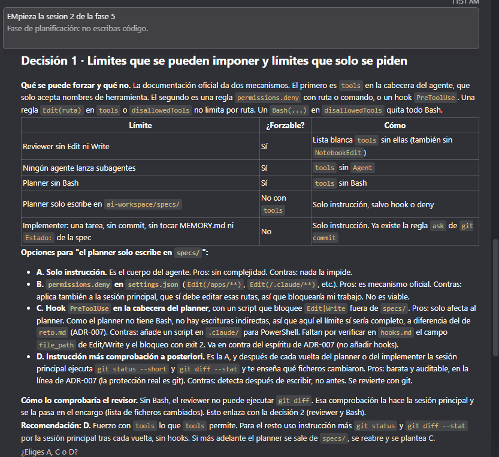
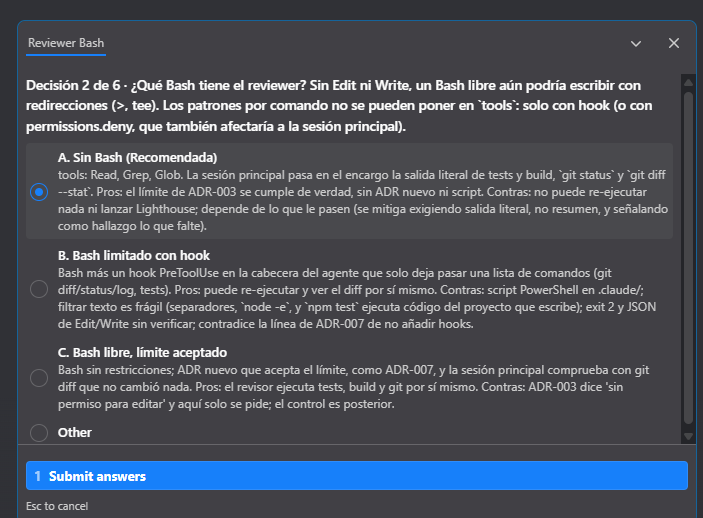
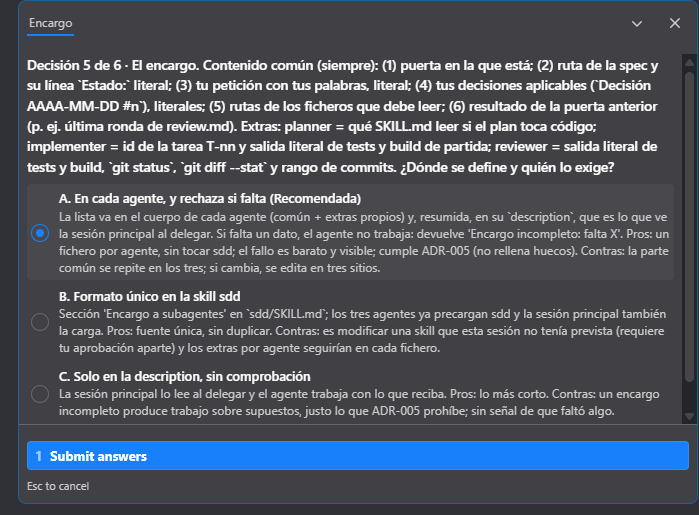
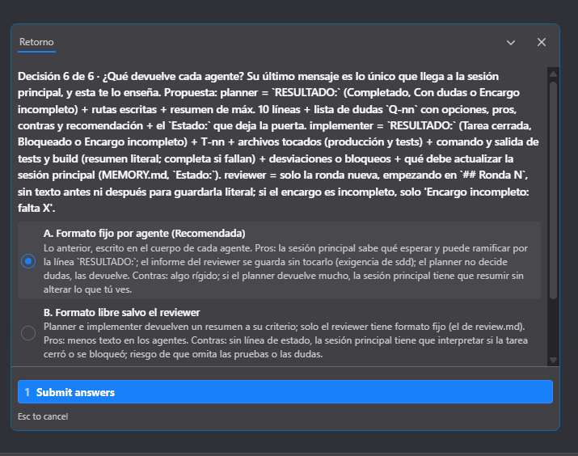

# Agentes — Fase 5 (2026-11-20, sesión 03)

Sesión 2 de 3 de la fase 5 (del proyecto). La sesión 3 (comandos) está pendiente.

## Objetivo y fase
Fase 5. Crear los tres agentes de `.claude/agents/` (`planner`, `implementer` y `reviewer`) en cuatro pasos con parada y aprobación tras cada uno: propuesta, seis decisiones de una en una, escritura fichero a fichero y cierre (diff de `MEMORY.md` y valorar un ADR). Sin comandos (sesión 3) ni código de la aplicación (fase 6). Cada fichero de `.claude/` se aprobaba uno a uno.
Fuentes leídas antes de proponer: `CLAUDE.md`, la constitución, `decisions.md` (ADR-002, 003, 007 y 012, y luego entero), las tres skills con sus checklists, las plantillas `spec.md`, `tasks.md` y `review.md`, el registro de la sesión anterior (`2026-11-20-02`) y `.claude/settings.json`. Además, por petición del autor, la documentación oficial de Claude Code (páginas de subagentes y de permisos), leída con un agente de lectura web. De la de hooks solo se leyó la parte inicial.
El entorno puso la conversación en modo plan varias veces; el autor aprobó cada plan antes de escribir ningún fichero.

## Prompts clave
Prompt inicial (literal):

> EMpieza la sesion 2 de la fase 5
>
> Fase de planificación: no escribas código.
>
> Vamos a crear los tres agentes en .claude/agents/. Antes de proponer nada, lee CLAUDE.md, la
> constitución, decisions.md (ADR-002, ADR-003, ADR-007 y ADR-012), las tres skills (sdd ya
> corregida: puertas con su columna "Estado al pasar", veredictos Conforme / Conforme con
> reservas / Cambios requeridos, reglas de tareas; y backend-conventions y
> frontend-conventions con sus checklists) y el registro de la sesión anterior. Comprueba en
> la documentación oficial de Claude Code el formato de un agente (campos de la cabecera:
> descripción, herramientas permitidas y prohibidas, skills, modelo), si las herramientas se
> pueden restringir por ruta o por comando, y qué puede y qué no puede hacer un subagente: no
> lanza otros subagentes y no ve esta conversación.
>
> Hazlo en cuatro pasos y PÁRATE después de cada uno para que lo apruebe. Cada fichero de
> .claude/ lo apruebo uno a uno.
>
> 1. Propuesta de los tres agentes. Parte de esta y dime qué cambiarías:
>    - planner: redacta spec, plan y tareas. Solo escribe en ai-workspace/specs/.
>    - implementer: una tarea de tasks.md cada vez, con los tests primero. Se para al
>      terminar y no empieza la siguiente. Respeta las reglas de tamaño de tasks.md.
>    - reviewer: sin Edit ni Write (ADR-003). Revisa la spec en la puerta 2 y valida la
>      implementación en la puerta 6, incluido que el Estado de la spec coincide con la
>      puerta alcanzada. Devuelve el informe en el chat, en el formato de review.md, con una
>      ronda nueva; no lo guarda: lo guarda la sesión principal, literal, tras enseñármelo.
>
> 2. Decisiones, de UNA en UNA, con opciones, pros, contras y tu recomendación:
>    - Límites que se pueden imponer y límites que solo se piden. Dime si "el planner solo
>      escribe en ai-workspace/specs/" se puede forzar con las herramientas o solo con
>      instrucciones, y cómo lo comprobaría el revisor (por ejemplo, con git diff).
>    - El reviewer y Bash. Sin Edit ni Write, un Bash sin restricciones aún podría escribir
>      con redirecciones (ADR-007 ya aceptó un límite parecido para reto.md). Dame las
>      opciones: sin Bash y que la sesión principal le pase los resultados de tests y build;
>      Bash limitado a ciertos comandos, si se puede; o Bash libre aceptando el límite.
>    - Qué skills carga cada agente.
>    - Si usan un modelo distinto del de la sesión principal.
>    - El "encargo": qué tiene que incluir toda llamada a un subagente (puerta en la que está,
>      Estado actual de la spec, mi petición con mis palabras, mis decisiones, rutas de los
>      ficheros y resultado de la puerta anterior), porque no ve la conversación.
>    - Qué devuelve cada agente: el planner, rutas y un resumen corto, o la lista de
>      preguntas; el implementer, resultado de tests y build y qué tarea cerró; el reviewer,
>      el informe con veredicto.
>
> 3. Escritura, fichero a fichero. Tras cada uno, comprueba la cabecera (nombre, descripción,
>    herramientas y skills) y enséñame que el reviewer no tiene Edit ni Write.
>
> 4. Cierre: el diff de MEMORY.md (Fase 5, sesión 2 de 3: agentes hechos) y un ADR solo si
>    alguna decisión cumple el criterio de decisions.md (por ejemplo, el límite aceptado del
>    reviewer con Bash). CLAUDE.md no se toca en esta sesión, salvo que sea imprescindible
>    (tiene 59 líneas de 60): se revisa en la sesión 3.
>
> Reglas:
> - No busques otros proyectos como referencia.
> - Si algo choca con una skill, un ADR o la constitución, para y dímelo antes de proponer.
> - No crees comandos todavía (sesión 3) ni código de la aplicación (fase 6).
>
> NO escribas ningún archivo hasta que apruebe su paso.

Respuestas del autor por el diálogo de preguntas: decisión 2 "A. Sin Bash (Recomendada)"; decisión 3 "A. Por rol (Recomendada)"; decisión 4 "B. Solo el reviewer distinto (Recomendada)"; decisión 5 "A. En cada agente, y rechaza si falta (Recomendada)"; decisión 6 "A. Formato fijo por agente (Recomendada)".

Resto de mensajes del autor, en orden (literales):

> Elijo la D, forzar con tools lo que tools permite

> Apruebo planner.md, pasa a implementer.md

> Aprobado con un cambio en el punto 2: el implementer deja la tarea en [~] y la sesión
> principal la marca [x] tras mi aprobación y antes del commit. Motivo: "hecha" significa
> aprobada por mí (ADR-002), no solo en verde, y así tasks.md no dice nada falso en git si
> rechazo una tarea. Puntos 1 y 3 como están. Para la spec 000, el encargo pasa solo los
> comandos de tests y build que existan en cada tarea.

> Apruebo implementer.md, pasa a reviewer.md

> Apruebo el contenido con 3 decisiones:
> 1 - cambios requeridos en la puerta 2, la spec sigue en clarificacion hata que una ronda nueva salga conforme o a esperas que yo acepte, el reviewer solo emite el veredicto;
>
> 2 - añade tus definiciones de gravedad y de veredicto al agente reviewerm, anota como pendientes y pasarla a la plantilla reviewer.md de sdd,
> 3-  la fecha de encarg

> revisamos los pendientes

> no quiero que los apuntes, quiero solucionarlos

> Apruebo los tres cambios; las casillas y la fecha, como dices

> Sí, enséñame el diff de MEMORY.md

> apruebo el diff de memory.md

> amplia ADR-003 con ese texto mas una frase, el plannere i mplementer: sus limited e escritura se piden por instruccion y se comprueban con git status y git diff --stat tras
>    cada vuelta, sin hook (ADR-007

> B. La quité yo adrede: sdd no se toca más en esta sesión. Corrige las dos líneas de
> MEMORY.md que citan "sdd, sección Subagentes" y pasa la obligación a Próximos pasos de la
> sesión 3: /sdd-flow debe hacer que la sesión principal (1) pase la fecha y la salida
> literal de tests, build, git status, git diff --stat y Lighthouse al reviewer, (2) ejecute
> git status y git diff --stat tras cada vuelta y me lo enseñe, (3) marque [x] y las casillas
> tras mi aprobación, y (4) guarde review.md literal.

> Capturas: fase-5-limites-planner.png es la decisión 1 (qué se puede forzar y qué solo se
> pide); fase-5-herramientas-reviewer.png, la decisión 2 (Bash del reviewer);
> fase-5-encargo-subagentes.png, la decisión 5 (el encargo); y fase-5-agentes-cabeceras.png,
> las cabeceras escritas del paso 3. Inclúyelas en el registro.

> /sdd-session 5 agentes

## Qué propuso la IA
- **Paso 1: propuesta de los tres agentes.** Con la documentación oficial (subagentes y permisos) y seis cambios a la propuesta del autor:
  - El planner no conduce la clarificación (puerta 2), que es una conversación con decisiones del autor y un subagente no puede hablar con él.
  - El planner no rellena huecos del reto ni inventa el formato de `plan.md`, que no tiene plantilla.
  - El implementer se para si la tarea exige más de 5 archivos sin `Excepción de tamaño:`, o choca con una fuente, o necesita una dependencia.
  - El implementer no hace commit ni toca `MEMORY.md` ni el `Estado:` de la spec.
  - El reviewer lee él mismo `review.md` para numerar la ronda, y devuelve solo la ronda nueva.
  - La sesión principal debe enseñar al autor el informe literal antes de guardarlo.
  - **Choque con la premisa del autor:** la documentación dice que un subagente sí puede lanzar subagentes (hasta tres niveles); se evita con una lista `tools` sin `Agent`. La parte "no ve la conversación" es coherente con la documentación, pero la frase literal no se pudo verificar.
  - Lo que la documentación no confirmó en el texto literal leído: la sintaxis `Agent(nombre)` en `deny`, el campo `file_path` en la entrada de los hooks de Edit/Write y el bloqueo con exit 2.
- **Paso 2: seis decisiones, de una en una.** Con opciones, pros, contras y recomendación. En todas el autor eligió la recomendada.
  1. **Límites.** Con `tools` (lista blanca) se puede forzar que el reviewer no tenga Edit ni Write y que nadie lance subagentes. "El planner solo escribe en `specs/`" no se puede forzar con `tools` (solo admite nombres de herramienta); haría falta `permissions.deny`, que afecta también a la sesión principal, o un hook. Opciones: A solo instrucción, B `permissions.deny`, C hook `PreToolUse` en el agente, D instrucción más `git status` y `git diff --stat`. Recomendación: D (elegida).
  2. **Reviewer y Bash.** A sin Bash, B Bash limitado con hook, C Bash libre con límite aceptado. Recomendación: A (elegida).
  3. **Skills.** A por rol (planner `sdd`; implementer y reviewer las tres), B las tres en todos, C solo `sdd` y carga por el encargo. Recomendación: A (elegida).
  4. **Modelo.** B solo el reviewer distinto (`opus`), A todos heredan, C un modelo por rol. Recomendación: B (elegida).
  5. **Encargo.** A en cada agente y rechaza si falta, B formato único en `sdd`, C solo en la `description`. Recomendación: A (elegida).
  6. **Retorno.** A formato fijo por agente con línea `RESULTADO:`, B formato libre salvo el reviewer, C fijo con salida de tests completa. Recomendación: A (elegida).
- **Paso 3: escritura fichero a fichero**, con comprobación de cabecera por grep y `git status` tras cada uno.
  - `planner.md`. Ajuste mío respecto al paso 1, enseñado al autor: no cambia la línea `Estado:` salvo crear la spec en `Borrador`; lo cambia la sesión principal tras la aprobación de cada puerta.
  - `implementer.md`. Señalé tres cosas: el encargo debe traer los comandos de tests y build porque "Comandos" de `CLAUDE.md` está pendiente hasta la fase 6; que el `[x]` lo marcara él (el autor lo corrigió); y que ninguna herramienta controla lo que escribe.
  - `reviewer.md`. Señalé tres huecos de `sdd` que no cubrí con valores míos: el veredicto en la puerta 2; que la plantilla nombra las gravedades pero no las define; y que el revisor no tiene reloj (la fecha va en el encargo).
- **Los pendientes.** Los agrupé por destino y propuse tres cambios en `.claude/` (la fila de la puerta 2 y los estados de `sdd/SKILL.md`, una sección nueva "Subagentes", la plantilla `review.md`, y quitar del reviewer las definiciones duplicadas). El autor aprobó los tres.
  - Ya resuelto sin escribir: el sistema registró los tres agentes como tipos disponibles en la sesión, con sus herramientas.
  - Un hueco que no se había nombrado: la sesión principal no lee el cuerpo de los agentes, solo sus `description`, así que sus obligaciones no estaban escritas donde ella las lee.
  - Dejé el encargo repetido en los tres agentes, porque el autor eligió esa opción en la decisión 5.
- **Cierre.** Diff de `MEMORY.md` en 50 líneas (verificado con `wc -l`); propuse ampliar ADR-003 en lugar de crear uno nuevo.
- **Errores y avisos de la IA, señalados por ella o por el sistema:**
  - `sdd/SKILL.md` cambió en disco sin que yo lo hiciera: el sistema avisó y comparé con `git diff` antes de darlo por bueno. Faltaba la sección "Subagentes", que yo había añadido y el autor había aprobado. No la repuse y pregunté (A: la repongo; B: queda fuera y la obligación pasa a otro sitio; C: la reescribe el autor). El autor la había quitado adrede y eligió B.
  - Eso dejaba falsas tres líneas de `MEMORY.md` que citaban "sdd, sección Subagentes", y el autor había contado dos. Corregí las tres.
  - No anuncié ninguna línea `CAPTURA:` en esta sesión, aunque `sdd` lo exige en preguntas con opciones y en correcciones del autor. Las cuatro capturas las hizo el autor (lo confirmó al final de la sesión); cuándo: (no registrado).
  - El mensaje del autor con la decisión 3 llegó cortado ("la fecha de encarg"); lo interpreté como "la fecha va en el encargo" y se lo dije; el autor lo confirmó ("como dices").
  - Interpretación mía confirmada: las casillas de "Hecho cuando" las marca la sesión principal junto con el `[x]`.
  - `model` y `skills` de los agentes no se han podido comprobar: el listado de agentes de la sesión solo mostró `description` y `tools`.

## Qué corregí y por qué
- **Estado de la tarea.** El implementer deja la tarea en `[~]` y la sesión principal la marca `[x]` tras mi aprobación y antes del commit. Motivo: "hecha" significa aprobada por mí (ADR-002) y así `tasks.md` no dice nada falso en git si rechazo una tarea. Para la spec 000, el encargo pasa solo los comandos de tests y build que existan en cada tarea.
- **Veredicto en la puerta 2.** Con `Cambios requeridos`, la spec sigue en `En clarificación` hasta una ronda nueva `Conforme`, o `Conforme con reservas` que yo acepte. El reviewer solo emite el veredicto. Motivo: (no registrado).
- **Gravedades y veredictos.** Añadir mis definiciones al agente y pasarlas a la plantilla `review.md` de `sdd`. Motivo: (no registrado).
- **No anotar los pendientes, resolverlos.** Pedí solucionarlos en vez de apuntarlos en `MEMORY.md`. Motivo: (no registrado).
- **Sección "Subagentes".** La quité yo de `sdd/SKILL.md` a propósito: `sdd` no se toca más en esta sesión. Pasé sus cuatro obligaciones a la sesión 3, como `/sdd-flow`.
- **ADR-003.** Ampliarlo con el texto propuesto y una frase mía: los límites de escritura del planner y del implementer se piden por instrucción y se comprueban con `git status` y `git diff --stat`, sin hook (ADR-007).

## Decisiones tomadas
- **Límites.** Se fuerzan con `tools` (lista blanca). Reviewer: `Read, Grep, Glob`. Planner: `Read, Grep, Glob, Edit, Write`. Implementer: `Read, Grep, Glob, Edit, Write, Bash`. Ninguno tiene `Agent`. Los límites de escritura del planner y del implementer se piden por instrucción y se comprueban con `git status` y `git diff --stat` tras cada vuelta, sin hooks.
- **Reviewer.** Sin Bash; la sesión principal le pasa tests, build, `git status` y `git diff --stat` literales (y Lighthouse si hay vistas). `model: opus`. Sin ADR de límite aceptado: el límite se fuerza.
- **Skills.** Planner: `sdd`. Implementer y reviewer: `sdd`, `backend-conventions` y `frontend-conventions`.
- **Encargo.** En el cuerpo de cada agente. Común: puerta, ruta de la spec con su `Estado:` literal, petición del autor literal, decisiones aplicables, rutas a leer y resultado de la puerta anterior; más extras por agente. Si falta algo, el agente no trabaja y devuelve `Encargo incompleto: falta X`.
- **Retorno.** Formato fijo por agente con línea `RESULTADO:`. El reviewer devuelve solo `## Ronda N …`, para guardarla literal.
- **Planner.** No conduce la clarificación ni cambia `Estado:`. Con decisiones ya tomadas actualiza la spec.
- **Implementer.** Una tarea, tests primero. Deja la tarea en `[~]`; el `[x]` y las casillas los marca la sesión principal tras mi aprobación. Se para ante más de 5 archivos sin `Excepción de tamaño:`, choque de fuentes, hueco del reto o dependencia nueva.
- **Reviewer, además.** Puerta 2: revisa la spec. Puerta 6: checklists, estado de la spec, justificación de tareas de más de 5 archivos. La fecha va en el encargo.
- **`sdd`.** La puerta 2 exige la última ronda del revisor `Conforme` (o `Conforme con reservas` aceptada por mí). `Cambios requeridos` en la puerta 6 devuelve la spec a `En implementación`; en la puerta 2 la deja en `En clarificación`. La sección "Subagentes" se quitó y `sdd` no se toca más en la sesión.
- **`templates/review.md`.** Lleva la sección "Gravedad y veredicto" (Bloqueante, Importante, Menor; Conforme, Conforme con reservas, Cambios requeridos). El reviewer apunta a esa plantilla.
- **`MEMORY.md`** actualizado y en 50 líneas. La obligación de la sesión principal queda como `/sdd-flow` de la sesión 3.
- **ADR-003** ampliado el 2026-11-20 con lo anterior.
- **Capturas.** Las cuatro, con el momento que indicó el autor (sección siguiente).
- **Archivos escritos o cambiados (sin commit):** `.claude/agents/planner.md`, `.claude/agents/implementer.md`, `.claude/agents/reviewer.md`, `.claude/skills/sdd/SKILL.md`, `.claude/skills/sdd/templates/review.md`, `MEMORY.md`, `ai-workspace/docs/decisions.md` y este registro.
- Commit: el de cierre de esta sesión.

## Capturas
- 
  Decisión 1 (límites que se pueden imponer y límites que solo se piden).
- 
  Decisión 2 (el reviewer y Bash).
- 
  Decisión 5 (qué incluye toda llamada a un subagente).
- 
  Las cabeceras escritas del paso 3.

## Pendiente para la siguiente sesión
- Fase 5, sesión 3: (a) revisar `/sdd-session` (comprobar las capturas anunciadas, admitir `N NNN-nombre` y no listar el commit de cierre como pendiente: la línea "Commit:" dirá "el de cierre de esta sesión"); (b) crear `/sdd-flow` para que la sesión principal (1) pase al reviewer la fecha y la salida literal de tests, build, `git status`, `git diff --stat` y Lighthouse, (2) ejecute `git status` y `git diff --stat` tras cada vuelta del planner o del implementer y me lo enseñe, (3) marque `[x]` y las casillas tras mi aprobación, y (4) guarde `review.md` literal.
- Comprobar `model` y `skills` de los agentes la primera vez que se use cada uno.
- La sesión 3 revisa también `CLAUDE.md` (59 de 60 líneas).
