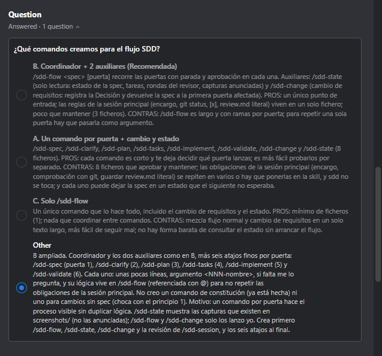
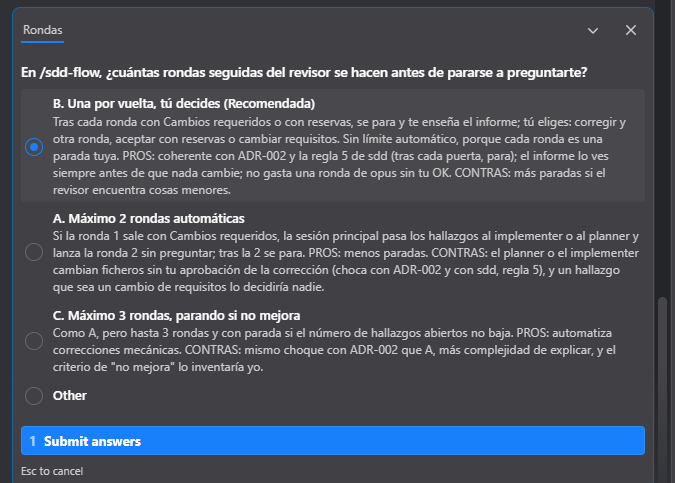
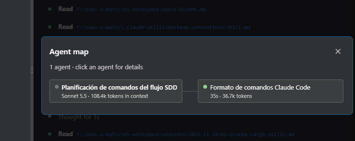
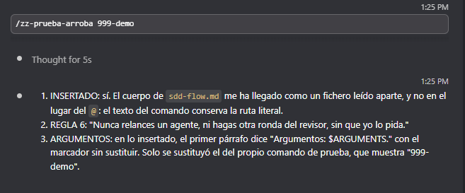
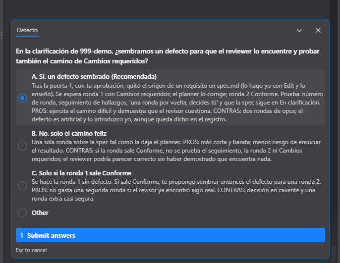
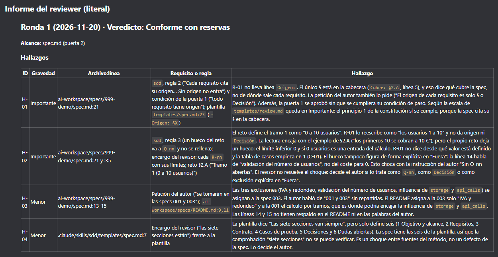

# Comandos y prueba — Fase 5 (2026-11-20, sesión 04)

Sesión 3 de 3 de la fase 5 (del proyecto). Cierra la fase 5.

## Objetivo y fase
Fase 5. Crear los comandos del flujo SDD, revisar `/sdd-session`, probar el flujo con una spec de juguete (`999-demo`) y cerrar la fase. Cuatro pasos con parada y aprobación tras cada uno; cada fichero de `.claude/` se aprobaba uno a uno. Sin código de la aplicación (empieza en la fase 6).
Fuentes leídas antes de proponer: `CLAUDE.md`, la constitución, `decisions.md` (ADR-002, 003 y 012 por encargo; la IA leyó el fichero entero), `MEMORY.md`, las tres skills con sus plantillas y checklists, los tres agentes, `/sdd-session` y los registros `2026-11-20-02` y `-03` (además, por iniciativa de la IA, el `-01`, `reto.md`, `specs/README.md` y los dos `settings`). La documentación oficial de Claude Code (skills y subagentes) se consultó con el agente `claude-code-guide`: la IA recibió resúmenes, no el texto íntegro.
El entorno puso la conversación en modo plan varias veces. La aprobación del plan no sustituyó la del fichero: la IA pidió cada vez tu aprobación explícita del texto antes de escribirlo.

## Prompts clave
Prompt inicial (literal):

> Fase de planificación: no escribas código.
>
> Vamos a crear los comandos del flujo SDD, revisar /sdd-session y probar el flujo. Antes de
> proponer nada, lee CLAUDE.md, la constitución, decisions.md (ADR-002, ADR-003 y ADR-012),
> MEMORY.md, las tres skills, los tres agentes de .claude/agents/, el comando
> .claude/commands/sdd-session.md y los registros de las dos sesiones anteriores. Comprueba en
> la documentación oficial de Claude Code el formato de los comandos (argumentos, cabecera,
> disable-model-invocation).
>
> Hazlo en cuatro pasos y PÁRATE después de cada uno para que lo apruebe. Cada fichero de
> .claude/ lo apruebo uno a uno.
>
> 1. Comandos. Plantéame de UNA en UNA, con opciones, pros, contras y tu recomendación:
>    - Qué comandos: uno por puerta (spec, clarificación, plan, tareas, implementar, validar),
>      más cambio de requisitos y estado; o solo un coordinador /sdd-flow con unos pocos
>      auxiliares.
>    - /sdd-flow: lo coordina la sesión principal, porque un subagente no puede lanzar otros.
>      Cómo pasa el encargo completo a cada agente, cómo guarda el informe del revisor tal
>      cual y cuántas rondas de revisión hace antes de pararse a preguntarme.
>    - Qué hace cada comando cuando falta un argumento: preguntarme, no suponer.
>    - Cuáles solo puedo lanzar yo (los que tocan el registro o hacen commit).
>
> 2. /sdd-session. Hoy la comprobación de las capturas anunciadas está solo en la skill sdd.
>    Dame las opciones (que la haga el comando, o que se quede en la skill) y tu recomendación.
>    Si hay que cambiar el comando, enséñame el diff.
>
> 3. Prueba del flujo, sin crear código de la aplicación. Con una spec de juguete
>    (ai-workspace/specs/999-demo, fuera del reparto del README) recorre solo las puertas 1 a 4
>    y la clarificación con el reviewer. Enséñame qué pasó en cada puerta, si el revisor
>    devolvió su informe y la sesión principal lo guardó literal, y si cada agente cargó sus
>    skills. Borra la spec al terminar.
>
> 4. Cierre: el diff de CLAUDE.md (hoy 59 líneas: dime qué recortarías si hace falta añadir
>    algo; máximo 60), el de MEMORY.md (Fase 5 cerrada; máximo 50), el de settings.json si
>    algún permiso lo necesita y un ADR solo si alguna decisión cumple el criterio de
>    decisions.md.
>
> Reglas:
> - No busques otros proyectos como referencia.
> - Si algo choca con una skill, un ADR o la constitución, para y dímelo antes de proponer.
> - No crees código de la aplicación: eso empieza en la fase 6.
>
> NO escribas ningún archivo hasta que apruebe su paso.

Respuestas del autor por el diálogo de preguntas (literales):

> B ampliada. Coordinador y los dos auxiliares como en B, más seis atajos finos por puerta:
> /sdd-spec (puerta 1), /sdd-clarify (2), /sdd-plan (3), /sdd-tasks (4), /sdd-implement (5) y
> /sdd-validate (6). Cada uno: unas pocas líneas, argumento <NNN-nombre>, si falta me lo
> pregunta, y su lógica vive en /sdd-flow (referenciada con @) para no repetir las
> obligaciones de la sesión principal. No creo un comando de constitución (ya está hecha) ni
> uno para cambios sin spec (choca con el principio 1). Motivo: un comando por puerta hace el
> proceso visible sin duplicar lógica. /sdd-state muestra las capturas que existen en
> screenshots/ (no las anunciadas); /sdd-flow y /sdd-change solo los lanzo yo. Crea primero
> /sdd-flow, /sdd-state, /sdd-change y la revisión de /sdd-session, y los seis atajos al final.

> B. Una por vuelta, tú decides (Recomendada)

> B. Propone la puerta y espera: lee el Estado de spec.md, me dice qué puerta toca según la
> tabla "Estado al pasar" y me pregunta si empiezo por ahí. Si el Estado es ambiguo, me
> consulta. Motivo: el Estado es la única fuente de verdad (sdd) y yo confirmo (ADR-002); los
> atajos por puerta cubren el caso en que ya sé cuál quiero.

> A. Todos menos /sdd-state (Recomendada)

> C. /sdd-session compara las líneas CAPTURA: de la conversación con Glob de screenshots/ y me
> dice por nombre cuáles faltan, antes de redactar el registro. En sdd cambia solo la última
> viñeta de Capturas para que remita al comando (una línea): es una excepción pequeña a "sdd no
> se toca más", porque quita una regla duplicada. Motivo: corre siempre, se cargue sdd o no, y
> hay una sola regla. Enséñame el diff de esa línea.

> A. Marcador y se completa al registrar (Recomendada)

> A. Sí, un defecto sembrado (Recomendada)

Resto de mensajes del autor, en orden (literales):

> Apruebo los dos diffs. Punto 1: déjalo como incoherencia asumida y anótala en el registro
> (el punto 3 del cierre de una spec dice "sin ninguna pendiente", y la comprobación real la
> hace /sdd-session en el punto 5); no toques nada más de sdd. Punto 2: bien. Punto 3: mantén
> la comprobación de la carpeta, solo cuando el segundo argumento tiene la forma NNN-nombre.
> Escribe primero sdd-session.md y luego la línea de sdd, y enséñame el resultado de cada uno.

> Sí, enséñame el texto completo de /sdd-flow

> Apruebo el texto completo con los dos añadidos, escríbelo

> Sí, enséñame el texto completo de /sdd-state

> Apruebo el texto completo de /sdd-state, escríbelo

> Sí, enséñame el texto completo de /sdd-change

> Apruebo el texto completo de /sdd-change, escríbelo

> Sí, enséñame el texto del comando de prueba de @

> Apruebo el texto del comando de prueba, escríbelo

> (Lanzó `/zz-prueba-arroba 999-demo` y pegó una captura con la respuesta, sin más texto.)

> apruebo todo

> Sí, enséñame el plan de la prueba de 999-demo

> Apruebo las tres cosas, lanza la puerta 1

> Apruebo el encargo, lanza al planner

> No apruebo todavía la puerta 1. Para la demo, relanza al planner con este encargo: acota la
> spec 999-demo a R-01 (tramos acumulativos, §2.A). Deja fuera de alcance el IVA, el
> redondeo, la validación de usuarios y si storage y api_calls influyen: son decisiones
> reales que se tomarán en las specs 001 y 003, no en una demo. Quita R-02 (céntimos
> enteros): es de la constitución y va en el plan, no en la spec. El origen de cada
> requisito es solo § o Decisión, como dice sdd. Sin Q-nn abiertas.

> Apruebo el encargo, lanza al planner

> Apruebo la puerta 1, pasa Estado a En clarificación

> (Lanzó `/sdd-flow 999-demo`, sin puerta.)

> Sí, empieza por la puerta 2 y enséñame el Edit del defecto

> Apruebo el Edit del defecto, aplícalo

> Apruebo el encargo con la opción A, lanza al reviewer

> Acepto con reservas, y las nombro: H-01 (R-01 sin origen propio, Importante), H-02 (tramo 1
> reescrito como 1 a 10 sin registrar el hueco del 0, Importante), H-03 (las exclusiones de la
> spec no coinciden con el README, Menor) y H-04 (la plantilla dice siete secciones y define
> seis, Menor). La spec es de demostración y se borra, así que no se corrige nada. Guarda el
> informe literal en review.md. Da por terminada la demo en la puerta 2 y lanza /sdd-session.

> Sí, empieza el paso 4 y borra 999-demo

> Apruebo los cuatro puntos: (1) la línea de CLAUDE.md, (2) el diff de MEMORY.md, (3) settings.json
> sin cambios y (4) sin ADR nuevo. Corrección en MEMORY.md: los seis atajos por puerta YA
> están creados (sdd-spec, sdd-clarify, sdd-plan, sdd-tasks, sdd-implement, sdd-validate), así
> que no los listes como pendientes. Anota solo cuáles se usaron en la demo y cuáles quedan
> sin probar. Escribe, enséñame wc -l de CLAUDE.md y MEMORY.md (máximo 60 y 50) y espera a que
> lance /sdd-session 5 comandos-y-prueba.

> voy a probar en una sesion diferente la demo, hasta la puerta 5 ya que no hay codigo

> no, cerramos esta sesion

> Las anunciadas que faltan no se añaden ni se enlazan; solo menciona en el registro que se
> anunciaron diez y no se hicieron, sin nombres ni enlaces. Las cinco que existen:
> fase-5-comandos.png es la pregunta de qué comandos crear; fase-5-rondas-revision.png, la
> pregunta de las rondas del revisor; fase-5-agent-map.png, el Agent map;
> fase-5-prueba-flujo.png, el resultado de la prueba del flujo; y fase-5-veredicto-demo.png,
> el informe de la ronda 1 del reviewer. fase-5-prueba-defecto.png es la pregunta del defecto
> sembrado. Si de alguna no estás seguro, pon "contenido: (no registrado)".

> si, pero elimina esta frase

## Qué propuso la IA
- **Documentación y formato.** Comandos y skills están unificados; la cabecera admite `description`, `argument-hint`, `disable-model-invocation` y `allowed-tools`, sin `name`; `$ARGUMENTS`, y `$0`, `$1`… cuentan desde 0; un argumento sin valor se queda literal. Sin confirmar entonces: `@fichero` dentro de un comando y que un comando pueda lanzar la herramienta Agent.
- **Paso 1: cuatro decisiones, de una en una, con opciones, pros, contras y recomendación.**
  1. Qué comandos: A (uno por puerta más cambio y estado, ocho ficheros), B (coordinador y dos auxiliares, recomendada) y C (solo `/sdd-flow`). Avisó de dos cosas: `@` sin confirmar y que los atajos no pueden repetir las obligaciones de la sesión principal.
  2. Rondas del revisor: B una por vuelta y decides tú (recomendada), A máximo dos automáticas y C máximo tres. Propuso además la plantilla del encargo y el guardado de `review.md` literal.
  3. Argumento que falta: sin spec, pregunta; sin puerta, B propone la puerta según el `Estado:` y espera (recomendada), A pregunta siempre, C exige la puerta.
  4. Quién lanza: A todos menos `/sdd-state` (recomendada), B todos, C solo los que escriben en el registro o hacen commit.
- **Paso 2: `/sdd-session`.** Opciones C (comando y la skill remite), A (solo comando) y B (solo skill); recomendó C. Enseñó el diff del comando y de una línea de `sdd`, con tres avisos: el punto 3 del cierre de una spec queda incoherente, solo cuentan las capturas anunciadas en la conversación, y la comprobación de la carpeta `NNN-nombre` era cosa suya. Escribió ambos ficheros tras la aprobación.
- **`/sdd-flow`** (71 líneas), con cinco notas: `@` sin confirmar, la columna "Registro de sesión", que el planner solo pasa decisiones a la spec en la puerta 2, que en `999-demo` no habría comandos de tests y build, y la longitud. Planteó la duda de la columna con tres opciones (A marcador, recomendada; B ruta esperada; C fuera) y el autor eligió A.
- **`/sdd-state`** (26 líneas) y **`/sdd-change`** (36 líneas), cada uno con sus notas. En `/sdd-change` señaló que `sdd` no define el `Estado:` que deja cada puerta afectada ni cómo se numera `#n`, y los dejó como propuestas que el comando consulta.
- **Prueba de `@`.** Propuso un comando temporal (`zz-prueba-arroba`, 19 líneas) que adjunta `sdd-flow.md` y pregunta si el contenido llega, la regla 6 y qué pasa con los argumentos. Resultado en la respuesta que el autor pegó: `@` adjunta el fichero como lectura aparte (la ruta queda literal en el comando) y no sustituye `$ARGUMENTS` dentro del fichero adjunto. Con eso diseñó los atajos: cada uno dice su spec y su puerta y avisa de que el marcador de `sdd-flow.md` llega sin sustituir.
- **Seis atajos** (11 líneas cada uno), escritos de una vez tras tu "apruebo todo", y borrado de `zz-prueba-arroba.md`, que también aprobaste.
- **Prueba con `999-demo`.** Plan de prueba, y sembrar un defecto (quitar el origen de R-01) tras preguntarlo con opciones. Resultado, puerta por puerta:
  - **Puerta 1, primera versión.** El planner devolvió una spec de cinco requisitos y cinco dudas (Q-01 a Q-05: IVA, país sin tipo, redondeo, usuarios válidos y `storage`/`api_calls`). El autor no la aprobó.
  - **Puerta 1, segunda versión.** Rehecha con el encargo del autor: un solo requisito, R-01 (§2.A), sin `Q-nn`, 53 líneas. El autor la aprobó y el `Estado:` pasó a `En clarificación`. El planner señaló dos cosas: la remisión de la validación y de `storage`/`api_calls` a la spec 003 era lectura suya y no constaba en ADR-012, y no había caso con 0 usuarios.
  - **`/sdd-flow 999-demo` sin puerta.** Leyó el `Estado:` literal y propuso la puerta 2.
  - **Puerta 2.** Con el defecto sembrado, el reviewer devolvió la ronda 1: veredicto `Conforme con reservas`, cuatro hallazgos. H-01: R-01 sin origen (el defecto sembrado), Importante. H-02: el tramo 1 reescrito como "1 a 10" frente al "0 a 10" del reto, Importante. H-03: las exclusiones no coinciden con el README, Menor. H-04: la plantilla `spec.md` dice "siete secciones" y define seis, Menor. El informe se guardó en `review.md` tal cual, con la aprobación del autor al final, y el `Estado:` pasó a `Aprobada`.
  - **Agent desde un comando.** El planner y el reviewer se lanzaron desde la sesión principal y devolvieron su formato. Los límites de escritura se comprobaron con `git status` y `git diff --stat` tras cada vuelta: solo cambió `999-demo/`.
  - **Skills.** El planner declaró ver `sdd` (y no las convenciones) y trabajar con Sonnet 5.5. El reviewer, por la opción A elegida, no lo declaró: solo citó reglas de `sdd`, la escala de `templates/review.md` y las dos checklists.
- **Paso 4: cierre.** Una línea nueva en `CLAUDE.md` (60 líneas), el diff de `MEMORY.md` (50 líneas), `settings.json` sin cambios y sin ADR nuevo (ninguna decisión cumple el criterio de `decisions.md`; la alternativa era ampliar ADR-003).
- **Errores y avisos de la IA:**
  - Estimó mal la longitud de tres comandos ("unas 90", "unas 30" y "unas 45" líneas; fueron 71, 26 y 36). Lo detectó con `wc -l`.
  - Esperaba una sola duda (el IVA) y la ronda 1 con `Cambios requeridos`; salieron cinco dudas y `Conforme con reservas`. La escala de gravedad está pensada para la puerta 6 y no cubre una spec sin origen.
  - Llevó la puerta 1 de `999-demo` a mano, siguiendo el texto de `/sdd-flow`, antes de que el autor lo invocara. Por eso ningún atajo se usó en la demo.
  - Cambió el `Estado:` de `999-demo` a `Aprobada` tras "acepto con reservas", sin que estuviera en la lista del autor; lo avisó.
  - Dijo que el defecto del R-01 lo había sembrado él: el informe del reviewer sostiene que "la puerta 1 se aprobó sin que se cumpliera su condición", cosa cierta solo en el estado en que él la dejó.
  - Dijo que `git diff` mostraría el estado de `999-demo`; no lo hace con ficheros sin añadir. Usó `grep` y Glob.
  - `/sdd-session` llegó dos veces con los argumentos vacíos (en el texto del comando no aparecía `<command-args>`), y la IA preguntó fase y tema antes de seguir.
  - Anunció once capturas con nombre; diez no se hicieron.

## Qué corregí y por qué
- **Comandos.** Elegí "B ampliada": además del coordinador y los dos auxiliares, seis atajos por puerta con su lógica en `/sdd-flow` referenciada con `@`, sin comando de constitución ni de cambios sin spec (choca con el principio 1). `/sdd-state` muestra las capturas que existen, no las anunciadas; `/sdd-flow` y `/sdd-change` solo los lanzo yo. Motivo: "un comando por puerta hace el proceso visible sin duplicar lógica".
- **Capturas en `/sdd-session`.** Elegí que lo compruebe el comando y que en `sdd` cambie solo la última viñeta de "Capturas". Una excepción pequeña a "sdd no se toca más", porque quita una regla duplicada.
- **Incoherencia asumida.** El punto 3 del cierre de una spec ("sin ninguna pendiente") va antes de que `/sdd-session` haga la comprobación (punto 5); la dejé como está y pedí anotarla.
- **Carpeta de la spec.** La comprobación de que existe `ai-workspace/specs/NNN-nombre/` se mantiene, pero solo cuando el segundo argumento tiene la forma `NNN-nombre`.
- **Puerta 1 de la demo.** Rechacé la primera versión y pedí acotarla a R-01, sin IVA, redondeo, validación ni `storage`/`api_calls`, sin R-02 (los céntimos van en el plan) y sin `Q-nn`. Motivo: son "decisiones reales que se tomarán en las specs 001 y 003, no en una demo".
- **Aceptación con reservas.** Acepté las cuatro reservas (H-01 a H-04) y di la demo por terminada en la puerta 2, sin corregir nada, porque la spec es de demostración y se borra.
- **MEMORY.md.** Corregí que los seis atajos ya estaban creados y pedí anotar solo cuáles se usaron en la demo y cuáles quedaron sin probar.
- **Probar en otra sesión.** Dije que probaría la demo en otra sesión hasta la puerta 5, y después decidí cerrar esta sesión. Motivo: (no registrado).
- **Capturas.** Descarté las anunciadas que no existen y fijé qué muestra cada una de las seis que sí existen.

## Decisiones tomadas
- **Comandos** (`.claude/commands/`): `/sdd-flow` (coordinador), `/sdd-state` (solo lectura, `allowed-tools: Read, Grep, Glob`), `/sdd-change` (cambio de requisitos, siempre con spec), seis atajos (`/sdd-spec`, `/sdd-clarify`, `/sdd-plan`, `/sdd-tasks`, `/sdd-implement`, `/sdd-validate`) y `/sdd-session` revisado. Solo yo lanzo todos salvo `/sdd-state` (`disable-model-invocation: true`).
- **Argumento que falta:** el comando pregunta y no elige. `/sdd-flow <spec>` sin puerta propone la puerta según el `Estado:` y espera mi respuesta.
- **Rondas del revisor:** una por vuelta; tras cada informe decido yo; sin rondas automáticas.
- **Encargo y `review.md`:** plantilla fija de encargo, que la sesión principal rellena y me enseña antes de lanzar el agente. El informe del revisor se enseña literal y se añade a `review.md` solo con mi OK, comprobando `## Ronda N` con N siguiente.
- **Columna "Registro de sesión":** el planner escribe `(pendiente de /sdd-session)` y la sesión principal lo sustituye por la ruta real tras guardar el registro, con mi OK.
- **`/sdd-session`:** admite `N NNN-nombre`, comprueba la carpeta de la spec, la línea "Commit:" dice "el de cierre de esta sesión" y comprueba las capturas anunciadas contra `screenshots/` antes de redactar. En `sdd`, la última viñeta de "Capturas" remite al comando.
- **Resultados de la prueba:** `@` adjunta el fichero aparte y no sustituye `$ARGUMENTS` dentro de él; un comando corre en la sesión principal y puede lanzar agentes.
- **Demo `999-demo`:** puerta 1 aprobada (segunda versión), ronda 1 de la puerta 2 `Conforme con reservas`, reservas H-01 a H-04 aceptadas, `Estado: Aprobada`, spec borrada. Los comandos y la ronda no se usaron más allá de la puerta 2.
- **Incoherencia asumida:** punto 3 del cierre de una spec en `sdd`.
- **Cierre:** `CLAUDE.md` con una línea de comandos (60 líneas), `MEMORY.md` actualizado (50 líneas), `settings.json` sin cambios, sin ADR nuevo.
- **Archivos escritos o cambiados (sin commit):** `.claude/commands/sdd-flow.md`, `sdd-state.md`, `sdd-change.md`, `sdd-spec.md`, `sdd-clarify.md`, `sdd-plan.md`, `sdd-tasks.md`, `sdd-implement.md`, `sdd-validate.md` (nuevos), `.claude/commands/sdd-session.md` y una línea de `.claude/skills/sdd/SKILL.md` (modificados), `CLAUDE.md`, `MEMORY.md` y este registro. Creados y borrados dentro de la sesión: `zz-prueba-arroba.md` y `ai-workspace/specs/999-demo/`.
- Commit: el de cierre de esta sesión.

## Capturas
- 
  La pregunta de qué comandos crear.
- 
  La pregunta de las rondas del revisor.
- 
  El Agent map.
- 
  El resultado de la prueba del flujo.
- 
  La pregunta del defecto sembrado.
- 
  El informe de la ronda 1 del reviewer.

## Pendiente para la siguiente sesión
- Pendientes de la prueba del flujo, ya en `MEMORY.md`: `sdd` y `reviewer.md` dicen «siete secciones» y la plantilla define seis; la escala de gravedad no cubre la puerta 2; `sdd` solo admite § o Decisión como origen y el planner citó la constitución; el punto 3 del cierre de una spec (incoherencia asumida).
- Sin probar: los seis atajos, `/sdd-state`, `/sdd-change`, las puertas 3 a 6, el marcador `(pendiente de /sdd-session)`, el formato de `plan.md`, y `skills` y `model` del implementer y del reviewer.
- Probar la demo en otra sesión: el autor lo anunció ("voy a probar en una sesion diferente la demo, hasta la puerta 5 ya que no hay codigo") y después dijo "no, cerramos esta sesion"; no consta cuándo se hará. La puerta 5 escribe código, y el código de la aplicación empieza en la fase 6.
- Fase 6 (esqueleto técnico): según `MEMORY.md`.
