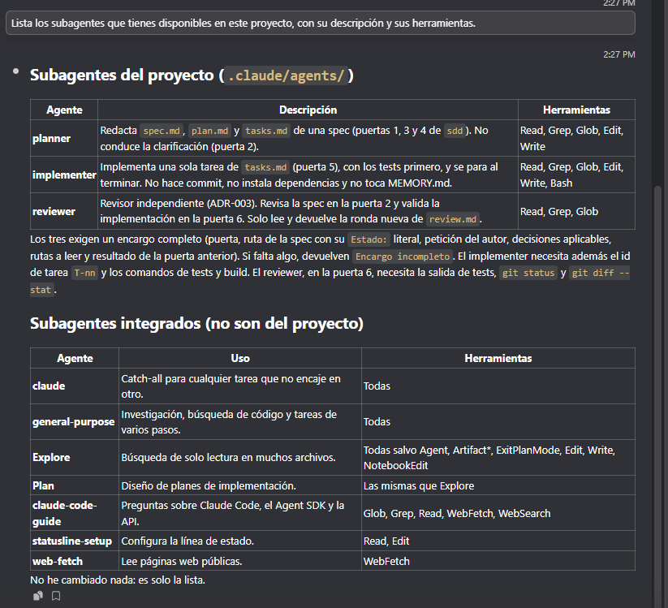
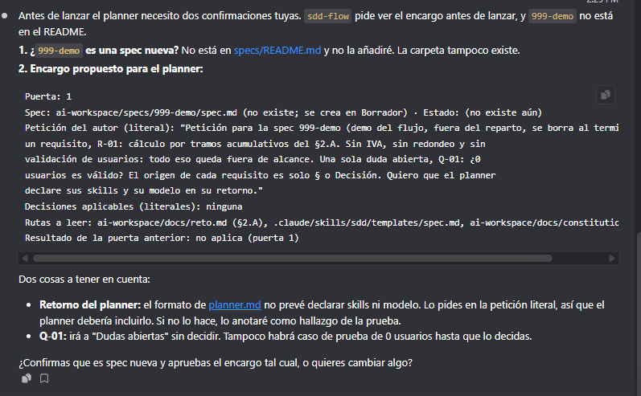
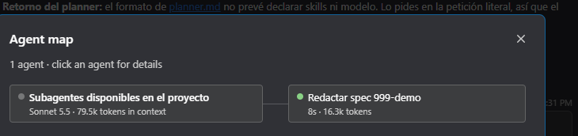
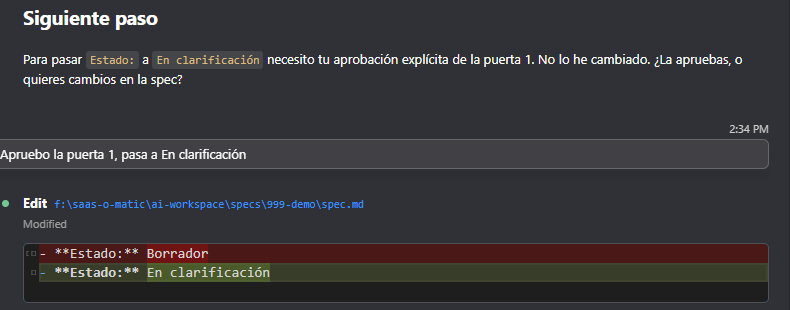
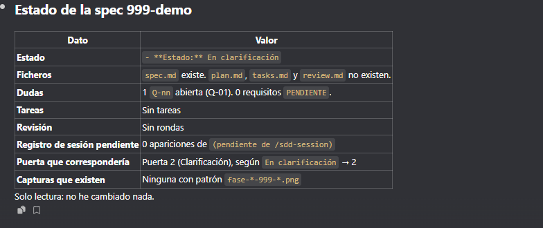
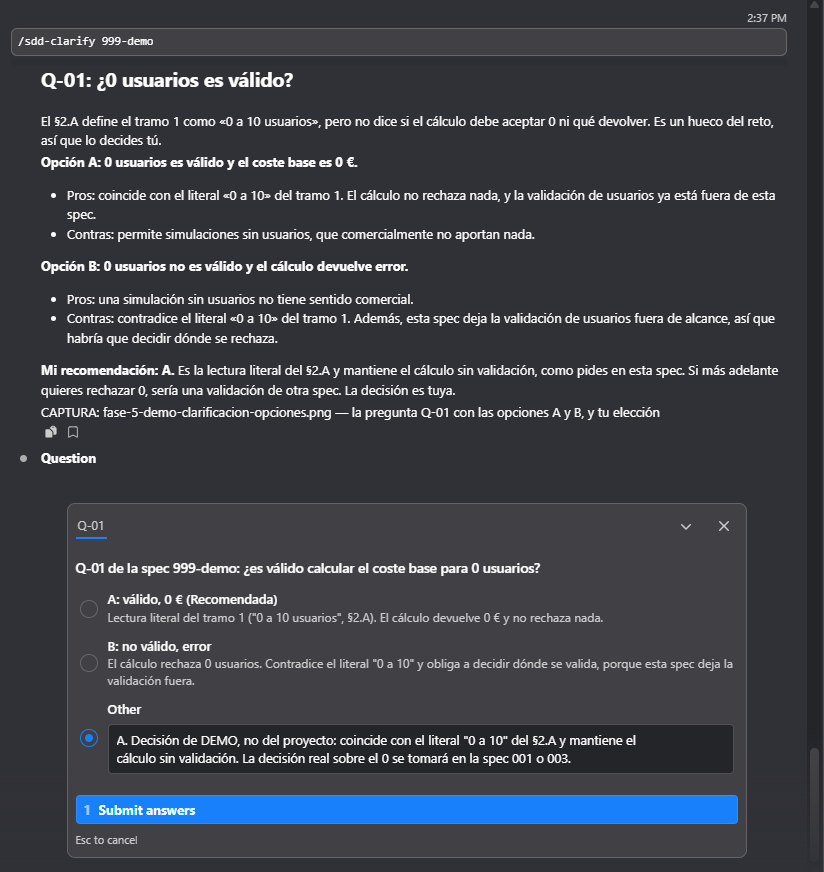
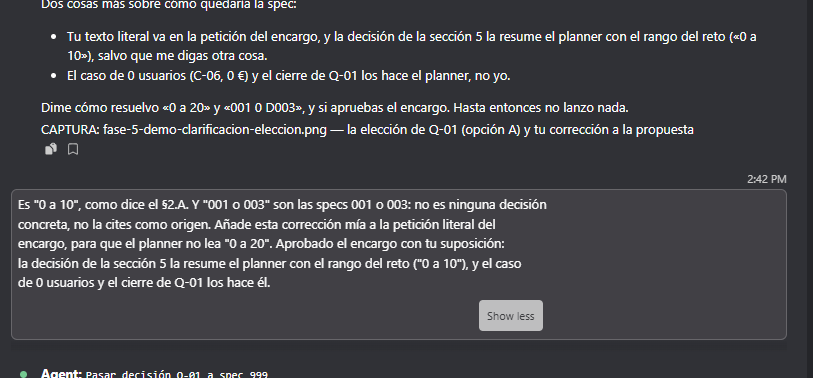
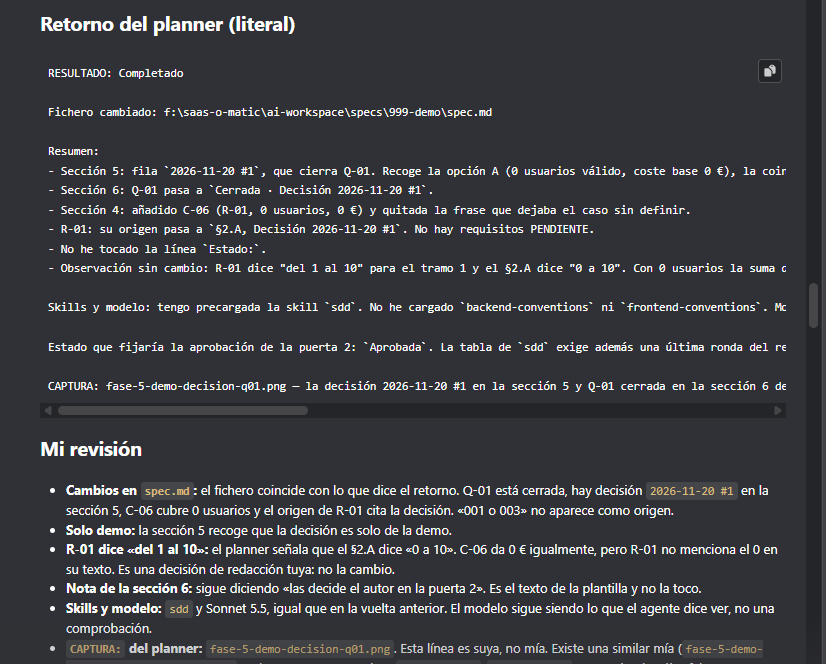
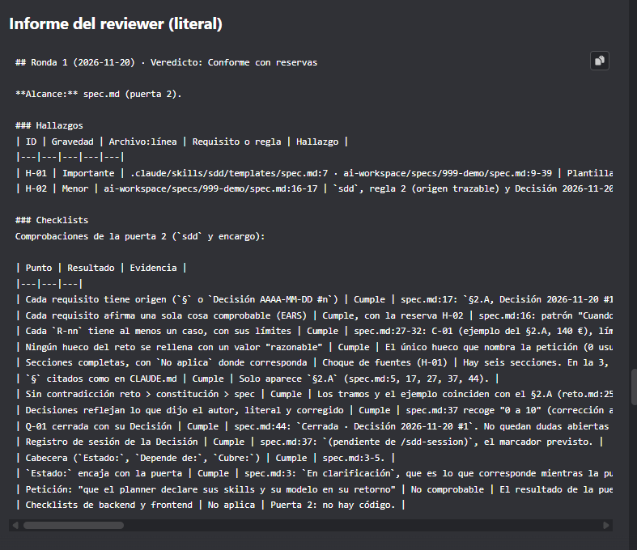

# Prueba de atajos — Fase 5 (2026-11-20, sesión 05)

## Objetivo y fase
Fase 5 (agentes y comandos). Segunda demo del flujo SDD con la spec de juguete `999-demo` (fuera del reparto): probar `/sdd-state` y `/sdd-clarify` y la puerta 2 completa (clarificación, planner, reviewer y `review.md`). El autor pidió además que el planner declarase sus skills y su modelo en el retorno. Al terminar, el autor decidió que los atajos de plan y tareas, el implementer y la validación se prueben en la spec 000 (fase 6).

## Prompts clave
Los mensajes del autor, citados tal como llegaron.

1. Tras ejecutar `/agents` (la sesión informó de que el asistente ya no existe):
> Lista los subagentes que tienes disponibles en este proyecto, con su descripción y sus herramientas.

2. Petición de la demo:
> Petición para la spec 999-demo (demo del flujo, fuera del reparto, se borra al terminar). Solo
> un requisito, R-01: cálculo por tramos acumulativos del §2.A. Sin IVA, sin redondeo y sin
> validación de usuarios: todo eso queda fuera de alcance. Una sola duda abierta, Q-01: ¿0
> usuarios es válido? El origen de cada requisito es solo § o Decisión. Quiero que el planner
> declare sus skills y su modelo en su retorno.

3. Aprobación del encargo de la puerta 1:
> Sí, 999-demo es una spec nueva de demostración, fuera del reparto. Apruebo el encargo tal
> cual.

4. Puerta 1:
> Apruebo la puerta 1, pasa a En clarificación

5. Comandos lanzados por el autor: `/sdd-state 999-demo` y `/sdd-clarify 999-demo`.

6. Respuesta a Q-01 (opción «Other» de la pregunta), tal como se recibió:
> a- decion de demo, no del proyecto, coincide con el literl 0 a 20, del 2.a y mantiene el calculo sin validacion , la decison real sobre el 0 se tomara en la espec 001 0 D003

7. Corrección del autor al encargo de la puerta 2:
> Es "0 a 10", como dice el §2.A. Y "001 o 003" son las specs 001 o 003: no es ninguna decisión concreta, no la cites como origen. Añade esta corrección mía a la petición literal del
> encargo, para que el planner no lea "0 a 20". Aprobado el encargo con tu suposición:
> la decisión de la sección 5 la resume el planner con el rango del reto ("0 a 10"), y el caso
> de 0 usuarios y el cierre de Q-01 los hace él.

8. Lanzamiento del revisor:
> Sí, lanza el reviewer en modo puerta 2

> Apruebo el encargo tal cual, lanza el reviewer

9. Guardado del informe y aceptación del veredicto:
> Si, guarda el informe y ademas, acepto conforme con reservas

10. Cierre de la demo y MEMORY.md:
> Doy por terminada la demo, los atajos de plan y tareas, implementer y la validacion se probaran en la spec 000, actualiza memory.md

> apruebo el diff de memory, pero quiero que esta demo permanezca

11. Comprobación de capturas:
> revisa las imagenes

> revisalo otra vez

## Qué propuso la IA
- Listar los subagentes del proyecto (`planner`, `implementer`, `reviewer`) y los integrados.
- Seguir a mano el texto de `/sdd-flow` (los comandos solo los lanza el autor), pedir confirmar que `999-demo` era una spec nueva (no está en el README) y mostrar el encargo antes de lanzar al planner.
- Planner (puerta 1): `spec.md` en `Borrador` con R-01 (origen §2.A), casos C-01 a C-05, Q-01 abierta. Declaró skills (`sdd`) y modelo (Sonnet 5.5, el que ve en su entorno).
- Puerta 2 (clarificación, conducida en la sesión principal): Q-01 con opciones A (válido, 0 €) y B (no válido), pros, contras y recomendación A. El autor eligió A.
- Planner (puerta 2): pasó la decisión a la sección 5 (`2026-11-20 #1`), cerró Q-01, añadió C-06 (0 usuarios, 0 €) y cambió el origen de R-01.
- Reviewer (puerta 2, ronda 1): `Conforme con reservas`. H-01 (Importante): la plantilla dice «siete secciones» y define seis. H-02 (Menor): el texto de R-01 no recoge que 0 usuarios es válido.
- Guardar el informe literal como ronda 1 en `review.md` y pasar `Estado:` a `Aprobada`.
- Actualizar MEMORY.md (estado, probado y sin probar, pendiente (e) y un aprendizaje).
- Tras guardar este registro, sustituir `(pendiente de /sdd-session)` en la sección 5 de `ai-workspace/specs/999-demo/spec.md` por `sessions/2026-11-20-05-prueba-atajos.md`, con el OK del autor. Queda una aparición del marcador en `review.md` (la ronda 1 lo cita como evidencia) y no se edita, porque las rondas no se tocan.
- Comprobar con `git status` y `git diff --stat`, tras cada vuelta de agente, que solo había cambiado `ai-workspace/specs/999-demo/`.

## Qué corregí y por qué
- El autor corrigió «0 a 20» a «0 a 10»: el §2.A dice «0 a 10». Se añadió su corrección a la petición literal del encargo.
- El autor aclaró que «001 o 003» son las specs 001 o 003 y no una decisión: no se cita como origen.
- El autor decidió conservar la demo. MEMORY.md decía «borrada» en tres sitios y se corrigió.
- Corrección de la IA: había dicho que `sdd` exige nombrar cada reserva para aceptar `Conforme con reservas`; eso solo se exige al cerrar la spec (puerta 6), no en la puerta 2.
- Capturas: dos no mostraban lo anunciado en su línea `CAPTURA:` (`decision-q01` y `veredicto-puerta2`); el autor las rehízo. `eleccion` queda como estaba: muestra la corrección, no la elección.

## Decisiones tomadas
- Q-01, opción A: 0 usuarios es válido y el coste base es 0 €. Es decisión solo de la demo, no del proyecto; la decisión real sobre el 0 se tomará en las specs 001 o 003 (`Decisión 2026-11-20 #1` en `999-demo`).
- Aceptado `Conforme con reservas` en la puerta 2; `Estado:` de `999-demo` pasa a `Aprobada`. Reservas: H-01 (pendiente (a) de MEMORY.md) y H-02 (pendiente (e)); no se corrigen en la demo.
- La demo `999-demo` se conserva (spec y `review.md`) y el commit la incluye.
- Los atajos `/sdd-plan`, `/sdd-tasks`, `/sdd-implement` y `/sdd-validate`, y las puertas 3 a 6, se prueban en la spec 000 (fase 6).
- Commit: el de cierre de esta sesión.

## Capturas
- 
- 
- 
- 
- 
- 
- 
- 
- 

## Pendiente para la siguiente sesión
- Spec 000 (fase 6): probar `/sdd-spec`, `/sdd-plan`, `/sdd-tasks`, `/sdd-implement`, `/sdd-validate` y `/sdd-change`, las puertas 3 a 6, el formato de `plan.md` y `skills` y `model` del implementer y del reviewer.
- Decidir los pendientes (a) a (e) de la prueba del flujo, en MEMORY.md.
