# 000-skeleton — Fase 6 (2026-11-20, sesión 06)

## Objetivo y fase
Fase 6 (esqueleto técnico), spec `000-skeleton`. La sesión empieza con tres retoques previos (MEMORY.md a 50 líneas como máximo, mover a «probado» la sustitución del marcador y una línea en `specs/README.md`). Después recorre las puertas 1 y 2 de la spec con los comandos `/sdd-spec` y `/sdd-clarify`: redacción por el planner, ocho dudas decididas una a una, tres choques o huecos resueltos y cuatro rondas del revisor. Termina con la spec en `Aprobada` y nueve reservas aceptadas por escrito. No hay código todavía.

## Prompts clave
Retoques iniciales:
> Tres retoques antes de empezar, enséñame el diff: 1) MEMORY.md tiene 52 líneas: déjalo en 50 como máximo, fusionando sin perder contenido. 2) Mueve a "probado" la sustitución del marcador: se hizo, porque la fila de decisión de 999-demo/spec.md ya lleva la ruta real (la aparición que queda en review.md es la ronda 1, que no se edita). 3) Añade una línea en ai-workspace/specs/README.md: "999-demo: spec de demostración del flujo (fase 5), conservada como evidencia y fuera del reparto".

Petición para la spec 000 (registrada como Decisión 2026-11-20 #1):
> Petición para la spec 000 skeleton (fase 6). Objetivo: un esqueleto técnico que arranca, sin ninguna funcionalidad del reto todavía. Cubre §4.4 (README y arranque en pocos pasos) y §3.2 (estructura limpia y modular).
> Debe incluir:
> - Workspaces de npm con apps/api, apps/web y packages/pricing.
> - API (Node 24, Express 5, TypeScript) que arranca y responde GET /health.
> - SQLite con better-sqlite3: ejecutor de migraciones con su propio test y ruta de la base en config/envs.ts.
> - packages/pricing compilado y consumido por la API y por la web (condición del ADR-010; si falla, la opción B).
> - apps/web (Angular 22.3) que arranca y llama a la API por el proxy de desarrollo.
> - Scripts en la raíz (dev, test, build, verify) que compilan pricing antes que las apps.
> - Tests con Vitest pasando y un .env.example.
> Los huecos NO los decidas: van a Dudas abiertas (puerto y prefijo de rutas, supertest o fetch, lista de dependencias con su justificación, .env.example frente a la regla deny, quién invoca el ejecutor de migraciones, comprobar better-sqlite3 en Windows con Node 24 y que admita STRICT). El origen de cada requisito es solo § o Decisión; lo que viene de la constitución va al plan, no a la spec. Quiero que el planner declare sus skills y su modelo en su retorno.

Respuesta sobre el origen y los tres pendientes:
> 1. Sí: cita el origen como "§4 (criterio 4, README y despliegue)". Anota que specs/README.md dice §4.4 y no existe.
> 2. A: registra mi petición de hoy como Decisión 2026-11-20 #1, con la celda de sesión "(pendiente de /sdd-session)". Motivo: los requisitos del esqueleto salen de mi petición, no de un § del reto; B dejaría la spec casi entera en PENDIENTE sin dudas reales, y C obliga a modificar sdd.
> 3. Recoge los tres pendientes así: "Comandos" de CLAUDE.md como requisito (origen Decisión #1); Zod en el frontend dentro de la Q-nn de dependencias (principio 4); y la guía de Angular con el workspace real como verificación para el plan, no como duda.
> Ajusta el encargo y enséñamelo definitivo antes de lanzar.

Decisiones de la puerta 2 (literales):
> C, Con el puerto 3000, La api queda sin prefijo (/health, /customers, /simulations, literal del §2.A) y el pxy reescribe /api a vacio
>
> Node 22, ya trae fech nativo, asi no hay ninguna dependencia extra
>
> tsx como devDependency. Justificación (principio 4): ejecuta TypeScript directamente y recarga al guardar sin exigir extensión .ts en los imports ni restringir la sintaxis, lo que encaja con la arquitectura por capas con muchos ficheros pequeños; solo se usa en desarrollo, la build sigue siendo tsc a dist y node. Sin ella, cada import necesitaría la extensión .ts.
>
> build + test. Motivo: principio 4 (sin herramientas nuevas) y es la puerta que exige el principio 3 antes de cerrar un cambio; el build ya comprueba los tipos con tsc y el de Angular. Un linter abriría reglas que nadie ha decidido y añadiría una dependencia a una Q-03 ya cerrada; si lo quiero más adelante, será una decisión aparte.

Sobre el reviewer y el choque Q-09:
> En la ronda del reviewer, solo esta vez, que ponga antes de "## Ronda 1" una línea con sus skills y su modelo. Sepárala y no la guardes en review.md. y elijo la A. Amplía la excepción de architecture.md al presentation/routes.ts de la raíz

Reparto de la respuesta a la ronda 1:
> Sí, empieza, pero con este reparto. 1) Rechazo H-05: el .gitignore ya ignora *.db, *.db-wal y *.db-shm. H-12 queda como reserva (es el pendiente (a) de MEMORY.md) y no se corrige en la spec. H-02 y H-15, corrígelos con el planner. 2) H-01 y H-03: de una en una, como Q-nn con opciones y recomendación. 3) Los demás (H-04, H-06, H-07, H-09, H-10, H-11, H-13 y H-14): preséntalos en una sola tabla, cada uno con su opción recomendada, y los apruebo en bloque o marco excepciones. Es una excepción mía a "una duda cada vez" por falta de tiempo: que conste en el registro. Anota también que el reviewer no incluyó la línea de skills y modelo, y que su modelo se comprobó en el panel del agente (Opus 5.5).

Sobre H-08 y el diff:
> Añade al encargo mi decisión sobre H-08: "aplazado al plan por el autor; R-08 y R-12 se quedan como están; si la ronda 2 lo mantiene, lo acepto como reserva". Aclárame si H-08 es un hallazgoImportante de review.md o "sin hallazgo propio". Y enséñame el diff de architecture.md que yahas aplicado (health/ y la excepción del routes.ts de la raíz): quiero verlo antes de seguir.

Ronda 3:
> Apruebo el encargo. He comparado la fila #1 con mi primer mensaje. Añade que, para cada hallazgo nuevo, indique si quien implemente tendría que inventarse un valor o elegir entre dos opciones.

Aprobación en bloque de la ronda 2:
> Apruebo en bloque las recomendadas de H-16 a H-23 como Decisiones #23 en adelante, con mi OK sobre _health.scss en architecture.md, con estas dos precisiones. H-19: el mensaje de error va en inglés (CLAUDE.md, Idioma) y nombra la variable o el fichero de migración. H-20: en la API la comprobación es un test que importa packages/pricing desde dist; en la web, health/ lo importa de verdad en producción para probar que el build lo empaqueta; ajusta el texto de R-24 en consecuencia. Mis porques: H-16, el valor por defecto no puede duplicar apps/api; H-17, los tests de integración usan :memory:; H-18, git no versiona carpetas vacías; H-19, una configuración inválida no puede decidirla quien implemente; H-20, no crear código sin uso solo para cumplir una regla; H-21 a H-23, coherencia con la spec y con la skill. Enséñame el encargo y el diff de architecture.md antes de lanzar al planner.

Cierre de la puerta 2:
> Acepto como reservas H-08, H-12, H-26, H-27, H-28, H-29, H-30, H-31 y H-32, y apruebo la puerta 2 de la spec 000-skeleton. Mi motivo: cada ronda con correcciones añadía requisitos nuevos que traían hallazgos nuevos; todas son Menor salvo H-08 y H-12, y las decisiones de H-29 a H-31 las fijará el plan, que apruebo yo. Sigue con los cuatro pasos que propones, enseñándome cada uno.

Elecciones con botones: «Aprobar todas en bloque» (huecos H-04 a H-14); «migrations/ vacía (Recomendada)» (Q-10); «Funcionalidad health/ (Recomendada)» (Q-11); «Corregir H-24 y H-25 (Recomendada)» y «Aceptar como reservas (Recomendada)» para H-29 a H-32.

## Qué propuso la IA
- **Encargos y retornos.**
  - El planner redactó la puerta 1: 19 requisitos, 20 casos, 8 dudas (Q-01 a Q-08) y dos huecos propios (Q-07, Q-08).
  - El reviewer (Opus 5.5) revisó en cuatro rondas: 15, 10, 7 y 9 hallazgos abiertos o nuevos.
  - Los dos agentes declararon sus skills y modelo: planner con `sdd` y Sonnet 5.5; reviewer con `sdd`, `backend-conventions`, `frontend-conventions` y Opus 5.5.
- **Una duda cada vez, con opciones.** Q-01 (opción C: API sin prefijo y proxy que reescribe), Q-02 (`fetch` nativo), Q-03 (Zod en la web, `concurrently`, `tsx`), Q-04 (`env.example` sin punto, porque un deny no admite excepciones), Q-05 (opción mía «La conexión migra»), Q-06 (comprobación de `better-sqlite3` como primera tarea), Q-07 (`{"status":"ok"}` y estado de la API en la web) y Q-08 (`build + test`).
- **Cuando el planner paró:** devolvió `Con dudas` al ver que la #6 chocaba con `architecture.md`. Propuse tres opciones (A, B y C) y recomendé A.
- **Tablas de huecos en bloque** para H-04 a H-14 (con H-02, H-15) y para H-16 a H-23, con la opción recomendada de cada uno, más Q-10 (`migrations/` vacía) y Q-11 (`health/`) una a una.
- **Edición de `architecture.md`** con tu OK: excepción de `routes.ts`, `health/` en el diagrama y `_health.scss` en la lista de parciales.
- **Edición de `review.md`** y de la fila #1 de la sección 5 (la #28), con tu OK.

## Qué corregí y por qué
- **Mi propuesta de la Q-05 violaba `architecture.md`.** Te dije que cumplía todas las reglas, pero la excepción era solo para `<recurso>/routes.ts`. El planner lo detectó, tú elegiste ampliar la excepción y lo hice yo.
- **El encargo de la #28 no traía el texto literal.** El planner no pudo aplicarla y pegué yo la petición literal con tu OK. En MEMORY.md anoté la lección.
- **Errores míos:**
  - Un fallo de Bash al guardar la ronda 2, que no escribió nada; la guardé con Edit.
  - Un «sin puerto» en MEMORY.md, corregido.
  - El motivo «por falta de tiempo» en la fila #23, que tú no diste para esa decisión (H-28).
- **Tu «Node 22»** en la Q-02 era un lapsus: confirmaste «Lapsus: sigue Node 24».
- **Tus correcciones:**
  - Rechazaste H-05 con evidencia (`.gitignore`).
  - Corregiste el origen «§4.4».
  - Pediste ver el encargo y el diff antes de lanzar cada vez.
  - Fijaste el idioma inglés del mensaje de arranque (H-19) y el import real de `health/` en producción (H-20).
- **Tu afirmación sobre el reviewer.** Dijiste que el reviewer no incluyó la línea de skills y modelo. Sí la incluyó, antes de `## Ronda 1`, y yo la separé y no la guardé; lo conté en el chat. El modelo coincide con tu comprobación en el panel (Opus 5.5).
- **Un mensaje tuyo llegó cortado** («Apruebo el encarg»). Lo leí como aprobación y lo dije al lanzar al planner.

## Decisiones tomadas
La spec tiene 32 decisiones (#1 a #32), todas con `(pendiente de /sdd-session)` en «Registro de sesión».
- #1 petición literal. #2 puerto 3000 y proxy. #3 `fetch` nativo, Node 24. #4 dependencias por familias, con Zod, `concurrently` y `tsx`. #5 `env.example`. #6 la conexión migra, `migrations/` relativa. #7 comprobación de `better-sqlite3` primera. #8 `/health`. #9 `verify` = `build + test`. #10 excepción de `routes.ts` (`architecture.md`). #11 `migrations/` vacía. #12 `health/`. #13 a #19 aprobadas en bloque (ruta de la base, variables, R-18, constante de `pricing`, dependencias, sin errores, textos). #20 casos de R-13 y migración que falla. #21 fila #1 sin «Comandos». #22 H-08 aplazado. #23 a #30 ronda 2 (valor por defecto `data/saas-o-matic.db`, `:memory:`, `.gitkeep`, errores de arranque, test de `pricing`, fila #1 literal, caso de `PORT`, `_health.scss`). #31 y #32 ronda 3 (rutas completas de `data/`, `user_version` = migraciones aplicadas).
- **Rondas del revisor:** ronda 1 `Cambios requeridos` (H-01 bloqueante); rondas 2, 3 y 4 `Conforme con reservas`.
- **Cierre:** puerta 2 aprobada con nueve reservas aceptadas por escrito (H-08, H-12, H-26 a H-32). `Estado: Aprobada` en `spec.md` y en la fila 000 de `specs/README.md`. Reservas pasadas a MEMORY.md.
- **Excepción del autor** a «una duda cada vez» por falta de tiempo (ver el prompt).
- Commit: el de cierre de esta sesión.

## Capturas
Existen y están enlazadas (15 de la fase 6):
- 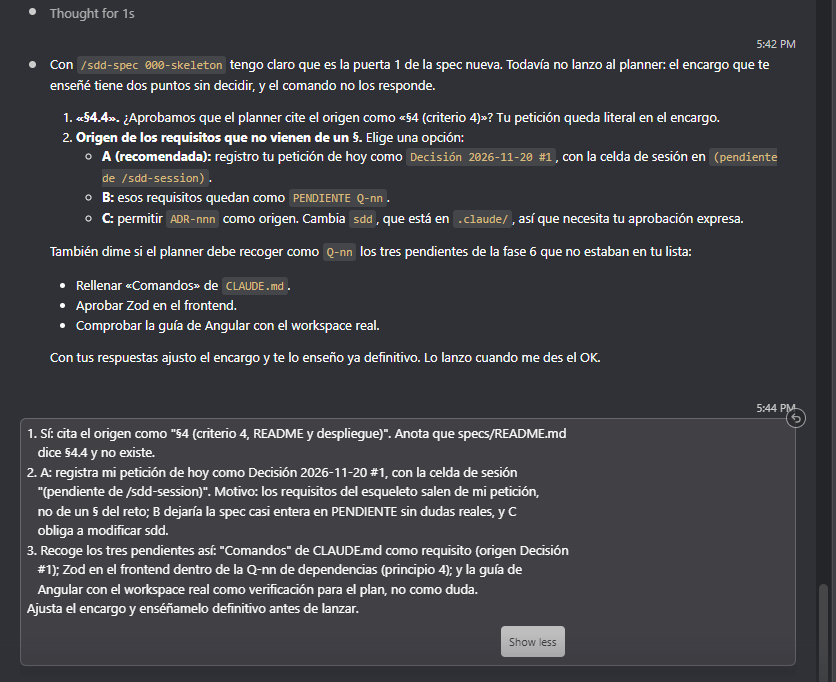
- 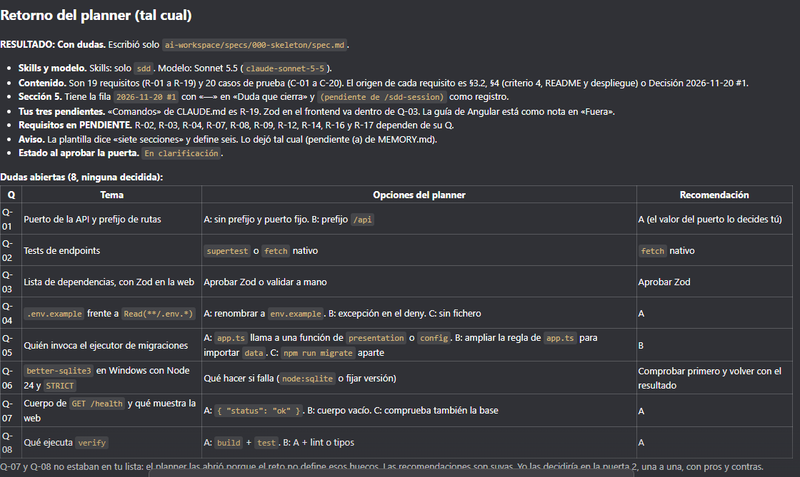
- 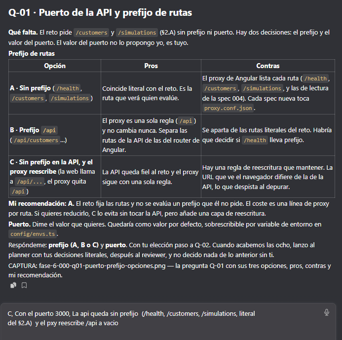
- 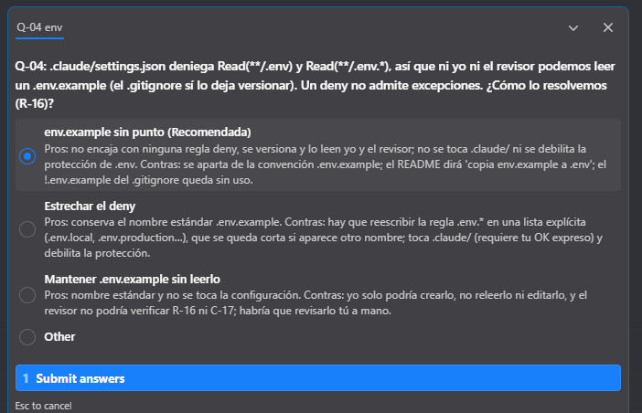
- 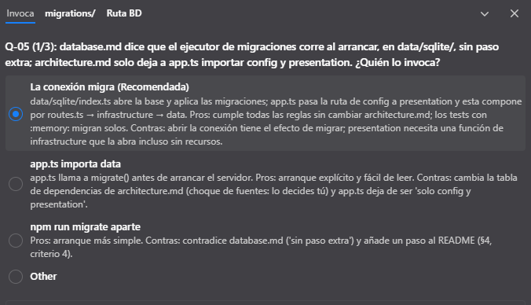 (equivale a `q05-invocador-opciones`)
- 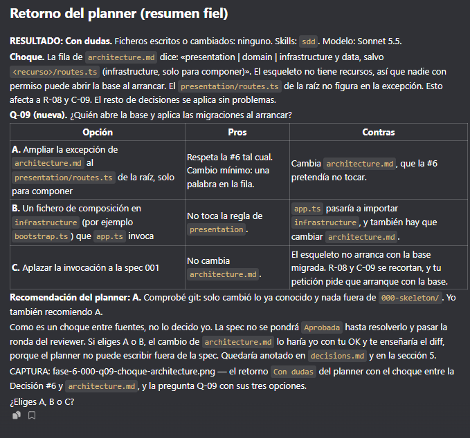
- 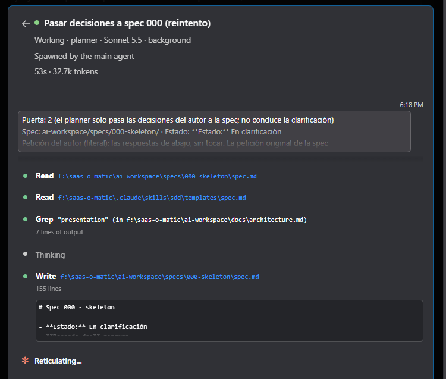
- 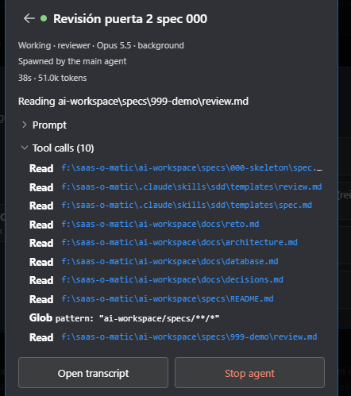
- 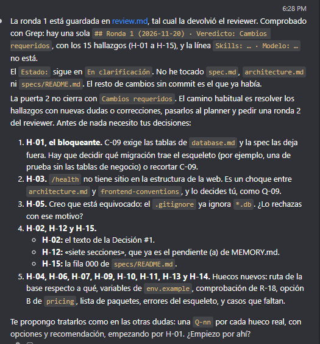 (equivale a `veredicto-ronda1`)
- 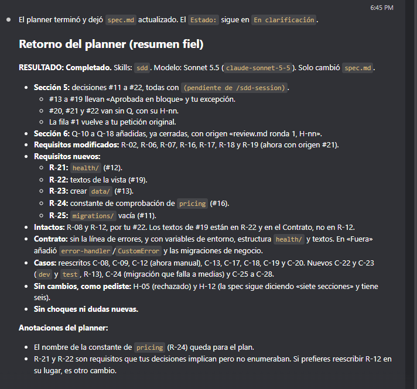
- 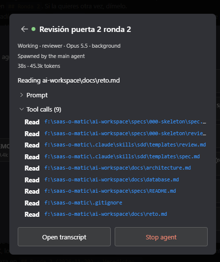
- 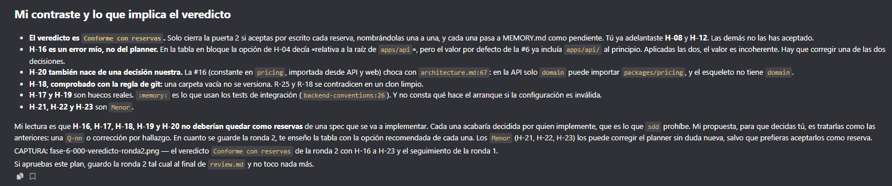
- 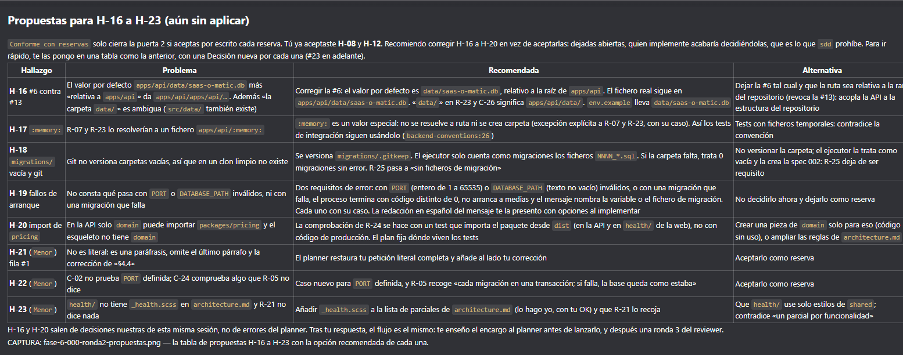
- 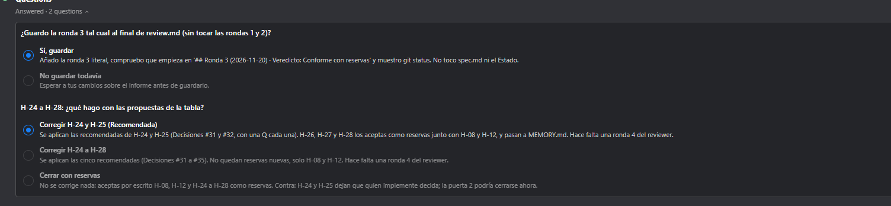 (equivale a `q24-q25-decisiones-31-32`)
- 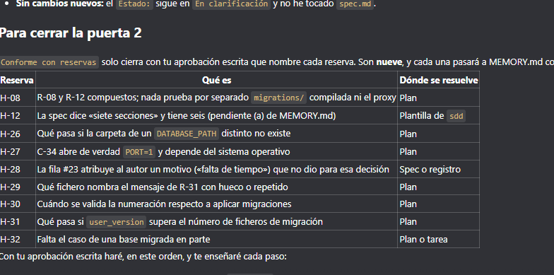

## Pendiente para la siguiente sesión
- **Puerta 3 (plan) de la spec 000.** `plan.md` no tiene plantilla: hay que preguntarte el formato antes de lanzar al planner. El plan debe fijar H-29 a H-31 (qué fichero nombra R-31, cuándo se valida la numeración y qué pasa si `user_version` supera los ficheros), la carpeta del test de `pricing` de la API, cómo usa `health/` la constante (R-24) y la lista concreta de paquetes, que aprobarás (principio 4).
- Después, las puertas 4 a 6, con la primera tarea fijada: comprobar `better-sqlite3` en Windows con Node 24 y `STRICT` (R-09).
- **Marcas pendientes:** sustituir las 32 `(pendiente de /sdd-session)` de la sección 5 de `spec.md` por `sessions/2026-11-20-06-000-skeleton.md`, con tu OK, mediante `/sdd-flow`.
- **Nueve reservas** (H-08, H-12, H-26 a H-32) en MEMORY.md como pendientes. H-12 lleva a corregir «siete secciones» en `templates/spec.md` y `reviewer.md`.
- **Commit** de esta sesión, sin `Co-Authored-By`.
- **Fase 6, resto:** rellenar «Comandos» de `CLAUDE.md` (R-19) y `proxyConfig` en `angular.json`.
