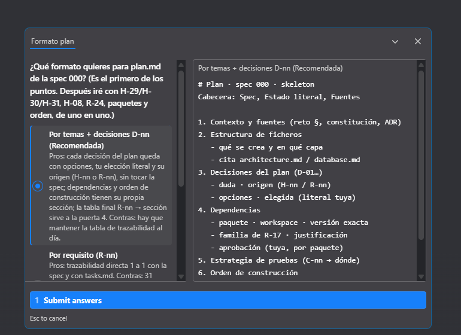
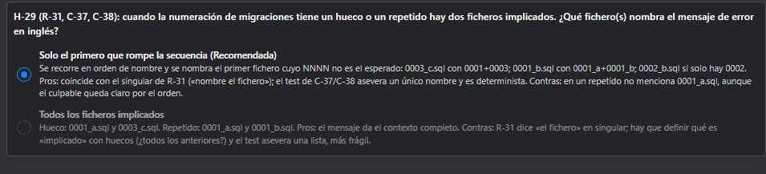
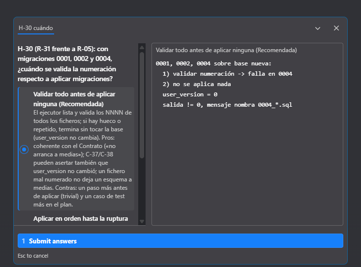
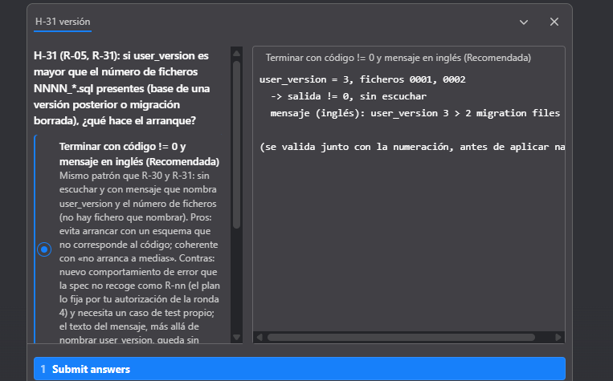
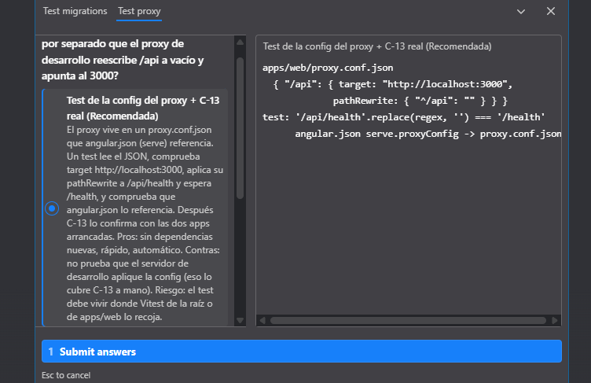
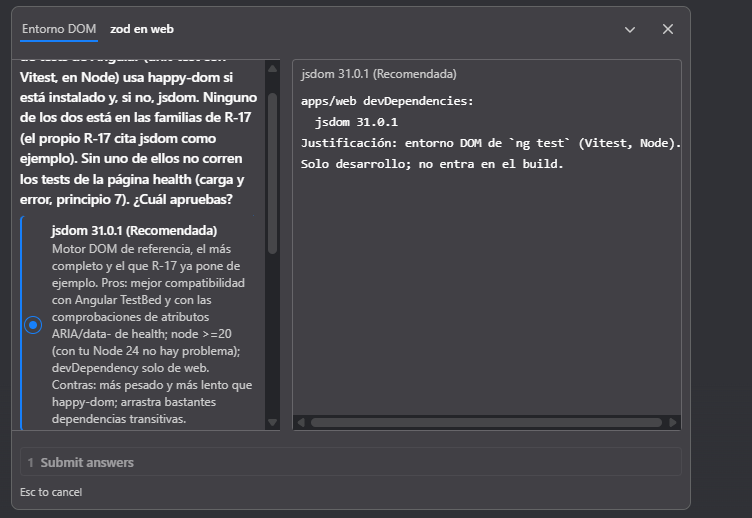
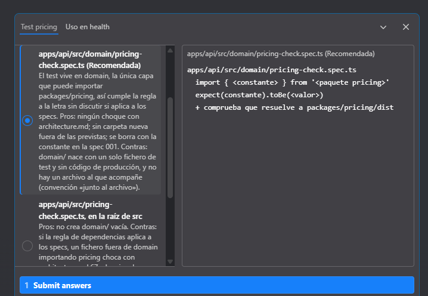
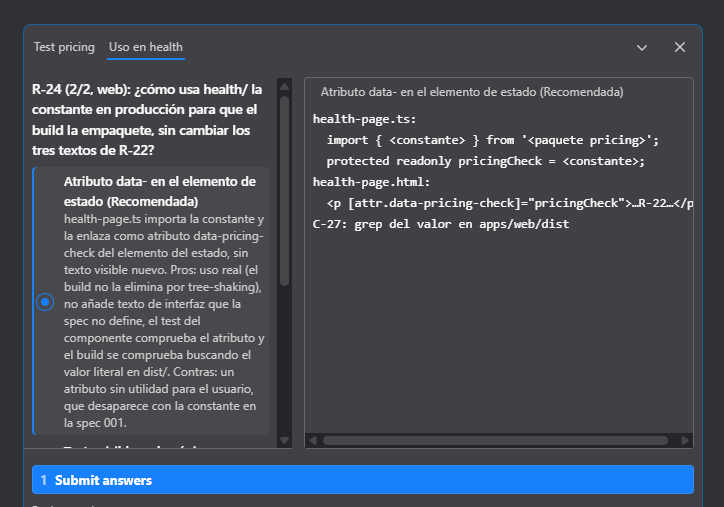
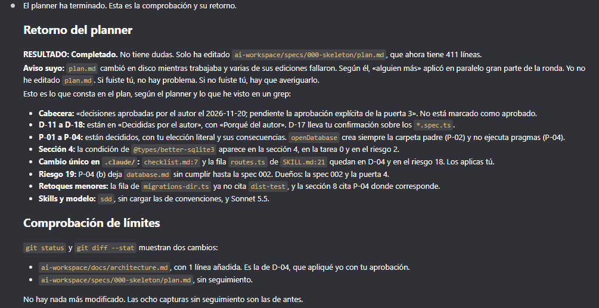

****# 000-skeleton — Fase 6 (2026-11-20, sesión 07)

## Objetivo y fase
Fase 6, spec `000-skeleton` (`ai-workspace/specs/000-skeleton/`), puerta 3 (plan). El plan dice el cómo, cita `architecture.md` y `database.md`, no cambia ningún requisito ni decide por cuenta de la IA. Estado de partida: `Estado: Aprobada` (puerta 2 aprobada en la sesión 06 con reservas). Objetivo de la sesión: cerrar con el autor H-29, H-30, H-31, H-08, la carpeta del test de `pricing` y el uso de la constante en `health/` (R-24), la lista de paquetes y el orden de construcción; fijar el formato de `plan.md` (que no existía); lanzar al planner y llegar a la aprobación de la puerta 3.

## Prompts clave
Petición inicial:

> Petición para el plan de la spec 000 skeleton (Puerta 3 · plan). El plan dice el cómo, citando
> architecture.md y database.md, sin cambiar ningún requisito de la spec ni decidir por mi cuenta.
>
> Tiene que cerrar estos puntos, cada uno con opciones, pros, contras y recomendación, de uno en uno:
> - H-29, H-30 y H-31 de la ronda 4 (reservas que acepté y que el plan debe fijar): qué fichero nombra el mensaje de R-31, cuándo se valida la numeración respecto a aplicar migraciones, y qué
>   pasa si user_version supera el número de ficheros de migración.
> - H-08: el fichero de infrastructure que architecture.md no prevé para la cadena routes.ts -> infrastructure -> data, y cómo se prueba por separado que migrations/ se localiza en la API compilada y que el proxy reescribe /api.
> - La carpeta donde vive el test de packages/pricing de la API (R-24) y cómo usa health/ la constante en producción.
> - La lista concreta de paquetes de cada workspace, para que yo apruebe cada dependencia con su justificación (principio 4). Lo que no entre en las familias de la #17 necesita mi aprobación.
> - El orden de construcción y los riesgos, con la comprobación de better-sqlite3 en Windows con Node 24 y STRICT (R-09) como primera tarea.
>
> El formato de plan.md no existe: antes de lanzar al planner, propónmelo con opciones.
> Si algo choca con la spec, la constitución o architecture.md, para y dímelo.
> No escribas código.

Primera revisión del plan:

> No apruebo todavía. Corrige: (1) D-10 es zod en la web, no jsdom: instalar ahora, sin imports hasta la spec 005, y quita de la sección 4 y del riesgo 12 lo de aplazarla; (2) añade mis porques literales en cada D-nn; (3) D-03 con el posible R-32; (4) D-04 con la corrección de checklist.md línea 7 de backend-conventions; (5) D-05 con dist-test en .gitignore; (6) en Riesgos, H-12 y H-32 con su dueño; (7) en Riesgos, que rellenar "Comandos" de CLAUDE.md (60 de 60 líneas) exige decidir qué recortar. Dime si todo esto estaba en el encargo.

Sus porqués (texto pegado):

> Mis porqués:
> D-01 (H-29): coincide con el singular de R-31 y con R-30, y el test de C-37 y C-38 afirma un único
> nombre, determinista.
> D-02 (H-30): coherente con el Contrato (no arranca a medias); una numeración mal puesta no deja un
> esquema parcial, y el test puede asertar que user_version no cambia.
> D-03 (H-31): mismo patrón que R-30 y R-31; es peor arrancar en silencio con un esquema que el
> código no conoce.
> D-04 (H-08, fichero): no es un datasource ni un repositorio y no quiero ensuciar datasource/, donde
> backend-conventions espera sqlite-*.datasource.ts.
> D-05 (H-08, migrations/): una ruta equivocada pasaría en silencio por R-28 y C-09 no la detecta;
> solo compilar prueba el layout real de dist.
> D-06 (H-08, proxy): [escribe aquí tu motivo; si no lo tienes claro, pon: sin porqué dado por el autor].
> D-07 (R-24, API): domain es la única capa que puede importar packages/pricing (architecture.md:67);
> así no discuto si la regla aplica a los specs ni creo carpetas nuevas.
> D-08 (R-24, web): es uso real, el build no lo elimina, no añade texto de interfaz que la spec no
> define (R-22) y se comprueba con un test y con la búsqueda en dist.
> D-09 (jsdom): es el que R-17 cita como ejemplo, es el DOM más completo para ARIA y data- en las
> próximas specs (principio 7) y solo es devDependency de la web.
> D-10 (zod en la web, no jsdom): ya lo aprobé en la Decisión #4 y R-17 y C-18 lo listan; diferirlo
> exigiría un cambio de requisitos. Sin imports hasta la spec 005.

Aprobación de decisiones y paquetes:

> Apruebo D-11 a D-18, P-01 (a), P-02 (a), P-03 (a), P-04 (b) y la lista de paquetes de la sección 4, con la condición de que R-09 compruebe @types/better-sqlite3. Mi motivo: las he revisado con las recomendaciones y las pros y contras que me enseñaste, y no quiero repetir cuatro rondas en una spec de esqueleto. En D-17 confirmo que las reglas de dependencia son del código de producción, no de los *.spec.ts. Aplica ahora la línea de architecture.md de D-04 y enséñame el diff.

Añadido al encargo de la última ronda del planner:

> Sí, lanza. Añade al punto 5 que, junto a checklist.md:7, el plan anote la fila de routes.ts de  SKILL.md de backend-conventions (línea 21, dice solo presentation/<recurso>/) como un único cambio en .claude/ que aplico yo. Anota también lo de P-04 (database.md exige los pragmas desde la spec 002) para que pase a MEMORY.md como pendiente.

Texto de la columna «Aprobada»:

> Corrige solo el texto de la columna "Aprobada" de la sección 4 de plan.md: pon "sí" en todos los paquetes, y la condición "(condición: R-09 comprueba @types/better-sqlite3)" únicamente en la fila de @types/better-sqlite3. No toques nada más del plan. Si puedes, aplícalo tú con Edit en lugar de relanzar al planner (es un cambio de texto de mi aprobación); enséñame el diff.

Aprobación de la puerta y del diff:

> Apruebo la puerta 3 de la spec 000-skeleton

> Apruebo el diff de MEMORY.md /sdd-session 6 000-skeleton

## Qué propuso la IA
- **Formato de `plan.md`**, con tres opciones: por temas con decisiones D-nn (recomendada), por requisito y por capas y paquetes.
- **Opciones, pros, contras y recomendación**, una pregunta cada vez, para:
  - H-29, H-30 y H-31.
  - El fichero de `infrastructure` de H-08 (D-04), y cómo probar `migrations/` compilada (D-05) y el proxy (D-06).
  - La carpeta del test de `pricing` (D-07) y el uso de la constante en `health/` (D-08).
  - El entorno DOM, `jsdom` o `happy-dom` (D-09), y `zod` en la web (D-10).
- **Lista de paquetes con versiones de npm** consultadas el 2026-11-20 (por ejemplo `typescript` 6.0.3, `vitest` 5.1.1, `better-sqlite3` 13.2.0, `@types/better-sqlite3` 9.6.0, `jsdom` 31.0.1).
- **Orden de construcción** con R-09 primero, y riesgos. Entre ellos, que `@types/better-sqlite3` 9.6.0 puede no corresponder a `better-sqlite3` 13.2.0.
- **Encargo al planner con la plantilla de `sdd-flow`**, mostrado antes de lanzar, y tres lanzamientos del planner:
  - El primero devolvió `Con dudas` (P-01 a P-04, D-11 a D-18 como propuestas).
  - El segundo aplicó las siete correcciones del autor.
  - El tercero reflejó las aprobaciones.
- **Comprobación tras cada vuelta** con `git status` y `git diff --stat`. Solo cambió `plan.md` y, aparte, `architecture.md` por la línea de D-04.
- **Aplicación con `Edit`, sin relanzar al planner**, de los cambios de texto de la columna «Aprobada» y de la línea 251 de `plan.md`.
- **Diff de `MEMORY.md`** con el estado de la puerta 3 y los pendientes.

## Qué corregí y por qué
- **D-10 mal rotulado.** El encargo decía «Instalar ahora, como pide R-17» sin nombrar `zod`, y el planner lo infirió como `jsdom`. El autor lo corrigió. Era un fallo del encargo de la IA.
- **Siete correcciones al plan**, de las que ninguna estaba en el encargo (la IA lo comprobó contra los ficheros): D-10, porqués literales, R-32 en D-03, `checklist.md:7`, `dist-test` en `.gitignore`, dueños de H-12 y H-32, y el recorte de `CLAUDE.md`. Para D-05, `plan.md` compilaba a `dist` y el autor había elegido una carpeta hermana.
- **Porqués.** En la pregunta de los porqués el autor eligió «Te los dicto yo ahora», y pegó el texto después. Dejó D-06 sin rellenar, así que consta «sin porqué dado por el autor».
- **Un único cambio en `.claude/`.** El autor añadió la fila de `routes.ts` de `SKILL.md:21` junto a `checklist.md:7`. Lo aplica el autor.
- **Columna «Aprobada».** El autor corrigió el texto para que solo la fila de `@types/better-sqlite3` lleve la condición. Un error de la IA al explicarlo: dijo 28 filas y eran 23 (22 con «sí» y una con la condición).
- **Línea 251 de `plan.md`.** Quedó desactualizada tras el cambio anterior. El autor pidió ajustarla, y quedó «solo en la fila de `@types/better-sqlite3`».
- **Mensaje `claude rc`.** No era una petición para la IA. Se ignoró.
- **Aviso del planner**, de que `plan.md` cambió en disco mientras trabajaba y «alguien más» aplicó parte de la ronda. Quién lo hizo, (no registrado).

## Decisiones tomadas
Decididas por el autor, con su elección literal:
- **D-01 (H-29):** «Solo el primero que rompe la secuencia (Recomendada)».
- **D-02 (H-30):** «Validar todo antes de aplicar ninguna (Recomendada)».
- **D-03 (H-31):** «Terminar con código != 0 y mensaje en inglés (Recomendada)». Sería un posible R-32 si el autor lo quiere como requisito.
- **D-04 (H-08, fichero):** «infrastructure/sqlite-connection.ts, en la raíz (Recomendada)». Línea añadida a `architecture.md` por la IA con el OK del autor.
- **D-05 (H-08, `migrations/`):** «Compilar con tsc y comprobar la ruta resuelta (Recomendada)», a `apps/api/dist-test`, con `dist-test/` en `.gitignore`.
- **D-06 (H-08, proxy):** «Test de la config del proxy + C-13 real (Recomendada)».
- **D-07 (R-24, API):** «apps/api/src/domain/pricing-check.spec.ts (Recomendada)».
- **D-08 (R-24, web):** «Atributo data- en el elemento de estado (Recomendada)».
- **D-09:** «jsdom 31.0.1 (Recomendada)».
- **D-10:** `zod` en la web, «Instalar ahora, como pide R-17 (Recomendada)», sin imports hasta la spec 005.
- **D-11 a D-18:** aprobadas por el autor en bloque. D-17: las reglas de dependencia son del código de producción, no de los `*.spec.ts`.
- **P-01 (a):** `env.example` en `apps/api/env.example`.
- **P-02 (a):** crear siempre la carpeta padre de la ruta resuelta (H-26).
- **P-03 (a):** límites 1 y 65535 solo en `envs.spec.ts`, sin abrir el puerto (H-27).
- **P-04 (b):** los pragmas `foreign_keys = ON` y `journal_mode = WAL` no entran en la spec 000; `database.md` los exige desde la spec 002.
- **Lista de paquetes de la sección 4:** aprobada, con la condición de que R-09 compruebe `@types/better-sqlite3` frente a `better-sqlite3` 13.2.0.
- **Formato de `plan.md`:** «Por temas + decisiones D-nn (Recomendada)».
- **Dueños de las reservas:** H-12, el autor (pendiente (a) de `MEMORY.md`). H-32, la puerta 4 (`tasks.md`).
- **Puerta 3 aprobada** por el autor. La spec sigue `Aprobada` (la puerta 3 no cambia el `Estado:`).
- **`MEMORY.md`:** diff aprobado por el autor.
- **Commit:** el de cierre de esta sesión.

## Capturas
Enlazo las de esta sesión. El resto de capturas de la fase 6 (`fase-6-000-q01-…`, `ronda-1`, `veredicto-ronda4`, etc.) son de la sesión 06.

## Pendiente para la siguiente sesión
- **Commit** de esta sesión: `plan.md`, `architecture.md`, `MEMORY.md`, este registro y las capturas.
- **Puerta 4 (`/sdd-tasks`):**
  - R-09 primero, con la comprobación de `@types/better-sqlite3`.
  - Tareas de un commit y como máximo 5 archivos de producción.
  - Anotar el caso de H-32 y los pragmas de P-04 (b).
- **A cargo del autor:**
  - El cambio único en `.claude/`: `backend-conventions/checklist.md:7` y la fila de `routes.ts` de su `SKILL.md:21`.
  - Decidir qué se recorta de `CLAUDE.md` (60 de 60 líneas) para rellenar «Comandos» (R-19), antes de esa tarea.
- **Abiertos:**
  - D-03 como posible R-32 (`/sdd-change`).
  - H-12, con el autor como dueño.
  - Las reservas H-08, H-28 y H-32.
- **Sin probar:** `/sdd-tasks`, `/sdd-implement`, `/sdd-validate` y `/sdd-change`, y los campos `skills` y `model` del implementer.
