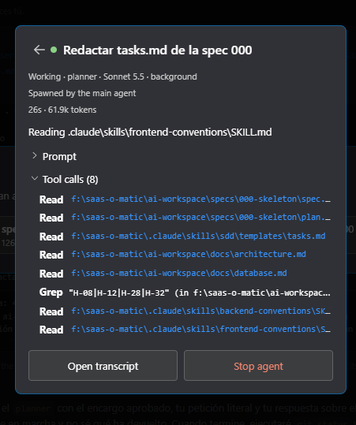
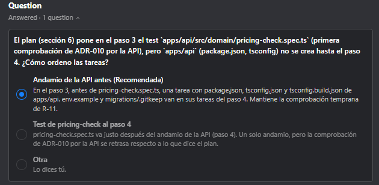
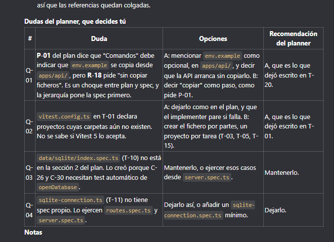
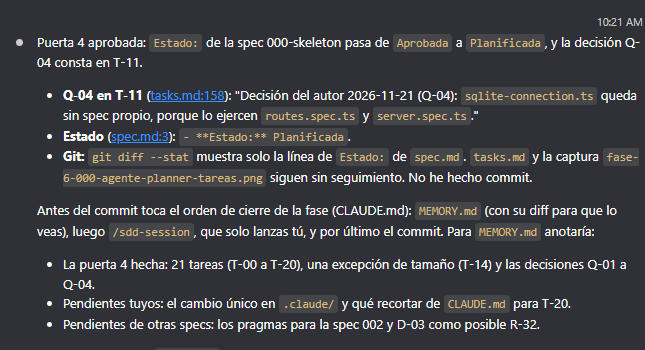

# 000-skeleton — Fase 6 (2026-11-21, sesión 01)

## Objetivo y fase
Fase 6, spec `000-skeleton`: puerta 4 (tareas). Desglosar el plan aprobado en `tasks.md`, sin cambiar la spec ni el plan, y pasar la spec de `Aprobada` a `Planificada` con la aprobación del autor. Al empezar se consultó `/sdd-state 000-skeleton`. Al final se cerró la fase con `MEMORY.md` y `/sdd-session`.

## Prompts clave
1. Consulta de estado:
   > /sdd-state 000-skeleton
2. Petición de la puerta 4, literal:
   > Petición para las tareas de la spec 000 skeleton (Puerta 4 · tareas). Desglosa el plan aprobado en
   > tasks.md, sin cambiar la spec ni el plan y sin decidir por tu cuenta.
   > Reglas: cada tarea cabe en un commit, tiene una responsabilidad y toca como máximo 5 archivos de
   > producción, sin contar sus tests ni el lockfile; una tarea por capa; el test va dentro de la tarea
   > que lo exige. Tests primero.
   >
   > Tiene que incluir:
   > - La tarea 0 (R-09): comprobar better-sqlite3 13.2.0 en Windows con Node 24 y STRICT, en una carpeta
   >   fuera del repositorio, con la comprobación de @types/better-sqlite3 (condición mía). Si falla,
   >   se para y se me avisa; no se elige alternativa.
   > - El orden del plan (sección 6): raíz, packages/pricing y scripts, API, web, scripts de extremo a
   >   extremo y documentación.
   > - Que cada R-01 a R-31 tenga al menos una tarea, también H-32 (base migrada en parte, test del
   >   plan) y el test de user_version mayor que los ficheros (D-03).
   > - Una tarea para aplicar la línea de .gitignore (dist-test/), otra para proxyConfig en angular.json
   >   y otra para rellenar "Comandos" de CLAUDE.md (R-19), que está en 60 de 60 líneas: esa tarea
   >   me pregunta qué recortar, no lo decide.
   > - Los pragmas de database.md quedan anotados para la spec 002; no hay tarea en esta.
   > - La tabla de cobertura R-nn → tareas al final.
   >
   > Si una tarea necesita más de 5 archivos y no se puede dividir, lleva "Excepción de tamaño:" con
   > el motivo. Si algo choca con la spec, el plan o architecture.md, para y dímelo.
   > No escribas código.
3. Decisiones sobre las dudas del planner y correcciones:
   > Decisiones: Q-01 A (opcional, en apps/api/, la API arranca sin copiarlo; la spec manda sobre el plan),
   > Q-02 A (como en el plan; si Vitest lo rechaza, el implementer para), Q-03 mantener index.spec.ts (C-26 y C-30 necesitan test automático), Q-04 dejarlo. Corrige con Edit: en T-18 quita "C-22 de textos" (solo C-13); y sustituye "el aviso en el informe de la puerta 4" en T-01, T-10 y T-20 por mi decisión (Q-02, Q-03 y Q-01) escrita en la propia tarea, con la fecha 2026-11-21. Enséñame el diff.
   > Después te doy la aprobación de la Puerta 4.
4. Aprobación de la puerta 4:
   > Añade a T-11 mi decisión Q-04 con la fecha 2026-11-21: sqlite-connection.ts queda sin spec propio,
   > porque lo ejercen routes.spec.ts y server.spec.ts. Y apruebo la Puerta 4 · tareas de la spec  000-skeleton. Mi motivo: las 21 tareas cubren las 31 R-nn, respetan el orden del plan y las paradas que decidí, y las cuatro dudas de Q-01 a Q-04 constan escritas en las tareas. Pasa el Estado a Planificada.
5. Cierre:
   > cerremos esta puerta y luego mado sdd-session
6. Sobre la captura que faltaba (respuesta a la pregunta de `/sdd-session`):
   > revisa por que si que está

   y después:
   > ya esta la imagen

## Qué propuso la IA
- Contestó `/sdd-state` con una tabla de hechos: `Estado: Aprobada`, sin `tasks.md`, 0 dudas abiertas, 4 rondas del revisor (la última, `Conforme con reservas`) y 24 capturas `fase-6-000-*`. Dijo que `Aprobada` no determina la puerta.
- Ante la petición de la puerta 4, y con el modo plan activo, leyó `plan.md`, `spec.md`, la skill `sdd`, la plantilla de tareas y `/sdd-flow`. Escribió un plan con el encargo al planner y un esquema de tareas T-00 a T-20.
- Detectó que `pricing-check.spec.ts` (paso 3 del plan) necesita `apps/api`, que el plan crea en el paso 4. Preguntó cómo ordenar. Recomendó adelantar el andamio de la API, y el autor lo eligió.
- Avisó de que `plan.md:5` aún decía «pendiente la aprobación explícita de la puerta 3» y lo tomó como aprobado por la petición del autor, sin editar el plan.
- Lanzó al planner con el encargo y la petición literal. Comprobó con `git status` y `git diff --stat` que solo se creó `tasks.md`.
- El planner devolvió `Con dudas`: 21 tareas (T-00 a T-20), solo T-14 con `Excepción de tamaño:`, cobertura de R-01 a R-31, y H-32 y D-03 en T-08. Planteó cuatro dudas:
  - **Q-01:** P-01 frente a R-18.
  - **Q-02:** `vitest.config.ts` con carpetas que aún no existen.
  - **Q-03:** `index.spec.ts`.
  - **Q-04:** `sqlite-connection.ts` sin spec.
- La IA leyó `tasks.md` y señaló dos fallos suyos: «C-22 de textos» en T-18 y referencias colgadas a «el informe de la puerta 4» en T-01, T-10 y T-20.
- Hizo los Edit pedidos y los enseñó con grep, porque `tasks.md` aún no estaba en git y `git diff` no lo mostraba.
- Añadió Q-04 a T-11 y cambió `Estado:` a `Planificada` (`git diff --stat`: una sola línea en `spec.md`).
- Actualizó `MEMORY.md` con la puerta 4 y enseñó el diff. Al revisarlo vio que la primera viñeta de "Estado actual" aún decía `Aprobada` y la corrigió.
- Al comprobar las capturas dijo que faltaba `fase-6-000-orden-andamio-api.png`.

## Qué corregí y por qué
- **Orden del paso 3 y 4:** elegí «Andamio de la API antes (Recomendada)», porque el test `pricing-check.spec.ts` necesita `apps/api` antes de lo que el plan ordena y así se mantiene la comprobación temprana de R-11.
- **Q-01 a Q-04:** decidí la opción A en Q-01 («la spec manda sobre el plan»), la A en Q-02, mantener `index.spec.ts` en Q-03 («C-26 y C-30 necesitan test automático») y dejar Q-04 como estaba.
- **Dos fallos de `tasks.md`:** pedí quitar «C-22 de textos» en T-18 y sustituir las referencias colgadas por mi decisión escrita en la propia tarea, con fecha 2026-11-21.
- **Q-04:** pedí añadirla a T-11 aunque no hacía falta cambiar el contenido de la tarea, para que la decisión conste escrita.
- **Captura que faltaba:** cuando `/sdd-session` dijo que `fase-6-000-orden-andamio-api.png` no existía, respondí «revisa por que si que está». La IA lo comprobó y seguía sin existir, y se lo dijo. Después guardé la imagen y la comprobación posterior sí la encontró.

## Decisiones tomadas
- **Orden:** el andamio de `apps/api` va en T-05, antes de `domain/pricing-check.spec.ts` (T-06). El plan lo ordenaba después.
- **Q-01:** «Comandos» menciona `env.example` como opcional, en `apps/api/`, y la API arranca sin copiarlo (T-20).
- **Q-02:** `vitest.config.ts` queda como en el plan, con los tres proyectos desde T-01. Si Vitest lo rechaza, el implementer para (T-01).
- **Q-03:** se mantiene `data/sqlite/index.spec.ts` (T-10).
- **Q-04:** `sqlite-connection.ts` queda sin spec propio (T-11).
- **Puerta 4:** aprobada por el autor el 2026-11-21. `Estado:` de `spec.md`: `Planificada`.
- Fuera de las tareas quedan los pragmas para la spec 002, D-03 como posible R-32, el cambio único en `.claude/` y qué recortar de `CLAUDE.md` para T-20.
- Commit: el de cierre de esta sesión.

## Capturas
- 
- 
- 
-  (no la anuncié: la guardó el autor; qué muestra exactamente, no registrado)
- Las otras 24 capturas `fase-6-000-*` son de sesiones anteriores (2026-11-20-06 y 07, por sus nombres); no las enlazo aquí. A qué sesión pertenece cada una: (no registrado).

## Pendiente para la siguiente sesión
- Puerta 5: implementar T-00 (R-09, comprobar `better-sqlite3` y `@types/better-sqlite3` fuera del repositorio). Si falla, se para y se avisa.
- Cada tarea que instala paquetes requiere aprobación del autor (T-00, T-01, T-03, T-05, T-14), y cada commit también.
- A cargo del autor: el cambio único en `.claude/` (`backend-conventions/checklist.md:7` y la fila de `routes.ts` en `SKILL.md:21`) antes de la puerta 6, y qué recortar de `CLAUDE.md` antes de T-20.
- Decidir si D-03 pasa a ser un requisito (posible R-32, `/sdd-change`). H-12 y H-28 siguen como reservas.
- Los pragmas `foreign_keys = ON` y `journal_mode = WAL` los trae la spec 002 con su test.
- Sin probar aún: `/sdd-tasks` como comando, `/sdd-implement`, `/sdd-validate`, `/sdd-change`, y `skills` y `model` del implementer.
