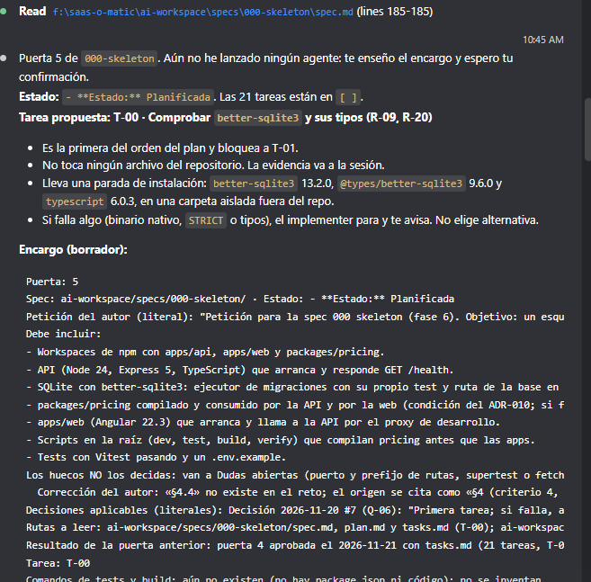
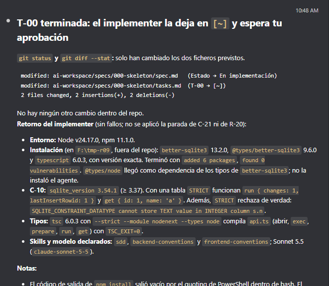

# 000-skeleton — Fase 6 (2026-11-21, sesión 02)

## Objetivo y fase
Fase 6, spec `000-skeleton`. Esta sesión empieza con `/sdd-state 000-skeleton` (consulta del estado) y sigue con la puerta 5 (`/sdd-implement 000-skeleton`): se propone, aprueba y ejecuta la tarea T-00 (comprobar `better-sqlite3` y sus tipos, R-09 y R-20), y se cierra con el cambio de `Estado:`, `tasks.md` y `MEMORY.md`.

## Prompts clave
> /sdd-state 000-skeleton

> /sdd-implement 000-skeleton

> Sí a las tres. Confirmo T-00 con el encargo tal cual; apruebo el paso a En implementación al empezar;
> y apruebo instalar better-sqlite3 13.2.0, @types/better-sqlite3 9.6.0 y typescript 6.0.3, con
> versión exacta, en una carpeta aislada fuera de F:\saas-o-matic (por ejemplo F:\tmp-r09) y ningún
> otro paquete. Mi motivo: R-09 es la condición para todo el proyecto. Si falla el binario, STRICT
> o los tipos, para y avísame con la salida; no elijas alternativa ni otro paquete.

> Apruebo T-00 como hecha. Mi motivo: C-10 y los tipos de @types/better-sqlite3 9.6.0 frente a better-sqlite3 13.2.0 pasan, STRICT rechaza el tipo erróneo, y no se tocó nada del repositorio fuera de spec.md y tasks.md. No borres F:\tmp-r09 hasta que T-05 esté en verde. Marca [x], actualiza MEMORY.md (máximo 50 líneas, fusionando) con sqlite_version 3.54.1 y Node 24.17.0, enséñame el diff y propón el commit sin Co-Authored-By. Después, T-01.

> acepto el diff

> si, renombralo

> /sdd-session 6 000-skeleton

## Qué propuso la IA
- `/sdd-state`: tabla con `Estado: Planificada`, los cuatro ficheros, 0 dudas abiertas, 21 tareas en `[ ]`, última ronda 4 (`Conforme con reservas`), 0 marcadores `(pendiente de /sdd-session)` y 28 capturas `fase-6-000-*`. No elegí puerta: `Planificada` no la determina en la tabla de `sdd`.
- `/sdd-implement`: proponer T-00 como primera tarea (bloquea a T-01), con un encargo con la petición literal (Decisión 2026-11-20 #1), la Decisión #7, ADR-009 y ADR-010, y tres peticiones de aprobación por separado (tarea y encargo, paso a `En implementación`, instalación de los tres paquetes).
- Tras la aprobación, cambió `Estado:` a `En implementación` y lanzó al implementer. Este instaló los tres paquetes con versión exacta en `F:\tmp-r09` y probó C-10 (SQLite 3.54.1, tabla `STRICT`, `run` y `get`) y `tsc` 6.0.3 con la API tipada (`TSC_EXIT=0`). Dejó T-00 en `[~]`, declaró sus skills (`sdd`, `backend-conventions`, `frontend-conventions`) y su modelo (Sonnet 5.5).
- `git status` y `git diff --stat` tras el agente: solo `spec.md` y `tasks.md`.
- Cierre de T-00: `[x]` en la tarea y sus cuatro casillas, `MEMORY.md` en 50 líneas con T-00 anotada, y el diff enseñado.
- Avisos que di al autor: el código de salida de `npm install` salió vacío (quoting de PowerShell dentro de bash), la prueba de tipos usó solo unas opciones de `tsc` y no el `tsconfig` real de T-01, y `F:\tmp-r09` seguía sin borrar.

## Qué corregí y por qué
- Pedí a la IA que no borrara `F:\tmp-r09` hasta que T-05 esté en verde, porque la evidencia puede hacer falta mientras se monta el andamio de la API.
- Fijé el límite de `MEMORY.md` en 50 líneas, fusionando contenido en vez de añadir líneas.
- La captura `fase-6-000-t00-resultado.png` se había guardado con un espacio y `.png` repetido; pedí que la renombrara y se renombró.
- Corrección de la IA en `MEMORY.md`: la frase «Todavía no hay código» y el estado `Planificada` quedaban desfasados y se actualizaron antes de enseñar el diff.

## Decisiones tomadas
- T-00 se da por hecha: C-10 y los tipos de `@types/better-sqlite3` 9.6.0 frente a `better-sqlite3` 13.2.0 pasan, y `STRICT` rechaza el tipo erróneo.
- Se aprueba la instalación (carpeta aislada fuera del repo, versiones exactas, ningún otro paquete) y el paso de `Estado:` a `En implementación`.
- `F:\tmp-r09` se conserva hasta que T-05 esté en verde.
- La siguiente tarea es T-01, que se propone tras el cierre de T-00.
- Commit: el de cierre de esta sesión.

## Capturas
- 
- 
- Las otras capturas `fase-6-000-*` existentes pertenecen a las sesiones anteriores de la spec; no las enlazo aquí.

## Pendiente para la siguiente sesión
- Proponer y aprobar T-01 (raíz: workspaces, TypeScript base y Vitest), con parada de instalación (`npm install`) que necesita aprobación expresa.
- Tras el commit, sustituir los `(pendiente de /sdd-session)` de `spec.md` si los hubiera (ahora hay 0).
- Borrar `F:\tmp-r09` solo cuando T-05 esté en verde y el autor lo apruebe.
- Reservas de la spec 000 todavía abiertas (H-08, H-12, H-28) y pendientes a cargo del autor (qué se recorta de `CLAUDE.md` antes de T-20; pragmas `foreign_keys` y WAL en la spec 002; D-03 como posible R-32).
