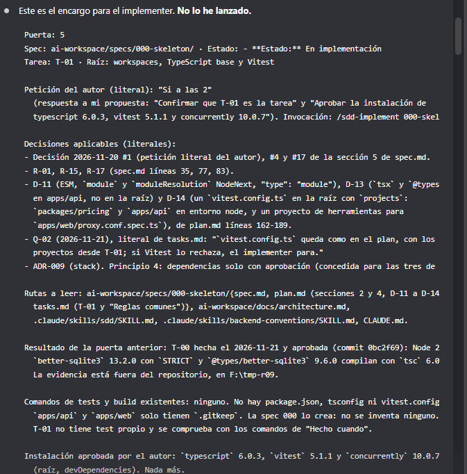
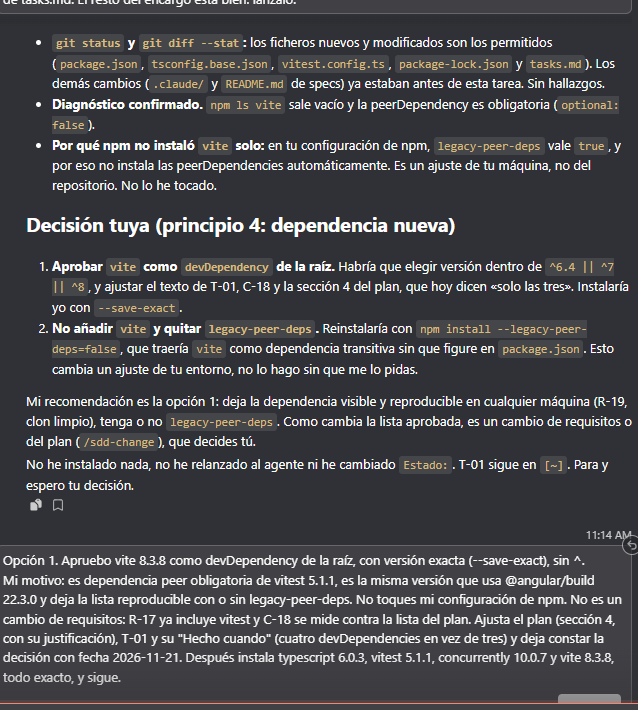
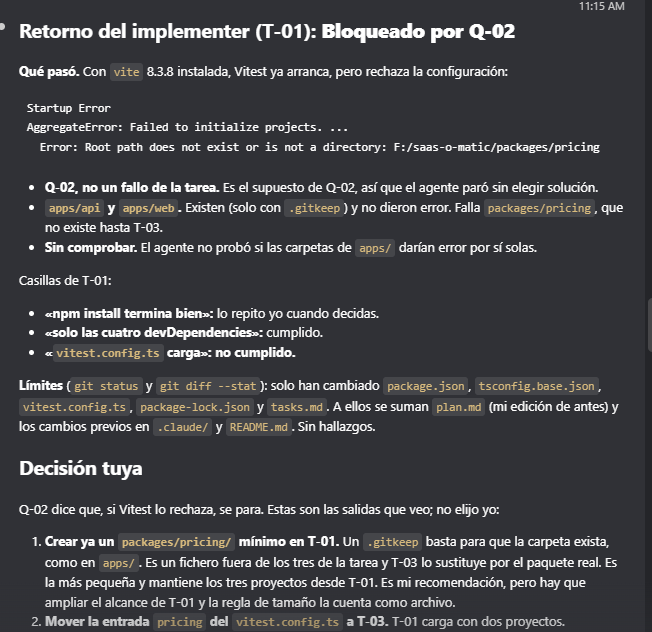
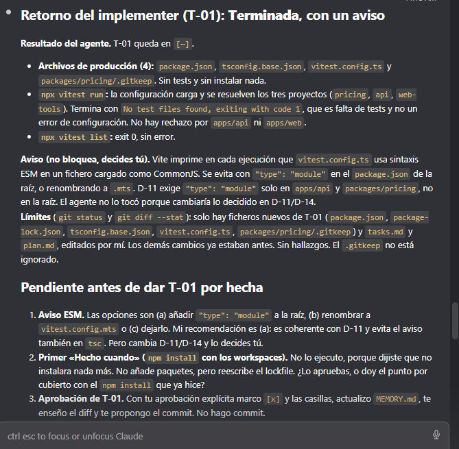

# 000-skeleton — Fase 6 (2026-11-21, sesión 03)

## Objetivo y fase
Fase 6, spec `000-skeleton` (estado `En implementación`), puerta 5 con `/sdd-implement`: implementar la tarea T-01 (raíz: workspaces, TypeScript base y Vitest) con el agente `implementer`. La instalación de dependencias la hizo la sesión principal, con la aprobación del autor.

## Prompts clave
> /sdd-implement 000-skeleton

> Si a las 2

(Respuesta a mi propuesta: confirmar que T-01 era la tarea y aprobar la instalación de `typescript` 6.0.3, `vitest` 5.1.1 y `concurrently` 10.0.7.)

> Antes de lanzar, añade al encargo: (1) las tres versiones se instalan exactas, sin ^ (npm install --save-exact), y quien instala es la sesión principal con la aprobación que di; (2) copia literal los tres "Hecho cuando" de T-01 de tasks.md. El resto del encargo está bien: lánzalo.

> Opción 1. Apruebo vite 8.3.8 como devDependency de la raíz, con versión exacta (--save-exact), sin ^.
> Mi motivo: es dependencia peer obligatoria de vitest 5.1.1, es la misma versión que usa @angular/build 22.3.0 y deja la lista reproducible con o sin legacy-peer-deps. No toques mi configuración de npm. No es un cambio de requisitos: R-17 ya incluye vitest y C-18 se mide contra la lista del plan. Ajusta el plan (sección 4, con su justificación), T-01 y su "Hecho cuando" (cuatro devDependencies en vez de tres) y deja constar la decisión con fecha 2026-11-21. Después instala typescript 6.0.3, vitest 5.1.1, concurrently 10.0.7 y vite 8.3.8, todo exacto, y sigue.

> Opción 1. Crea packages/pricing/.gitkeep en T-01. Mi motivo: mantiene los tres proyectos desde T-01 como decidí en Q-02, y es lo más pequeño. Ajusta T-01 en tasks.md (alcance: cuatro archivos de producción con el .gitkeep; "Hecho cuando", con la decisión Q-02 aplicada y la fecha 2026-11-21) y añade a T-03 que retire ese .gitkeep al crear el paquete real. Reanuda al agente para que cree el fichero y compruebe que vitest.config.ts carga. Aún no instales nada más.

> Apruebo (a): añade "type": "module" al package.json de la raíz. Mi motivo: es coherente con D-11 (ESM NodeNext) y evita el aviso en cada ejecución. Deja constar en plan.md (D-11) que la raíz también es type: module, con la fecha 2026-11-21. Apruebo ejecutar npm install (sin paquetes nuevos) para comprobar el primer "Hecho cuando", y comprueba con npm ls vite que solo hay una versión, la 8.3.8. Si npx vitest list ya no da el aviso y todo sale bien, apruebo T-01 como hecha: marca [x] y las casillas, actualiza MEMORY.md (máximo 50 líneas), enséñame el diff y propón el commit sin Co-Authored-By. Si algo falla, para y avísame.

> haz el commit

> /sdd-session 6 000-skeleton y depues prepara el commit y hazlo

## Qué propuso la IA
- T-01 como siguiente tarea (T-00 `[x]`, T-01 depende solo de ella), con parada de instalación; sin comandos de test o build previos porque aún no existían.
- Un encargo con la plantilla de `/sdd-flow`, mostrado antes de lanzar. Preguntó si pegar íntegra la Decisión #1 (no consta respuesta; el encargo la citó por número).
- Instalar yo las tres dependencias exactas antes de lanzar, para que el implementer pudiera comprobar `vitest.config.ts`.
- Tras el primer bloqueo del implementer (`Cannot find package 'vite'`), comprobé que la peerDependency de `vitest` 5.1.1 es obligatoria y que el npm del autor tiene `legacy-peer-deps=true`. Propuse dos opciones; recomendé añadir `vite` como `devDependency`.
- Tras el segundo bloqueo (Q-02: Vitest rechaza `packages/pricing` inexistente), propuse tres opciones; recomendé crear un `.gitkeep`.
- Ante el aviso ESM del implementer, propuse tres opciones; recomendé `"type": "module"` en la raíz.
- Un commit con una lista cerrada de ficheros y sin los cambios previos de `.claude/` y `README.md`.

## Qué corregí y por qué
- Pedí instalaciones exactas (`--save-exact`) y que las hiciera la sesión principal, no el implementer.
- Pedí copiar literal los tres «Hecho cuando» de T-01 en el encargo.
- Pedí no tocar mi configuración de npm.
- Elegí cada vez la opción que mantenía lo ya decidido (Q-02, D-11) y la más pequeña.
- Rechacé el primer intento de commit antes de ejecutar `/sdd-session`. El motivo no lo dio (no registrado).

## Decisiones tomadas
- 2026-11-21: `vite` 8.3.8 como `devDependency` de la raíz, exacta, sin `^`; fila nueva en la sección 4 del plan. La raíz declara cuatro `devDependencies`. No es un cambio de requisitos (R-17, C-18).
- 2026-11-21 (Q-02 aplicada): `packages/pricing/.gitkeep` en T-01, para mantener los tres proyectos de `vitest.config.ts`; T-03 lo retira. T-01 pasa a cuatro archivos de producción.
- 2026-11-21: `"type": "module"` también en el `package.json` de la raíz (ampliación de D-11 en `plan.md`).
- 2026-11-21: T-01 hecha: `npm install` sin paquetes nuevos, `npm ls vite` con una sola versión (8.3.8) y `npx vitest list` sin aviso. `tasks.md` en `[x]` y `MEMORY.md` actualizado (50 líneas).
- Commit: el de cierre de esta sesión.

## Capturas

No hubo líneas `CAPTURA:` en esta sesión; las cuatro imágenes son las que ya existen para T-01.

## Pendiente para la siguiente sesión
- T-02 a T-20 de la spec 000 y la validación (puerta 6).
- `npm ls --workspaces` seguirá dando «No workspaces found» hasta T-05; el enlace de los tres miembros se comprueba en T-05 y T-14 (C-01).
- T-03 debe retirar `packages/pricing/.gitkeep`.
- Antes de T-20, el autor decide qué se recorta de `CLAUDE.md` (60 de 60 líneas).
- Cambios previos sin commit (`.claude/commands/sdd-change.md`, `.claude/commands/sdd-flow.md`, `.claude/skills/sdd/SKILL.md`, `ai-workspace/specs/README.md`): quedan fuera del commit de T-01.
- Reservas de la spec 000 (H-08, H-12, H-28) y los pendientes del plan (pragmas en la spec 002; D-03 sin `R-nn`).
