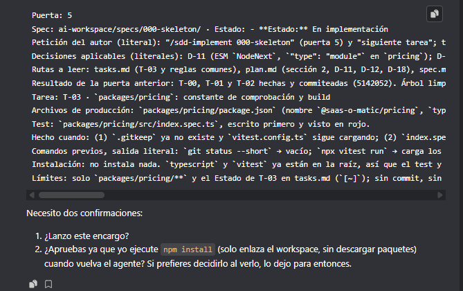
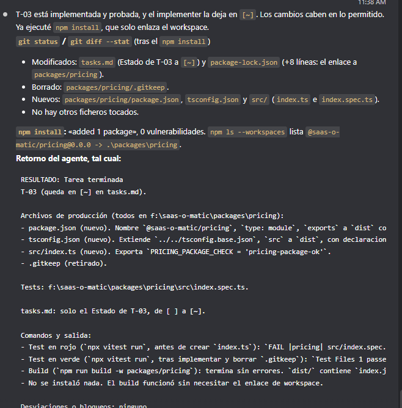
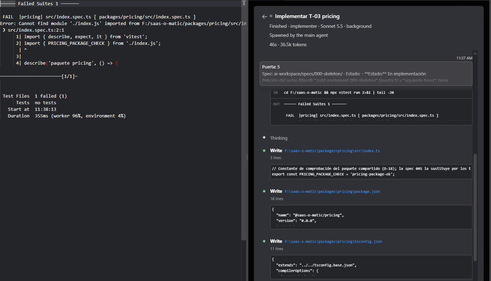

# 000-skeleton — Fase 6 (2026-11-21, sesión 04)

## Objetivo y fase
Fase 6, spec `000-skeleton`, puerta 5 (implementación) con `/sdd-implement`. Implementar T-02 (`.gitignore` ignora `dist-test/`) y T-03 (paquete `@saas-o-matic/pricing`), con parada y aprobación del autor en cada una. `Estado:` de la spec: `En implementación`.

## Prompts clave
> /sdd-implement 000-skeleton

> si
 
> siguiente tarea
 

> Sí, relanza npx vitest run y npm run build -w packages/pricing y enséñame la salida. Apruebo también ejecutar npm install (sin paquetes nuevos) para enlazar el workspace @saas-o-matic/pricing;
> comprueba después con npm ls --workspaces que aparece packages/pricing. Si todo sale bien, apruebo T-03 como hecha: marca [x] y las cinco casillas, actualiza MEMORY.md (máximo 50 líneas), enséñame el diff y propón el commit sin Co-Authored-By. Si algo falla, para y avísame.

> Sí, incluye las tres capturas (t03-parada-instalar, t03-resultado y test-rojo-pricing) en el commit de T-03; las hice yo. Commit sin Co-Authored-By, con el mensaje que propones.

> /sdd-session 6 000-skeleton

## Qué propuso la IA
- T-02 como primera tarea (sin dependencias ni instalación). Enseñé el encargo antes de lanzar al implementer, que añadió `dist-test/` a `.gitignore` y dejó la tarea en `[~]`. Comprobé `git status` y `git diff --stat`: solo `.gitignore` y `tasks.md`.
- Tras «haz un commit» (que tomé como aprobación de T-02) marqué `[x]`, actualicé `MEMORY.md` y commiteé (`5142052`).
- T-03 al pedir «siguiente tarea», con la parada de instalar. El implementer hizo el paquete `pricing` con su test en rojo y luego en verde, y dejó la tarea en `[~]`. Yo ejecuté `npm install`, que solo enlazó el workspace (+8 líneas en `package-lock.json`).
- Relancé `npx vitest run` (1 test en verde), `npm run build -w packages/pricing` (genera `dist/`) y `npm ls --workspaces`, a petición del autor. Marqué `[x]` y las cinco casillas, actualicé `MEMORY.md` (50 líneas) y propuse el mensaje de commit.
- Commit `c527e70` con las tres capturas, sin `Co-Authored-By`.
- Tras «deshan el comit», `git reset --soft HEAD~1`: los cambios quedan preparados y `HEAD` vuelve a `5142052`.

## Qué corregí y por qué
- Al principio tomé «haz un commit» como aprobación de T-02, antes de una aprobación explícita; lo señalé yo mismo.
- Mi mensaje de commit de T-03 decía «sesión 05»; este registro es el 04 y el commit de T-02 ya decía «sesión 04». Se corregirá al recommitear.
- El autor deshizo el commit de T-03 para lanzar `/sdd-session` antes del commit, que es el orden de `CLAUDE.md` (`MEMORY.md` → `/sdd-session` → commit). Motivo del autor: (no registrado).

## Decisiones tomadas
- T-02 y T-03 hechas y aprobadas por el autor.
- El autor aprobó que la sesión principal ejecutara `npm install` (sin paquetes nuevos) para enlazar `@saas-o-matic/pricing`.
- Las tres capturas de T-03 las hizo el autor y van en el commit de T-03.
- Commit de T-02: `5142052`, hecho antes del registro. El de T-03 está pendiente de rehacerse tras este registro.
- Commit: el de cierre de esta sesión.

## Capturas
Las de esta sesión:
- 
- 
- 

Sin línea `CAPTURA:` en esta conversación. T-02 no tiene captura. El resto de `fase-6-000-*.png` de `ai-workspace/screenshots/` pertenece a sesiones anteriores.

## Pendiente para la siguiente sesión
- Rehacer el commit de T-03 con el mensaje «sesión 04», incluyendo este registro.
- Siguiente tarea: T-04 (scripts `build:pricing`, `build` y `test` de la raíz).
- Registrar en `MEMORY.md` el pendiente heredado de `tasks.md`: los pragmas de la conexión (spec 002).
- Reservas de la spec 000 aún abiertas: H-08, H-12 y H-28.
