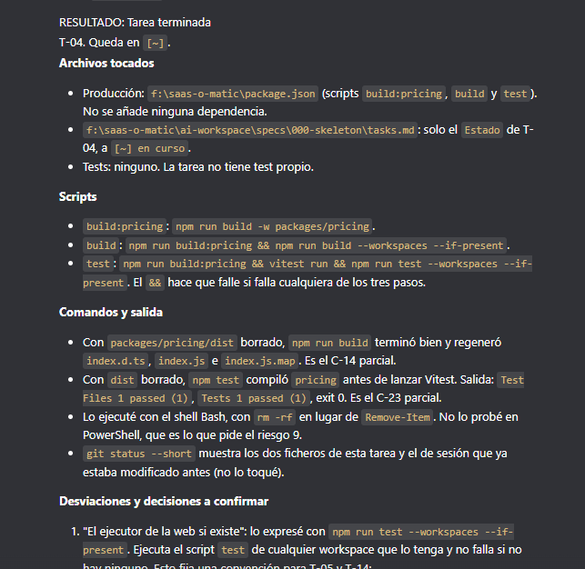

# 000-skeleton — Fase 6 (2026-11-21, sesión 05)

## Objetivo y fase
Fase 6, spec `000-skeleton` (`Estado: En implementación`). Puerta 5 con `/sdd-implement`: hacer la tarea T-04 (scripts de la raíz `build:pricing`, `build` y `test`; R-13 y R-15), con el `implementer` y el orden de cierre MEMORY.md → `/sdd-session` → commit.

## Prompts clave
> /sdd-implement 000-skeleton

> si, confirmo

(respuesta a mi propuesta de T-04 como tarea de esta vuelta)

> si, lanzalo

(respuesta al encargo del `implementer`, enseñado antes de lanzarlo)

> Acepto los tres puntos con una condición. (1) --workspaces --if-present está bien; anótalo en tasks.md (en T-05: apps/api no tiene script test; en T-14: la web lo llama test). (2) El doble build de pricing es una desviación aceptada, con la fecha 2026-11-21: garantiza pricing antes que las apps. (3) Repite C-14 y C-23 en PowerShell con Remove-Item -Recurse -Force packages\pricing\dist y enséñame la salida. Si salen bien, apruebo T-04 como hecha: marca [x] y las casillas, actualiza MEMORY.md (máximo 50 líneas), enséñame el diff y propón el commit sin Co-Authored-By.

> Apruebo T-04 como hecha. Mi motivo: C-14 y C-23 pasan en PowerShell, los scripts son los del plan y la desviación del doble build queda anotada con fecha. Deja la tercera casilla sin marcar (es de T-19). Enséñame el diff final y propón el commit sin Co-Authored-By, sin el registro de sesión 04, que no es de esta tarea.

> /sdd-session 6 000-skeleton

## Qué propuso la IA
- Proponer T-04 como siguiente tarea (T-00 a T-03 estaban `[x]`), con un solo archivo de producción (`package.json`) y sin instalar nada.
- Ejecutar `npx vitest run` y el build de `pricing` antes de montar el encargo, y enseñar el encargo completo antes de lanzar al `implementer`. El `git status` ya mostraba cambios en el registro de sesión 04, ajenos a la tarea.
- El `implementer` dejó T-04 en `[~]`. Los scripts quedaron así:
  - `build:pricing`: `npm run build -w packages/pricing`.
  - `build`: `npm run build:pricing && npm run build --workspaces --if-present`.
  - `test`: `npm run build:pricing && vitest run && npm run test --workspaces --if-present`.
- Tras el retorno, la IA comprobó `git status` y `git diff --stat`: solo cambiaron `package.json` y `tasks.md`.
- Señaló tres puntos para el autor:
  - la forma de expresar «el ejecutor de la web si existe»;
  - el doble build de `pricing`;
  - que las pruebas se hicieron en Bash y no en PowerShell.
- Repitió C-14 y C-23 en PowerShell con `Remove-Item -Recurse -Force`. Ambos salieron con `exit=0`.
- Tras la aprobación, marcó `[x]` en T-04 y sus dos primeras casillas. Anotó las convenciones en T-04, T-05 y T-14, y amplió en sitio la frase de T-04 en `MEMORY.md`, que sigue en 50 líneas.

## Qué corregí y por qué
- La IA marcó primero también la tercera casilla («C-14 y C-23 se repiten completos en T-19») y se corrigió ella misma, antes de enseñar el diff, porque es un recordatorio de una tarea futura. El autor lo confirmó: «Deja la tercera casilla sin marcar (es de T-19)».
- El autor excluyó del commit el registro de sesión 04, «que no es de esta tarea».
- Del autor, el resto: (no registrado).

## Decisiones tomadas
- 2026-11-21: «el ejecutor de la web si existe» se expresa con `npm run test --workspaces --if-present`. Por tanto, `apps/api` no tiene script `test` (T-05) y la web lo llama `test` (T-14). Anotado en `tasks.md`.
- 2026-11-21: el doble build de `pricing` en `build` es una desviación aceptada, porque garantiza `pricing` antes que las apps.
- 2026-11-21: T-04 aprobada como hecha. Motivo del autor: C-14 y C-23 pasan en PowerShell, los scripts son los del plan y la desviación queda anotada con fecha.
- Commit: el de cierre de esta sesión.

## Capturas
- 
- No hubo líneas `CAPTURA:` en esta conversación.
- El resto de `fase-6-000-*.png` pertenece a sesiones anteriores de la fase.

## Pendiente para la siguiente sesión
- Siguiente tarea: T-05 (andamio de `apps/api`), con parada de instalar la lista aprobada. No debe llevar script `test`.
- La tercera casilla de T-04 se cierra en T-19.
- Reservas aceptadas de la spec 000 que siguen abiertas: H-08, H-12, H-26, H-27, H-28, H-29, H-30, H-31 y H-32, tal como constan en `MEMORY.md`.
- Pendientes del autor: qué se recorta de `CLAUDE.md` antes de T-20, y D-03 (un posible R-32 con `/sdd-change`).
- Las pruebas de C-14 y C-23 se repiten completos en T-19.
