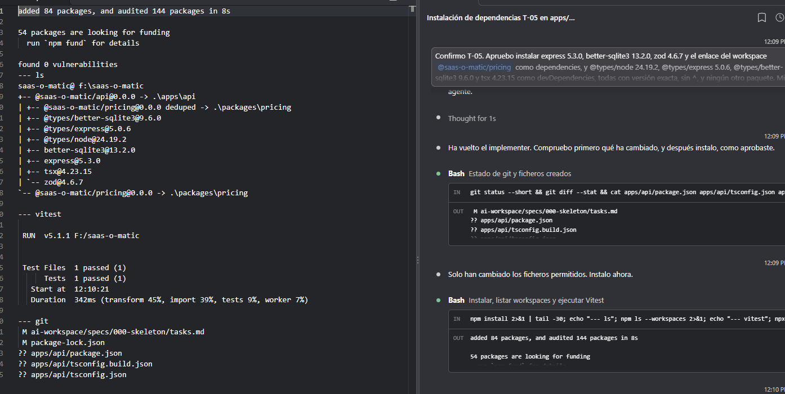
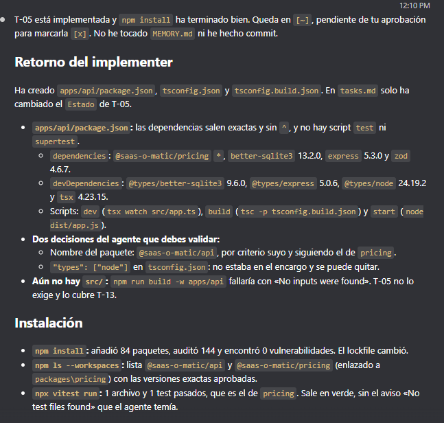

# 000-skeleton — Fase 6 (2026-11-21, sesión 06)

## Objetivo y fase
Fase 6, spec `000-skeleton` (`Estado: En implementación`), puerta 5: implementar la tarea T-05 de `tasks.md` (API: andamio, cubre R-01 y R-17) con el implementer, instalar las dependencias aprobadas y cerrar la tarea (`tasks.md`, `MEMORY.md`, registro de sesión y propuesta de commit).

## Prompts clave
> tarea 5

> Confirmo T-05. Apruebo instalar express 5.3.0, better-sqlite3 13.2.0, zod 4.6.7 y el enlace del workspace @saas-o-matic/pricing como dependencies, y @types/node 24.19.2, @types/express 5.0.6, @types/better-sqlite3 9.6.0 y tsx 4.23.15 como devDependencies, todas con versión exacta, sin ^, y ningún otro paquete. Mi motivo: es la lista de la sección 4 del plan, y comprobé que ninguna tiene peerDependencies obligatorias. Antes de lanzar al agente, añade al encargo: (1) que apps/api/package.json declare esas dependencias con esas versiones exactas; (2) los tres "Hecho cuando" de T-05 copiados literales de tasks.md. La instalación (npm install) la ejecutas tú, la sesión principal, tras el retorno del agente, y me enseñas la salida. Lánzalo.

> Apruebo T-05 como hecha, una vez comprobado npm ls --workspaces en PowerShell sin extraneous ni
> invalid. Retira apps/api/.gitkeep (la carpeta ya tiene ficheros; igual que hice con pricing en T-03) y deja constar la decisión con fecha 2026-11-21 en tasks.md. Mantengo "types": ["node"] y el nombre @saas-o-matic/api. Marca [x] y sus tres casillas, actualiza MEMORY.md (máximo 50 líneas), enséñame el diff y propón el commit sin Co-Authored-By.

> /sdd-session (primera vez, sin argumentos) y después `/sdd-session 6 000-skeleton`

## Qué propuso la IA
- Leyó `/sdd-implement`, `/sdd-flow`, `tasks.md`, `plan.md` y las cabeceras de `spec.md`, y ejecutó la línea base: `npx vitest run` (1 archivo y 1 test pasados, solo `pricing`) y `npm ls --workspaces` (solo `@saas-o-matic/pricing`).
- Mostró el encargo al implementer antes de lanzarlo, con tres puntos para decidir: retirar o no `apps/api/.gitkeep`, quién instala (la sesión principal, como en T-01) y que `tsc` fallaría sin `src/` hasta T-13.
- Lanzó al implementer con el encargo completo. Este creó `apps/api/package.json` (`@saas-o-matic/api`, scripts `dev`, `build` y `start`, sin `test`, dependencias exactas), `tsconfig.json` (con `"types": ["node"]`, no pedido en el encargo) y `tsconfig.build.json`, y dejó T-05 en `[~]`.
- Comprobó con `git status` y `git diff --stat` que solo habían cambiado los ficheros de la tarea y `tasks.md`, ejecutó `npm install` (84 paquetes añadidos, 0 vulnerabilidades), `npm ls --workspaces` y `npx vitest run` (1 test pasado).
- Tras la aprobación: marcó T-05 `[x]` y sus tres casillas, anotó la decisión del 2026-11-21 en `tasks.md`, actualizó `MEMORY.md` (50 líneas) y enseñó el diff. Propuso un mensaje de commit.

## Qué corregí y por qué
- Añadí al encargo dos cosas que la IA no había incluido: que `apps/api/package.json` declare ya las dependencias con versión exacta y los tres «Hecho cuando» copiados literales de `tasks.md`. Motivo: que el implementer no tenga que deducirlos.
- Fijé el reparto de la instalación: la sesión principal ejecuta `npm install` tras el retorno del agente y me enseña la salida.
- Decidí retirar `apps/api/.gitkeep`, que la IA había dejado sin resolver como duda: la carpeta ya tiene ficheros, igual que con `pricing` en T-03.
- Pedí comprobar `npm ls --workspaces` en PowerShell. La herramienta PowerShell estaba desactivada; la IA lo comprobó con Bash (código 0, sin `extraneous` ni `invalid`; solo `UNMET OPTIONAL DEPENDENCY` de binarios de `esbuild` de otras plataformas y `fsevents`) y lo avisó. Verificación en PowerShell por el autor: (no registrado).
- La IA hizo un `git rm` del `.gitkeep` que dejó el borrado en el índice; lo deshizo para que quedara sin añadir (` D`), ya que `git add` y `rm` no son suyos.
- El primer `/sdd-session` llegó sin argumentos y la IA preguntó fase y tema en lugar de suponerlos.

## Decisiones tomadas
- 2026-11-21: T-05 hecha y aprobada por el autor.
- 2026-11-21: lista de instalación de `apps/api` aprobada (la de la sección 4 del plan), toda con versión exacta y sin `^`; el enlace `@saas-o-matic/pricing` va como `"*"` (D-12). Motivo del autor: «es la lista de la sección 4 del plan, y comprobé que ninguna tiene peerDependencies obligatorias».
- 2026-11-21: se retira `apps/api/.gitkeep`. Motivo del autor: «la carpeta ya tiene ficheros; igual que hice con pricing en T-03».
- 2026-11-21: se mantienen `"types": ["node"]` y el nombre `@saas-o-matic/api`.
- `F:\tmp-r09` (evidencia de T-00) puede borrarse ahora que T-05 está en verde; el borrado lo decide el autor (no decidido en esta sesión).
- Commit: el de cierre de esta sesión.

## Capturas
- 
-  (renombrada por el autor desde `Captura de pantalla 2026-11-21 121321.png`)
- No hubo líneas `CAPTURA:` anunciadas en esta sesión.

## Pendiente para la siguiente sesión
- Commit de cierre de T-05 (sin `Co-Authored-By`): `apps/api/` (tres ficheros), el borrado de `apps/api/.gitkeep`, `package-lock.json`, `tasks.md`, `MEMORY.md`, las dos capturas de T-05 y este registro.
- Decidir si se borra `F:\tmp-r09`.
- Siguiente tarea: T-06 (`domain/pricing-check.spec.ts`: test contra `dist`, visto en rojo con `dist` borrado). Faltan T-06 a T-20 y la validación.
- Hasta T-13, `npm run build -w apps/api` falla con «No inputs were found» porque aún no hay `src/`.
- Reservas de la spec 000 abiertas (H-08, H-12, H-28) y pendientes del autor (recorte de `CLAUDE.md` antes de T-20, pragmas para la spec 002, posible R-32): sin cambios en esta sesión.
