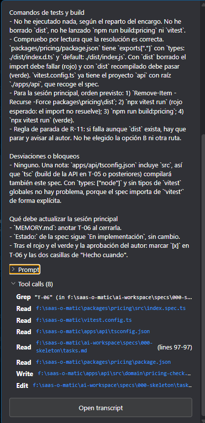
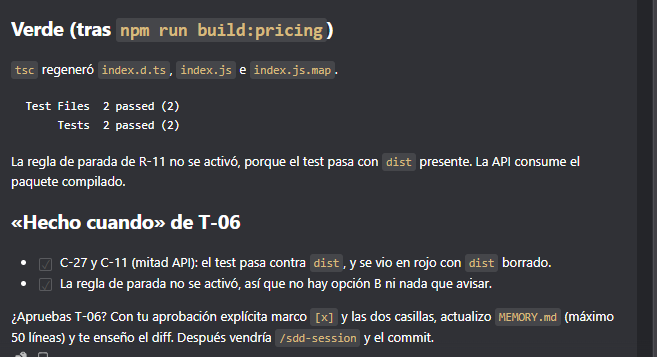

# 000-skeleton — Fase 6 (2026-11-21, sesión 07)

## Objetivo y fase
Fase 6, spec `000-skeleton` (`Estado: En implementación`), puerta 5: implementar la tarea T-06 de `tasks.md` (API, `domain`: comprobar `packages/pricing` desde `dist`; cubre R-10, R-11 y R-24) con el implementer, ver el test en rojo con `dist` borrado y en verde tras recompilar, y cerrar la tarea (`tasks.md`, `MEMORY.md`, registro de sesión y propuesta de commit).

## Prompts clave
> /sdd-implement 000-skeleton

> Confirmo T-06. Hazlo así: el implementer escribe pricing-check.spec.ts; después tú borras packages\pricing\dist con Remove-Item -Recurse -Force y ejecutas el test para ver el rojo; luego recompilas con npm run build:pricing y vuelves a ejecutar para el verde. Pon en el encargo, literales, los dos "Hecho cuando" de T-06, con la regla de parada de R-11 (si falla aunque dist exista, para y avísame; no elijas otra cosa). Enséñame el encargo completo antes de lanzar al agente.

> si, lanzalo, cumple lo que pedi

> lo apruebo

> /sdd-session 6 000-skeleton

## Qué propuso la IA
- Leyó la línea `Estado:` de `spec.md` (`En implementación`) y el estado de las tareas (T-00 a T-05 hechas) y propuso T-06 como siguiente, por el orden del plan y por estar cumplida su dependencia (T-05). Ofreció también T-07, T-08 y T-09, que dependen solo de T-05.
- Ejecutó la línea base: `packages/pricing/dist` existe (`index.d.ts`, `index.js`, `index.js.map`), `npx vitest run` pasa 1 test (solo `pricing`) y `npm ls --workspaces` lista `api` y `pricing`. Avisó de que la herramienta PowerShell seguía desactivada y propuso lanzar `Remove-Item` con `powershell.exe -Command` desde Bash.
- Enseñó el encargo completo antes de lanzar y lo lanzó tras la confirmación del autor.
- El implementer escribió solo `apps/api/src/domain/pricing-check.spec.ts` (importa `PRICING_PACKAGE_CHECK` de `@saas-o-matic/pricing` y comprueba `'pricing-package-ok'`) y dejó T-06 en `[~]`. No ejecutó nada, como pedía el encargo, y avisó de que `apps/api/tsconfig.json` incluye `src`, así que el build de la API compilará también este spec.
- La sesión principal comprobó con `git status` y `git diff --stat` que solo habían cambiado el test y `tasks.md`; borró `packages\pricing\dist` (`Test-Path` dio `False`) y ejecutó `npx vitest run`: **rojo**, `Failed to resolve entry for package "@saas-o-matic/pricing"` (1 archivo fallado, el del test de `pricing` sigue pasando porque importa desde `src/`); recompiló con `npm run build:pricing` y ejecutó de nuevo: **verde**, 2 archivos y 2 tests pasados. La regla de parada de R-11 no se activó.
- Tras la aprobación: marcó T-06 `[x]` y sus dos casillas, actualizó `MEMORY.md` (50 líneas) y enseñó el diff.

## Qué corregí y por qué
- Fijé el reparto de la ejecución: el implementer solo escribe el test; el borrado de `dist`, el rojo, la recompilación y el verde los ejecuta la sesión principal, para que el rojo quede a la vista. Motivo del autor: (no registrado).
- Exigí que el encargo llevase literales los dos «Hecho cuando» de T-06 y la regla de parada de R-11, y que se me enseñase completo antes de lanzar.
- Verificación del rojo y del verde por el autor: (no registrado).

## Decisiones tomadas
- 2026-11-21: T-06 confirmada como siguiente tarea.
- 2026-11-21: reparto de la ejecución de T-06 como se indica arriba (implementer escribe; sesión principal ejecuta rojo y verde).
- 2026-11-21: T-06 hecha y aprobada por el autor.
- La opción B (R-11, C-12) no hace falta: la API consume el paquete compilado desde `dist`.
- Commit: el de cierre de esta sesión.

## Capturas
- 
- 
- No hubo líneas `CAPTURA:` anunciadas en esta sesión.

## Pendiente para la siguiente sesión
- Commit de cierre de T-06 (sin `Co-Authored-By`): `apps/api/src/domain/pricing-check.spec.ts`, `tasks.md`, `MEMORY.md`, las dos capturas y este registro.
- Siguiente tarea: T-07 (`config/envs.ts` y `env.example`), T-08 o T-09, que dependen solo de T-05; el autor elige. Faltan T-07 a T-20 y la validación.
- Decidir si se borra `F:\tmp-r09` (T-05 ya está en verde).
- Hasta T-13, `npm run build -w apps/api` falla con «No inputs were found» si no hay `src/`; ahora `src/` tiene solo el spec, así que el build compilaría ese test: comprobar el comportamiento cuando se cree el primer fichero de producción.
- Reservas de la spec 000 abiertas (H-08, H-12, H-28) y pendientes del autor (recorte de `CLAUDE.md` antes de T-20, pragmas para la spec 002, posible R-32): sin cambios en esta sesión.
