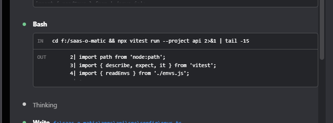
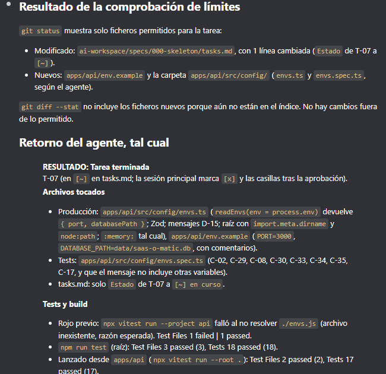

# 000-skeleton — Fase 6 (2026-11-21, sesión 08)

## Objetivo y fase
Fase 6, spec `000-skeleton`, puerta 5 (implementación): hacer la tarea **T-07** (API, `config`: variables de entorno y `env.example`) con el agente `implementer`, hasta su aprobación por el autor. La spec estaba en `Estado: En implementación`; T-00 a T-06 hechas (último commit 13a2ef4).

## Prompts clave
> /sdd-implement 000-skeleton

> confirmo t-0

> Cambios antes de lanzar:
> (1) pega íntegra la fila #1 de la spec, sin (...);
> (2) en la ruta deapps/api, no lo dejes abierto: usa import.meta.dirname con node:path (apps/api está dos niveles por encima de src/config y de dist/config, a la misma profundidad en ambos), y nunca process.cwd(), porque R-07 y C-08 piden resolverla respecto a la raíz de apps/api y no al directorio de trabajo; el plan ya lousa así en migrations-dir (D-05).
>
> El resto del encargo está bien. Lánzalo.

> Apruebo T-07 como hecha. Mi motivo: los 16 casos de envs.spec.ts pasan, C-08 pasa desde la raíz y desde apps/api (sin process.cwd()), el rojo falló por no existir envs.ts y el build de la API ya compila. Marca [x] y las casillas, actualiza MEMORY.md (máximo 50 líneas, fusionando), enséñame el diff y  ropón el commit sin Co-Authored-By, con las dos capturas.

## Qué propuso la IA
- Tarea **T-07** como siguiente (única con T-05 hecha y sin dependencias abiertas). Ejecuté `npm run test` (verde, 2 tests) y `npm run build` (falla con TS18003, esperado hasta que exista código en `src/`) y los puse en el encargo con su salida literal.
- Un encargo para el `implementer` con la plantilla completa. Lo enseñé antes de lanzarlo. Dejé dos cosas que el autor corrigió después: la petición literal recortada con `(...)` y la localización de la raíz de `apps/api` abierta al implementer.
- Al interpretar «confirmo t-0» (mensaje cortado) como T-07, lo dije y pedí que me avisara si era otra.
- Con el plan mode activo no pude lanzar el agente: escribí el plan con el encargo definitivo y tras la aprobación lancé el `implementer`.
- Al volver el agente: `git status` y `git diff --stat` (solo `tasks.md` modificado; `apps/api/env.example` y `apps/api/src/config/` nuevos). Retorno del agente enseñado literal; propuse comprobar el código y repetir tests.
- Tras la aprobación: marqué `[x]` y las casillas de T-07, fusioné T-06 y T-07 en la línea de «Estado actual» de `MEMORY.md` (50 líneas), enseñé el diff y propuse el commit.

## Qué corregí y por qué
- **Petición literal íntegra:** el encargo debía llevar la fila #1 completa, sin `(...)`. (Motivo no dado por el autor.)
- **Raíz de `apps/api`:** no dejarla al implementer. Usar `import.meta.dirname` con `node:path`, nunca `process.cwd()`. Motivo del autor: R-07 y C-08 piden resolverla respecto a la raíz de `apps/api`, no al directorio de trabajo.
- **Omisión mía:** no anuncié ninguna línea `CAPTURA:` en esta sesión, ni al recibir la corrección del autor.

## Decisiones tomadas
- T-07 aprobada como hecha, motivo del autor: los 16 casos de `envs.spec.ts` pasan, C-08 pasa desde la raíz y desde `apps/api` sin `process.cwd()`, el rojo falló por no existir `envs.ts` y el build de la API ya compila.
- `MEMORY.md`: máximo 50 líneas, fusionando.
- Resultado verificado por mí: `npx vitest run --project api` → 17 tests pasados (1 de `pricing-check` y 16 de `envs.spec.ts`); según el agente, `npm run test` en la raíz da 18. Build de la API: según el agente, compila `envs.ts` sin TS18003 (no lo repetí yo).
- `Estado:` de la spec sigue `En implementación`.
- Commit: el de cierre de esta sesión.

## Capturas
- 
- 
- Hay otras 40 capturas `fase-6-000-*` de las sesiones anteriores; no las enlazo aquí.
- Ninguna fue anunciada con una línea `CAPTURA:` en esta conversación.

## Pendiente para la siguiente sesión
- Commit de T-07 (sin `Co-Authored-By`) con `MEMORY.md`, `tasks.md`, `apps/api/env.example`, `apps/api/src/config/`, las dos capturas y este registro.
- Siguiente tarea: **T-08** (API, `data`: ejecutor de migraciones), con el encargo y los comandos de tests y build ejecutados antes de empezar.
- Pendientes de la spec ya conocidos: qué recortar de `CLAUDE.md` antes de T-20 (R-19); `database.md` exige `foreign_keys = ON` y WAL (lo trae la 002); D-03 sin `R-nn`; reservas H-08, H-12 y H-28.
- Anunciar siempre las líneas `CAPTURA:` en los cuatro momentos de `sdd` (aquí faltó una al corregir el encargo).
