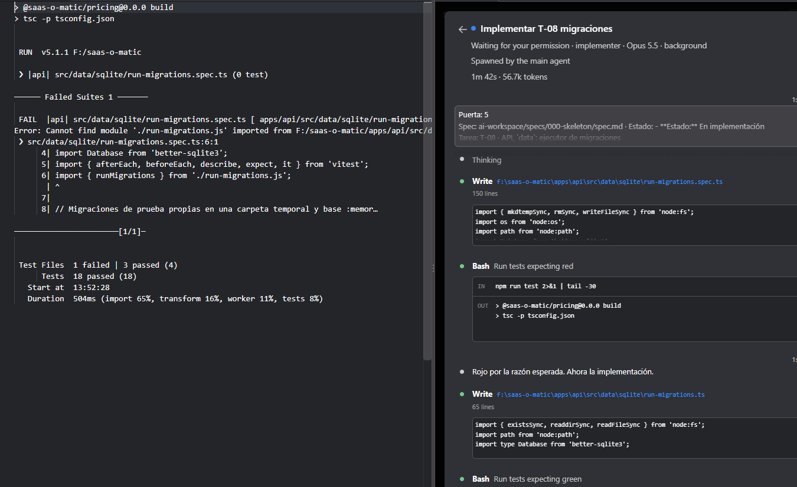
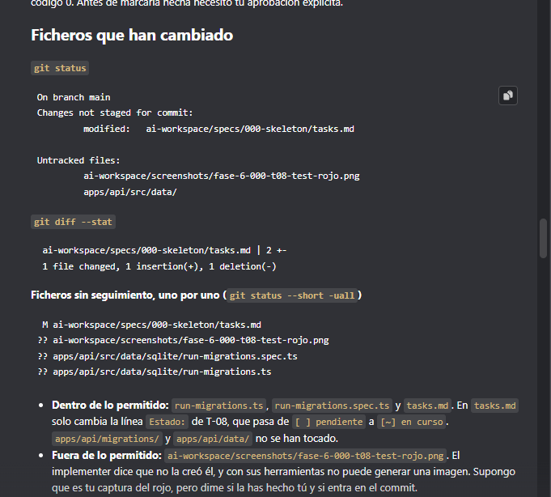

# 000-skeleton — Fase 6 (2026-11-21, sesión 09)

## Objetivo y fase
Fase 6, spec `000-skeleton`, puerta 5 (implementación) con `/sdd-implement 000-skeleton`: implementar T-08 (API, `data`: ejecutor de migraciones), que cubre R-05, R-06, R-27, R-28, R-30 y R-31, más los tests de H-32 y D-03.

## Prompts clave
Invocación del atajo:
> /sdd-implement 000-skeleton

Confirmación de la tarea y condiciones del encargo:
> Confirmo T-08. En el encargo pon completos, sin (...): los 8 "Hecho cuando" de T-08, D-01, D-02 y D-03 con su porqué y su "cómo se aplica", los requisitos R-05, R-06, R-27, R-28, R-30 y R-31 y los casos C-05, C-06, C-07, C-24, C-31, C-32, C-36, C-37 y C-38. Los tests usan solo :memory: y carpetas temporales: nunca apps/api/migrations/ ni la base real. Si algo no está en el plan, el implementer para y me pregunta. Incluye la salida de npm test y npm run build antes de empezar y enséñame el encargo completo antes de lanzar al agente.

Lanzamiento del agente:
> OK explícito, lanza al implementer con este encargo

Aprobación de la tarea:
> Apruebo T-08 como hecha. Mi motivo: los 31 tests pasan, D-01, D-02 y D-03 se aplican como en el plan, cada migración va en su transacción con user_version dentro, y no se tocó apps/api/migrations ni la base real. Marca [x] y las 7 casillas, actualiza MEMORY.md (máximo 50 líneas, fusionando) y añade al
> pendiente de los pragmas de la spec 002 que van en openDatabase y no en una migración, porque cada migración corre en una transacción. Enséñame el diff y propón el commit sin Co-Authored-By, con las capturas.

## Qué propuso la IA
- Leyó la línea de estado literal de la spec (`- **Estado:** En implementación`) y propuso T-08, la primera pendiente, que depende de T-05 (hecha). Esperó la confirmación del autor antes de hacer nada.
- Con el modo plan activo, montó el encargo en el plan con los textos literales de `spec.md`, `plan.md` y `tasks.md`: R-05, R-06, R-27, R-28, R-30 y R-31 con su origen; las filas de los nueve casos; cómo los prueba el plan, sección 5; D-01, D-02 y D-03 completos; el extracto de D-16; las decisiones de la spec #11, #25, #26, #29 y #32; y T-08 entera. No ejecutó `npm test` ni `npm run build`, porque escriben `dist/` y el modo plan no lo permite.
- Avisó de que «Hecho cuando» de T-08 tiene 7 casillas, no 8, y de que la parte de servidor de C-36 y C-37 (no escuchar, código de salida) es de T-12 y T-13.
- Al salir del modo plan ejecutó `npm test` (3 ficheros, 18 tests, código 0) y `npm run build` (código 0), pegó la salida literal en el encargo y lo enseñó completo antes de lanzar.
- El implementer (Sonnet 5.5, en segundo plano) creó `apps/api/src/data/sqlite/run-migrations.ts` y `run-migrations.spec.ts`, con 13 tests solo con `:memory:` y carpetas temporales, y dejó T-08 en `[~] en curso`. El rojo salió por no existir `./run-migrations.js` (1 fichero fallido y 3 pasados, 18 tests pasados); el verde, 4 ficheros y 31 tests; el build, código 0. Usó los mensajes literales de D-15. Añadió, dentro del alcance de C-24 y D-02, un test de «la migración anterior a la que falla se conserva» y el caso `0001`, `0002`, `0004`. Sin desviaciones ni dudas.
- La sesión principal comprobó `git status` y `git diff --stat`. Cambiaron solo los tres ficheros permitidos, más `ai-workspace/screenshots/fase-6-000-t08-test-rojo.png`, que el implementer no creó. Contrastó los mensajes con D-15, líneas 197 a 199 de `plan.md`. Enseñó el retorno literal y paró.
- Tras la aprobación, marcó `[x]` en T-08 y sus 7 casillas. Actualizó `MEMORY.md` fusionando T-00 a T-08 en la misma línea, que se queda en 50, y añadió al pendiente de los pragmas que van en `openDatabase`. Enseñó el diff y propuso el commit.

## Qué corregí y por qué
- Exigí que el encargo llevara los textos completos, sin «(...)», porque en la spec 000 ya se perdió una decisión por faltar su texto en el encargo.
- Añadí dos condiciones para el implementer: tests solo con `:memory:` y carpetas temporales, nunca `apps/api/migrations/` ni la base real; y si algo no está en el plan, para y pregunta.
- Al aprobar, añadí al pendiente de la spec 002 que los pragmas van en `openDatabase` y no en una migración, porque cada migración corre en una transacción.
- Cambié el modelo de la sesión a Opus con `/model opus` antes de confirmar T-08 (motivo: no registrado).

## Decisiones tomadas
- T-08 aprobada como hecha (2026-11-21). Motivo del autor: «los 31 tests pasan, D-01, D-02 y D-03 se aplican como en el plan, cada migración va en su transacción con user_version dentro, y no se tocó apps/api/migrations ni la base real».
- Pragmas `foreign_keys = ON` y WAL de la spec 002: en `openDatabase`, no en una migración, porque cada migración corre en una transacción.
- Recuento de «Hecho cuando»: la IA contó 7 casillas frente a las 8 de la petición del autor. Se marcaron las 7 por indicación del autor.
- Las capturas de T-08 entran en el commit («con las capturas»).
- `MEMORY.md` se queda en 50 líneas como máximo, fusionando.
- Commit: el de cierre de esta sesión.

## Capturas
- 
- 
- Hay otras 43 capturas `fase-6-000-*` de las sesiones anteriores; no las enlazo aquí.
- Ninguna fue anunciada con una línea `CAPTURA:` en esta conversación.

## Pendiente para la siguiente sesión
- Commit de cierre de T-08, con la aprobación del autor.
- T-09: localización de `migrations/` (`migrations-dir.ts`, test compilado en `dist-test/`) y `apps/api/migrations/.gitkeep`.
- La parte de servidor de C-36 y C-37 (no escuchar, código de salida) en T-12 y T-13.
- Pendientes que siguen en `MEMORY.md`: recorte de `CLAUDE.md` antes de T-20, posible R-32 de D-03 (`/sdd-change`) y los pragmas de la spec 002 en `openDatabase`.
