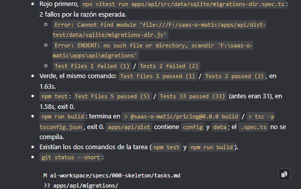
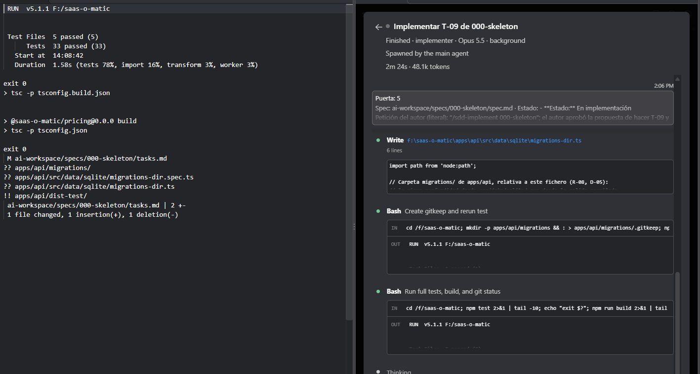

# 000-skeleton — Fase 6 (2026-11-21, sesión 10)

## Objetivo y fase
Fase 6, spec `000-skeleton`, puerta 5 (implementación): tarea T-09, «API, `data`: localización de `migrations/` y carpeta versionada» (R-08, R-25; D-05 del plan). La spec seguía en `- **Estado:** En implementación`.

## Prompts clave
> /sdd-implement 000-skeleton

> Sí, lanza al implementer con ese encargo

> Enséñame la salida literal del rojo. Si falló porque no existía migrations-dir.ts (o su compilado),
> apruebo T-09 como hecha: marca [x] y las 3 casillas, actualiza MEMORY.md (máximo 50 líneas,
> fusionando), enséñame el diff y propón el commit sin Co-Authored-By, incluyendo
> apps/api/migrations/.gitkeep (C-28 exige que esté versionado) y las dos capturas.

> Usamos MIGRATIONS_DIR, el nombre del plan (D-16). Renómbralo ya en migrations-dir.ts y en migrations-dir.spec.ts (incluida la descripción del describe), cambia también la mención en MEMORY.md, y vuelve a pasar npm test. En el registro, si la captura del rojo es tu reproducción, dilo así: "rojo reproducido tras la tarea, sha256 verificado".

> La captura del rojo es el retorno del implementer, con su rojo original (2 fallos: no existe el compilado de migrations-dir.js y no existe apps/api/migrations). En el registro escribe: "rojo  original del implementer, tomado de su retorno; la sesión principal lo reprodujo después con los mismos dos errores (sha256 verificado)". Haz /sdd-session y el commit con los ficheros propuestos y el mensaje con MIGRATIONS_DIR, sin Co-Authored-By.

> (a) descártala; enlaza solo las dos de T-09

> Sí, guárdalo con un solo espacio y haz el commit

## Qué propuso la IA
- La IA empezó en modo plan. Leyó el `Estado:` de `spec.md` y `tasks.md` (T-00 a T-08 en `[x]`) y propuso T-09, cuyas dependencias (T-02 y T-05) ya estaban hechas. El autor aprobó el plan.
- Antes de lanzar al implementer ejecutó `npm test` (4 ficheros, 31 tests, exit 0) y `npm run build` (exit 0). Montó el encargo con la plantilla de `/sdd-flow`: Decisiones #1, #6, #25 y #31 y D-05, literales; T-08 como resultado anterior; salidas de tests y build. Se lo enseñó al autor antes de lanzarlo.
- El implementer devolvió `Tarea terminada`:
  - `migrations-dir.ts` con `MIGRATIONS_DIRECTORY` (nombre suyo; el plan no lo fijaba en la tarea).
  - `apps/api/migrations/.gitkeep`.
  - `migrations-dir.spec.ts`, que borra `dist-test/`, compila con `tsc -p tsconfig.build.json --outDir dist-test` y comprueba la ruta compilada y C-28.
  - Rojo con 2 fallos y verde con 33 tests. T-09 quedó en `[~]`.
- La IA ejecutó `git status` y `git diff --stat`: solo habían cambiado los ficheros de T-09 y la línea de estado de `tasks.md`. Señaló dos cosas: el choque entre `MIGRATIONS_DIRECTORY` y `MIGRATIONS_DIR` (plan, línea 205), y que C-28 («está versionado») solo se cumple con el commit.
- Para enseñar el rojo literal, la IA lo reprodujo:
  - Apartó al scratchpad `migrations-dir.ts` y `apps/api/migrations/`, ejecutó el test y los restauró, con sha256 comprobado antes y después.
  - El primer intento, filtrando por ruta, no encontró el test («No test files found»). El segundo, filtrando por nombre, dio los dos errores esperados: `Cannot find module 'file:///F:/saas-o-matic/apps/api/dist-test/data/sqlite/migrations-dir.js'` y `ENOENT: no such file or directory, scandir 'F:\saas-o-matic\apps\api\migrations'`.
- Con la condición del autor cumplida, la IA hizo tres cosas:
  - Marcó T-09 `[x]` y sus tres casillas.
  - Fusionó T-09 en `MEMORY.md`, que sigue en 50 líneas.
  - Propuso el commit con `.gitkeep` y las dos capturas.
- Tras la decisión del autor, la IA renombró la constante a `MIGRATIONS_DIR` en el código, el test y el `describe`. Recompiló `apps/api/dist` (ignorado) para que no conservara el nombre antiguo y comprobó con grep que no quedaba `MIGRATIONS_DIRECTORY`. `npm test` dio 5 ficheros y 33 tests en verde.

## Qué corregí y por qué
- **Nombre de la constante:** `MIGRATIONS_DIR`, el del plan (D-16), y no el `MIGRATIONS_DIRECTORY` que puso el implementer. También en el `describe` y en `MEMORY.md`. La IA había dejado en `MEMORY.md` una mención del nombre antiguo como contexto y la quitó.
- **Rojo:** el autor pidió ver la salida literal antes de aprobar. La IA solo tenía el extracto del implementer y lo reprodujo.
- **Origen de la captura del rojo:** el autor aclaró que la captura es el retorno del implementer con su rojo original, no la reproducción de la IA, y fijó cómo decirlo en este registro.
- **Captura `fase-6-000-t09-test-verde.png`:** descartada, porque la sustituye `fase-6-000-t09-resultado.png`.
- **`/sdd-session` lanzado dos veces sin argumentos:** la IA preguntó la fase y el tema en vez de suponerlos.

## Decisiones tomadas
- T-09 aprobada como hecha por el autor, con la condición de que el rojo fallara por no existir `migrations-dir.ts` o su compilado. La condición se cumplió.
- La constante se llama `MIGRATIONS_DIR` (D-16). T-10 la importa con ese nombre.
- Rojo de T-09: rojo original del implementer, tomado de su retorno; la sesión principal lo reprodujo después con los mismos dos errores (sha256 verificado).
- `apps/api/migrations/.gitkeep` entra en el commit, porque C-28 exige que esté versionado.
- Captura `fase-6-000-t09-test-verde.png` descartada. En este registro solo se enlazan las dos de T-09.
- Commit: el de cierre de esta sesión.

## Capturas

- `fase-6-000-t09-test-verde.png`: anunciada y no existente (sustituida por `fase-6-000-t09-resultado.png`).

## Pendiente para la siguiente sesión
- T-10 («API, `data`: abrir la base»): `openDatabase` en `data/sqlite/index.ts` importa `MIGRATIONS_DIR`. Faltan T-10 a T-20 y la puerta 6.
- Reservas de la spec 000 que siguen abiertas: H-08 (falta la parte del proxy, T-15), H-12 y H-28.
- Sigue pendiente lo de `MEMORY.md`: qué se recorta de `CLAUDE.md` antes de T-20, los pragmas `foreign_keys` y WAL en la spec 002, y el posible R-32 (D-03).
