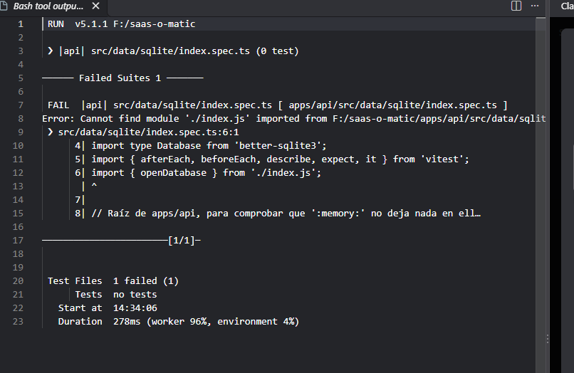
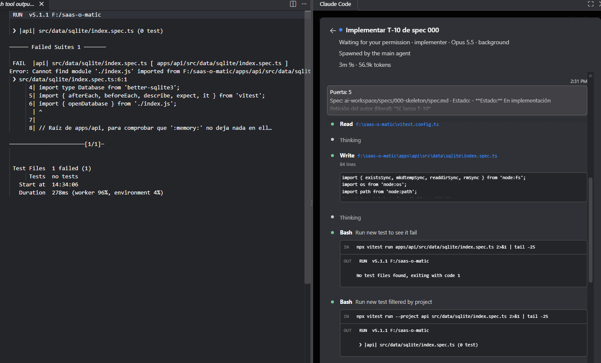

# 000-skeleton — Fase 6 (2026-11-21, sesión 11)

## Objetivo y fase
Fase 6, spec `000-skeleton`, puerta 5: hacer la tarea T-10 (`openDatabase` en `apps/api/src/data/sqlite/index.ts`) con el implementer y cerrarla con la aprobación del autor.

## Prompts clave
> /sdd-implement 000-skeleton

> Sí, lanza T-10

> Apruebo T-10, opción (a); la captura es mía

> /sdd-session 6 000-skeleton

## Qué propuso la IA
- Leyó la línea `Estado:` de `spec.md` (`- **Estado:** En implementación`) y `tasks.md`. Como T-00 a T-09 estaban en `[x]`, propuso T-10 (cubre R-08, R-23 y R-26; sin parada de instalación) y esperó la confirmación del autor.
- Antes de montar el encargo ejecutó `npm test` (5 ficheros, 33 tests, EXIT=0) y `npm run build` (EXIT=0).
- Enseñó el encargo completo, con las decisiones literales #6, #11, #13, #23, #24 y #31 de la spec, D-16, P-02 y P-04 del plan y Q-03 de `tasks.md`. Después lanzó al implementer.
- Retorno del implementer: `Tarea terminada`.
  - Escribió `index.ts` y `index.spec.ts`, con 6 tests (C-26, C-26/P-02, carpeta ya existente, C-30 y la base de C-09 en memoria y en fichero).
  - Vio el rojo (`Cannot find module './index.js'`) y después el verde: `npm test` dio 6 ficheros y 39 tests, y `npm run build` terminó bien.
  - Dejó T-10 en `[~]` y no encontró ningún choque entre fuentes.
  - Señaló que `openDatabase` no cierra la conexión si `runMigrations` lanza.
- La sesión principal ejecutó `git status` y `git diff --stat`. Solo habían cambiado `index.ts`, `index.spec.ts` y `tasks.md`, y había además una captura sin seguimiento que no era del implementer.
- Propuso dos opciones sobre el cierre de la conexión: (a) dejarlo como está y decidirlo en T-12, que era la recomendada; (b) añadirlo ya, con su test.
- Tras la aprobación:
  - marcó `[x]` en T-10 y en sus tres casillas, y anotó la decisión (a) en `tasks.md`;
  - actualizó `MEMORY.md`;
  - enseñó el diff;
  - propuso el commit.
- Durante `/sdd-session` comprobó las capturas por MD5:
  - `fase-6-000-t10-resultado.png` era idéntica a la del rojo.
  - Tras el primer intento del autor, la captura que había cambiado era `fase-6-000-t10-test-rojo.png`, ahora un recorte del rojo; la de resultado seguía igual.
  - Lo avisó las dos veces antes de guardar el registro.

## Qué corregí y por qué
- El autor no corrigió ninguna propuesta.
- Al ver que `resultado` seguía siendo el rojo, el autor decidió guardar el registro sin rehacer la captura del verde.

## Decisiones tomadas
- T-10 aprobada por el autor: «Apruebo T-10».
- Opción (a): `openDatabase` no cierra la conexión si `runMigrations` lanza, porque ninguna fuente lo pide. Se decidirá en T-12 si su test de arranque fallido (C-36 a C-38) deja el fichero bloqueado en Windows. Consta en `tasks.md` (T-10) y en `MEMORY.md`.
- Las capturas de T-10 son del autor. La de resultado no se rehace: «no , haz la sesion».
- Commit: el de cierre de esta sesión.

## Capturas

- No se anunció ninguna línea `CAPTURA:` en la sesión.
- El verde de T-10 (`npm test` con 6 ficheros y 39 tests) no tiene captura. Consta solo en el retorno del implementer.

## Pendiente para la siguiente sesión
- T-11: `infrastructure/sqlite-connection.ts`, el puente a la conexión, sin test propio (Q-04).
- En T-12, decidir si `openDatabase` debe cerrar la conexión cuando fallan las migraciones (opción (a) de esta sesión).
