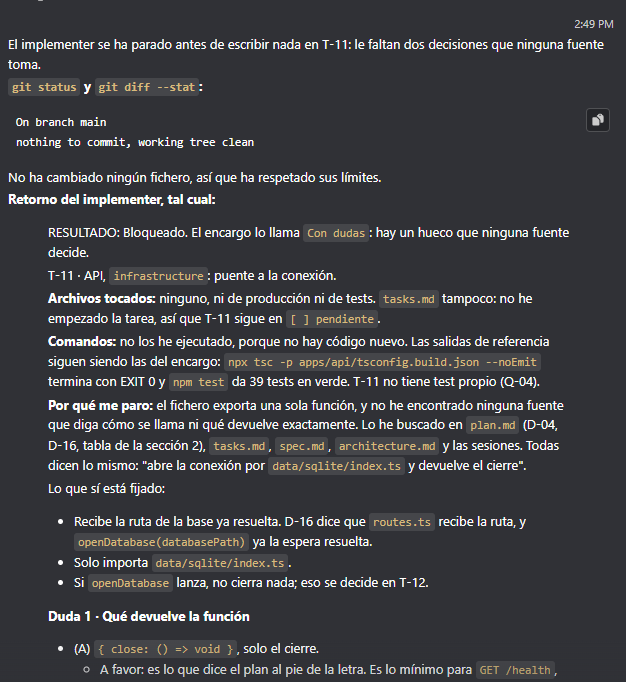
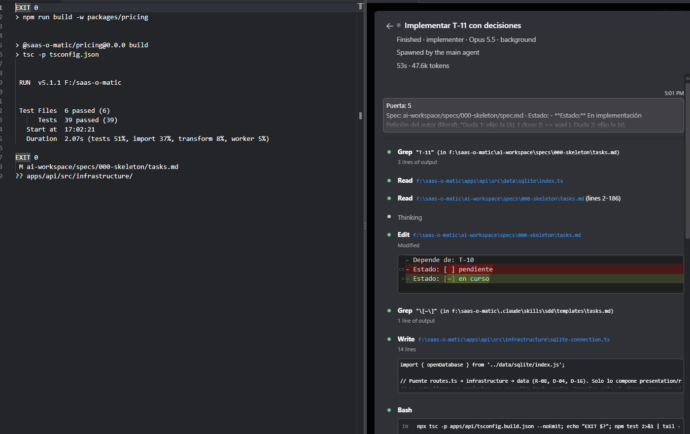

# 000-skeleton — Fase 6 (2026-11-21, sesión 12)

## Objetivo y fase
Fase 6, spec `000-skeleton`, puerta 5: implementar T-11 (API, `infrastructure`: puente a la conexión) con `/sdd-implement 000-skeleton` y el agente implementer, siguiendo `/sdd-flow`.

## Prompts clave
> /sdd-implement 000-skeleton

> Sí, T-11

> si, lo apruebo

> Duda 1: elijo la (A), { close: () => void }. Duda 2: elijo la (a), openSqliteConnection(databasePath: string). Mi motivo: el plan (D-16) pide solo devolver el cierre; así ningún tipo de better-sqlite3 llega a presentation, y si la spec 002 necesita la conexión se añade un campo sin cambiar la firma. Anota las dos decisiones con fecha 2026-11-21 en T-11 de tasks.md y enséñame el diff.
> En el encargo nuevo añade además, como restricciones literales: (1) no crees sqlite-connection.spec.ts
> (Q-04); (2) la ruta llega por parámetro: sin process.env ni config; (3) sin pragmas (P-04 (b)). Enséñame el encargo antes de lanzarlo.

> Sí, apruebo el encargo, lánzalo

> Sí, apruebo T-11; la captura la guardé yo

## Qué propuso la IA
- Leyó el `Estado:` de la spec (`En implementación`) y `tasks.md`. Propuso T-11, la siguiente pendiente tras T-00 a T-10, y esperó la confirmación del autor.
- Antes de montar el encargo ejecutó `npx tsc -p apps/api/tsconfig.build.json --noEmit` (EXIT 0) y `npm test` (6 ficheros, 39 tests en verde).
- Montó el encargo con la plantilla y lo enseñó antes de lanzarlo. Llevaba la fila #1 íntegra, R-08, las decisiones #6, #10 y #18, D-04 y D-16 del plan, la fila de la tabla de la sección 2, Q-04 y la decisión de T-10 sobre el cierre. Avisó de un posible hueco: ninguna fuente fija el nombre de la función ni la forma de lo que devuelve. Por eso el encargo pedía al implementer parar con `Con dudas` en vez de decidir.
- **Primera vuelta del implementer:** devolvió `Bloqueado` (`Con dudas`) sin tocar ningún fichero; `git status` estaba limpio. Planteó dos dudas con opciones y recomendaciones:
  - Duda 1, qué devuelve la función: (A) `{ close }`, (B) `{ db, close }` o (C) la función de cierre directamente. Recomendó la (A).
  - Duda 2, el nombre: (a) `openSqliteConnection`, (b) `createSqliteConnection` o (c) `connectSqlite`. Recomendó la (a).
  - La IA enseñó el retorno tal cual y paró, sin elegir.
- Anotó la decisión del autor en T-11 de `tasks.md`, enseñó el diff y montó el encargo nuevo con las tres restricciones literales. Dio como referencia la salida anterior de `npm test` sin repetirlo, porque entre medias solo había cambiado `tasks.md`, y lo dijo en el mensaje.
- **Segunda vuelta del implementer:** creó `apps/api/src/infrastructure/sqlite-connection.ts` con `openSqliteConnection(databasePath: string): { close: () => void }`. Solo importa `../data/sqlite/index.js` y no lleva spec propio. Dejó T-11 en `[~]`. `tsc` terminó con EXIT 0 y siguen 39 tests en verde. El tipo de retorno va escrito en la firma, sin un nombre de tipo nuevo exportado.
- Tras cada vuelta comprobó los cambios con `git status` y `git diff --stat`: solo había cambiado el fichero de la tarea y `tasks.md`. La captura sin versionar la había guardado el autor.
- Con la aprobación del autor, marcó `[x]` en T-11 y en sus dos casillas, actualizó `MEMORY.md` (T-00 a T-11 hechas; faltan T-12 a T-20), enseñó el diff y propuso el mensaje de commit.

## Qué corregí y por qué
- El autor decidió las dos dudas del implementer: (A) y (a). Su motivo: «el plan (D-16) pide solo devolver el cierre; así ningún tipo de better-sqlite3 llega a presentation, y si la spec 002 necesita la conexión se añade un campo sin cambiar la firma».
- El autor añadió al encargo nuevo tres restricciones literales: no crear `sqlite-connection.spec.ts` (Q-04), recibir la ruta por parámetro sin `process.env` ni `config`, y no usar pragmas (P-04 (b)). (Motivo no dado por el autor, salvo las referencias a Q-04 y P-04 (b).)

## Decisiones tomadas
- T-11: `openSqliteConnection(databasePath: string)` devuelve `{ close: () => void }`. Es la decisión del autor del 2026-11-21, anotada en T-11 de `tasks.md`.
- `sqlite-connection.ts` queda sin spec propio (Q-04). Lo ejercen `routes.spec.ts` y `server.spec.ts` en T-12.
- T-11 aprobada por el autor y marcada `[x]` con sus dos casillas de «Hecho cuando».
- Commit: el de cierre de esta sesión.

## Capturas

## Pendiente para la siguiente sesión
- T-12 (API, `presentation`: `routes.ts` y `server.ts`, `GET /health`). `routes.ts` usa `openSqliteConnection` y recibe `{ close }`.
- En T-12 hay que decidir si el test de arranque fallido (C-36 a C-38) deja el fichero bloqueado en Windows, porque `openDatabase` no cierra la conexión si `runMigrations` lanza (decisión de T-10).
- Faltan T-12 a T-20 y la validación (puerta 6).
- El panel del agente de la captura de resultado muestra «implementer · Opus 5.5». `MEMORY.md` dice que el implementer vio Sonnet 5.5 en T-00. (No contrastado en esta sesión.)
