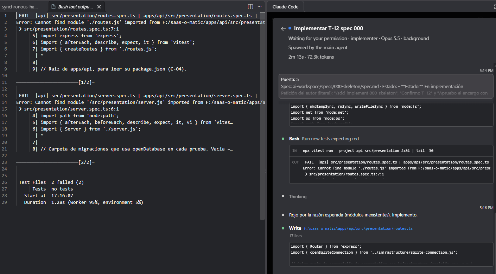
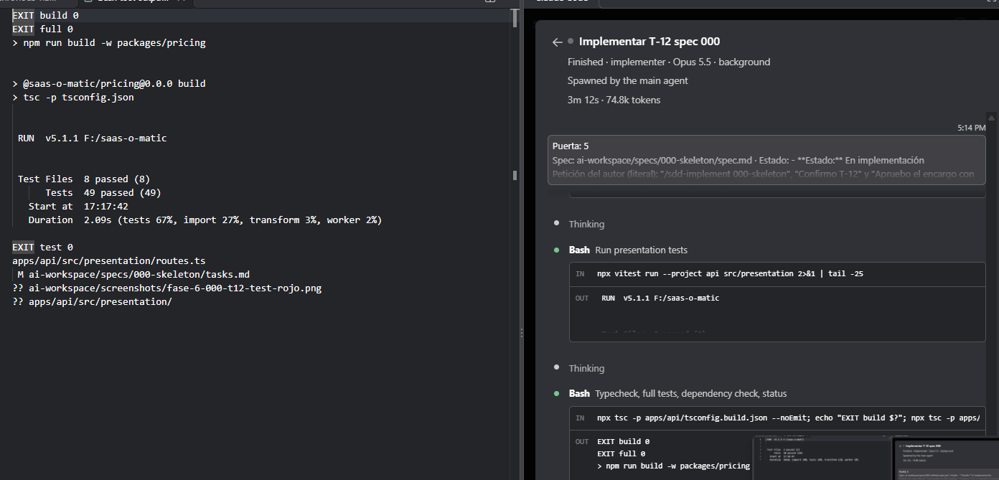

# 000-skeleton — Fase 6 (2026-11-21, sesión 13)

## Objetivo y fase
Fase 6, spec `000-skeleton`, puerta 5: implementar T-12 (API, `presentation`: servidor y `GET /health`) siguiendo `/sdd-flow` y con el agente implementer.

## Prompts clave
> sdd-implement 000-skeleton

> Confirmo T-12

> Apruebo el encargo con estas decisiones del autor 2026-11-21 (anótalas literales en T-12 de tasks.md):
> (1) Nombres: routes.ts exporta createRoutes(databasePath: string): { router: Router; close: () => void }.
> server.ts exporta class Server con constructor({ port, databasePath }), start(): Promise<number>, que abre la base con createRoutes, luego hace listen y resuelve con el puerto real (los tests usan puerto 0), y rechaza antes de listen si la base falla; y stop(): Promise<void>, que cierra el servidor HTTP y después
> la base. Motivo: D-16 pide una función que devuelve router y cierre, y un Server con arranque y parada;
> el puerto real hace falta con puerto 0.
> (2) EBUSY: con :memory: no se puede reproducir, así que la decisión (a) de T-10 queda definitiva;
> anótalo en T-12. Si aun así aparece un fichero bloqueado, para.
> (3) C-09 se reparte como en D-17: server.spec.ts comprueba que start() con :memory: y las migraciones
> reales resuelve y GET /health responde; user_version = 0 ya lo prueba index.spec.ts (T-10). Motivo:
> Server solo expone close (decisión de T-11) y se mantiene :memory: por prueba (riesgo 10).
> Enséñame el diff de tasks.md y lanza el implementer.

> Desviación 1: la acepto como decisión del autor 2026-11-21, anótala literal en T-12: "si listen falla,
> start() cierra la base y rechaza con el error de listen; motivo: R-30/R-31, un arranque fallido no deja nada abierto". Pero pide un test: añade en server.spec.ts un caso que arranca un Server en puerto 0, arranca otro en ese mismo puerto y comprueba que el segundo start() rechaza (EADDRINUSE) y que su stop() no lanza. Relanza al implementer solo para ese test; luego tsc y npm test (50 tests).
>
> Desviación 2: la acepto (C-04 pide que no haya supertest; así queda comprobado).
> Registra en la sesión como observación que el implementer decidió la desviación 1 en vez de parar.
> Después marca [x] T-12 y sus cinco casillas, actualiza MEMORY.md (≤ 50 líneas) y propón el commit.

> /sdd-session 6 000-skeleton

## Qué propuso la IA
- El autor escribió `sdd-implement 000-skeleton` sin la barra. La IA leyó `.claude/commands/sdd-implement.md` y `sdd-flow.md` y siguió la puerta 5.
- Leyó `spec.md` (`Estado: En implementación`) y `tasks.md`, y propuso T-12, la siguiente pendiente. Recordó al autor que en T-12 quedaba por decidir lo que había aplazado en T-10: si el arranque fallido deja el fichero bloqueado en Windows.
- Con la confirmación del autor, ejecutó `npx tsc -p apps/api/tsconfig.build.json --noEmit` (EXIT 0) y `npm test` (6 ficheros, 39 tests en verde).
- Enseñó el encargo antes de lanzarlo. Llevaba:
  - las decisiones #2, #3, #6, #8, #10, #18, #26 y #32;
  - D-15 a D-17 del plan y los riesgos 9 y 10;
  - las decisiones de T-10 y T-11;
  - las restricciones de la tarea.
- Avisó de dos puntos abiertos:
  - Ninguna fuente fija el nombre ni la firma de `routes.ts` y `Server`, así que era probable que el implementer parase.
  - Con `:memory:`, el test de arranque fallido puede no sacar a la luz el bloqueo en Windows.
- Anotó literalmente en T-12 las decisiones (1) a (3) del autor y enseñó el diff de `tasks.md`.
- Al lanzar al implementer, el clasificador del modo automático no dio veredicto y la sesión pasó a modo plan. La IA escribió un plan con el paso pendiente y el autor lo aprobó. Después lanzó al implementer con el encargo aprobado, sin cambios.
- **Primera vuelta del implementer:**
  - Creó `presentation/routes.ts` (`createRoutes`, `GET /health` sin prefijo), `presentation/server.ts` (`class Server` con `start` y `stop`), `routes.spec.ts` (4 tests) y `server.spec.ts` (6 tests).
  - Los tests se vieron en rojo antes de la implementación (`Cannot find module`).
  - Cubren C-03, C-04, C-09 según la decisión (3), y C-36 a C-38 con `vi.mock` de `migrations-dir`.
  - `tsc` terminó con EXIT 0 y quedaron 49 tests en verde. No apareció EBUSY.
  - Dejó T-12 en `[~]` y señaló tres desviaciones: (1) qué hace `start()` si falla `listen`; (2) un test de C-04 que lee `package.json`; (3) `user_version` = 0 queda en `index.spec.ts`.
- La IA comprobó `git status` y `git diff --stat`: solo habían cambiado los cuatro ficheros de la tarea y `tasks.md`. Repitió `tsc` y `npm test` (49 tests) y enseñó el retorno tal cual.
- Advirtió al autor que la desviación 1 contradecía el encargo, que pedía parar con `Con dudas`. Después paró a esperar su decisión.
- Anotó en T-12 la decisión del autor sobre la desviación 1. No pudo retomar al implementer anterior (no quedaba su registro), así que lanzó uno nuevo con un encargo completo, solo para el test de `EADDRINUSE`.
- **Segunda vuelta del implementer:**
  - Añadió el caso a `server.spec.ts`: un segundo `Server` en el mismo puerto rechaza con `EADDRINUSE` y su `stop()` resuelve.
  - El test salió en verde a la primera y no podía verse en rojo sin tocar producción. El implementer lo declaró en su retorno.
  - Quedaron 50 tests en verde.
- La IA volvió a comprobar `git status`, `tsc` (EXIT 0) y `npm test` (8 ficheros, 50 tests).
- Marcó `[x]` en T-12 y en sus cinco casillas.
- Actualizó `MEMORY.md` sin pasar de 50 líneas:
  - T-12 hecha; faltan T-13 a T-20.
  - La decisión (a) de T-10 queda definitiva.
  - Aprendizaje sobre las desviaciones del implementer.
- Enseñó el diff y propuso el mensaje de commit.

## Qué corregí y por qué
- El autor fijó los nombres y las firmas de `createRoutes` y `Server`. Motivo: «D-16 pide una función que devuelve router y cierre, y un Server con arranque y parada; el puerto real hace falta con puerto 0».
- El autor dejó definitiva la decisión (a) de T-10. Motivo: «con :memory: no se puede reproducir».
- El autor repartió C-09 según D-17. Motivo: «Server solo expone close (decisión de T-11) y se mantiene :memory: por prueba (riesgo 10)».
- El autor aceptó la desviación 1, pero pidió un test de `EADDRINUSE`. Motivo: «R-30/R-31, un arranque fallido no deja nada abierto».
- El autor aceptó la desviación 2. Motivo: «C-04 pide que no haya supertest; así queda comprobado».
- **Observación (petición del autor):** el implementer decidió la desviación 1 (qué hace `start()` si `listen` falla) en vez de parar con `Con dudas`, como pedía el encargo.

## Decisiones tomadas
- T-12:
  - `createRoutes(databasePath: string): { router: Router; close: () => void }`.
  - `class Server` con `constructor({ port, databasePath })`, `start(): Promise<number>` y `stop(): Promise<void>`.
  - Decisiones del autor del 2026-11-21, anotadas en T-12.
- La decisión (a) de T-10 (no cerrar la conexión si `runMigrations` lanza) queda definitiva.
- C-09 se comprueba en `server.spec.ts` con `start()` y `GET /health`; `user_version` = 0 queda en `index.spec.ts`.
- Si `listen` falla, `start()` cierra la base y rechaza con el error de `listen`. Lo cubre el test de `EADDRINUSE`.
- El test de C-04 sobre `package.json` queda aceptado.
- T-12 aprobada y marcada `[x]` con sus cinco casillas. 50 tests en verde.
- Commit: el de cierre de esta sesión.

## Capturas

## Pendiente para la siguiente sesión
- T-13 (API, `app`: arranque y errores de arranque; `app.spec.ts` con proceso real y `PORT=abc`). Faltan T-13 a T-20 y la validación (puerta 6).
- El panel y el retorno del implementer dicen Opus 5.5 en T-12, y `MEMORY.md` dice Sonnet 5.5 en T-00. (No contrastado en esta sesión.)
