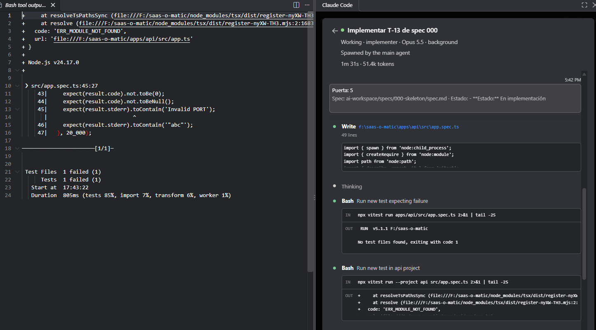

# 000-skeleton — Fase 6 (2026-11-21, sesión 14)

## Objetivo y fase
Fase 6, spec `000-skeleton`, puerta 5 (implementación): hacer la tarea T-13 (API, `app`: arranque y errores de arranque; cubre R-02, R-29, R-30 y R-31) con el agente `implementer`, y cerrarla con la aprobación del autor.

## Prompts clave
> /sdd-implement 000-skeleton

> Apruebo T-13Decisión 2: acepto lanzar tsx/cli con process.execPath; equivale a D-17 y es portable.
> Decisión 1: decisión del autor 2026-11-21 (anótala literal en T-13): al arrancar bien, app.ts imprime
> con console.log "API listening on http://localhost:<puerto>", usando el puerto que devuelve start().
> Motivo: el proyecto se ejecuta en otro ordenador y quien lo arranque debe ver que la API escucha y en qué puerto. Sin test nuevo; se comprueba en la verificación. Aplica ese cambio (o relanza al implementer solo para eso), ejecuta tsc y npm test (51), y apruebo T-13: marca [x] y sus tres casillas, actualiza MEMORY.md (≤ 50 líneas) y propón el commit. La captura fase-6-000-t13-test-rojo.png es mía y entra en el  commit., sin mensaje al arrancar y tsx/cli aceptado

Respuesta del autor a la pregunta sobre la contradicción final del mensaje anterior:
> Con mensaje (Decisión 1)

## Qué propuso la IA
- **Plan de la vuelta:** la sesión principal leyó el `Estado:` literal (`- **Estado:** En implementación`) y comprobó que T-00 a T-12 estaban en `[x]`. Propuso T-13 como siguiente tarea, con un plan y un borrador del encargo, y el autor lo aprobó.
- **Antes del agente:** ejecutó `npm test` (8 ficheros, 50 tests en verde) y `npm run build -w apps/api` (sin errores). Copió su salida literal al encargo, con D-15, D-16, D-17, R-02 y R-29 a R-31, la Decisión #1 y las decisiones del autor de T-12, y enseñó el encargo antes de lanzar al implementer.
- **Retorno del implementer:**
  - `app.ts` lee `readEnvs()`, arranca `Server` y saca todos los errores por un único `catch`, con `console.error` y `process.exit(1)`.
  - `app.spec.ts` lanza un proceso real con `PORT=abc` (C-33); lo vio en rojo y después quedaron 51 tests en verde.
  - Comprobó que `node dist/app.js` y `npm run dev` responden `/health` en el 3000 y crean `apps/api/data/saas-o-matic.db`.
  - Desviaciones que señaló: (1) no imprime nada al arrancar bien, porque ninguna fuente fija el texto; (2) lanza `tsx/cli` con `process.execPath` en lugar del binario `tsx`.
- **Comprobación de límites:** tras el agente, `git status` y `git diff --stat` mostraron que solo cambiaron `app.ts`, `app.spec.ts` y `tasks.md` (T-13 en `[~]`). La captura sin seguimiento no era del agente.

## Qué corregí y por qué
- **Desviación 1:** el autor decidió que `app.ts` imprima `API listening on http://localhost:<puerto>` con el puerto de `start()`, porque el proyecto se ejecuta en otro ordenador y quien lo arranque debe ver que la API escucha y en qué puerto.
- **Contradicción en el mensaje:** el mensaje terminaba con «sin mensaje al arrancar». La IA preguntó cuál valía y el autor confirmó «Con mensaje (Decisión 1)».
- **Desviación 2:** aceptada porque «equivale a D-17 y es portable».

## Decisiones tomadas
- **T-13 aprobada.** La sesión principal aplicó el `console.log` sin relanzar al implementer. `tsc --noEmit` terminó sin errores y `npm test` dio 51 de 51. Con la API compilada, `PORT=3999` y `DATABASE_PATH=:memory:`, imprimió `API listening on http://localhost:3999` y `/health` respondió `{"status":"ok"}`.
- **En `tasks.md`:** T-13 y sus tres casillas en `[x]`, y las dos decisiones del autor anotadas literales.
- **En `MEMORY.md`:** T-13 añadida en la línea de la fase 6 y «Faltan T-14 a T-20»; sigue en 50 líneas.
- **La captura `fase-6-000-t13-test-rojo.png`** es del autor y entra en el commit.
- Commit: el de cierre de esta sesión.

## Capturas

En esta sesión no se anunció ninguna línea `CAPTURA:`.

## Pendiente para la siguiente sesión
- **T-14** (web: proyecto Angular en `apps/web`), con su parada para instalar y la consulta previa al MCP de Angular CLI.
- **T-15 a T-20 y la validación** (puerta 6).
- **Celdas `(pendiente de /sdd-session)`** de `spec.md`: buscarlas tras guardar este registro.
