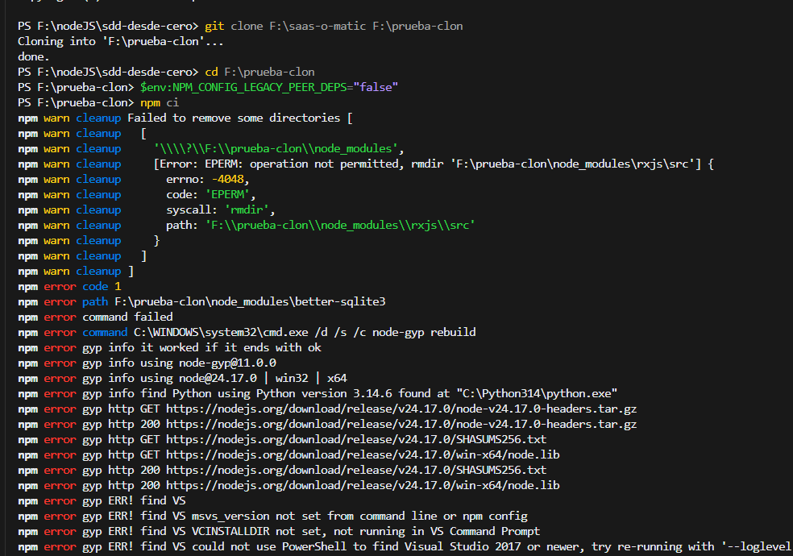
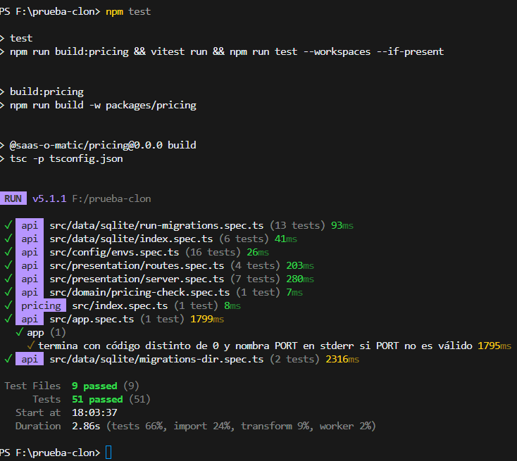
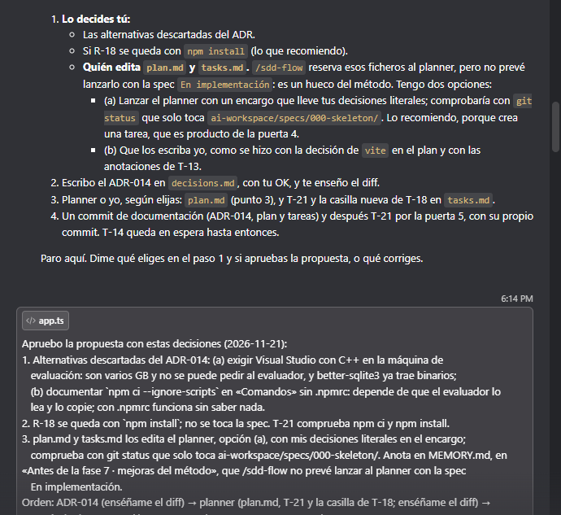
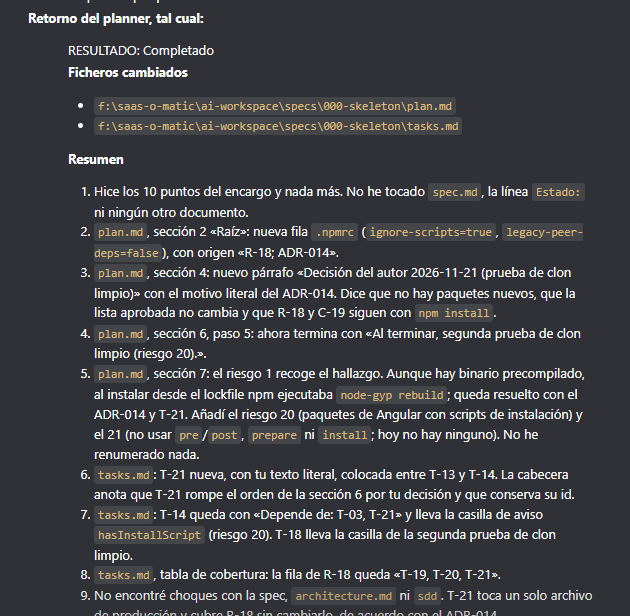

# 000-skeleton — Fase 6 (2026-11-21, sesión 15)

## Objetivo y fase
Fase 6, spec `000-skeleton`, puerta 5. Con `/sdd-implement 000-skeleton.` se propuso T-14. Antes de confirmarla, el autor trajo un hallazgo de su prueba de clon limpio y una decisión: añadir un `.npmrc`. La sesión metió esa decisión en el método sin cambiar requisitos: ADR-014, cambio de `plan.md` y `tasks.md` hecho por el planner, tarea nueva T-21 antes de T-14, y `MEMORY.md` actualizado. No se escribió código.

## Prompts clave
> /sdd-implement 000-skeleton.

> Hallazgo de la prueba de clon limpio (fuera de tasks.md), hecha por mí tras T-13: en un clon nuevo, `npm ci` y `npm install` fallan porque npm lanza `node-gyp rebuild` en better-sqlite3 13.2.0 y pide Visual Studio con C++. El paquete trae sus binarios en prebuilds/ (win32-x64.node incluido) y declara "gypfile": false, pero el package-lock.json no guarda ese campo, así que npm compila al instalar desde el lockfile. En mi repo no pasó porque en T-05 aún no había lockfile. Con `npm ci --ignore-scripts` el clon instala, `npm run build` pasa, `npm test` da 51 passed y la API responde /health en el 3000.
> Los únicos paquetes con scripts de instalación son esbuild (postinstall de verificación; tsx funciona
> sin él, lo prueba app.spec.ts) y fsevents (solo macOS).
>
> Capturas: fase-6-000-clon-limpio-error-gyp.png y fase-6-000-clon-limpio-ok.png.
> ****
> Mi decisión (2026-11-21): añadir un .npmrc en la raíz del repositorio con `ignore-scripts=true` y
> `legacy-peer-deps=false`, para que mi ordenador se comporte como uno limpio.
> Motivo: el proyecto se evalúa en otro ordenador y debe instalarse con `npm ci` sin herramientas de
> compilación; ningún script de instalación actual hace falta.
> No lo apliques todavía. Propónme cómo entra en el método sin saltarse nada: dónde se registra la
> decisión (decisions.md / ADR), qué cambia en plan.md y cómo se implementa (tarea nueva en tasks.md o
> dentro de una existente, con su "Hecho cuando"). Añade un riesgo para T-14: Angular puede traer
> paquetes con scripts de instalación; se comprueba en la segunda prueba de clon limpio tras T-18.
> Enséñame la propuesta y para.

> Apruebo la propuesta con estas decisiones (2026-11-21):
> 1. Alternativas descartadas del ADR-014: (a) exigir Visual Studio con C++ en la máquina de
>    evaluación: son varios GB y no se puede pedir al evaluador, y better-sqlite3 ya trae binarios;
>    (b) documentar `npm ci --ignore-scripts` en «Comandos» sin .npmrc: depende de que el evaluador lo
>    lea y lo copie; con .npmrc funciona sin saber nada.
> 2. R-18 se queda con `npm install`; no se toca la spec. T-21 comprueba npm ci y npm install.
> 3. plan.md y tasks.md los edita el planner, opción (a), con mis decisiones literales en el encargo;
>    comprueba con git status que solo toca ai-workspace/specs/000-skeleton/. Anota en MEMORY.md, en   «Antes de la fase 7 · mejoras del método», que /sdd-flow no prevé lanzar al planner con la spec
>    En implementación.
> Orden: ADR-014 (enséñame el diff) → planner (plan.md, T-21 y la casilla de T-18; enséñame el diff) →
> commit de documentación → T-21 por la puerta 5 con su commit → T-14.

> Apruebo el diff del ADR-014; monta el encargo del planner

> Sí, añade el punto 10 y lanza el planner

> Apruebo el diff del planner; punto 10, opción (a)

> Sí, guárdalo y apruebo el diff de MEMORY.md

## Qué propuso la IA
- Con `/sdd-implement`, T-14 como siguiente tarea (T-00 a T-13 en `[x]`; depende de T-03). La spec estaba `En implementación`.
- Ante el hallazgo, una propuesta en cinco partes:
  1. No es un cambio de requisitos: R-18 y C-19 siguen igual, como pasó con `vite` en T-01. Recomendación: no tocar la spec aunque el motivo hable de `npm ci`.
  2. ADR-014 en `decisions.md`, con un borrador y sin escribir alternativas que el autor no había dado.
  3. Cambios en `plan.md`: `.npmrc` en la sección 2; un párrafo de decisión en la sección 4; el hallazgo en el riesgo 1; riesgos nuevos 20 (Angular con scripts de instalación) y 21 (no usar `pre`/`post`, `prepare` ni `install`); el paso 5 de la sección 6.
  4. Tarea nueva T-21 (`.npmrc`, con su «Hecho cuando»), antes de T-14 y sin renumerar, y una casilla de segunda prueba de clon limpio en T-18.
  5. Quién edita `plan.md` y `tasks.md`: (a) el planner, recomendado, aunque `/sdd-flow` no lo prevé con la spec `En implementación`; (b) la sesión principal.
- Comprobaciones antes de proponer: las capturas del autor existían; ninguna regla deny afectaba a `.npmrc`; el npm del autor daba `legacy-peer-deps=true` e `ignore-scripts=false`; ningún `package.json` tenía scripts de ciclo de vida.
- ADR-014 escrito con las alternativas del autor, y su diff.
- Encargo del planner con los 9 puntos literales. Antes de lanzarlo, la IA preguntó si T-14 debía llevar también la casilla de aviso del riesgo 20, que había quitado para no dejar el riesgo remitiendo a una tarea que no lo dijera.
- Tras el retorno del planner: `git status` y `git diff --stat` (solo `plan.md` y `tasks.md` de la spec), el diff y el retorno literal. Para el punto 10 del planner (cabecera de `plan.md` con «Estado: Aprobada» y trazabilidad de R-18 sin los riesgos 20 y 21), dos opciones; la IA recomendó la (a), aceptarlo.
- `MEMORY.md` con el estado (ADR-014, T-21 y casillas), una línea en «Decisiones» y la sección nueva «Antes de la fase 7 · mejoras del método».

## Qué corregí y por qué
- Paré T-14 antes de confirmarla para meter el hallazgo del clon limpio: en un clon nuevo, la instalación exigía Visual Studio con C++.
- Di las alternativas descartadas del ADR-014 con su motivo.
- Añadí el punto 10 al encargo: casilla de aviso en T-14 y `Depende de: T-21`.

## Decisiones tomadas
- ADR-014 · Instalación sin scripts de paquetes: `.npmrc` en la raíz con `ignore-scripts=true` y `legacy-peer-deps=false`. Alternativas descartadas: (a) Visual Studio con C++ en la máquina de evaluación; (b) documentar `npm ci --ignore-scripts` sin `.npmrc`.
- R-18 se queda con `npm install`; no se toca la spec. T-21 comprueba `npm ci` y `npm install`.
- `plan.md` y `tasks.md` los edita el planner (opción (a)); la spec sigue `En implementación`.
- T-21 es tarea nueva, se hace antes de T-14 y conserva su id. T-14 depende de T-03 y T-21 y lleva la casilla de aviso `hasInstallScript`. T-18 lleva la segunda prueba de clon limpio.
- Punto 10 del planner, opción (a): la cabecera de `plan.md` y la trazabilidad de R-18 se dejan como están.
- Diff de `MEMORY.md` aprobado por el autor.
- Orden: ADR-014 → planner → commit de documentación → T-21 por la puerta 5 con su commit → T-14.
- Commit: el de cierre de esta sesión.

## Capturas

## Pendiente para la siguiente sesión
- Commit de documentación de esta sesión (`decisions.md`, `plan.md`, `tasks.md`, `MEMORY.md`, este registro y las cuatro capturas), con la aprobación del autor.
- T-21 por la puerta 5, con su commit. Después, T-14.
- Mejora del método antes de la fase 7: `/sdd-flow` y `sdd` no prevén lanzar al planner con la spec `En implementación`.
