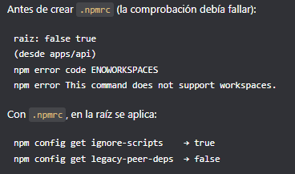
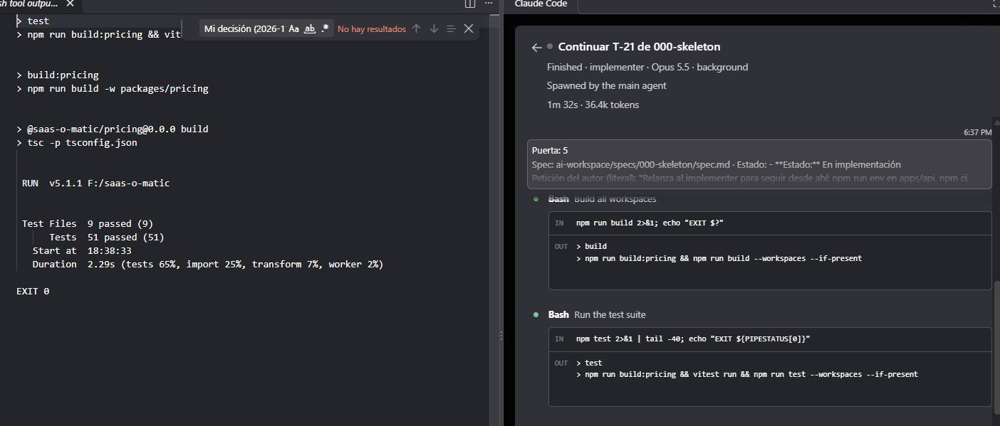
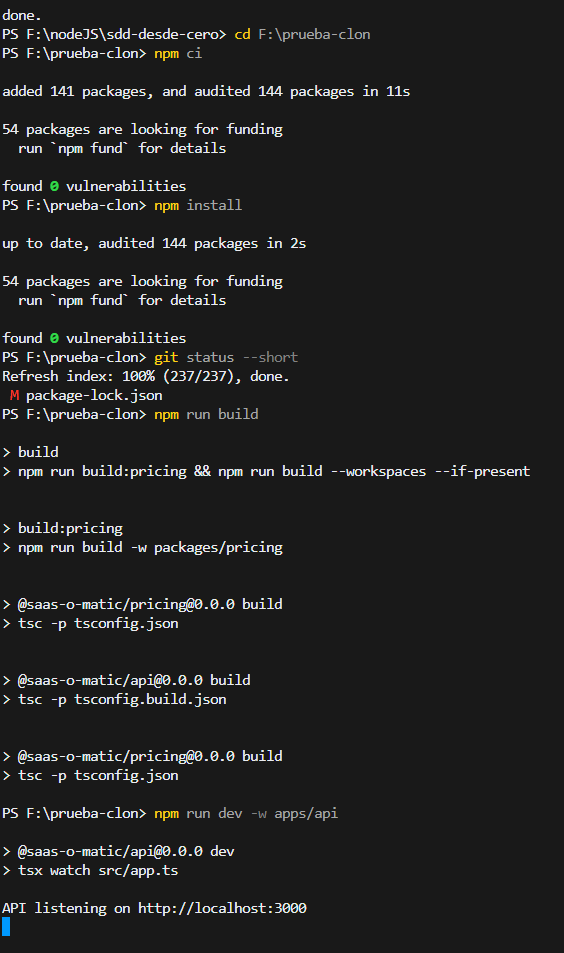

# 000-skeleton — Fase 6 (2026-11-21, sesión 16)

## Objetivo y fase
Fase 6, spec `000-skeleton`, puerta 5: implementar T-21 (`.npmrc` en la raíz sin scripts de instalación, ADR-014), que va tras T-13 y antes de T-14. Además, dejar `MEMORY.md` en ≤ 50 líneas y añadir la captura de resultado al commit.

## Prompts clave
> /sdd-implement 000-skeleton

> Añadidos: (1) al cerrar, MEMORY.md debe quedar en ≤ 50 líneas: ahora tiene 54 porque se creó la sección «Antes de la fase 7 · mejoras del método» pese a mi indicación; fusiona esa sección en la línea de pendientes de la fase 5 y no añadas líneas. (2) Añade al commit de T-21 la captura fase-6-000-t13-resultado.png (la guardo yo en screenshots/) y su referencia en el registro 2026-11-21-14-000-skeleton.md.

> Instalación: apruebo `npm ci` en el repositorio (reinstala desde el lockfile, sin paquetes nuevos).
> Cerré la API y Vitest. Antes de lanzarlo, completa el encargo:
> 1. Pega la fila literal de T-21 de tasks.md, con sus cuatro «Hecho cuando».
> 2. Restricciones: solo crear .npmrc en la raíz (y [~] en tasks.md); no tocar package.json ni
>    package-lock.json; tras npm ci, git status no debe mostrar package-lock.json; si npm ci falla, el
>    lockfile cambia o desde apps/api no se aplica el .npmrc, para y avisa, sin buscar alternativas.
> 3. Salida literal en el retorno de: npm config get ignore-scripts y legacy-peer-deps (en la raíz y en
>    apps/api), npm ci, npm ls --workspaces, npm run build, npm test y git status.
> Enséñame el encargo completo y lánzalo.
> Para ti, al cerrar (no para el implementer): MEMORY.md ≤ 50 líneas (hoy 54: fusiona la sección «Antes
> de la fase 7 · mejoras del método» en la línea de pendientes de la fase 5) y añade al commit
> fase-6-000-t13-resultado.png con su referencia en el registro 2026-11-21-14.

> Decisión del autor 2026-11-21 (anótala literal en T-21): la casilla 1 se comprueba desde apps/api con
> `npm run env` en lugar de `npm config get`, que no admite workspaces (ENOWORKSPACES). Vale si sale
> npm_config_local_prefix=F:\saas-o-matic y npm_config_ignore_scripts=true, y no sale
> npm_config_legacy_peer_deps (npm solo exporta valores distintos del de por defecto; mi npm tiene true).
> Motivo: los comandos reales (run, install, test) suben a la raíz y leen su .npmrc; --workspaces=false
> no es representativo. No se añade .npmrc en apps/api.
> Relanza al implementer para seguir desde ahí: npm run env en apps/api, npm ci, npm ls --workspaces,
> npm run build, npm test y git status (package-lock.json sin cambios), con salidas literales.

> Apruebo T-21. Marca [x] y las casillas 1 a 3; la 4 queda sin marcar hasta que haga el clon limpio
> justo después de este commit (el clon necesita el .npmrc ya commiteado); la marcaré en el commit de
> T-14. Anótalo así en tasks.md y MEMORY.md. fase-6-000-t21-npm-config.png entra en este commit, y
> fase-6-000-t13-resultado.png también (ya la he guardado). MEMORY.md ≤ 50 líneas. Enséñame el diff
> y propón el commit.

> Descártala; me refería a fase-6-000-t21-resultado.png, enlázala aquí

> Haz el commit con ese mensaje

Aprobación del commit de cierre de T-21 con el mensaje propuesto (que aún decía «clon limpio pendiente»). La IA hizo el commit `18cb37b`.

 
> Clon limpio de T-21 hecho tras el commit 18cb37b, sin --ignore-scripts ni variables de entorno:
> npm ci y npm install instalan sin Visual Studio, npm run build pasa y npm run dev -w apps/api
> responde /health en el 3000 ("API listening on http://localhost:3000"). Captura:
> fase-6-000-t21-clon-limpio.png (ya está en screenshots/).
> Hallazgo: en el clon, npm install añade 26 líneas "peer": true a package-lock.json (paquetes de
> esbuild por plataforma), sin cambiar versiones: el lockfile se generó con legacy-peer-deps=true. Se
> recoge en T-14, que reescribe el lockfile al instalar Angular.
> Quiero incorporarlo al commit de T-21 con git commit --amend (no hay remoto):
> 1. Marca [x] la casilla 4 de T-21 y sustituye su nota «queda sin marcar…» por «comprobado por el
>    autor el 2026-11-21 tras el commit de T-21».
> 2. Registro 2026-11-21-16: añade el resultado del clon limpio, la captura y el hallazgo del lockfile.
> 3. MEMORY.md: T-21 completa (sin «clon limpio pendiente») y el hallazgo del lockfile para T-14;
>    ≤ 50 líneas.
> 4. Mensaje del commit: quita «clon limpio pendiente» y pon «clon limpio comprobado».
> Enséñame el diff antes del amend.
 

## Qué propuso la IA
- Con la spec en `En implementación` y T-00 a T-13 en `[x]`, propuso T-21 como siguiente tarea y preguntó si el implementer podía ejecutar `npm ci` o debía parar antes.
- Ejecutó `npm run build` (EXIT 0) y `npm test` (9 ficheros, 51 tests en verde) para el encargo, y lo enseñó antes de lanzar al implementer.
- Primera vuelta del implementer: `Bloqueado`. Creó `.npmrc` (`ignore-scripts=true`, `legacy-peer-deps=false`) y puso T-21 en `[~]`. En la raíz, `npm config get` da `true` y `false`; desde `apps/api` falla con `ENOWORKSPACES`, y con `--workspaces=false` npm toma `apps/api` como proyecto, no lee el `.npmrc` de la raíz y da `false` y `true`. Paró antes de `npm ci` y propuso tres salidas: aceptar solo la raíz, cambiar el método (vía planner) o un `.npmrc` en `apps/api`.
- Segunda vuelta, con el método del autor: `npm run env` desde `apps/api` da `npm_config_ignore_scripts=true` y `npm_config_local_prefix=F:\saas-o-matic`, y no sale `npm_config_legacy_peer_deps`. `npm ci` termina bien (141 paquetes) sin compilar `better-sqlite3`, que trae `prebuilds/` y `"gypfile": false`. `npm ls --workspaces`, `npm run build` y `npm test` (51) en verde. `package-lock.json` sin cambios.
- En las dos vueltas, `git status` y `git diff --stat` mostraron solo `.npmrc` y `tasks.md` (más las capturas del autor).
- Para dejar `MEMORY.md` en 50 líneas: fusionó la sección «Antes de la fase 7» como punto (f) de los pendientes de la fase 5 y unió en una sola línea «Fase 5, probado» y «Fase 5, sin probar», sin quitar texto.
- Avisó de que `fase-6-000-t13-resultado.png` no existía y de que la captura guardada (`fase-6-000-t21-resultado.png`) mostraba el resultado de T-21, no el de T-13.
- Hizo el commit `18cb37b` con el mensaje aprobado («… clon limpio pendiente (puerta 5)»), sin `Co-Authored-By` ni push.
- A «des hazn el ultimo commit» respondió con `git reset --soft HEAD~1` (elección de la IA, sin preguntar el tipo de deshacer): `HEAD` volvió a `16f19f1` y los seis ficheros quedaron en el índice. Señaló la captura nueva `fase-6-000-t21-clon-limpio.png` y propuso incorporarla con la casilla 4.
- Avisó de que, tras el `reset --soft`, `git commit --amend` reescribiría `16f19f1` (sesión 15) y propuso un `git commit` normal, con el mismo resultado: un único commit de T-21 encima de `16f19f1`.

## Qué corregí y por qué
- El encargo debía llevar la fila literal de T-21, las restricciones de archivos y del lockfile, y las salidas literales en el retorno. Sin ellas, el implementer podía tocar más de lo debido o devolver un resumen.
- La sección «Antes de la fase 7 · mejoras del método» se creó pese a mi indicación: se fusiona en los pendientes de la fase 5, sin añadir líneas, y `MEMORY.md` queda en ≤ 50.
- El método de la casilla 1 desde `apps/api`: `npm run env` en lugar de `npm config get`, porque los comandos reales suben a la raíz y leen su `.npmrc`, y `--workspaces=false` no es representativo.
- La captura que nombré como `fase-6-000-t13-resultado.png` es `fase-6-000-t21-resultado.png` y se enlaza en este registro, no en el `-14`. La captura `fase-6-000-t21-npmrc-apps-api-enoworkspaces.png` se descarta.

## Decisiones tomadas
- Se aprueba `npm ci` en el repositorio: reinstala desde el lockfile, sin paquetes nuevos.
- Casilla 1 de T-21 (anotada literal en `tasks.md`): desde `apps/api` se comprueba con `npm run env`. Vale si salen `npm_config_local_prefix=F:\saas-o-matic` y `npm_config_ignore_scripts=true` y no sale `npm_config_legacy_peer_deps`. No se añade `.npmrc` en `apps/api`.
- T-21 aprobada: `[x]` y casillas 1 a 3 marcadas. La 4 (clon limpio) quedó sin marcar en el primer commit (`18cb37b`), porque el clon necesita el `.npmrc` ya commiteado.
- Clon limpio del autor tras `18cb37b`, sin `--ignore-scripts` ni variables de entorno: `npm ci` y `npm install` instalan sin Visual Studio, `npm run build` pasa y `npm run dev -w apps/api` responde `/health` en el 3000 («API listening on http://localhost:3000»). Casilla 4 marcada: «Comprobado por el autor el 2026-11-21 tras el commit de T-21».
- Hallazgo del clon: `npm install` añade 26 líneas `"peer": true` a `package-lock.json` (paquetes de `esbuild` por plataforma), sin cambiar versiones, porque el lockfile se generó con `legacy-peer-deps=true`. Se recoge en T-14, que reescribe el lockfile al instalar Angular.
- El commit `18cb37b` se deshizo con `git reset --soft HEAD~1` (el autor pidió deshacerlo; la IA eligió `--soft`), para incorporar el clon limpio al commit de T-21 (no hay remoto). El commit de cierre es uno normal, no `--amend`.
- `MEMORY.md` en 50 líneas, con la sección «Antes de la fase 7» fusionada en los pendientes de la fase 5.
- Commit: el de cierre de esta sesión.

## Capturas

- Anunciada y no existente: `fase-6-000-t21-npmrc-apps-api-enoworkspaces.png` (descartada por el autor).

## Pendiente para la siguiente sesión
- T-14 (proyecto Angular en `apps/web`), con su parada de instalación y el aviso `hasInstallScript` del ADR-014; recoge las 26 líneas `"peer": true` del lockfile al reescribirlo. Después, T-15 a T-20 y la validación (puerta 6).
