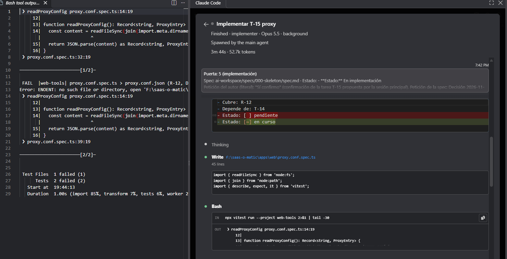
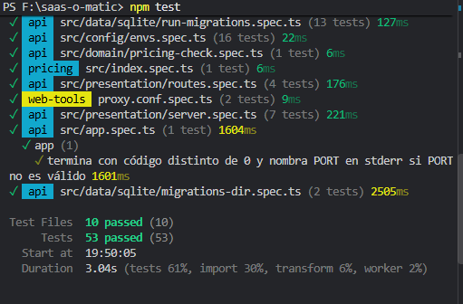
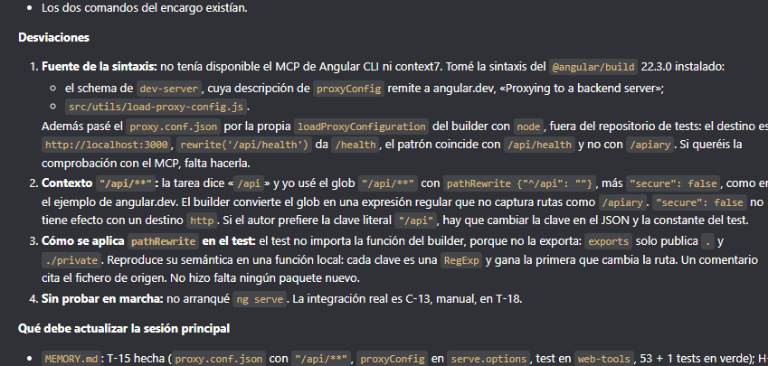
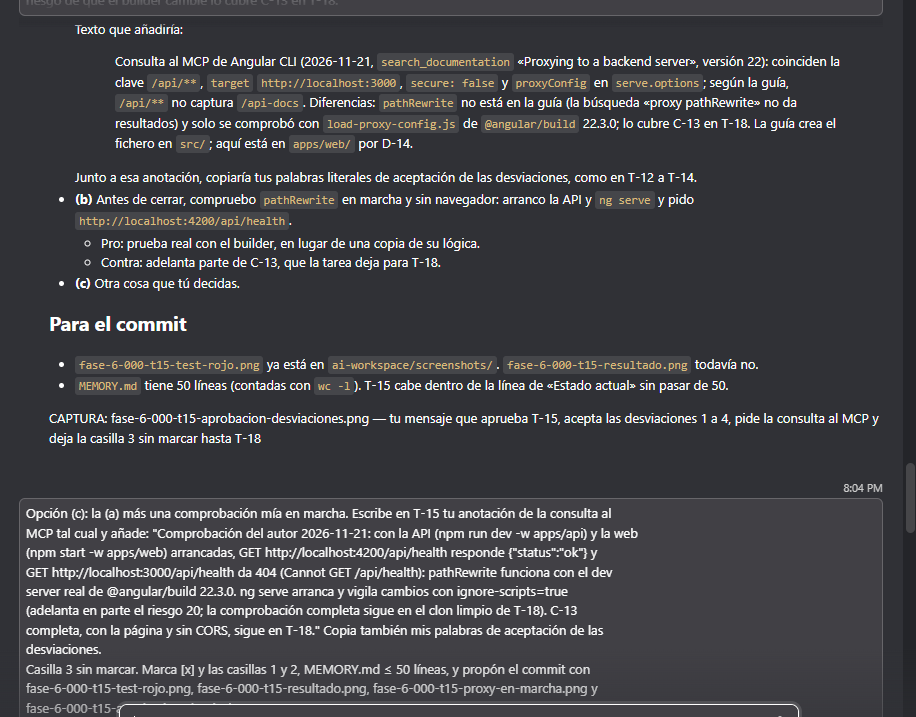
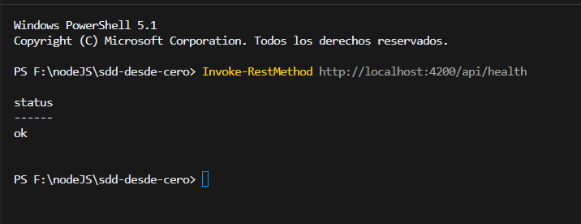
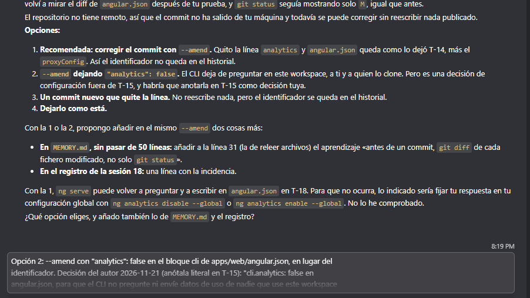

# 000-skeleton — Fase 6 (2026-11-21, sesión 18)

## Objetivo y fase
Fase 6, spec `000-skeleton`, puerta 5 (implementación), con `/sdd-implement`. Estado al empezar, literal de `spec.md`: `- **Estado:** En implementación`. Objetivo: la tarea T-15, proxy de desarrollo de la web (R-12; parte proxy de la reserva H-08, D-06).

## Prompts clave
Arranque de la puerta:
> /sdd-implement 000-skeleton

Confirmación de la tarea propuesta:
> Sí confirmo

Aprobación del encargo del implementer:
> Sí, lánzalo con ese encargo

Aprobación de T-15 tras el retorno del implementer:
> Apruebo T-15 y acepto las desviaciones 1 a 4: "/api/**" con secure:false es el formato de angular.dev
> y no captura /apiary; la copia local de pathRewrite es la decisión que tomé (RegExp nativo), y el
> riesgo de que el builder cambie lo cubre C-13 en T-18.
> Haz antes la consulta al MCP (search_documentation, "Proxying to a backend server") y anota en T-15 si
> coincide con proxy.conf.json; si no coincide, para y dímelo.
> Casilla 3 sin marcar hasta T-18, como en T-04. Marca [x] y las casillas 1 y 2, MEMORY.md ≤ 50 líneas,
> y propón el commit con fase-6-000-t15-test-rojo.png y fase-6-000-t15-resultado.png.

Elección tras la consulta al MCP:
> Opción (c): la (a) más una comprobación mía en marcha. Escribe en T-15 tu anotación de la consulta al
> MCP tal cual y añade: "Comprobación del autor 2026-11-21: con la API (npm run dev -w apps/api) y la web
> (npm start -w apps/web) arrancadas, GET http://localhost:4200/api/health responde {"status":"ok"} y
> GET http://localhost:3000/api/health da 404 (Cannot GET /api/health): pathRewrite funciona con el dev
> server real de @angular/build 22.3.0. ng serve arranca y vigila cambios con ignore-scripts=true
> (adelanta en parte el riesgo 20; la comprobación completa sigue en el clon limpio de T-18). C-13
> completa, con la página y sin CORS, sigue en T-18." Copia también mis palabras de aceptación de las
> desviaciones.
> Casilla 3 sin marcar. Marca [x] y las casillas 1 y 2, MEMORY.md ≤ 50 líneas, y propón el commit con
> fase-6-000-t15-test-rojo.png, fase-6-000-t15-resultado.png, fase-6-000-t15-proxy-en-marcha.png y
> fase-6-000-t15-aprobacion-desviaciones.png.

Registro de la sesión:
> /sdd-session 6 000-skeleton

> Ya la he hecho, sigue con el registro

## Qué propuso la IA
- Propuso T-15 como siguiente tarea, por ser la siguiente en el orden del plan y porque T-16 depende de ella. Avisó de que T-17 también podía hacerse ya, porque solo depende de T-14. T-15 no tiene parada de instalación.
- Antes de lanzar al implementer ejecutó dos comandos, los dos en verde: `npm test` (51 tests de la raíz y 1 de la web) y `npm run build -w apps/web`. Después enseñó el encargo. Contenido:
  - la puerta, el `Estado:` literal, la petición literal («Sí confirmo») y la Decisión #1 de la spec;
  - las Decisiones #2 y #22, D-06, D-14 (opción (a)), el riesgo 6, ADR-009 y ADR-014;
  - las rutas a leer, los cuatro archivos permitidos y la salida literal de los dos comandos.

  La IA añadió dos cosas por su cuenta y lo señaló al autor: comprobar `proxyConfig` con el MCP de Angular o con angular.dev antes de escribirlo, y parar si para probar `pathRewrite` hacía falta un paquete.
- El implementer volvió con «Tarea terminada»:
  - `proxy.conf.json`, con `"/api/**"`, `target` `http://localhost:3000`, `secure: false` y `pathRewrite` `{"^/api": ""}`;
  - `proxyConfig` en `serve.options` de `angular.json`;
  - `proxy.conf.spec.ts`, con dos tests en `web-tools`, vistos en rojo con `ENOENT`;
  - 53 + 1 tests en verde, y `ng build` con el mismo hash de `main` que antes.

  Declaró cuatro desviaciones: (1) tomó la sintaxis del builder 22.3.0, sin el MCP ni context7; (2) clave `"/api/**"` con `secure: false`; (3) `pathRewrite` reproducido en una función local del test; (4) no arrancó `ng serve`.
- La IA comprobó con `git status` y `git diff --stat` que solo habían cambiado los cuatro ficheros permitidos y enseñó el retorno tal cual. Señaló tres cosas:
  - el test copia la lógica del builder: si el builder cambia, el test sigue en verde, y la prueba con `loadProxyConfiguration` no quedó en el repositorio;
  - el MCP sí estaba disponible en la sesión principal;
  - para la casilla 3, el precedente de T-04.
- Consulta al MCP (`list_projects` y `search_documentation`, versión 22), sección «Proxying to a backend server»:
  - coinciden la clave `/api/**`, `target`, `secure: false`, `proxyConfig` en `serve.options` y que `/api/**` no captura `/api-docs`;
  - no documenta `pathRewrite`: la búsqueda «proxy pathRewrite» no dio resultados;
  - crea el fichero en `src/`.

  La IA paró antes de marcar nada, por la orden «si no coincide, para y dímelo», y propuso tres opciones: (a) anotar en qué coincide y las dos diferencias, y seguir (recomendada); (b) comprobar `pathRewrite` en marcha, sin navegador; (c) otra cosa.
- Tras la elección (c) del autor, la IA:
  - dejó T-15 en `[x]` con las casillas 1 y 2;
  - anotó en T-15 las desviaciones con la aceptación literal del autor, la anotación de la consulta al MCP y la comprobación del autor, literal;
  - repitió `npm test` (53 + 1 en verde);
  - actualizó `MEMORY.md`, que quedó en 50 líneas: T-15 hecha, «T-00 a T-12» corregido a «T-00 a T-15 y T-21», y la reserva H-08 con D-05 y D-06 hechas en T-09 y T-15;
  - propuso el commit, sin `Co-Authored-By`.

## Qué corregí y por qué
- La IA recomendaba la opción (a). Elegí la (c): la anotación de la consulta al MCP tal cual, más una comprobación mía en marcha, escrita literal en T-15. Con la API y la web arrancadas, `GET http://localhost:4200/api/health` responde `{"status":"ok"}` y `GET http://localhost:3000/api/health` da 404. Por qué: (no registrado).
- Incidencia tras el commit: el `ng serve` de mi comprobación escribió en `apps/web/angular.json` (`cli.analytics`) el identificador de datos de uso del Angular CLI, y la IA hizo el commit sin volver a mirar el `git diff`. La IA recomendaba quitar la línea con `--amend`; elegí `--amend` con `"analytics": false`, «para que el CLI no pregunte ni envíe datos de uso de nadie que use este workspace (tampoco en la máquina de evaluación) y no vuelva a escribir en angular.json al arrancar ng serve».

## Decisiones tomadas
- T-15 como tarea de esta vuelta, y el encargo del implementer tal como se enseñó.
- Desviaciones 1 a 4 del implementer aceptadas: «"/api/**" con secure:false es el formato de angular.dev y no captura /apiary; la copia local de pathRewrite es la decisión que tomé (RegExp nativo), y el riesgo de que el builder cambie lo cubre C-13 en T-18.»
- Consulta al MCP antes de cerrar, anotada en T-15. Ante las diferencias, la opción (c) (ver arriba).
- Casilla 3 de T-15 (C-13) sin marcar hasta T-18, como en T-04.
- T-15 en `[x]` con las casillas 1 y 2. El `Estado:` de la spec no cambia (`En implementación`).
- `MEMORY.md` en 50 líneas como máximo.
- Commit: el de cierre de esta sesión.

## Capturas

## Pendiente para la siguiente sesión
- T-16 (servicio e interfaces de `health/`), luego T-17 a T-20 y la validación (puerta 6). T-17 solo depende de T-14.
- En T-18:
  - C-13 completa, con la página y sin CORS. Cierra la casilla 3 de T-15 y cubre el riesgo de que el builder cambie la reescritura.
  - La segunda prueba de clon limpio (riesgo 20), que completa la comprobación de `ng serve` con `ignore-scripts=true`.
