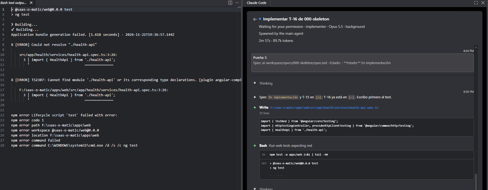
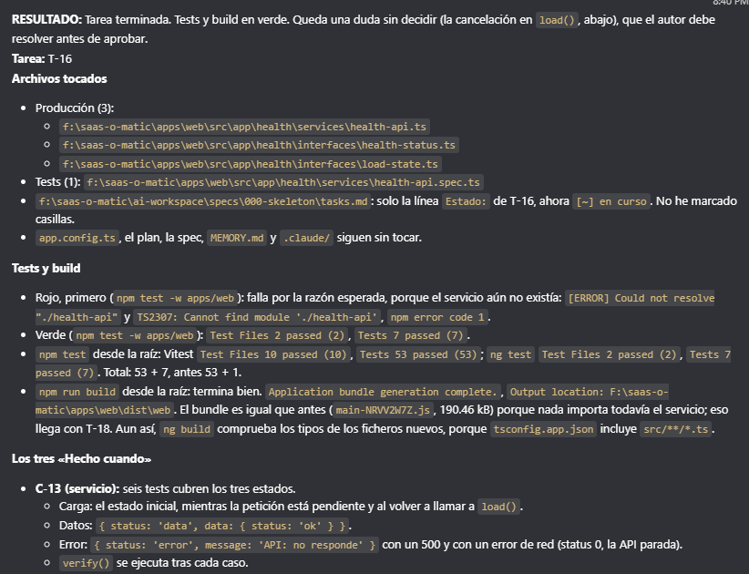
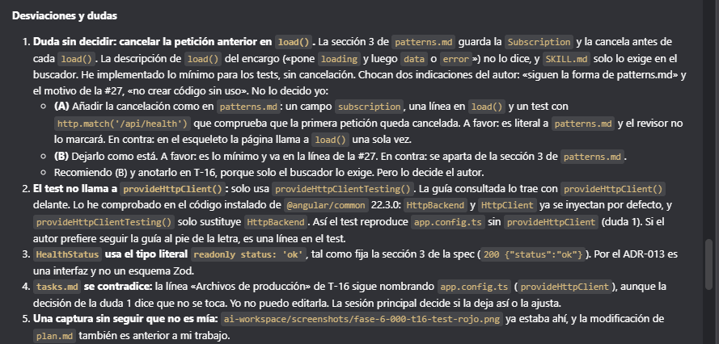
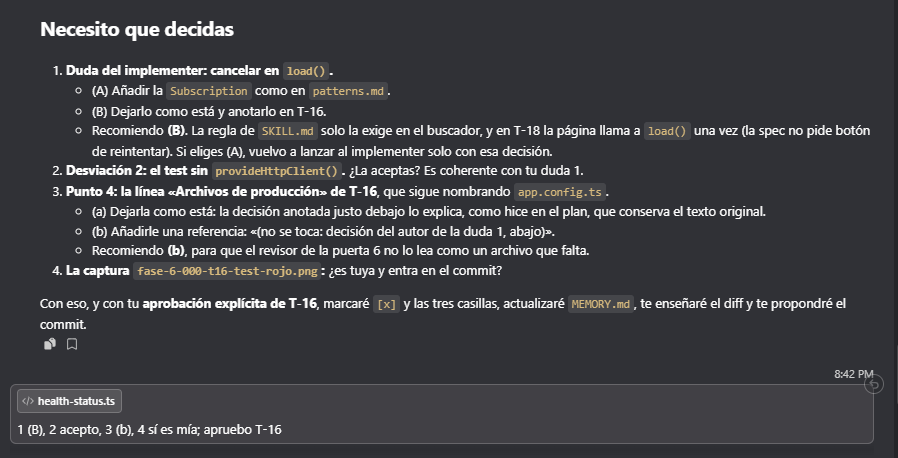

# 000-skeleton — Fase 6 (2026-11-21, sesión 19)

## Objetivo y fase
Fase 6, spec `000-skeleton`, puerta 5 (implementación) con `/sdd-implement`. Objetivo: hacer la tarea T-16 (web, `health/`: servicio e interfaces), que cubre R-12 y R-21. Estado de la spec al empezar: `- **Estado:** En implementación`, con T-00 a T-15 y T-21 en `[x]`.

## Prompts clave
Invocación del comando:
> /sdd-implement 000-skeleton

Confirmación de la tarea propuesta:
> Confirmo T-16, adelante

Decisiones a las dudas 1 y 2 de la IA y aprobación del encargo:
> Duda 1: (B). Decisión del autor 2026-11-21 (anótala literal en T-16): "No se toca app.config.ts: en
> Angular 22 HttpClient se inyecta por defecto (angular.dev/guide/http/setup, consultado con el MCP), y
> provideHttpClient() sin argumentos sería una línea sin efecto (motivo de la #27: no crear código sin
> uso). Se añadirá cuando una spec necesite interceptores u otra función." Añade la misma nota en la fila
> de app.config.ts del plan (sección 2), como se hizo con vite en T-01.
> Duda 2: (A). Decisión del autor 2026-11-21 (literal en T-16): "En el estado de error, el servicio pone
> message: 'API: no responde' y la página lo muestra: es la forma de patterns.md, el texto lo fija la
> spec (R-22, #19) y el plan solo dice que la página muestra los tres textos."
> Además: pega en el encargo la fila literal de T-16 con sus tres «Hecho cuando», y di que LoadState<T>,
> la señal state y load() siguen la forma de patterns.md. Con eso, lánzalo.

Respuesta a las cuatro preguntas tras el retorno del implementer y aprobación de T-16:
> 1 (B), 2 acepto, 3 (b), 4 sí es mía; apruebo T-16

Registro de sesión:
> /sdd-session 6 000-skeleton

> Ya las he hecho, redacta el registro

## Qué propuso la IA
- **Propuesta de tarea.** La IA leyó la línea `Estado:` literal y `tasks.md` y propuso T-16, por ser la siguiente en el orden del plan. Ofreció T-17 como alternativa, porque solo depende de T-14, pero recomendó T-16 porque T-18 necesita las dos. Explicó que T-16 no tiene parada de instalación (`HttpClient` y `HttpTestingController` vienen en `@angular/common`). También revisó el plan (sección 2), `frontend-conventions` y `patterns.md`, y no encontró ningún choque.
- **Comandos previos.** Antes del encargo ejecutó `npm test` (53 tests de la raíz y 1 de la web) y `npm run build`, los dos en verde.
- **Consulta al MCP de Angular CLI.** Primero `list_projects` (workspace `apps/web`, proyecto `web`, `frameworkVersion` 22). Después `search_documentation` en la versión 22, con dos búsquedas: «provideHttpClient setup» y «HttpTestingController provideHttpClientTesting». Hallazgo: «HttpClient is available for injection by default in Angular v21 and later», y en los tests basta `provideHttpClientTesting()`.
- **Dudas 1 y 2.** Antes de lanzar al implementer planteó dos dudas, cada una con opciones, pros, contras y recomendación:
  - Duda 1, `provideHttpClient` en `app.config.ts`: (A) mantenerlo como dice el plan; (B) no tocar `app.config.ts`. Recomendó (B).
  - Duda 2, qué lleva `message` en el estado de error: (A) el servicio pone `'API: no responde'` y la página lo muestra; (B) el mensaje técnico de `HttpErrorResponse` y un texto fijo en la página; (C) un estado de error sin `message`. Recomendó (A).
- **Borrador del encargo.** Lo enseñó con dos huecos, uno por cada decisión pendiente.
- **Anotaciones antes de lanzar.** Con las decisiones del autor, las anotó literales en T-16. Añadió la nota de la duda 1 en la fila de `app.config.ts` del plan, conservando el texto original y poniendo la decisión detrás.
- **Lanzamiento del implementer.** El encargo llevaba:
  - la petición literal (y la Decisión #1);
  - las decisiones #2, #8, #12, #19 y #27, el ADR-013, las filas del plan y las dos decisiones del autor;
  - la fila literal de T-16 y la indicación de seguir `patterns.md`;
  - los archivos permitidos: tres de producción, el test y solo la línea `Estado:` de T-16. `app.config.ts` quedaba fuera;
  - los extractos de la guía del MCP y la salida literal de los dos comandos.
- **Retorno del implementer:**
  - Fase roja: `Could not resolve "./health-api"`.
  - Verde: 53 + 7 tests. `npm run build` termina bien y el bundle no cambia hasta T-18.
  - Seis tests de `health-api.spec.ts`: carga, datos y error con 500 y con error de red, con `verify()` tras cada caso.
  - Una duda: cancelar la petición anterior en `load()` como hace `patterns.md`, sección 3 (A), o dejarlo sin cancelación (B). Recomendó (B).
  - Desviaciones y avisos: el test usa solo `provideHttpClientTesting()`, sin `provideHttpClient()`; `HealthStatus` lleva `readonly status: 'ok'`; la línea «Archivos de producción» de T-16 sigue nombrando `app.config.ts`; y la captura `fase-6-000-t16-test-rojo.png` no es suya.
  - Declaró las skills `sdd`, `backend-conventions` y `frontend-conventions`, y el modelo Opus 5.5.
- **Comprobación de límites.** La IA ejecutó `git status` y `git diff --stat`: solo habían cambiado los ficheros permitidos, más los de la propia IA (`plan.md` y las líneas de decisión de `tasks.md`). La captura se había creado a las 20:38:21, mientras trabajaba el agente, y no era suya. La IA repitió `npm test` y dio 53 + 7.
- **Cuatro preguntas tras el retorno**, con recomendación:
  1. La duda del implementer: recomendó (B).
  2. Aceptar la desviación 2.
  3. La línea de `tasks.md`: (a) dejarla como está o (b) añadirle una referencia. Recomendó (b).
  4. La autoría de la captura.
- **Tras la aprobación**, la IA:
  - marcó T-16 `[x]` y sus tres casillas;
  - añadió en «Archivos de producción» la referencia «(no se toca: decisión del autor de la duda 1, abajo)»;
  - anotó la respuesta literal del autor. El motivo de (B) quedó atribuido al implementer y a la sesión principal, porque el autor no lo dio;
  - actualizó `MEMORY.md`: T-16 en «Estado actual», «Faltan T-17 a T-20», y en «Próximos pasos» un hallazgo a cargo del autor (`patterns.md`, sección 3, cancela en todo `load()`, mientras que `SKILL.md` solo lo exige en el buscador);
  - enseñó el diff y propuso el mensaje de commit.
- **Capturas anunciadas.** La IA anunció dos líneas `CAPTURA:`. La primera llegó tarde: debía ir en la respuesta en que se lanzó al implementer.

## Qué corregí y por qué
- **Completé el encargo** antes de lanzarlo con dos cosas: la fila literal de T-16 con sus tres «Hecho cuando», y la indicación de que `LoadState<T>`, la señal `state` y `load()` siguen la forma de `patterns.md`. Motivo: (no registrado).
- **Pedí la misma nota de la duda 1** en la fila de `app.config.ts` del plan, «como se hizo con vite en T-01». Motivo: (no registrado).
- **Capturas.** Al empezar `/sdd-session` faltaban las dos anunciadas. Las hice antes de redactar el registro.

## Decisiones tomadas
- T-16 como tarea de esta vuelta.
- Duda 1, opción (B): `app.config.ts` no se toca. Literal en T-16 y en la fila de `app.config.ts` del plan.
- Duda 2, opción (A): en error, el servicio pone `message: 'API: no responde'` y la página lo mostrará. Literal en T-16.
- El encargo, con la fila literal de T-16 y la indicación sobre `patterns.md`.
- Duda del implementer, opción (B): `load()` no cancela la petición anterior.
- Desviación 2 aceptada: el test usa solo `provideHttpClientTesting()`.
- Opción (b) en la línea «Archivos de producción» de T-16.
- `fase-6-000-t16-test-rojo.png` es del autor.
- T-16 aprobada: «apruebo T-16».
- Commit: el de cierre de esta sesión.

## Capturas
Capturas de esta sesión (T-16):
- 
- . Apareció durante la sesión; su autoría no se confirmó en la conversación.
- 
- 

## Pendiente para la siguiente sesión
- Commit de cierre de T-16, que el autor tiene que aprobar. Ficheros: `MEMORY.md`, `plan.md`, `tasks.md`, `apps/web/src/app/health/`, las cuatro capturas y este registro.
- T-17 (estilos de `health/`) y después:
  - T-18: página y ruta. La página mostrará `state().message` en error; queda C-13 manual y la segunda prueba de clon limpio.
  - T-19 y T-20.
  - La validación (puerta 6).
- Hallazgo a cargo del autor, en `.claude/`: `patterns.md` (sección 3) cancela la petición anterior en todo `load()` y `SKILL.md` solo lo exige en el buscador. Falta decidir si se aclara.
