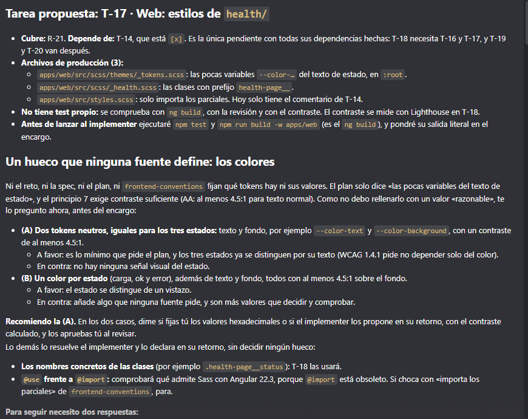
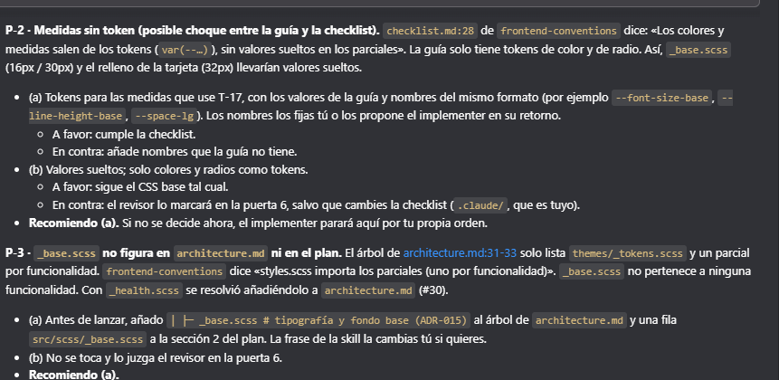
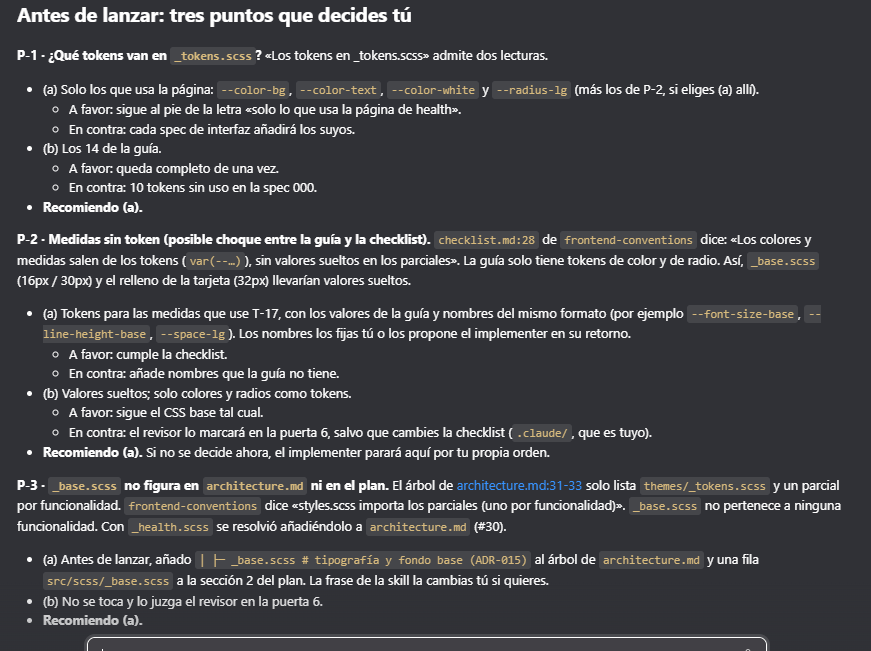
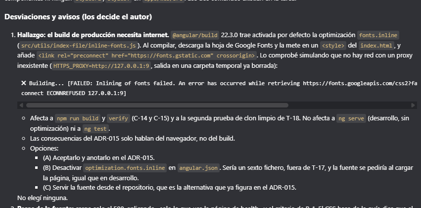

# 000-skeleton — Fase 6 (2026-11-21, sesión 20)

## Objetivo y fase
Fase 6, spec `000-skeleton`, puerta 5 (implementación): T-17 · Web: estilos de `health/` (R-21), con `/sdd-implement 000-skeleton`. Estado de la spec al empezar y al terminar: `- **Estado:** En implementación`. En la misma vuelta, el autor registró la guía de estilo de la interfaz como fuente (ADR-015).

## Prompts clave
1. Inicio de la vuelta:

> /sdd-implement 000-skeleton

2. Confirmación de T-17 y guía de estilo. Se cita del fichero del autor `prompt-t17-guia-estilo.md`, que la IA leyó en la sesión: al pegarlo en el chat se perdió `<link>` en la decisión del punto 3 («se carga con de Google Fonts»).

> Puerta 5 · implementación, T-17 (estilos de `health/`). Este mensaje sustituye al anterior: corrige la ruta de la imagen del mapa y añade el CSS base de la guía. No lances todavía al implementer.
>
> Confirmo T-17. Para los colores no elijo ni (A) ni (B): uso la guía de estilo y el mapa de página que van al final.
>
> Antes de proponer nada, lee:
> - la guía, el CSS base y el mapa de este mensaje;
> - `ai-workspace/docs/decisions.md`, para seguir el formato de los ADR;
> - `.claude/skills/frontend-conventions/SKILL.md`, sección «Estilos»;
> - T-17 en `ai-workspace/specs/000-skeleton/tasks.md`.
>
> ## 1. Registra la guía como fuente
> 1. Crea `ai-workspace/docs/style-guide.md` con la guía completa, el CSS base incluido, y el enlace a la imagen del mapa.
> 2. La imagen del mapa está en `ai-workspace/docs/0_mapa_general.png`. Renómbrala a `ai-workspace/docs/style-guide-mapa.png`.
> 3. Añade el ADR-015 «Guía de estilo» a `decisions.md`, con este contenido:
>    - Está inspirada en roams.es/detras-de-roams en estilo, tipografía y estructura, con marca, textos, logo e imágenes propios. No se copia la marca Roams.
>    - Cada spec de interfaz decide qué componentes del mapa usa.
>    - Dónde viven los componentes comunes (`shared/` o una carpeta de layout) se decide en la primera spec que los use.
>
> ## 2. Ajustes al registrarla (por `frontend-conventions`)
> 1. Los tokens siguen el formato `--color-…` y `--radius-…`: `--color-brand`, `--color-ink`, `--color-text`… y `--radius-sm`… No `--brand` ni `--r-sm`.
> 2. Las clases genéricas del CSS base (`.card`, `.pill`, `.eyebrow`, `.accent`, `.stat`) llevarán prefijo de componente cuando una spec las use.
> 3. `.pill` usa el peso 500 o el 700, porque el 600 no se carga.
> 4. La fuente se carga con `<link>` de Google Fonts en `index.html`, no con el `@import` del CSS base.
>
> ## 3. Decisión del autor 2026-11-21 para T-17
> Anótala literal en T-17 y como nota en las filas de estilos del plan (sección 2):
>
> "T-17 aplica de la guía (ADR-015) solo lo que usa la página de health: los tokens en _tokens.scss, la tipografía base (Montserrat, fondo #eef0f6, texto #4a4d56) en un parcial nuevo _base.scss y el texto de estado en una tarjeta blanca de radio 32px en _health.scss. Montserrat se carga con <link> de Google Fonts en index.html. styles.scss carga los parciales con @use, no @import. Los estados se distinguen por su texto, no por el color. Ningún componente del mapa se construye en la spec 000."
>
> T-17 toca cinco ficheros: `_tokens.scss`, `_health.scss`, `styles.scss`, `_base.scss` e `index.html`.
>
> ## 4. Encargo del implementer
> 1. La fila literal de T-17, con sus «Hecho cuando».
> 2. La decisión del punto 3, literal.
> 3. La guía, el CSS base y el mapa enteros, como contexto.
> 4. La orden de parar si algo de la guía choca con `frontend-conventions`.
> 5. Que el retorno indique el contraste de cada color de texto que use sobre su fondo. El mínimo es 4,5:1 (WCAG 2.2 AA).
>
> Enséñame el ADR-015, el diff de `style-guide.md` y el encargo. NO lances al implementer: espera mi aprobación.
>
> ---
>
> ## Guía de estilo (inspirada en roams.es/detras-de-roams)
> Usa esta guía para maquetar la página. Debe parecerse en estilo, tipografía y estructura, pero con nuestra propia marca, textos, logo e imágenes (no copiar la marca Roams).
>
> ### Tipografía
> - Fuente única: Montserrat (Google Fonts), pesos 400, 500, 700 y 800.
> - H1: 50px / line-height 70px / 800 / `#0d0d1a`
> - H2: 38px / 60px / 800
> - H3: 28px / 50px / 800
> - Párrafos: 16px / 30px / 500 / `#4a4d56`, texto justificado en bloques largos.
> - Menú: 16px / 700; el activo en negro y el resto en gris.
> - «Eyebrow» (etiqueta sobre el título): 14px / 500 / azul de marca.
> - En los títulos, 1 o 2 palabras clave en azul de marca.
> - Dentro de los párrafos, las frases clave en negrita 700 y color `#0d0d1a`.
>
> ### Colores
> - Marca: `#3838ec` · Marca oscuro: `#313087`
> - Títulos: `#0d0d1a` · Texto: `#4a4d56` · Secundario: `#666666`
> - Fondo de página: `#eef0f6` · Tarjetas: `#ffffff`
> - Fondos suaves: `#e4e4fc` / `#eef2ff`
> - Check OK: `#047857` sobre `#e8f8ee`
>
> ### Forma y componentes
> - Radios: píldoras 9999px, 32px (tarjeta hero), 24px (fotos y tarjetas de datos), 12–16px (cajas pequeñas).
> - Sin sombras marcadas: diseño plano, como mucho un borde sutil de 1px.
> - Header blanco: logo a la izquierda y menú a la derecha; debajo, una barra de migas gris.
> - Hero: tarjeta blanca grande sobre un fondo con formas azules diagonales y círculos difuminados. Eyebrow, H1 con una palabra en azul y párrafo con negritas.
> - Stats: rejilla 2×2 de bloques azules sólidos (`#3838ec`) con el texto blanco centrado: un número grande en 800 y su etiqueta debajo. A su lado, un collage de fotos redondeadas.
> - Índice «En esta página»: fila de píldoras blancas con scroll horizontal y una flecha.
> - Secciones en zigzag: imagen a un lado (radio 24px) y texto al otro, alternando el lado.
> - Listas con un check verde dentro de un círculo verde claro.
> - Caja destacada: fondo gris lavanda, icono azul de línea a la izquierda y texto con negritas.
> - Contenedor centrado de unos 1200px y mucho espacio entre secciones.
>
> ### CSS base
> ```css
> @import url('https://fonts.googleapis.com/css2?family=Montserrat:wght@400;500;700;800&display=swap');
>
> :root{
>   --brand:#3838ec; --brand-dark:#313087;
>   --ink:#0d0d1a; --text:#4a4d56; --muted:#666;
>   --bg:#eef0f6; --soft:#e4e4fc; --white:#fff;
>   --ok:#047857; --ok-bg:#e8f8ee;
>   --r-sm:12px; --r-md:24px; --r-lg:32px; --r-pill:9999px;
> }
> body{font-family:'Montserrat',sans-serif;background:var(--bg);color:var(--text);font-weight:500;font-size:16px;line-height:30px}
> h1,h2,h3{color:var(--ink);font-weight:800}
> h1{font-size:50px;line-height:70px} h2{font-size:38px;line-height:60px} h3{font-size:28px;line-height:50px}
> .accent{color:var(--brand)}
> p strong{color:var(--ink);font-weight:700}
> .card{background:#fff;border-radius:var(--r-lg);padding:32px}
> .stat{background:var(--brand);color:#fff;border-radius:var(--r-md);text-align:center;padding:24px;font-weight:700}
> .pill{background:#fff;border-radius:var(--r-pill);padding:6px 14px;font-size:13px;font-weight:600}
> .eyebrow{color:var(--brand);font-size:14px}
> ```
>
> ## Mapa de página
> Imagen: `ai-workspace/docs/0_mapa_general.png`, que pasará a llamarse `style-guide-mapa.png`. Componentes, de arriba abajo:
> 1. `<app-header>` + `<app-breadcrumb>`: logo, menú y migas.
> 2. `<app-hero>` con `<app-stats>`: eyebrow, título y párrafo a la izquierda, y una rejilla 2×2 de cifras a la derecha.
> 3. `<app-page-toc>`: píldoras «Sección 1…N» con una flecha.
> 4. `<app-split-section>` ×N: texto e imagen, alternando el lado.
> 5. `<app-feature-columns>`: dos columnas con checks y una caja destacada.
> 6. `<app-footer>`: pie oscuro.

3. Respuestas a P-1, P-2 y P-3:

> P-1: (a). Solo los tokens que usa la página de health (motivo de la #27: no crear código sin uso); cada
> spec de interfaz añadirá los suyos desde style-guide.md.
> P-2: (a). Las medidas que use T-17 van como tokens con los valores de la guía, para cumplir
> checklist.md («colores y medidas salen de los tokens») y architecture.md («colores y medidas con
> nombre»). Formato de los nombres: --font-family-base, --font-size-…, --line-height-… y --space-…; el
> implementer propone los nombres concretos dentro de ese formato y los lista en su retorno.
> P-3: (a). Añade _base.scss al árbol de architecture.md («tipografía y fondo base (ADR-015)») y una fila
> src/scss/_base.scss a la sección 2 del plan. La frase de frontend-conventions («un parcial por
> funcionalidad») la ajustaré yo: anótala en MEMORY.md como pendiente del autor en .claude/, junto a la
> de patterns.md, sin añadir líneas (MEMORY.md está en 51 y debe quedar en ≤ 50).
> .pill: no lo fijes; lo decidirá la spec que use la píldora.
> ADR-015, en Consecuencias, añade: "Cargar la fuente desde Google Fonts envía a Google la IP de cada
> visitante; el autor lo acepta para esta herramienta interna. La alternativa es servir la fuente desde
> el repositorio."
> Completa el [PENDIENTE] del encargo con esto y lánzalo; no hace falta que me lo enseñes otra vez.

4. Aprobación de T-17:

> Hallazgo 1: (A). Decisión del autor 2026-11-21 (anótala literal en T-17 y en Consecuencias del ADR-015):
> "El build de producción descarga la hoja de Google Fonts para incrustarla (fonts.inline de
> @angular/build, activada por defecto): necesita red, igual que npm ci, así que quien pueda instalar el
> proyecto puede compilarlo. Si en algún momento molesta, la alternativa es servir la fuente desde el
> repositorio (C)."
> Puntos 2 a 6: los acepto todos (solo el peso 500, font-weight sin token, display=swap, una sola clase
> .health-page__card que T-18 debe usar, y sin contenedor: la maquetación llega con las specs de
> interfaz). Acepto también los nombres --font-size-base, --line-height-base y --space-lg.
> Punto 8: sí, renómbrala a fase-6-000-t17-p1-p3-decisiones.png.
> Apruebo T-17: marca [x] y las casillas 1 y 2; la 3 (contraste) queda para Lighthouse en T-18, como la
> casilla de C-13 en T-15. Anota en T-17 mis decisiones P-1 a P-3 y las de esta vuelta, deja MEMORY.md en
> ≤ 50 líneas y propón el commit con las capturas.

## Qué propuso la IA
- **Tarea:** propuso T-17 como tarea de la vuelta. Era la única pendiente con todas sus dependencias hechas (T-14 en `[x]`), con tres ficheros de producción y sin test propio.
- **Colores:** señaló que ninguna fuente los fija y propuso dos opciones: (A) dos tokens neutros, iguales para los tres estados, o (B) un color por estado. Recomendó (A) y preguntó quién fijaría los valores.
- **Registro de la guía:**
  - Creó `ai-workspace/docs/style-guide.md`: la guía literal, con los ajustes 1 y 4 aplicados al CSS base y `.pill` sin peso, con un comentario.
  - Renombró la imagen a `style-guide-mapa.png`.
  - Añadió el ADR-015 a `decisions.md`, con las opciones (A) y (B) como alternativa descartada.
  - Anotó la decisión literal en T-17 y en la fila `src/styles.scss` del plan; las filas `_tokens.scss` y `_health.scss` remiten a ella.
  - Amplió la línea «Archivos de producción» de T-17 a cinco ficheros.
  - Usó el fichero del autor para el texto literal, porque el chat había perdido `<link>`.
  - Calculó el contraste del texto `#4a4d56`: 8,44:1 sobre `#ffffff` y 7,41:1 sobre `#eef0f6`.
- **Dudas antes de lanzar, las tres con recomendación (a):**
  - P-1: qué tokens van en `_tokens.scss`, solo los que usa la página o los 14 de la guía.
  - P-2: las medidas no tienen token en la guía, frente a `checklist.md:28` de `frontend-conventions`.
  - P-3: `_base.scss` no figuraba en `architecture.md` ni en el plan, y `frontend-conventions` dice «uno por funcionalidad».
- **Otros avisos:** cargar Montserrat desde Google Fonts envía a Google la IP de cada visitante (LG München, 2022). Preguntó si fijaba el peso de `.pill`. Montó el encargo con un hueco [PENDIENTE].
- **Con las respuestas:**
  - Añadió `_base.scss` al árbol de `architecture.md` y una fila al plan.
  - Añadió la consecuencia del autor al ADR-015.
  - En MEMORY.md unió el pendiente de `.claude/` con el de `patterns.md`; quedó en 50 líneas.
  - Completó el encargo y lanzó al implementer, tras guardar `git status` y `git diff --stat`.
- **Retorno del implementer:** `Tarea terminada`, T-17 en `[~]`.
  - Cinco ficheros: `_tokens.scss`; `_base.scss`; `_health.scss`, con `.health-page__card`; `styles.scss`, con `@use`; e `index.html`, con el `<link>` de Montserrat 500 y `display=swap`.
  - Tokens propuestos: `--font-size-base`, `--line-height-base` y `--space-lg`. Contraste: 8,44:1 y 7,41:1.
  - `npm test`: 53 + 7 en verde. `ng build`: `styles` pasa de 0 a 489 bytes.
  - Ocho avisos:
    1. El `ng build` de producción falla sin red por `fonts.inline` de `@angular/build` 22.3.0; lo comprobó con un proxy inexistente. Opciones: (A) aceptarlo y anotarlo en el ADR-015; (B) desactivar `optimization.fonts.inline` en `angular.json`; (C) servir la fuente desde el repositorio.
    2. Solo carga el peso 500.
    3. `font-weight: 500` sin token.
    4. `display=swap` en la URL.
    5. Una sola clase, que T-18 debe usar.
    6. Sin contenedor ni márgenes.
    7. `inlineCritical` añade un `<script>` en línea en producción.
    8. Una captura con ` .png` repetido.
- **Comprobación de límites:** comparado con el estado guardado, el implementer solo tocó los cinco ficheros y la línea `Estado:` de T-17. Las tres capturas nuevas eran del autor.
- **Tras la aprobación:**
  - Renombró la captura y marcó T-17 en `[x]`, con las casillas 1 y 2.
  - Anotó en T-17 las decisiones P-1 a P-3, la de `.pill`, el hallazgo con la opción (A) y las desviaciones aceptadas.
  - Añadió la decisión al ADR-015 y actualizó MEMORY.md (50 líneas).
  - Propuso el commit con las capturas.

## Qué corregí y por qué
- **Colores:** no elegí ni (A) ni (B); usé la guía de estilo y el mapa de página que aporté. Motivo: (no registrado).
- **Mensaje anterior:** mi mensaje dice que sustituye a uno anterior, que corregía la ruta de la imagen del mapa y añadía el CSS base. Ese mensaje anterior: (no registrado).
- **Ajustes de la guía:** al registrarla, cuatro ajustes «por `frontend-conventions`»: el formato de los tokens, el prefijo de las clases genéricas, el peso de `.pill` y `<link>` en lugar de `@import`.
- **P-2, nombres de los tokens:** fijé su formato (`--font-family-base`, `--font-size-…`, `--line-height-…` y `--space-…`), y el implementer propone los nombres concretos dentro de él. Motivo: cumplir `checklist.md` y `architecture.md`.
- **`.pill`:** no se fija; lo decide la spec que use la píldora.
- **ADR-015:** añadí con mis palabras la consecuencia sobre la IP: la acepto para esta herramienta interna.
- **MEMORY.md:** el pendiente de `.claude/` va sin añadir líneas, porque estaba en 51 y debe quedar en ≤ 50.

## Decisiones tomadas
- T-17 confirmada como tarea de la vuelta.
- **ADR-015 · Guía de estilo:**
  - `style-guide.md`, con su mapa, es la fuente de estilo de la interfaz, inspirada en roams.es/detras-de-roams sin copiar la marca.
  - Cada spec de interfaz decide qué componentes del mapa usa.
  - Dónde viven los componentes comunes se decide en la primera spec que los use.
  - Lleva cuatro ajustes por `frontend-conventions`.
  - Consecuencias del autor: la IP de cada visitante va a Google, aceptado; el build de producción necesita red, opción (A).
- Decisión para T-17, literal arriba: solo lo que usa la página de health, en cinco ficheros.
- **P-1 (a):** solo los tokens que usa la página.
- **P-2 (a):** medidas como tokens, con el formato del autor.
- **P-3 (a):** `_base.scss` en `architecture.md` y en el plan. La frase de `frontend-conventions` la ajusta el autor, y queda pendiente en MEMORY.md.
- `.pill` sin fijar.
- **Hallazgo del build sin red:** opción (A), con el texto literal en T-17 y en el ADR-015.
- **Desviaciones 2 a 6 aceptadas:** solo el peso 500, `font-weight` sin token, `display=swap`, la única clase `.health-page__card` (que T-18 debe usar) y sin contenedor. Nombres aceptados: `--font-size-base`, `--line-height-base` y `--space-lg`.
- Captura renombrada a `fase-6-000-t17-p1-p3-decisiones.png`.
- **T-17 aprobada:** `[x]` y casillas 1 y 2. La 3, el contraste, queda para Lighthouse en T-18.
- Commit: el de cierre de esta sesión.

## Capturas
- 
- 
- 
- 

Solo se enlazan las de esta sesión; las demás `fase-6-000-*` son de sesiones anteriores.

## Pendiente para la siguiente sesión
- Aprobar y hacer el commit de cierre de esta sesión: los cambios de T-17, la guía, el ADR-015, las capturas y este registro.
- Tras guardar el registro, buscar `(pendiente de /sdd-session)` en `spec.md`. En esta sesión no se lanzó al planner, así que no se espera ninguno.
- **T-18, página `health-page` y ruta:**
  - usa `.health-page__card`;
  - contraste con Lighthouse (casilla 3 de T-17);
  - C-13 manual;
  - segunda prueba de clon limpio, en la que el `ng build` de producción necesita red (ADR-015).
- **Autor, en `.claude/`:** ajustar «un parcial por funcionalidad» de `frontend-conventions/SKILL.md` (`_base.scss`) y decidir lo de `patterns.md` (T-16).
- T-19; T-20, antes de la cual el autor decide qué se recorta de `CLAUDE.md`; y la validación (puerta 6).
