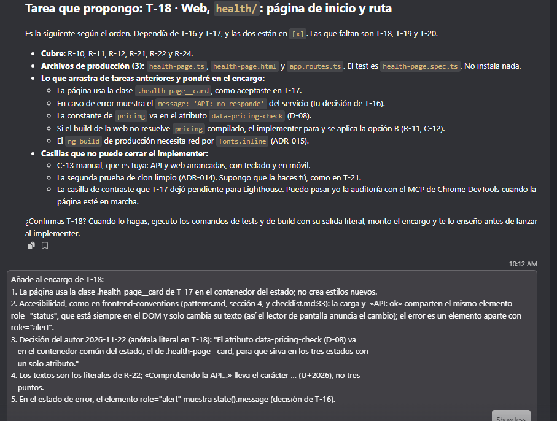
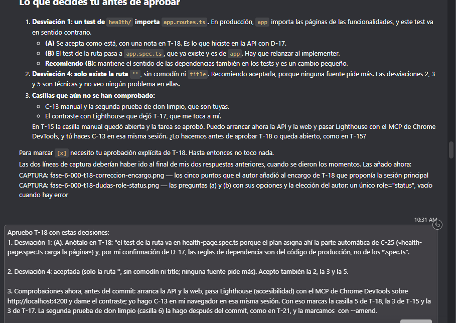
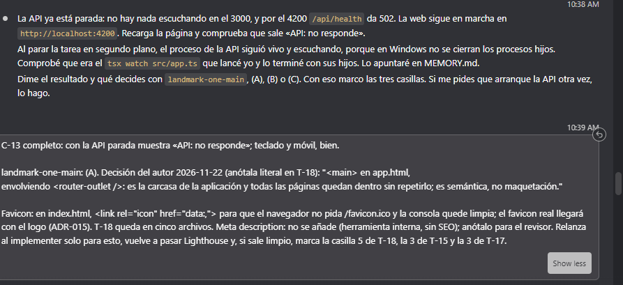
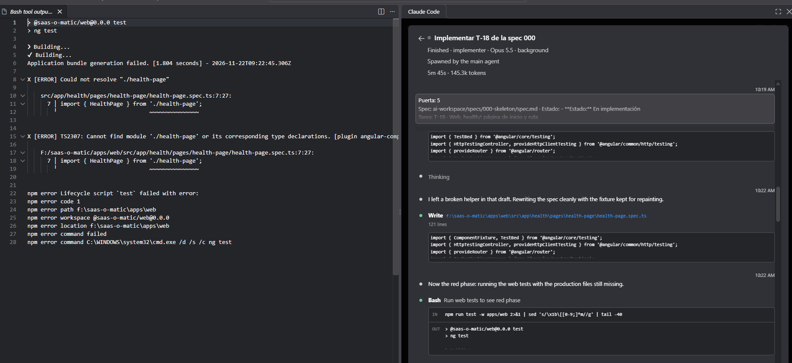
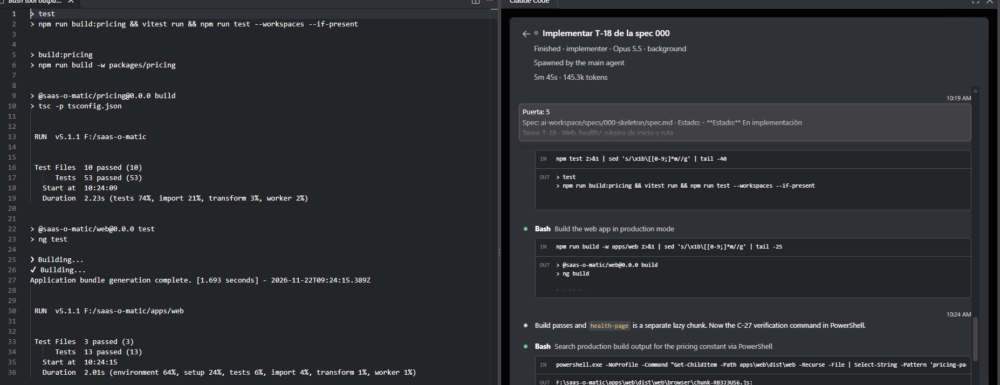
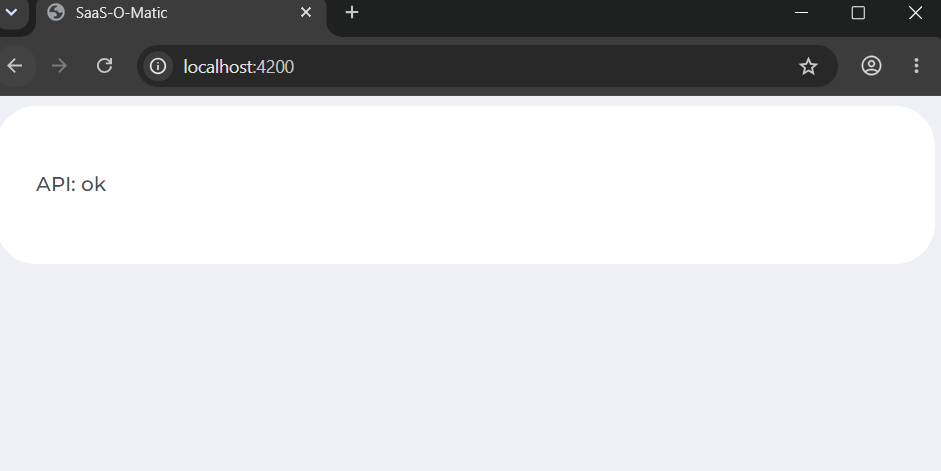
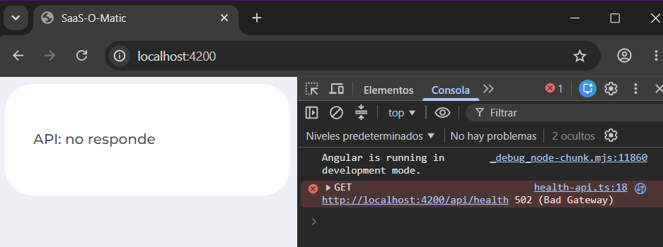
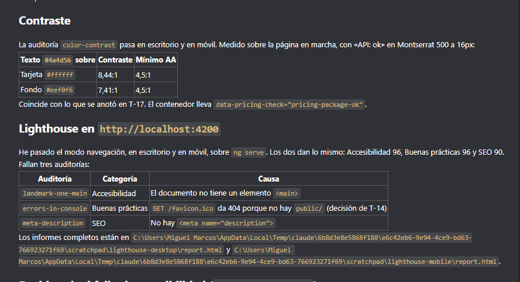
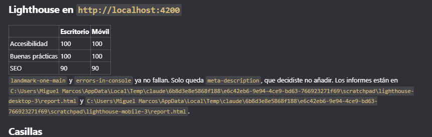
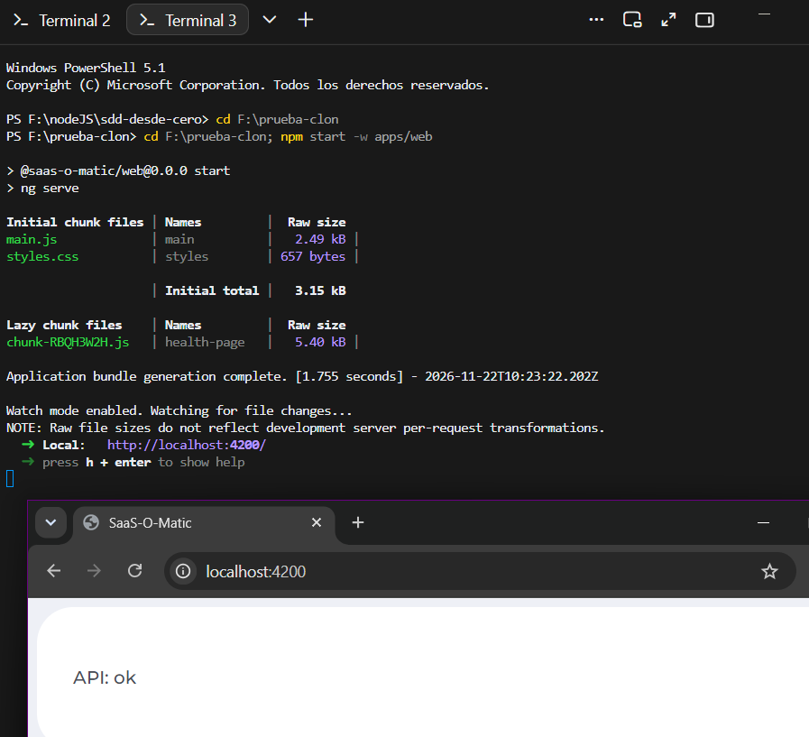

# 000-skeleton — Fase 6 (2026-11-22, sesión 01)

## Objetivo y fase
Fase 6, spec `000-skeleton`, puerta 5 (implementación). Objetivo: T-18, la página de inicio de `health/` y su ruta, con `/sdd-implement 000-skeleton`. La spec estaba en `- **Estado:** En implementación` y sigue así.

## Prompts clave
1. Inicio de la vuelta:

> /sdd-implement 000-skeleton

2. Añadidos al encargo de T-18, tras la propuesta de la IA:

> Añade al encargo de T-18:
> 1. La página usa la clase .health-page__card de T-17 en el contenedor del estado; no crea estilos nuevos.
> 2. Accesibilidad, como en frontend-conventions (patterns.md, sección 4, y checklist.md:33): la carga y  «API: ok» comparten el mismo elemento role="status", que está siempre en el DOM y solo cambia su texto (así el lector de pantalla anuncia el cambio); el error es un elemento aparte con role="alert".
> 3. Decisión del autor 2026-11-22 (anótala literal en T-18): "El atributo data-pricing-check (D-08) va
>    en el contenedor común del estado, el de .health-page__card, para que sirva en los tres estados con
>    un solo atributo."
> 4. Los textos son los literales de R-22; «Comprobando la API…» lleva el carácter … (U+2026), no tres
>    puntos.
> 5. En el estado de error, el elemento role="alert" muestra state().message (decisión de T-16).

3. Fila literal en el encargo:

> Añade al encargo la fila literal de T-18 de tasks.md con sus seis «Hecho cuando», y lánzalo.

4. Respuestas a las dudas (a) y (b), enviadas tras interrumpir el turno:

> (a) Sí, anótalo como decisión del autor 2026-11-22 en T-18, literal: "La carga y «API: ok» comparten un único elemento role="status", siempre en el DOM, que solo cambia su texto; el error es un elemento aparte con role="alert". Se aparta del ejemplo de patterns.md §4 (allí el status solo existe en la carga) porque en health el dato es en sí un mensaje de estado (WCAG 4.1.3): para que el lector de pantalla lo anuncie, el role="status" tiene que existir antes del cambio. Cumple checklist.md:33."
>
> (b) Vacío: en el estado de error, el elemento role="status" queda vacío y solo se ve y se anuncia «API: no responde», una vez, por el role="alert". D-08: de acuerdo, no toques plan.md.
> Con la fila literal de T-18 y sus seis «Hecho cuando» en el encargo, lánzalo.

5. Mensaje recibido mientras se lanzaba al implementer:

> luego haz
> Añade al encargo la fila literal de T-18 de tasks.md con sus seis «Hecho cuando», y lánzalo.

6. Aprobación de la primera vuelta y comprobaciones en marcha:

> Apruebo T-18 con estas decisiones:
> 1. Desviación 1: (A). Anótalo en T-18: "el test de la ruta va en health-page.spec.ts porque el plan asigna ahí la parte automática de C-25 («health-page.spec.ts carga la página») y, por mi confirmación de D-17, las reglas de dependencia son del código de producción, no de los *.spec.ts".
>
> 2. Desviación 4: aceptada (solo la ruta '', sin comodín ni title; ninguna fuente pide más). Acepto también la 2, la 3 y la 5.
>
> 3. Comprobaciones ahora, antes del commit: arranca la API y la web, pasa Lighthouse (accesibilidad) con el MCP de Chrome DevTools sobre http://localhost:4200 y dame el contraste; yo hago C-13 en mi navegador en esa misma sesión. Con eso marcas la casilla 5 de T-18, la 3 de T-15 y la 3 de T-17. La segunda prueba de clon limpio (casilla 6) la hago después del commit, como en T-21, y la marcamos  con --amend.

7. C-13 con la API en marcha:

> C-13: «API: ok» por el 4200, sin errores de CORS en la consola (solo el 404 de favicon.ico). Para ahora
> la API, que compruebo «API: no responde».

8. C-13 completo y decisiones tras el primer Lighthouse:

> C-13 completo: con la API parada muestra «API: no responde»; teclado y móvil, bien.
>
> landmark-one-main: (A). Decisión del autor 2026-11-22 (anótala literal en T-18): "<main> en app.html,
> envolviendo <router-outlet />: es la carcasa de la aplicación y todas las páginas quedan dentro sin repetirlo; es semántica, no maquetación."
>
> Favicon: en index.html, <link rel="icon" href="data:,"> para que el navegador no pida /favicon.ico y la consola quede limpia; el favicon real llegará con el logo (ADR-015). T-18 queda en cinco archivos. Meta description: no se añade (herramienta interna, sin SEO); anótalo para el revisor. Relanza al implementer solo para esto, vuelve a pasar Lighthouse y, si sale limpio, marca la casilla 5 de T-18, la 3 de T-15 y la 3 de T-17.

9. Anotaciones añadidas por la IA sin petición:

> Déjalas anotadas; sigue cuando vuelva el implementer.

10. Aprobación de la segunda vuelta y cierre:

> Apruebo la segunda vuelta de T-18 (favicon sin test y el test de app.spec.ts). Sí, añade apps/web/src/app/app.spec.ts a la línea «Tests» de T-18.
>
> Antes de marcar: vuelve a pasar Lighthouse en el 4200 (escritorio y móvil) y dime las puntuaciones; deberían desaparecer landmark-one-main y errors-in-console, y quedar solo meta-description (no se añade, por mi decisión).
>
> Si sale así, marca T-18 en [x] con las casillas 1, 3, 4 (no se activó, como en T-06) y 5 (C-13: lo comprobé yo con la API en marcha y parada), y además la casilla 3 de T-15 y la 3 de T-17. La 2 (C-25) queda para el revisor y la 6 (clon limpio) la marcamos con --amend tras el commit.
>
> Para la API y el ng serve, deja MEMORY.md en ≤ 50 líneas y propón el commit con las capturas de T-18.

11. Registro de la sesión:

> /sdd-session 6 000-skeleton

12. Cierre de los pendientes de esta sesión, tras revisarlos con la IA:

> 3. Sí, anota la decisión (b) literal en T-18.
> 4. (A), y resolvemos los pendientes de .claude/ de una vez, en un commit aparte, después del --amend de
>    la casilla 6 (si no, el --amend caería sobre el commit equivocado). Te autorizo expresamente a
>    editar solo estos cuatro puntos de .claude/:
>    a. patterns.md §4: la nota que propones (si el dato es en sí un mensaje de estado, la carga y el dato
>       comparten un único role="status", siempre en el DOM; el error va aparte con role="alert"; WCAG 4.1.3).
>    b. patterns.md §3: nota de que cancelar la petición anterior solo hace falta cuando load() puede
>       lanzarse varias veces seguidas (el buscador, SKILL.md «Estados»); si la vista lo llama una vez al
>       crearse, se omite (health/, T-16).
>    c. SKILL.md, Estilos: "styles.scss carga con @use los parciales: themes/_tokens.scss, _base.scss
>       (tipografía y fondo base, ADR-015) y uno por funcionalidad".
>    d. En la plantilla del encargo del implementer (/sdd-implement o /sdd-flow, donde esté): un campo
>       obligatorio «Fila literal de la tarea de tasks.md, con todos sus "Hecho cuando"».
>    Al hacerlo, quita de MEMORY.md los pendientes de .claude/ que queden resueltos. Enséñame el diff
>    antes del commit.
> Orden: anota (b) → commit de T-18 (con el número del registro de hoy) → yo hago el clon limpio →
> --amend con la casilla 6 → commit de .claude/ → T-19.

13. Segunda prueba de clon limpio, tras el commit de T-18:

> Clon limpio hecho: npm ci, build y tests en verde

> Sí, la web arrancó con «API: ok» y sin Visual Studio

> . Sí: npm ci terminó bien y sin gyp ERR!, sin Visual Studio ni herramientas de compilación, como en
>    T-21. npm run build y npm test (53 + 14) también pasaron en el clon.
> Captura: fase-6-000-t18-clon-limpio.png. Marca la casilla 6, añade el resultado al registro y a
> MEMORY.md (≤ 50 líneas), enséñame el diff y haz el --amend sobre a20dbf5

## Qué propuso la IA
- **Tarea:**
  - Leyó la línea `Estado:` de `spec.md` y propuso T-18 como siguiente tarea. Sus dependencias, T-16 y T-17, estaban en `[x]`.
  - Detalló lo que T-18 arrastraba de tareas anteriores: `.health-page__card`, el `message` de T-16, `data-pricing-check` (D-08), la opción B (R-11) y `fonts.inline` (ADR-015).
  - Señaló las casillas que no podía cerrar el implementer: C-13 manual, el clon limpio y el contraste de T-17. Ofreció pasar Lighthouse con el MCP de Chrome DevTools.
  - Tomó el mensaje del punto 2 como confirmación de T-18.
- **Comprobación de los cinco puntos antes de montar el encargo:**
  - R-22 ya usa `…` (U+2026).
  - `LoadState` tiene `message` en la variante de error.
  - D-08 dice «el elemento que muestra el estado», con un «p. ej.». No lo vio como choque y no tocó `plan.md`.
  - El punto 2 no es igual al ejemplo de `patterns.md` §4, donde `role="status"` solo existe en la carga. Duda (a): anotarlo como decisión del autor; recomendó que sí.
  - Duda (b): qué muestra el `role="status"` cuando hay error. Opciones: vacío (recomendada) o conservar «Comprobando la API…».
- **Antes de lanzar:**
  - Ejecutó `npm test` (53 + 7 en verde) y `npm run build -w apps/web` (producción).
  - Buscó `pricing-package-ok` en `dist` y no lo encontró: C-27 estaba en rojo.
  - Anotó la decisión del punto 3, literal, en T-18 y enseñó el encargo.
- **Lanzamiento:**
  - Anotó (a), literal, en T-18.
  - Lanzó al implementer con la fila literal de T-18, las tres peticiones literales y las decisiones aplicables.
  - Al mensaje del punto 5 respondió que el encargo ya llevaba la fila y que no relanzaba.
  - La decisión (b) quedó solo en el encargo, no en `tasks.md`, y ofreció anotarla.
- **Primer retorno del implementer:** `Tarea terminada`, T-18 en `[~]`.
  - Tres archivos de producción y `health-page.spec.ts`, con 6 tests.
  - Fase roja en dos pasos: primero `TS2307`; después `1 failed | 12 passed`, por la ruta.
  - 53 + 13 tests en verde.
  - Build de producción con el chunk diferido de `health-page`.
  - C-27 en verde con `Select-String`, sin `-SimpleMatch`.
  - Cinco desviaciones:
    1. El test de la ruta, en `health-page.spec.ts`, importa `app.routes.ts`.
    2. `@let current = state();` en la plantilla.
    3. `whenStable()` sin `detectChanges()`.
    4. Solo la ruta `''`.
    5. Sin consulta al MCP de Angular.
- **Límites:** `git status` y `git diff --stat` mostraron solo los archivos permitidos. En `tasks.md`, el implementer solo cambió la línea `Estado:`.
- **Propuestas tras el retorno:**
  - Desviación 1: (A) aceptarla con una nota o (B) mover el test a `app.spec.ts`. Recomendó (B).
  - Desviación 4: aceptarla.
  - Preguntó si las comprobaciones manuales iban antes o después de aprobar.
- **Capturas:** anunció tarde las líneas `CAPTURA:`. Las dos primeras salieron una respuesta después del momento, y las dos siguientes también.
- **Comprobaciones en marcha:**
  - Anotó la decisión 1, literal, en T-18.
  - Arrancó la API con `npm run dev -w apps/api` y la web con el MCP de Angular, en el 4200.
  - Abrió la página en Chrome: un `status` con «API: ok».
  - Primer Lighthouse, en escritorio y móvil: Accesibilidad 96, Buenas prácticas 96 y SEO 90. Fallaban `landmark-one-main`, `errors-in-console` (404 de `/favicon.ico`) y `meta-description`.
  - Contraste medido en la página: 8,44:1 sobre la tarjeta y 7,41:1 sobre el fondo.
  - `/api/health` respondía 200 por el 4200.
  - Para `landmark-one-main` propuso tres opciones: (A) `<main>` en `app.html`, la recomendada; (B) `<main>` en `health-page.html`; (C) justificarlo, por ser una regla de buenas prácticas de axe y no un criterio de WCAG 2.2 AA.
  - El favicon y la `meta description` los dejaba apuntados para el revisor.
- **Parada de la API:**
  - Al detener la tarea en segundo plano, el `tsx watch` hijo seguía escuchando en el 3000.
  - Comprobó su línea de órdenes y lo terminó con `taskkill /T`.
  - Por el 4200, `/api/health` pasó a dar 502.
- **Segunda vuelta:**
  - Anotó en T-18 las decisiones de `landmark-one-main` y del favicon, y la nota de `meta description`.
  - Anotó también, sin petición, las desviaciones 2 a 5 y el resultado del primer Lighthouse.
  - Amplió a cinco la lista de archivos de producción.
  - Ejecutó `npm test` (53 + 13) y el build.
  - Relanzó al mismo implementer, que conservaba el contexto.
- **Segundo retorno:** `Tarea terminada`.
  - `<main>` en `app.html` y favicon `data:,` en `index.html`.
  - Test nuevo en `app.spec.ts`, visto en rojo (`1 failed | 13 passed`).
  - 53 + 14 tests en verde y build correcto.
  - Desviaciones: el favicon no tiene test, y `app.spec.ts` no figura en «Tests».
- **Segundo y tercer Lighthouse**, con la API arrancada de nuevo:
  - Accesibilidad 100, Buenas prácticas 100 y SEO 90, en escritorio y móvil. Solo falla `meta-description`.
  - En el árbol de accesibilidad: `main` → `status` → «API: ok».
  - Tras el segundo marcó la casilla 5 de T-18, la 3 de T-15 y la 3 de T-17. El tercero, pedido por el autor, dio lo mismo.
- **Cierre:**
  - T-18 en `[x]`, con las casillas 1, 3 (con el comando de PowerShell), 4 («No se activó») y 5, y `app.spec.ts` en «Tests».
  - Paró el `ng serve` y la API (con `taskkill /T`). Los puertos 3000 y 4200 quedaron libres.
  - Actualizó MEMORY.md sin añadir líneas; sigue en 50.
  - `npm test`: 53 + 14 en verde.
  - `git status` sin cambios en `angular.json`.
  - Propuso el commit con «sesión 21» y lo corrigió a «sesión 01» al calcular este registro.
- **Pendientes del registro:**
  - Tras guardar el registro buscó `(pendiente de /sdd-session)` en `spec.md` y no había ninguno.
  - Revisó con el autor los pendientes de esta sesión.
  - Recomendó anotar (b) en T-18, porque el revisor vería un `role="status"` vacío en el error.
  - Para `patterns.md` §4 propuso (A), una nota tras el ejemplo, la recomendada, o (B) dejarlo como está.
  - Recordó los otros dos pendientes de `.claude/` que recoge MEMORY.md: la cancelación de `patterns.md` §3 y «un parcial por funcionalidad» de `SKILL.md`.
  - Señaló que `/sdd-flow` le prohíbe tocar `.claude/` sin autorización expresa.
  - Anotó (b), literal, en T-18 antes del commit.
- **Commit y clon limpio:**
  - Hizo el commit de T-18.
  - Al primer aviso del clon limpio preguntó por las dos comprobaciones de la casilla 6 que no constaban: que la web arrancara y que se instalara sin herramientas de compilación.
  - Repasó los `hasInstallScript` del `package-lock.json` commiteado:
    - `@parcel/watcher` 2.6.0;
    - `esbuild` 0.28.2;
    - `fsevents` 2.3.3, opcional;
    - `lmdb` 3.5.9, opcional;
    - `msgpackr-extract` 3.0.7, opcional.

    Son los cinco de T-14 y no hay ninguno nuevo. Todos son de desarrollo y, con `ignore-scripts=true`, ninguno ejecuta su script.
  - Marcó la casilla 6 y lo añadió a MEMORY.md y a este registro, con `--amend` sobre el commit de T-18.
  - Con el tercer mensaje del autor, que llegó después de ese `--amend`, añadió «sin `gyp ERR!`», «53 + 14» y la captura del clon. Hizo un segundo `--amend` sobre el commit de T-18, sin los cambios de `.claude/`, que van aparte.

## Qué corregí y por qué
- **Encargo de T-18:** añadí cinco puntos a lo que proponía la IA:
  - la clase `.health-page__card`, sin estilos nuevos;
  - un único `role="status"` y el `role="alert"` aparte;
  - `data-pricing-check` en el contenedor;
  - el carácter U+2026;
  - el `role="alert"` con `state().message`.

  Motivos dados: para el punto 2, «así el lector de pantalla anuncia el cambio»; para el 3, «para que sirva en los tres estados con un solo atributo». Los demás: (no registrado).
- **Fila literal de T-18 en el encargo:** la pedí con sus seis «Hecho cuando». Motivo: (no registrado).
- **Desviación 1:** elegí (A), no la (B) que recomendaba la IA. Motivo: el plan asigna a `health-page.spec.ts` la parte automática de C-25 y, por mi confirmación de D-17, las reglas de dependencia son del código de producción, no de los `*.spec.ts`.
- **Favicon:** la IA lo dejaba apuntado para el revisor y yo lo corregí con un favicon vacío en `index.html`. Motivo: que el navegador no pida `/favicon.ico` y la consola quede limpia. El favicon real llegará con el logo (ADR-015).
- **Meta description:** no se añade. Motivo: herramienta interna, sin SEO.
- **Lighthouse antes de marcar:** pedí repetirlo y conocer las puntuaciones antes de marcar las casillas. Motivo: (no registrado).
- **MEMORY.md:** debe quedar en ≤ 50 líneas.

## Decisiones tomadas
- T-18 confirmada como tarea de la vuelta.
- **Contenedor del estado:** `data-pricing-check` va en `.health-page__card` (literal en T-18). Concreta D-08 y `plan.md` no se toca.
- **Estado accesible:** un único `role="status"` siempre en el DOM y un `role="alert"` aparte (literal en T-18). Se aparta del ejemplo de `patterns.md` §4 por WCAG 4.1.3.
- **Duda (b):** en el estado de error, el `role="status"` queda vacío. Anotada literal en T-18 antes del commit.
- **Desviaciones del implementer:** la 1 en (A), literal en T-18; las 2 a 5 aceptadas y anotadas en T-18.
- **`landmark-one-main`:** (A), `<main>` en `app.html` envolviendo `<router-outlet />` (literal en T-18).
- **Favicon:** vacío, con `data:,`, en `index.html` (literal en T-18). T-18 pasa a cinco archivos de producción.
- **Meta description:** no se añade. Queda como nota para el revisor en T-18.
- **Segunda vuelta aprobada:** el favicon sin test y el test de `app.spec.ts`, que entra en «Tests».
- **Casillas:**
  - T-18 en `[x]`, con las casillas 1, 3, 4 y 5.
  - Casillas 3 de T-15 y 3 de T-17, marcadas.
  - La 2 de T-18 (C-25) queda para el revisor.
  - La 6 de T-18 (clon limpio) se hace tras el commit y se marca con `--amend`.
- Captura `fase-6-000-t18-dudas-role-status.png` descartada.
- **`.claude/`, opción (A):** el autor autoriza expresamente cuatro cambios, los puntos a a d del prompt 12. Van en un commit aparte, después del `--amend` de la casilla 6.
- **Orden de cierre:**
  1. Anotar (b).
  2. Commit de T-18.
  3. Clon limpio del autor.
  4. `--amend` con la casilla 6.
  5. Commit de `.claude/`.
  6. T-19.
- **Casilla 6 de T-18 marcada:** segunda prueba de clon limpio del autor en verde. `npm ci` termina bien, sin `gyp ERR!` y sin Visual Studio ni herramientas de compilación, como en T-21; `npm run build` y `npm test` (53 + 14) pasan, y la web arranca con «API: ok».
- Commit: el de cierre de esta sesión.

## Capturas
- 
- 
- 
- 
- 
- 
- 
- 
- 
- 

Solo se enlazan las de esta sesión; las demás `fase-6-000-*` son de sesiones anteriores.

## Pendiente para la siguiente sesión
- **Commit de cierre de esta sesión:** los cambios de T-18, MEMORY.md, las nueve capturas `fase-6-000-t18-*.png` y este registro, con «Fase 6 (sesión 01)».
- **Commit de `.claude/`**, aparte y después del `--amend`:
  - los cuatro puntos autorizados (a a d del prompt 12);
  - quitar de MEMORY.md los pendientes de `.claude/` que queden resueltos;
  - enseñar el diff antes del commit.
- **C-25** (casilla 2 de T-18): la revisa el revisor en la puerta 6, con la nota sobre `meta-description`.
- **Tareas siguientes:**
  - T-19: scripts `dev` y `verify`.
  - T-20: antes, el autor decide qué se recorta de `CLAUDE.md`.
  - La validación (puerta 6).
