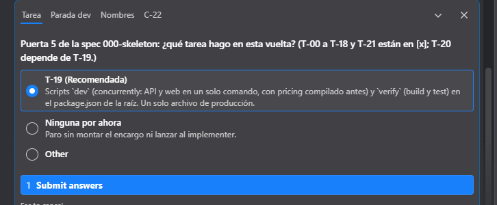
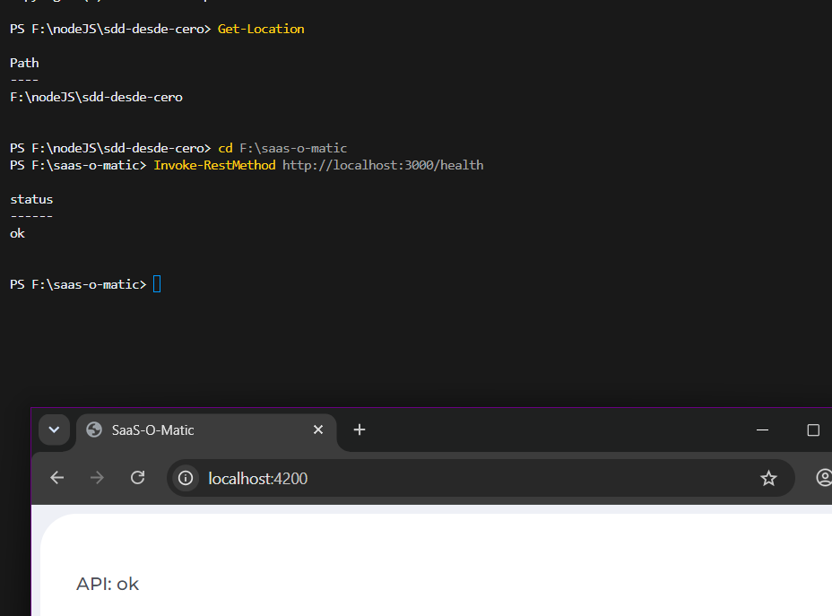
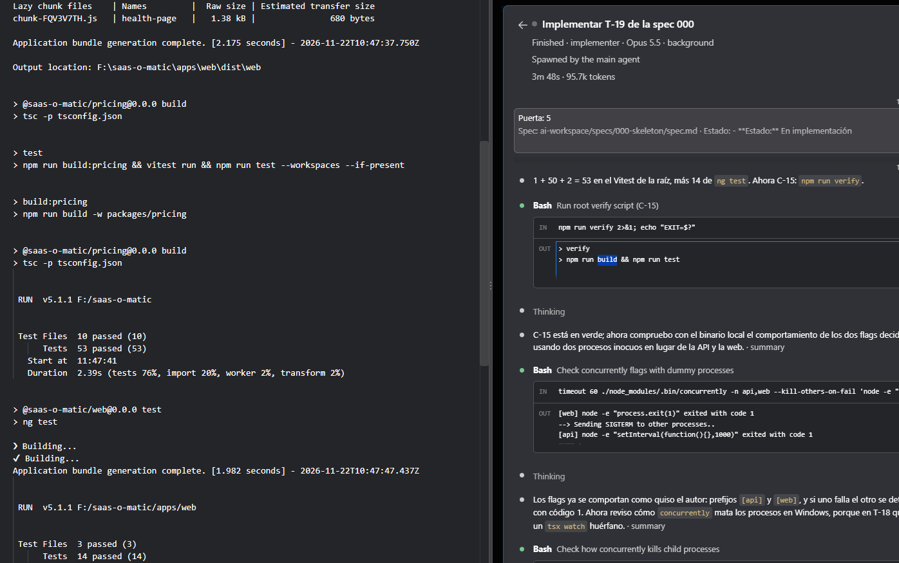

# 000-skeleton — Fase 6 (2026-11-22, sesión 02)

## Objetivo y fase
Fase 6, spec `000-skeleton`, puerta 5 (implementación). Objetivo: T-19, los scripts `dev` y `verify` del `package.json` de la raíz, con `/sdd-implement 000-skeleton`. La spec estaba en `- **Estado:** En implementación` y sigue así (no era la primera tarea).

## Prompts clave
1. Inicio de la vuelta (en modo plan):

> /sdd-implement 000-skeleton

2. Elecciones del autor en el diálogo de preguntas de la IA (tarea, parada de `dev`, nombres y C-22):

> "T-19 (Recomendada)"
> "--kill-others-on-fail (Recomendada)"
> "-n api,web (Recomendada)"
> "Tú, a mano"

3. Aprobación del plan: en el diálogo del modo plan, sin texto.

4. Captura renombrada, tras el retorno del implementer:

> Captura renombrada a fase-6-000-t19-dudas-dev.png

5. Desviación 1, C-22 y aprobación de T-19:

> Acepto la desviación 1 (rm -rf en Bash tras comprobar con git check-ignore; los scripts corren con cmd.exe igual). C-22 comprobada a mano en PowerShell: con packages\pricing\dist borrado, npm run dev compila pricing antes de las líneas [api] y [web]; /health responde en el 3000 y la página muestra «API: ok» en el 4200; tras Ctrl+C, netstat no muestra nada escuchando en el 3000 ni en el 4200. npm run verify en verde (53 + 14). Capturas: fase-6-000-t19-dev-una-terminal.png y fase-6-000-t19-resultado.png.
>
> Apruebo T-19: marca [x] y todas sus casillas (C-22 incluida) y la casilla pendiente de T-04; deja
> MEMORY.md en ≤ 50 líneas y propón el commit con las capturas.

6. Registro de la sesión:

> /sdd-session 6 000-skeleton

## Qué propuso la IA
- **Tarea:**
  - Leyó la línea `Estado:` de `spec.md` y propuso T-19. Sus dependencias, T-13 y T-18, estaban en `[x]`; T-20 depende de T-19.
  - Leyó los scripts de los tres miembros: la API arranca con `dev` (`tsx watch`) y la web con `start` (`ng serve`).
  - Vio tres puntos del `dev` que ninguna fuente fija. Los preguntó con la tarea en un diálogo de cuatro preguntas, con opciones, pros y contras y su recomendación:
    - qué pasa si un proceso termina;
    - cómo se distingue cada proceso en la salida;
    - quién comprueba C-22. Para esta recomendó la sesión principal, por el `tsx watch` huérfano de T-18.
  - Comprobó en el código de `tsx` 4.23.15 que `tsx watch` no termina cuando la API sale con error («Rerunning...»), y lo dijo en la pregunta.
- **Plan (modo plan):**
  - anotar las elecciones en T-19;
  - comandos de partida;
  - encargo completo;
  - comprobaciones al volver el implementer;
  - pasos de C-22 para el autor;
  - pasos tras la aprobación.

  Avisó de que `verify` compila `pricing` tres veces.
- **Antes de lanzar:**
  - Anotó en T-19 las elecciones del autor, literales.
  - Ejecutó los comandos de partida:
    - `npm run build`: EXIT=0;
    - `npm test`: 53 + 14 en verde;
    - `npm run dev` y `npm run verify`: `Missing script`, EXIT=1. Es el rojo de partida, porque la tarea no tiene test propio.
  - Avisó de una captura sin versionar, `fase-6-000-t19-c22-quien-comprueba.png`, con otro nombre que el anunciado.
  - Enseñó el resumen del encargo y lanzó al implementer con la fila literal de T-19, las decisiones aplicables y las salidas de partida.
- **Retorno del implementer:** `Tarea terminada`, T-19 en `[~]`.
  - `package.json`: `"dev": "npm run build:pricing && concurrently -n api,web --kill-others-on-fail \"npm run dev -w apps/api\" \"npm run start -w apps/web\""` y `"verify": "npm run build && npm run test"`. `package-lock.json` sin cambios.
  - C-14 y C-23 con `dist` borrado, C-15 y C-16 en verde: `pricing` 1, `api` 50, `web-tools` 2 y `ng test` 14 (53 + 14).
  - No lanzó `npm run dev`. Probó los dos flags con dos procesos de prueba: prefijos `[api]` y `[web]`, y el fallo de uno para al otro (EXIT=1).
  - Desviaciones y avisos:
    1. El clasificador de permisos le denegó `powershell.exe` desde Bash; borró `dist` con `rm -rf`.
    2. `verify` compila `pricing` tres veces.
    3. La web arranca con `npm run start -w apps/web`.
    4. `concurrently` mata el árbol de procesos con `tree-kill`.
    5. La captura sin versionar había cambiado de nombre.
- **Comprobación de la sesión principal:**
  - `git status` y `git diff --stat`: solo `package.json` y `tasks.md`.
  - `netstat`: nada escuchando en el 3000 ni en el 4200.
  - Lockfile sin cambios.
  - Enseñó el retorno tal cual, paró y pidió tres cosas: decidir la desviación 1, C-22 a mano y la aprobación explícita.
- **Tras la aprobación:**
  - Marcó T-19 en `[x]` con sus seis casillas y la casilla de T-04.
  - Sin petición del autor, anotó en T-19 la desviación 1 aceptada y el resultado de C-22, con sus palabras. Ofreció quitarlas.
  - Actualizó `MEMORY.md` (50 líneas): T-19 hecha y el aprendizaje sobre `powershell.exe`.
  - Enseñó el diff y propuso el commit con «sesión 02».

## Qué corregí y por qué
- **C-22:** elegí «Tú, a mano» (la compruebo yo), no la sesión principal que recomendaba la IA. Motivo: (no registrado).
- **Captura de las dudas:** la renombré de `fase-6-000-t19-c22-quien-comprueba.png` a `fase-6-000-t19-dudas-dev.png`, el nombre que anunció la IA. Motivo: (no registrado).

## Decisiones tomadas
- T-19 confirmada como tarea de la vuelta.
- **`dev`:** «--kill-others-on-fail (Recomendada)» y «-n api,web (Recomendada)», literales en T-19.
- **C-22:** la comprueba el autor a mano («Tú, a mano»), literal en T-19.
- Plan de la vuelta aprobado.
- **Desviación 1 aceptada:** `dist` borrado con `rm -rf` en Bash en C-14 y C-23, literal en T-19.
- **C-22 comprobada por el autor** en PowerShell:
  - `pricing` se compila antes de las líneas `[api]` y `[web]`;
  - `/health` responde en el 3000 y la página muestra «API: ok» en el 4200;
  - sin puertos abiertos tras Ctrl+C.

  `npm run verify` en verde (53 + 14).
- **T-19 aprobada:** `[x]` con todas sus casillas, C-22 incluida, y la casilla de T-04 «C-14 y C-23 se repiten completos en T-19».
- MEMORY.md en ≤ 50 líneas.
- Commit: el de cierre de esta sesión.

## Capturas
- 
- 
- 

Solo se enlazan las de esta sesión; las demás `fase-6-000-*` son de sesiones anteriores.

## Pendiente para la siguiente sesión
- **Commit de cierre de esta sesión:** `package.json`, `tasks.md`, MEMORY.md, las tres capturas `fase-6-000-t19-*.png` y este registro, con «Fase 6 (sesión 02)».
- **T-20:** antes, el autor decide qué se recorta de `CLAUDE.md`, que está en 60 de 60 líneas.
- **La validación (puerta 6):** incluye C-25 (casilla 2 de T-18) y C-18 (T-20).
- **Modelo del implementer:** el panel del agente de la captura `fase-6-000-t19-resultado.png` muestra «implementer · Opus 5.5», y MEMORY.md dice Sonnet 5.5 (T-00). Hay que comprobarlo y corregir MEMORY.md si procede.
