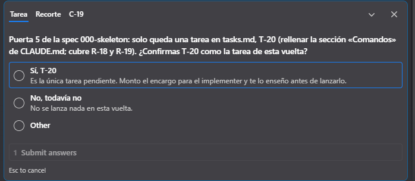
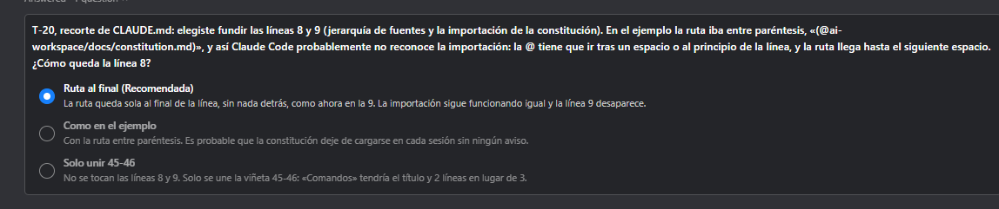
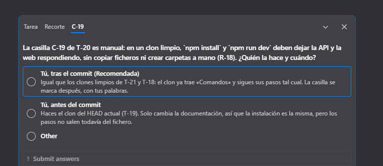
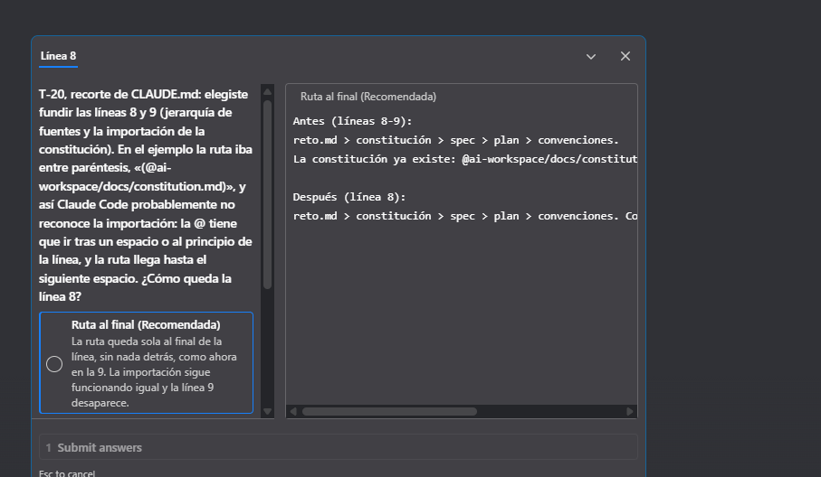
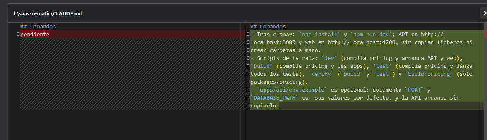

# 000-skeleton — Fase 6 (2026-11-22, sesión 03)

## Objetivo y fase
Fase 6, spec `000-skeleton`, puerta 5 (implementación). Objetivo: T-20, la sección «Comandos» de `CLAUDE.md` (R-18 y R-19), última tarea pendiente de `tasks.md`, con `/sdd-implement 000-skeleton`. La spec estaba en `- **Estado:** En implementación` y sigue así (no era la primera tarea). Con T-20, todas las tareas quedan hechas y lo siguiente es la puerta 6.

## Prompts clave
Invocación:
> /sdd-implement 000-skeleton

Elecciones del autor en las preguntas de la sesión principal (con opciones):
> Sí, T-20

> Unir 45-46 y fundir 8-9

> Tú, tras el commit (Recomendada)

> Ruta al final (Recomendada)

Mensaje del autor durante la segunda pregunta:
> Al fundir las líneas 8 y 9, deja @ai-workspace/docs/constitution.md sin comillas invertidas: dentro de `código` Claude Code no lo importa.

Tras ver el encargo completo:
> OK, lanza al implementer con ese encargo

Aprobación de T-20:
> Apruebo T-20.
> (1) Acepto la frase añadida sobre PORT y DATABASE_PATH: es cierta y útil; anótala como desviación aceptada.
>
> (2) Pon entre comillas invertidas pricing y packages/pricing en «Comandos», para
> que el formato sea uniforme (te autorizo ese cambio de formato; no cambia el texto).
> (3) La importación de la constitución la compruebo yo con /context en la sesión nueva que abriré al cerrar la spec; anótalo como pendiente en MEMORY.md.
> Marca [x] y las casillas 1 y 2; C-19 queda para mi clon limpio tras el commit (--amend) y C-18 para el
> revisor. Deja MEMORY.md en ≤ 50 líneas y propón el commit con las capturas de T-20.

Registro de la sesión:
> /sdd-session 6 000-skeleton

## Qué propuso la IA
- Leyó la línea `Estado:` de `spec.md` y `tasks.md`: solo quedaba T-20. Contó `CLAUDE.md` con `wc -l` (60 de 60 líneas) y leyó R-18, R-19, C-19, C-20 y el riesgo 17 del plan.
- Propuso T-20. Antes de montar el encargo, planteó la parada previa de la tarea (qué se recorta de `CLAUDE.md`) con tres opciones y ejemplos: unir la viñeta partida de las líneas 45-46 (recomendada: no quita texto y deja 2 líneas a «Comandos»), no recortar nada y escribir «Comandos» en una sola línea, o unir 45-46 y fundir 8-9 (3 líneas a «Comandos»). También preguntó quién hace C-19 y cuándo (recomendada: el autor, tras el commit, como los clones limpios de T-21 y T-18).
- Tras la elección del autor, avisó de un error en su propio ejemplo: con la ruta entre paréntesis, `(@ai-workspace/docs/constitution.md)`, Claude Code probablemente no reconoce la importación, porque la `@` tiene que ir al principio de la línea o tras un espacio. Lo dijo como lectura propia, sin comprobarlo en la documentación. Propuso tres formas de la línea 8: la ruta sola al final (recomendada), la del ejemplo o solo unir 45-46.
- La sesión entró en modo plan. El plan recogía las decisiones, los pasos, el borrador del encargo y una nota: R-19 dice «los scripts de la raíz», la raíz tiene cinco (también `build:pricing`) y la casilla de C-20 nombra cuatro; con los cinco se cumplen las dos. El autor aprobó el plan en la interfaz.
- Antes de lanzar, ejecutó `wc -l CLAUDE.md` («60 CLAUDE.md») y `npm run verify`: `ng build` correcto, Vitest de la raíz con «Test Files 10 passed (10) · Tests 53 passed (53)» y `ng test` con «Test Files 3 passed (3) · Tests 14 passed (14)»; `git status` siguió limpio. Enseñó el encargo completo, con las decisiones literales (#15, #21, Q-01, la parada previa y C-19), la fila literal de T-20 y esas salidas, y esperó el OK.
- El implementer fundió las líneas 8-9 (`reto.md > constitución > spec > plan > convenciones. Constitución: @ai-workspace/docs/constitution.md`, con la ruta sin comillas invertidas) y las 45-46. Escribió «Comandos» con 3 líneas: los pasos de R-18 (API en el 3000 y web en el 4200), los cinco scripts y `apps/api/env.example` como opcional. Dejó `CLAUDE.md` en 60 líneas y T-20 en `[~]`, con `npm run verify` y `npm run build` en verde. Declaró «Ninguna desviación». Modelo del implementer: (no registrado).
- `git status` y `git diff --stat` tras el implementer: solo `CLAUDE.md` (10 +++++-----), `tasks.md` (2 +-) y la captura del autor sin seguimiento.
- Al enseñar el retorno, la sesión principal señaló tres cosas: la frase «documenta `PORT` y `DATABASE_PATH` con sus valores por defecto» la añadió el implementer sin declararla como desviación; «pricing» y «packages/pricing» iban sin comillas invertidas; y la importación de la constitución no se puede comprobar desde esta sesión.
- Tras la aprobación: aplicó las comillas invertidas en «Comandos»; marcó T-20 `[x]` con las casillas 1 y 2 y anotó en T-20 las decisiones y la aprobación literales; C-19 y C-18 quedan abiertas. Actualizó `MEMORY.md` sin pasar de 50 líneas: resumen de T-20, el pendiente de `/context` en lugar del pendiente del recorte, y un aprendizaje sobre `@ruta`. Propuso el commit.

## Qué corregí y por qué
- Recorte: elegí unir 45-46 y fundir 8-9, no la opción recomendada, para dejar 3 líneas a «Comandos».
- Comillas invertidas: la ruta de la constitución va sin ellas, porque «dentro de `código` Claude Code no lo importa».
- Formato: `pricing` y `packages/pricing` entre comillas invertidas en «Comandos», «para que el formato sea uniforme».
- Acepté como desviación la frase sobre `PORT` y `DATABASE_PATH`, que el implementer no había declarado: «es cierta y útil».
- Capturas: dos de las seis anunciadas no llegaron a `ai-workspace/screenshots/`; las descarté.

## Decisiones tomadas
- Tarea de la vuelta: T-20.
- Recorte de `CLAUDE.md`: unir la viñeta de las líneas 45-46 y fundir las 8-9, con la ruta de la constitución sola al final de la línea 8 y sin comillas invertidas. «Comandos» queda con el título y 3 líneas; `CLAUDE.md`, en 60.
- «Comandos» lista los cinco scripts de la raíz, también `build:pricing` (plan aprobado).
- Desviación 1 del implementer aceptada (la frase sobre `PORT` y `DATABASE_PATH`) y comillas invertidas en `pricing` y `packages/pricing`.
- T-20 `[x]`, con las casillas 1 (recorte) y 2 (C-20). C-19 la hace el autor en un clon limpio tras el commit y su casilla entra con `--amend`; C-18 es del revisor (puerta 6).
- La importación de la constitución la comprueba el autor con `/context` en la sesión nueva que abrirá al cerrar la spec; consta como pendiente en `MEMORY.md`.
- `MEMORY.md` en ≤ 50 líneas.
- Capturas `fase-6-000-t20-comillas-invertidas.png` y `fase-6-000-t20-aprobacion-formato.png`: descartadas.
- Commit: el de cierre de esta sesión.

## Capturas
- 
- 
- 
- 
- 

Solo se enlazan las de esta sesión; las demás `fase-6-000-*` son de sesiones anteriores.

## Pendiente para la siguiente sesión
- C-19: clon limpio del autor tras el commit de esta sesión (`npm install` y `npm run dev`, API y web respondiendo); su casilla de T-20 entra con `--amend`.
- Puerta 6 (`/sdd-validate`): validación con el revisor, incluidas C-18 (T-20) y C-25 (T-18).
- Al cerrar la spec, en una sesión nueva: comprobar con `/context` que `CLAUDE.md` sigue importando la constitución.
