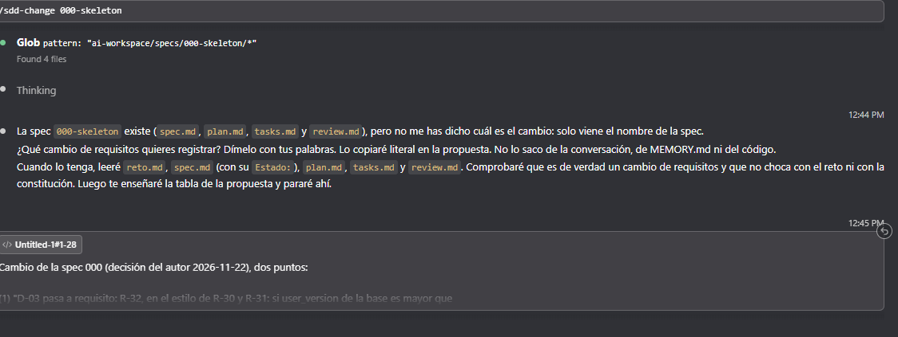
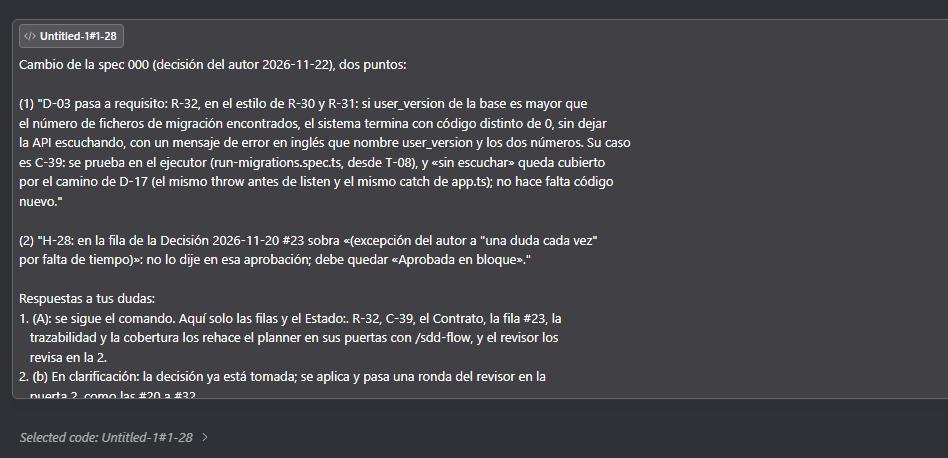

# 000-skeleton — Fase 6 (2026-11-22, sesión 04)

## Objetivo y fase
Fase 6, spec `000-skeleton`. Registrar con `/sdd-change` un cambio de requisitos: D-03 pasa a requisito (R-32, caso C-39) y la fila de la Decisión 2026-11-20 #23 deja de atribuir al autor un motivo que no dio (H-28). La spec vuelve a `En clarificación` y este paso se commitea antes de seguir con la puerta 2.

La primera vuelta de `/sdd-change`, con la tabla de propuesta y las dudas 1 a 4, no consta en esta conversación: (no registrado). Solo se sabe por la corrección del autor (abajo).

## Prompts clave
Invocación sin el cambio:

> /sdd-change 000-skeleton

Cambio, respuestas y aprobación del autor:

> Cambio de la spec 000 (decisión del autor 2026-11-22), dos puntos:
>
> (1) "D-03 pasa a requisito: R-32, en el estilo de R-30 y R-31: si user_version de la base es mayor que
> el número de ficheros de migración encontrados, el sistema termina con código distinto de 0, sin dejar
> la API escuchando, con un mensaje de error en inglés que nombre user_version y los dos números. Su caso
> es C-39: se prueba en el ejecutor (run-migrations.spec.ts, desde T-08), y «sin escuchar» queda cubierto
> por el camino de D-17 (el mismo throw antes de listen y el mismo catch de app.ts); no hace falta código
> nuevo."
>
> (2) "H-28: en la fila de la Decisión 2026-11-20 #23 sobra «(excepción del autor a "una duda cada vez"
> por falta de tiempo)»: no lo dije en esa aprobación; debe quedar «Aprobada en bloque»."
>
> Respuestas a tus dudas:
> 1. (A): se sigue el comando. Aquí solo las filas y el Estado:. R-32, C-39, el Contrato, la fila #23, la
>    trazabilidad y la cobertura los rehace el planner en sus puertas con /sdd-flow, y el revisor los
>    revisa en la 2.
> 2. (b) En clarificación: la decisión ya está tomada; se aplica y pasa una ronda del revisor en la
>    puerta 2, como las #20 a #32.
> 3. y 4. Resueltas en el texto de arriba.
> Dos filas: Decisión 2026-11-22 #1 con el punto (1) y Decisión 2026-11-22 #2 con el punto (2).
>
> Para después: si al terminar la puerta 4 no sale ninguna tarea nueva, la spec vuelve a En
> implementación con todas las tareas en [x] y se sigue con la puerta 6 (decisión del autor 2026-11-22;
> anótalo en MEMORY.md como mejora del método: sdd no dice cómo se pasa de Planificada a la puerta 6 sin
> tareas nuevas).
>
> Apruebo el paso explícitamente: añade las dos filas y pon Estado: En clarificación en spec.md y en el
> README. Enséñame el diff y dime con qué puerta seguimos.

Corrección del autor y commit:

> Bien el diff. Una corrección en MEMORY.md: /sdd-change está probado entero, no «en parte»: la tabla de
> propuesta sí se enseñó, en la primera vuelta (con las dudas 1 a 4; captura fase-6-000-sdd-change-choque-alcance.png), y después vinieron mi cambio corregido, la aprobación y las filas. Cámbialo a «probado».
> Sí al commit de este paso antes de seguir: lanzo /sdd-session y después propón el commit con spec.md,
> README, MEMORY.md, el registro y las capturas.

Cierre:

> /sdd-session 6 000-skeleton

## Qué propuso la IA
- **Sin el cambio en los argumentos:** comprobó que existe `ai-workspace/specs/000-skeleton/` y preguntó cuál era el cambio, «sin sacarlo de la conversación, de MEMORY.md ni del código».
- **Con el cambio y la aprobación:**
  - Leyó `reto.md`, `spec.md`, `plan.md`, `tasks.md`, `review.md`, `ai-workspace/specs/README.md`, la skill `sdd` y `/sdd-flow`.
  - Comprobó que la sección 5 no tenía filas del 2026-11-22, así que tocaban la #1 y la #2.
  - Añadió las dos filas con el texto literal del autor. «Duda que cierra»: `— (plan.md, D-03; review.md ronda 4, H-31)` y `— (review.md rondas 3 y 4, H-28)`. «Registro de sesión»: `(pendiente de /sdd-session)`.
  - Cambió `Estado:` a `En clarificación` en `spec.md` y en la fila 000 del README.
  - No tocó `plan.md`, `tasks.md`, `review.md`, `reto.md` ni `.claude/`, y no hizo commit.
- **MEMORY.md:**
  - Pendiente (g): la mejora del método que pidió el autor.
  - Estado de la spec y siguientes puertas.
  - La atribución «por falta de tiempo» se queda solo en #13 a #19, no en #23 a #30.
  - Reservas H-28 y H-31 al día.
  - Quitó el pendiente (3), «posible R-32».
  - `/sdd-change` como «probado en parte». La IA dijo: «Has traído el cambio y la aprobación en el mismo mensaje, así que no he enseñado antes la tabla de propuesta». El autor lo corrigió (abajo).
- **Lo que queda por rehacer:**
  - En `spec.md`: R-32, C-39, el Contrato y la fila #23.
  - En `plan.md`: D-03 y las secciones 1, 5 y 8.
  - En `tasks.md`: T-08 `[x]` («Cubre» y la casilla de D-03), las anotaciones «D-03 sin `R-nn`» y H-28, y «Cobertura». T-12 y T-13 `[x]`, a decidir en la puerta 4.
  - Código: nada.
- **Siguiente puerta:** la 2, con `/sdd-flow 000-skeleton 2` o `/sdd-clarify 000-skeleton`. El planner aplica las dos decisiones y después revisa el revisor en modo puerta 2.
- **Capturas:** avisó de que las dos del cambio no estaban aún en `ai-workspace/screenshots/` antes de `/sdd-session`.
- **Tras guardar el registro:** propuso sustituir los dos `(pendiente de /sdd-session)` de `spec.md` por la ruta de este registro y un commit de seis ficheros.

## Qué corregí y por qué
- **MEMORY.md:** `/sdd-change` está «probado», no «probado en parte». La tabla de propuesta sí se enseñó en la primera vuelta, con las dudas 1 a 4 y la captura `fase-6-000-sdd-change-choque-alcance.png`. Después vinieron el cambio corregido, la aprobación y las filas. Corregido en MEMORY.md.
- **En la spec, no a una propuesta de esta sesión:** la fila de la Decisión 2026-11-20 #23 atribuía al autor una excepción «por falta de tiempo» que no dio en esa aprobación (H-28). Queda registrado como Decisión 2026-11-22 #2.

## Decisiones tomadas
- **Decisión 2026-11-22 #1:** D-03 pasa a requisito como R-32, con su caso C-39 (texto literal en «Prompts clave», punto (1)).
- **Decisión 2026-11-22 #2:** la fila #23 queda «Aprobada en bloque», sin el inciso (punto (2)).
- **Respuestas del autor a las dudas de la primera vuelta:** «1. (A)», solo las filas y el `Estado:`, y lo demás lo rehace el planner en sus puertas. «2. (b) En clarificación». 3 y 4, resueltas en el texto.
- **Mejora del método (decisión del autor del 2026-11-22):** si al terminar la puerta 4 no sale ninguna tarea nueva, la spec vuelve a `En implementación` con todas las tareas en `[x]` y se sigue con la puerta 6. Anotada en MEMORY.md como pendiente (g) de `sdd` y `/sdd-flow`.
- **Commit de este paso antes de seguir:** «Sí al commit de este paso antes de seguir».
- **Marcadores de la sección 5 de `spec.md`:** los dos `(pendiente de /sdd-session)` de las filas 2026-11-22 #1 y #2 pasan a `sessions/2026-11-22-04-000-skeleton.md`. OK del autor, literal: «sustituir los dos `(pendiente de /sdd-session)` de las filas 2026-11-22 #1 y #2 de `spec.md` por `sessions/2026-11-22-04-000-skeleton.md`. y modificar la session».
- Commit: el de cierre de esta sesión.

## Capturas
- 
- 

Solo se enlazan las de esta sesión; las demás `fase-6-000-*` son de sesiones anteriores.

## Pendiente para la siguiente sesión
- Puerta 2 (`/sdd-flow 000-skeleton 2` o `/sdd-clarify 000-skeleton`): el planner aplica las Decisiones 2026-11-22 #1 y #2 (R-32, C-39, el Contrato y la fila #23) y después pasa una ronda del revisor en modo puerta 2.
- Puertas 3 y 4:
  - `plan.md`: D-03 y las secciones 1, 5 y 8.
  - `tasks.md`: T-08, las anotaciones y «Cobertura»; si T-12 y T-13 cubren R-32 se decide aquí.
  - Si no sale ninguna tarea nueva: `En implementación` con todo en `[x]`, y luego la puerta 6.
- Mejora del método (g): añadir a `sdd` y a `/sdd-flow` el paso de `Planificada` a la puerta 6 sin tareas nuevas.
