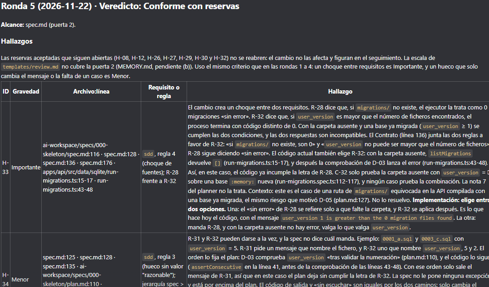
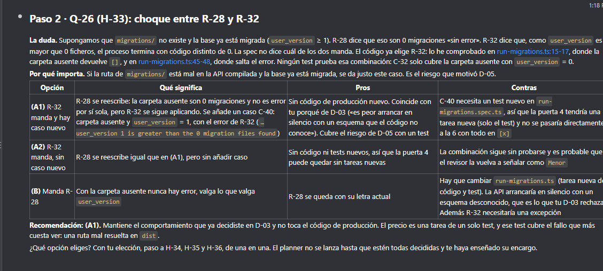
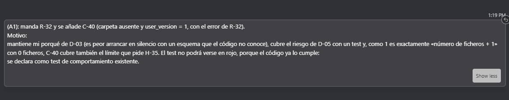
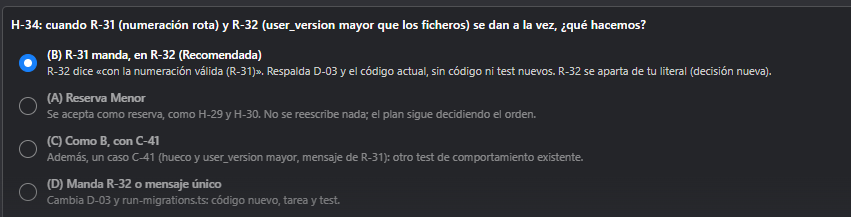
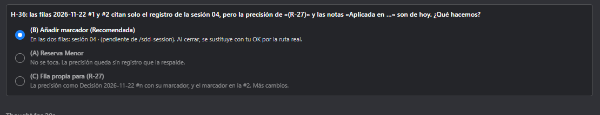
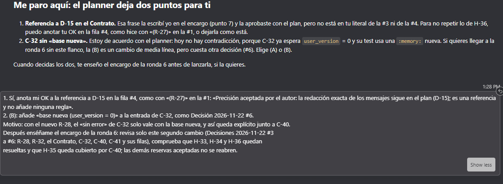
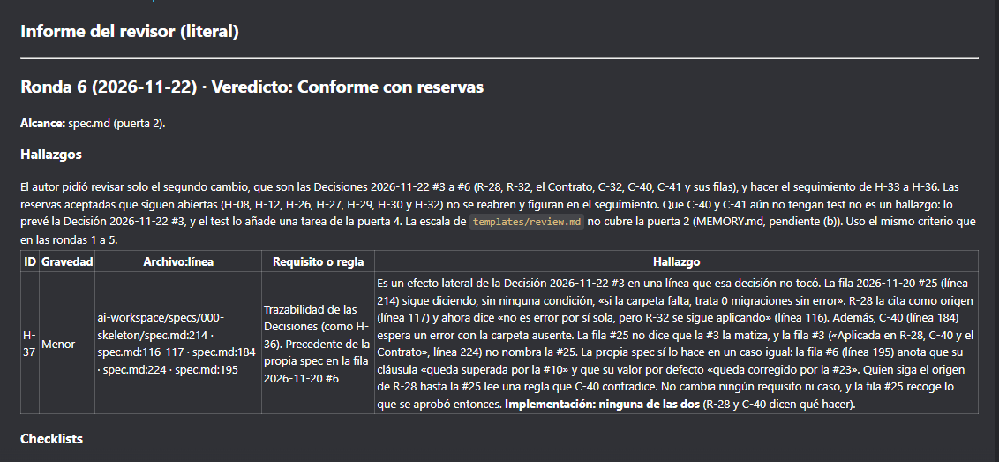
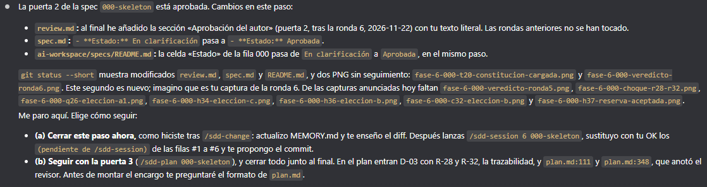
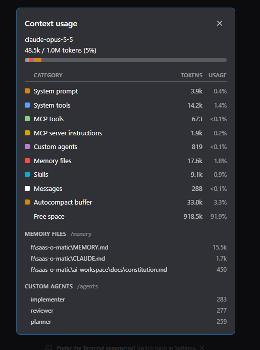

# 000-skeleton — Fase 6 (2026-11-22, sesión 05)

## Objetivo y fase
Fase 6, spec `000-skeleton`. Rehacer la puerta 2 (clarificación) con `/sdd-clarify` tras el cambio de requisitos de la sesión 04 (Decisiones 2026-11-22 #1 y #2). Había que aplicar R-32, C-39, el Contrato y la fila #23, pasar las rondas del revisor que hicieran falta y aprobar la puerta. Al terminar, la spec queda en `Aprobada`.

## Prompts clave
Invocación:

> /sdd-clarify 000-skeleton

Lanzamiento del planner (primera vuelta):

> Sí, lanza al planner con ese encargo

Después del retorno del planner (la IA preguntó qué agente lanzar y el autor rechazó la pregunta):

> lanza el planner

> 1. «(R-27)» se queda: es una referencia cruzada que precisa qué cuenta como fichero de migración, como R-07 con R-26; no añade ninguna regla. Anótalo como precisión aceptada por el autor.
>
> 2. Sí, prepara el encargo de la ronda 5 del revisor en modo puerta 2 y enséñamelo antes de lanzarlo.
>    Añade: "La ronda 5 revisa el cambio (Decisiones 2026-11-22 #1 y #2): R-32, C-39, el Contrato y la fila #23. Debe comprobar que H-31 queda resuelta por R-32 y H-28 por la #2. Las demás reservas ya aceptadas siguen aceptadas y no se reabren, salvo que el cambio las afecte."

> Sí, lanza al revisor con ese encargo

> Enséñame el informe del revisor cuando vuelva

Plan de la IA tras la ronda 5 (guardar la ronda 5 tal cual y plantear la Q-26): aprobado en el modo de planificación, sin texto.

Q-26 (H-33):

> (A1): manda R-32 y se añade C-40 (carpeta ausente y user_version = 1, con el error de R-32).
> Motivo:
> mantiene mi porqué de D-03 (es peor arrancar en silencio con un esquema que el código no conoce), cubre el riesgo de D-05 con un test y, como 1 es exactamente «número de ficheros + 1» con 0 ficheros, C-40 cubre también el límite que pide H-35. El test no podrá verse en rojo, porque el código ya lo cumple:
> se declara como test de comportamiento existente.

H-34, en el cuadro de opciones: «(B) R-31 manda, en R-32 (Recomendada)». Después, interrumpiendo:

> LA opcion C

H-36, en el cuadro de opciones: «(B) Añadir marcador (Recomendada)».

Plan con el encargo del planner (segunda vuelta): aprobado en el modo de planificación, sin texto.

Respuesta a los dos puntos del planner:

> 1. Sí, anota mi OK a la referencia a D-15 en la fila #4, como con «(R-27)» en la #1: «Precisión aceptada por el autor: la redacción exacta de los mensajes sigue en el plan (D-15); es una referencia y no añade ninguna regla».
> 2. (B): añade «base nueva (user_version = 0)» a la entrada de C-32, como Decisión 2026-11-22 #6.
> Motivo: con el nuevo R-28, el «sin error» de C-32 solo vale con la base nueva, y así queda explícito junto a C-40.
> Después enséñame el encargo de la ronda 6: revisa solo este segundo cambio (Decisiones 2026-11-22 #3
> a #6: R-28, R-32, el Contrato, C-32, C-40, C-41 y sus filas), comprueba que H-33, H-34 y H-36 quedan
> resueltas y que H-35 queda cubierto por C-40; las demás reservas aceptadas no se reabren.

> El encargo está bien. Añade una línea al alcance: "C-40 y C-41 aún no tienen test: los añade una tarea nueva en la puerta 4 y se implementa en la 5 (Decisión 2026-11-22 #3: test de comportamiento existente). Que no tengan test todavía no es un hallazgo de esta ronda." Con eso, lánzalo.

> Guarda la ronda 6 y acepto H-37 como reserva

Aprobación de la puerta 2:

> Acepto como reservas H-08, H-12, H-26, H-27, H-29, H-30 y H-32 (las de la ronda 4, que este cambio no
> afecta) y H-37 (ronda 6), y apruebo la puerta 2 de la spec 000-skeleton. Mi motivo: las de la ronda 4 siguen con el motivo que di entonces (cada ronda con correcciones añadía requisitos nuevos que traían hallazgos nuevos; todas son Menor salvo H-08 y H-12, y las decisiones las fija el plan, que apruebo yo); H-37 es Menor, solo afecta a la trazabilidad de la fila #25 y no cambia ningún requisito ni caso, porque R-28 y C-40 ya dicen qué hacer.

Cierre:

> (a): actualiza MEMORY.md y enséñame el diff

> /sdd-session 6 000-skeleton

## Qué propuso la IA
- **Arranque:**
  - Leyó `spec.md`, el README de specs, la skill `sdd`, `review.md` (rondas 1 a 4), el registro de la sesión 04 y D-03 y D-15 de `plan.md`.
  - Copió la línea `- **Estado:** En clarificación`.
  - Comprobó que Q-01 a Q-25 estaban cerradas y que no había requisitos PENDIENTE: no había ninguna duda que conducir, solo decisiones que aplicar.
- **Primer encargo del planner:**
  - Lo enseñó antes de lanzarlo.
  - Llevaba tres puntos propios, que señaló:
    - los valores de C-39, tomados del test existente (`user_version` = 3 y un fichero);
    - que el sitio donde se prueba C-39 es cosa del plan;
    - permiso para añadir «Aplicada en …» a las filas #1 y #2.
  - Al lanzarlo añadió una línea que no había enseñado («Declara en tu retorno las skills que has cargado y el modelo que ves en tu entorno», tomada de la petición de la fila #1). Se lo dijo al autor después.
- **Retorno del planner (`Completado`):**
  - R-32 con «(R-27)», que no está en el literal y el planner señaló.
  - C-39, el Contrato, la fila #23 en «Aprobada en bloque.» y «Aplicada en …» en las #1 y #2.
  - Nota 7, para el revisor.
  - Skills: `sdd`. Modelo: Opus 5.5.
  - `git status` y `git diff --stat`: solo `spec.md`.
- **«lanza el planner»:** como el planner ya había terminado, la IA preguntó qué lanzar (el revisor o el planner, con «(R-27)» o sin él). El autor rechazó la pregunta.
- **Precisión de «(R-27)» y ronda 5:**
  - Anotó la precisión en la fila 2026-11-22 #1 con las palabras del autor.
  - Vio un PNG sin seguimiento que no era suyo (`fase-6-000-t20-constitucion-cargada.png`).
  - Preparó el encargo de la ronda 5 con la línea del autor.
- **Ronda 5:**
  - Veredicto: `Conforme con reservas`.
  - Resueltos: H-28 y H-31.
  - Nuevos:
    - H-33, `Importante`: R-28 «sin error» chocaba con R-32 si falta `migrations/` y la base ya está migrada;
    - H-34, `Menor`: R-31 y R-32 a la vez;
    - H-35, `Menor`: falta el límite n+1;
    - H-36, `Menor`: el registro de sesión de las #1 y #2 no recoge esta sesión.
  - La IA comprobó que el revisor no había escrito nada.
  - En el modo de planificación propuso un plan: guardar la ronda 5 tal cual, plantear la Q-26 y seguir con el resto de hallazgos de uno en uno.
- **Guardado de la ronda 5:** el primer intento, con un heredoc por Bash, falló sin escribir nada. La IA la añadió con `Edit`: +50 líneas y ninguna borrada.
- **Dudas, una cada vez, con opciones, pros, contras y recomendación:**
  - Q-26 (H-33): (A1), (A2) y (B); recomendó la (A1), tras comprobarla en `run-migrations.ts`.
  - H-34: de (A) a (D); recomendó la (B).
  - H-36: de (A) a (C); recomendó la (B).
- **Segunda vuelta del planner:**
  - Encargo dentro del plan; el planner lo copió literal.
  - Retorno `Completado`: R-28 y R-32 reescritas, Contrato, C-40, C-41, filas #3 a #5, Q-26 y Q-27 cerradas y marcador en las #1 y #2.
  - Dejó dos puntos para el autor: la referencia a D-15 no está en ningún literal, y C-32 no dice «base nueva» (opciones (A) y (B), recomendó la (B)).
  - La IA coincidió en que no había contradicción en C-32.
- **Puntos del autor aplicados por la sesión principal:**
  - la precisión de D-15 en la fila #4;
  - «base nueva (`user_version` = 0)» en C-32;
  - la fila 2026-11-22 #6.
- **Ronda 6:**
  - Encargo enseñado; el autor añadió una línea.
  - Veredicto: `Conforme con reservas`.
  - H-33 a H-36 resueltos; nuevo H-37, `Menor`: la fila 2026-11-20 #25 sigue diciendo «sin error» sin anotar que la #3 la matiza.
  - Para la puerta 3, el revisor señaló `plan.md:111` y `plan.md:348`.
- **Cierre de la puerta:**
  - La IA guardó la ronda 6 sin borrar nada.
  - Pidió la aprobación escrita de la puerta 2 nombrando cada reserva.
  - Con ella, añadió «Aprobación del autor» al final de `review.md` y puso `Estado: Aprobada` en `spec.md` y en la fila 000 del README, en el mismo paso.
- **MEMORY.md:** diff en cinco puntos: estado de la spec, puerta 2 rehecha, una viñeta nueva de aprendizajes, el pendiente (g) y lo probado de la fase 5, y las reservas.
- **`/sdd-session`:**
  - Comprobó las ocho capturas anunciadas: primero faltaban seis y luego una (la de C-32).
  - Preguntó por la de T-20, que no se había anunciado en la conversación.

## Qué corregí y por qué
- **H-34:** en el cuadro marcó (B) y luego escribió «LA opcion C». Manda la (C). No dio motivo y no se escribe ninguno.
- **Pregunta sobre qué lanzar:** rechazó la pregunta de la IA y respondió con las dos decisiones (precisión «(R-27)» y encargo de la ronda 5). Motivo: (no registrado).
- **Encargo de la ronda 6:** añadió la línea según la cual que C-40 y C-41 aún no tengan test no es un hallazgo, porque sus tests llegan con una tarea nueva de la puerta 4 (Decisión 2026-11-22 #3).
- **La línea añadida sin enseñar al primer encargo del planner:** no la corrigió el autor. La IA avisó de ella después de lanzarlo.

## Decisiones tomadas
- **Precisión de «(R-27)» en R-32:** aceptada por el autor y anotada en la fila 2026-11-22 #1 («es una referencia cruzada … no añade ninguna regla»).
- **Decisión 2026-11-22 #3 (Q-26, H-33): (A1).**
  - R-28 se reescribe: la carpeta ausente son 0 migraciones y no es error por sí sola, pero R-32 se sigue aplicando.
  - Se añade C-40: carpeta ausente y `user_version` = 1, con el error de R-32.
  - Según el autor, C-40 cubre también el límite de H-35.
  - Su test será de comportamiento existente.
- **Decisión 2026-11-22 #4 (Q-27, H-34): (C).**
  - R-32 solo se aplica con la numeración válida (manda R-31).
  - Se añade C-41.
  - Precisión aceptada por el autor: «la redacción exacta de los mensajes sigue en el plan (D-15); es una referencia y no añade ninguna regla».
- **Decisión 2026-11-22 #5 (H-36): (B).** Marcador `(pendiente de /sdd-session)` en la celda de registro de las filas 2026-11-22 #1 y #2.
- **Decisión 2026-11-22 #6 (nota del planner): (B).** C-32 pasa a «base nueva (`user_version` = 0)».
- **Reservas:**
  - H-37 aceptada como reserva.
  - Aceptadas de nuevo: H-08, H-12, H-26, H-27, H-29, H-30 y H-32.
  - H-28, H-31 y H-33 a H-36 quedan resueltas.
- **Puerta 2 aprobada** (texto literal en «Prompts clave» y en `review.md`). `Estado: Aprobada` en `spec.md` y en el README.
- **Cierre de este paso ahora,** antes de la puerta 3: «(a)». Orden: MEMORY.md, `/sdd-session` y commit.
- **Capturas:** la de T-20 es de esta sesión, según el autor.
- Commit: el de cierre de esta sesión.

## Capturas
- 
- 
- 
- 
- 
- 
- 
- 
- 

Solo se enlazan las de esta sesión; las demás `fase-6-000-*` son de sesiones anteriores.

## Pendiente para la siguiente sesión
- **Puerta 3** (`/sdd-plan 000-skeleton`):
  - D-03 frente a R-28 y R-32.
  - Trazabilidad de R-32 y de C-39 a C-41.
  - El aviso de `plan.md:111` («Este plan no crea R-32») y la fila «(sin caso) | D-03» de `plan.md:348`, que anotó el revisor en la ronda 6.
  - Antes de lanzar al planner, preguntar al autor el formato de `plan.md`.
- **Puerta 4:**
  - Una tarea nueva con los tests de C-40 y C-41, como tests de comportamiento existente (Decisión 2026-11-22 #3).
  - T-08: «Cubre» y la casilla de D-03.
  - Las anotaciones «D-03 sin `R-nn`» y H-28.
  - «Cobertura», y decidir si T-12 y T-13 cubren R-32.
  - Como sale una tarea nueva, la spec no pasa directamente a la puerta 6.
- **Puertas 5 y 6:** la puerta 5 de la tarea nueva y después la puerta 6 (`/sdd-validate`).
- **Reservas abiertas de la spec 000:** H-08, H-12, H-26, H-27, H-29, H-30, H-32 y H-37.
