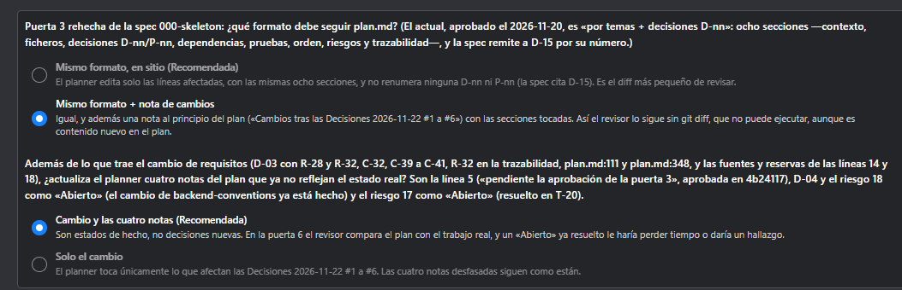
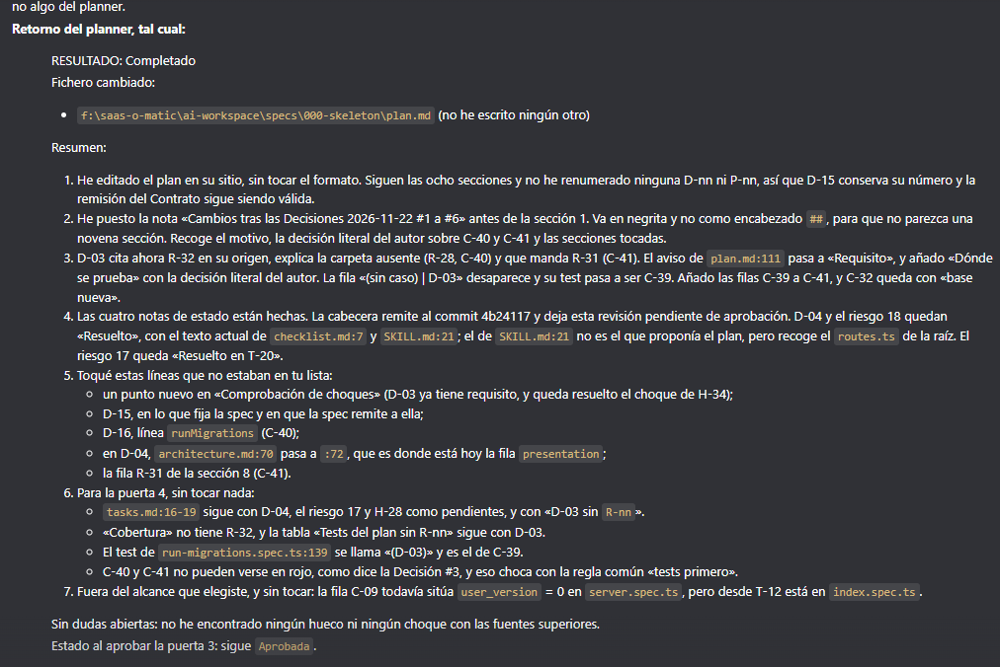

# 000-skeleton — Fase 6 (2026-11-22, sesión 06)

## Objetivo y fase
Fase 6, spec `000-skeleton`. Rehacer la puerta 3 (plan) con `/sdd-plan` tras el cambio de requisitos y la puerta 2 rehecha (Decisiones 2026-11-22 #1 a #6). Había que poner `plan.md` al día con R-32, C-39 a C-41 y la nueva R-28, y aprobar la puerta. La spec sigue en `Aprobada`.

## Prompts clave
Invocación:

> /sdd-plan 000-skeleton

Formato de `plan.md`, en el cuadro de opciones: «Mismo formato + nota de cambios».

Alcance, en el cuadro de opciones: «Cambio y las cuatro notas (Recomendada)».

Respuesta al encargo del planner:

> El encargo está bien. Para que el planner no tenga que parar en el punto 3, lo decido ya (decisión del autor 2026-11-22; anótala en D-03 y en la nota de cambios del plan): "C-40 y C-41 se prueban en run-migrations.spec.ts, en el ejecutor, como C-39; server.spec.ts no los repite, porque «sin escuchar» lo cubre el camino de D-17 (el mismo throw antes de listen y el mismo catch de app.ts). Los dos son tests de comportamiento existente." Con eso, lánzalo.

Aprobación de la puerta 3:

> Apruebo la puerta 3 de la spec 000-skeleton con el plan revisado (el Estado sigue en Aprobada).
> Antes del commit, dos correcciones de hecho en plan.md, que te autorizo a hacer tú (anótalas en la
> nota de cambios):
>
> 1. Fila C-09 de la sección 5: user_version = 0 se comprueba en index.spec.ts desde T-12, no en
>    server.spec.ts.
> 2. D-04 y riesgo 18: añade el commit en que lo aplicó el autor, a3da2fb (2026-11-21).
> Para la puerta 4 (/sdd-tasks): la tarea nueva lleva C-40 y C-41 en run-migrations.spec.ts, declara que
> no pueden verse en rojo (Decisión 2026-11-22 #3, tests de comportamiento existente) y renombra el test
> «(D-03)» a C-39; además, las notas de tasks.md:16-19, la cobertura de R-32 y la tabla de tests sin
> R-nn.
> Cierre de la puerta 3: MEMORY.md ≤ 50 líneas (ahora 51) → /sdd-session → commit. Enséñame wc -l y
> git log -1.

Cabecera del plan:

> Sí, cámbiala a «aprobada por el autor el 2026-11-22»

Cierre:

> /sdd-session 6 000-skeleton

## Qué propuso la IA
- **Arranque:**
  - Leyó `spec.md`, la skill `sdd`, el agente `planner`, `plan.md`, las rondas 5 y 6 de `review.md`, el README de specs y el «Pendiente» del registro de la sesión 05.
  - Copió la línea `- **Estado:** Aprobada`: la puerta 3 está permitida y la spec sigue `Aprobada` al pasarla.
  - Comprobó en `checklist.md:7` y `SKILL.md:21` de `backend-conventions` que el cambio de D-04 ya estaba aplicado.
- **Qué cambiaba en el plan:**
  - Por el cambio de requisitos:
    - D-03 frente a R-32: el aviso de `plan.md:111` y la fila «(sin caso) | D-03» de `plan.md:348`.
    - C-32, C-39 a C-41 y R-32 en la trazabilidad y en las filas de `app.ts`, `run-migrations.ts`, `server.ts`, D-16 y D-17.
    - Las fuentes y las reservas de las líneas 14 y 18.
  - Cuatro notas desfasadas que no venían del cambio:
    - la línea 5 («pendiente la aprobación de la puerta 3», aprobada en 4b24117);
    - D-04 y el riesgo 18 como «Abierto»;
    - el riesgo 17 como «Abierto» (resuelto en T-20).
- **Dos preguntas antes del encargo** (`/sdd-flow` pide preguntar el formato):
  - Formato. Recomendación de la IA: «Mismo formato, en sitio». Otra opción: «Mismo formato + nota de cambios».
  - Alcance. Recomendación de la IA: «Cambio y las cuatro notas». Otra opción: «Solo el cambio».
- **Encargo del planner:**
  - Lo enseñó antes de lanzarlo, con las Decisiones 2026-11-22 #1 a #6 literales y la aprobación de la puerta 2.
  - Llevaba tres puntos propios, que señaló:
    - escribir solo en `plan.md`;
    - una lista orientativa de líneas afectadas;
    - devolver como `Q-nn` dónde se prueban C-40 y C-41, porque la Decisión #1 solo fija el sitio de C-39.
  - Lo lanzó con los dos cambios del autor y nada más: su decisión, literal, en «Decisiones aplicables», y el punto 3 cambiado a «anótalo en D-03 y en la nota de cambios».
- **Retorno del planner (`Completado`):**
  - Plan editado en sitio, con las mismas ocho secciones y sin renumerar D-nn ni P-nn.
  - Nota «Cambios tras las Decisiones 2026-11-22 #1 a #6» antes de la sección 1.
  - D-03 cita R-32 y trae «Dónde se prueba», con la decisión literal del autor.
  - C-39 a C-41 tienen fila propia, se retira la fila «(sin caso) | D-03» y hay fila de R-32.
  - Las cuatro notas pasan a «Resuelto».
  - Tocó líneas fuera de la lista: «Comprobación de choques», D-15, D-16, `architecture.md:70` → `:72` en D-04 y la fila R-31.
  - Para la puerta 4 anotó, sin tocar nada:
    - las notas de `tasks.md:16-19`;
    - «Cobertura» sin R-32;
    - la tabla «Tests del plan sin R-nn» con D-03;
    - el test «(D-03)» de `run-migrations.spec.ts:139`;
    - que C-40 y C-41 no pueden verse en rojo.
  - Fuera de alcance, también sin tocarla: la fila C-09.
- **Comprobaciones de la IA:**
  - `git status` y `git diff --stat`: solo `plan.md` (41 inserciones y 23 borrados), además de la captura del autor.
  - Diff palabra a palabra revisado.
  - `architecture.md:72` es la fila `presentation`.
  - El cambio de `backend-conventions` es el commit `a3da2fb` (2026-11-21), que el plan no citaba.
- **Tras la aprobación:**
  - Fila C-09: deja `server.spec.ts` para el arranque, porque su test `(C-09, C-03)` sigue en `server.spec.ts:76`, y lleva `user_version` = 0 a `data/sqlite/index.spec.ts` (`index.spec.ts:72`).
  - `a3da2fb` añadido en D-04 y en el riesgo 18.
  - Viñeta «Correcciones de hecho de la sesión principal, autorizadas por el autor al aprobar la puerta 3 (2026-11-22)» en la nota de cambios.
- **MEMORY.md de 51 a 50 líneas:**
  - Línea 6: «puertas 2 y 3 rehechas».
  - Línea 8: resumen de la puerta 3 rehecha e indicaciones del autor para la puerta 4.
  - Línea 44: `/sdd-plan` probado tras un cambio de requisitos.
  - Las antiguas líneas 49 y 50 se unen en una.
- **Cabecera del plan:** la IA señaló que la línea 5 seguía diciendo «pendiente la aprobación explícita del autor» y preguntó antes de tocarla, porque no estaba entre las dos correcciones autorizadas.

## Qué corregí y por qué
- **Formato:** elegí «Mismo formato + nota de cambios», no la recomendación de la IA («Mismo formato, en sitio»). Motivo: (no registrado).
- **Punto 3 del encargo:** decidí yo dónde se prueban C-40 y C-41, «para que el planner no tenga que parar en el punto 3».
- **Dos correcciones de hecho en `plan.md`** (fila C-09 y commit `a3da2fb`), que autoricé a hacer a la sesión principal y anotar en la nota de cambios. Motivo: «correcciones de hecho».
- **Límite de MEMORY.md:** 50 líneas como máximo (tenía 51).

## Decisiones tomadas
- **Formato de `plan.md`:** «Mismo formato + nota de cambios». **Alcance:** «Cambio y las cuatro notas (Recomendada)».
- **Decisión del autor 2026-11-22 (puerta 3):** C-40 y C-41 se prueban en `run-migrations.spec.ts`, como C-39. `server.spec.ts` no los repite (camino de D-17), y los dos son tests de comportamiento existente. Anotada en D-03, D-17 y la nota de cambios.
- **Puerta 3 aprobada** el 2026-11-22. `Estado: Aprobada` sin cambios; no se tocan `spec.md` ni el README.
- **Correcciones en `plan.md`:** fila C-09, `a3da2fb` en D-04 y en el riesgo 18, y cabecera «aprobada por el autor el 2026-11-22».
- **Indicaciones para la puerta 4:**
  - La tarea nueva lleva C-40 y C-41 en `run-migrations.spec.ts`.
  - Declara que no pueden verse en rojo (Decisión 2026-11-22 #3).
  - Renombra el test «(D-03)» a C-39.
  - Además, las notas de `tasks.md:16-19`, la cobertura de R-32 y la tabla de tests sin R-nn.
- **MEMORY.md:** 50 líneas.
- Commit: el de cierre de esta sesión.

## Capturas
- 
- 

Solo se enlazan las de esta sesión; las demás `fase-6-000-*` son de sesiones anteriores.

## Pendiente para la siguiente sesión
- **Puerta 4** (`/sdd-tasks 000-skeleton`), con las indicaciones del autor:
  - Una tarea nueva con C-40 y C-41 en `run-migrations.spec.ts`, que declara que no pueden verse en rojo (Decisión 2026-11-22 #3, tests de comportamiento existente).
  - Renombrar el test «(D-03)» de `run-migrations.spec.ts:139` a C-39.
  - Las notas de `tasks.md:16-19`: D-04, el riesgo 17 y H-28 como pendientes, y «D-03 sin `R-nn`».
  - La cobertura de R-32 y la tabla «Tests del plan sin R-nn», que sigue con D-03.
  - Como sale una tarea nueva, la spec no pasa directamente a la puerta 6.
- **Puertas 5 y 6:** la puerta 5 de la tarea nueva y después la puerta 6 (`/sdd-validate`).
- **Reservas abiertas de la spec 000:** H-08, H-12, H-26, H-27, H-29, H-30, H-32 y H-37.
