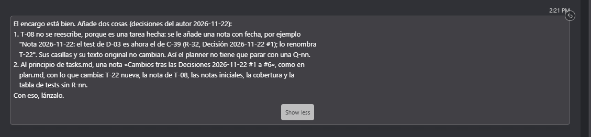
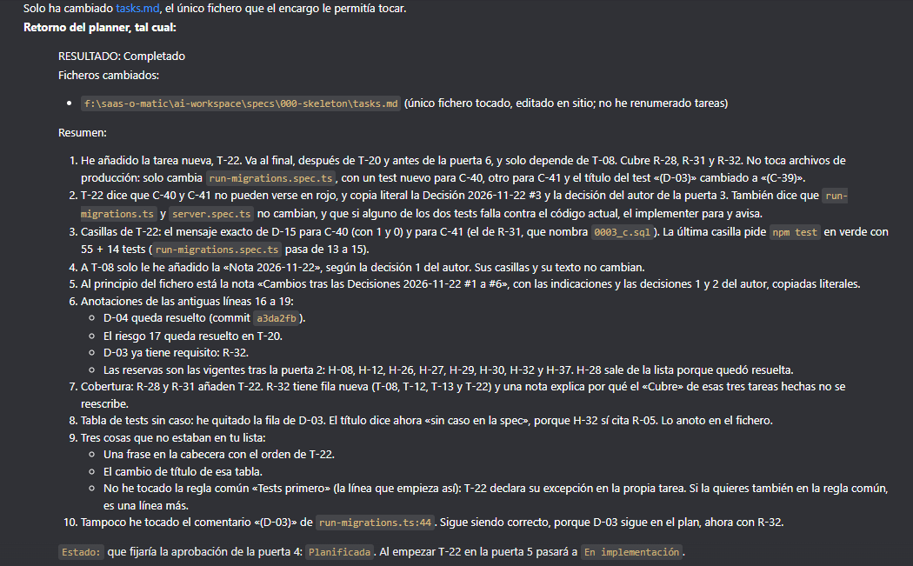
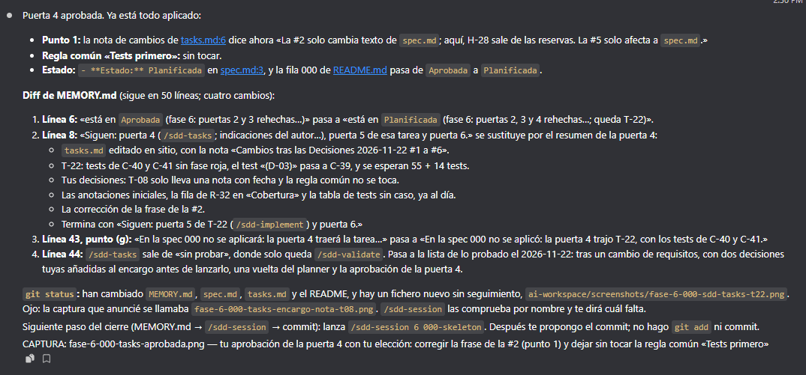

# 000-skeleton — Fase 6 (2026-11-22, sesión 07)

## Objetivo y fase
Fase 6, spec `000-skeleton`. Rehacer la puerta 4 (tareas) con `/sdd-tasks` tras el cambio de requisitos y las puertas 2 y 3 rehechas (Decisiones 2026-11-22 #1 a #6). Había que poner `tasks.md` al día con R-32 y C-39 a C-41, añadir la tarea de los tests de C-40 y C-41 y aprobar la puerta. Al aprobarla, la spec pasa de `Aprobada` a `Planificada`.

## Prompts clave
Invocación:

> /sdd-tasks 000-skeleton

Respuesta al encargo del planner:

> El encargo está bien. Añade dos cosas (decisiones del autor 2026-11-22):
> 1. T-08 no se reescribe, porque es una tarea hecha: se le añade una nota con fecha, por ejemplo
>    "Nota 2026-11-22: el test de D-03 es ahora el de C-39 (R-32, Decisión 2026-11-22 #1); lo renombra
>    T-22". Sus casillas y su texto original no cambian. Así el planner no tiene que parar con una Q-nn.
> 2. Al principio de tasks.md, una nota «Cambios tras las Decisiones 2026-11-22 #1 a #6», como en
>    plan.md, con lo que cambia: T-22 nueva, la nota de T-08, las notas iniciales, la cobertura y la
>    tabla de tests sin R-nn.
> Con eso, lánzalo.

Aprobación de la puerta 4:

> Apruebo la puerta 4; corrige el punto 1, regla común sin tocar

Capturas, tras la primera comprobación:

> Ya las he hecho, compruébalo otra vez

Cierre:

> /sdd-session 6 000-skeleton

## Qué propuso la IA
- **Arranque:**
  - Cargó la skill `sdd` y leyó:
    - el README de specs;
    - el registro de la sesión 06, con las indicaciones del autor para la puerta 4;
    - `tasks.md` y el agente `planner`;
    - de `spec.md`, la línea `Estado:` y las Decisiones 2026-11-22;
    - las partes de `plan.md` que tocan D-03 y C-39 a C-41;
    - la plantilla de `tasks.md`;
    - las rondas de `review.md`;
    - `run-migrations.spec.ts` y `run-migrations.ts`.
  - Copió la línea `- **Estado:** Aprobada`: la puerta 4 está permitida y, al pasarla, la spec queda en `Planificada`.
- **Encargo del planner**, enseñado antes de lanzarlo:
  - Petición del autor literal: la invocación y las indicaciones que dio al aprobar la puerta 3.
  - Decisiones 2026-11-22 #1 a #4 y #6, literales, y la decisión del autor de la puerta 3 sobre dónde se prueban C-40 y C-41. La #5 no se incluyó, porque solo afecta a `spec.md`.
  - `backend-conventions` como skill de convenciones. El formato de `plan.md` no aplicaba.
  - Tres límites propios, señalados como suyos:
    - escribir solo en `tasks.md`, en sitio y sin renumerar;
    - no cambiar el estado ni las casillas de las tareas hechas, y devolver como `Q-nn` cualquier cambio en el texto de T-08;
    - la tarea nueva es T-22, el siguiente id libre.
  - Una observación que dejó fuera del encargo salvo que el autor la pidiera: el test de C-32 (`run-migrations.spec.ts:112`) ya usa una base nueva, pero su nombre no lo dice.
- **Lanzamiento:** con los dos cambios del autor y nada más. Sus decisiones 1 y 2 van literales en «Decisiones aplicables», y el límite 2 se cambió a «solo se añade la nota con fecha».
- **Retorno del planner (`Completado`):**
  - T-22 va al final, tras T-20, y depende de T-08. Cubre R-28, R-31 y R-32.
  - T-22 solo toca `run-migrations.spec.ts`: tests de C-40 y C-41 y el test «(D-03)» renombrado a «(C-39)».
  - Declara que C-40 y C-41 no pueden verse en rojo, con las decisiones literales. Si fallan contra el código actual, el implementer para.
  - Las casillas llevan los mensajes exactos de D-15. Se esperan 55 + 14 tests.
  - T-08 solo gana la «Nota 2026-11-22».
  - Al principio del fichero, la nota «Cambios tras las Decisiones 2026-11-22 #1 a #6».
  - Anotaciones iniciales al día: D-04 y el riesgo 17 resueltos, D-03 con R-32 y las reservas vigentes, sin H-28.
  - Fila de R-32 en «Cobertura» (T-08, T-12, T-13 y T-22), con una nota.
  - La tabla de tests se queda sin la fila de D-03 y se titula «sin caso en la spec».
  - Declaró tres cosas fuera de la lista: la frase «segunda excepción» de la cabecera, el título nuevo de la tabla y la regla común «Tests primero», que no tocó.
- **Comprobaciones de la IA:**
  - `git status` y `git diff --stat`: solo `tasks.md` (42 inserciones y 9 borrados).
  - Diff palabra a palabra revisado.
  - Los mensajes de T-22 coinciden con `run-migrations.ts:31` y `:47`, y la numeración se valida antes que `user_version` (línea 41), así que C-41 da el error de R-31.
  - `run-migrations.spec.ts` pasa de 13 a 15 tests.
- **Tres puntos para el autor:**
  1. La frase «La #2 y la #5 solo afectan a `spec.md`» no es exacta, porque la #2 saca H-28 de las reservas de `tasks.md`. La IA propuso una corrección.
  2. La regla común «Tests primero». Recomendación de la IA: dejar la excepción solo en T-22.
  3. Los dos añadidos del planner.
- **Tras la aprobación:**
  - Corrección en `tasks.md:6`: «La #2 solo cambia texto de `spec.md`; aquí, H-28 sale de las reservas. La #5 solo afecta a `spec.md`.»
  - `Estado: Planificada` en `spec.md:3` y en la fila 000 del README.
  - MEMORY.md, en 50 líneas, con cuatro cambios en las líneas 6, 8, 43 y 44: estado de la spec, resumen de la puerta 4, punto (g) y `/sdd-tasks` probado.
- **Capturas:** en la primera comprobación no existía ninguna de las dos anunciadas. `fase-6-000-sdd-tasks-t22.png` sí existía, pero muestra el retorno del planner. El autor hizo las dos que faltaban.

## Qué corregí y por qué
- **Límite 2 del encargo:** no quise una `Q-nn` sobre T-08, sino una nota con fecha que deja intactos sus casillas y su texto. Motivo: «T-08 no se reescribe, porque es una tarea hecha» y «Así el planner no tiene que parar con una Q-nn».
- **Nota de cambios al principio de `tasks.md`:** la pedí yo; no estaba en el encargo. Motivo: «como en plan.md».

## Decisiones tomadas
- **Decisiones del autor 2026-11-22 (puerta 4):** la 1 (nota con fecha en T-08) y la 2 (nota «Cambios tras las Decisiones 2026-11-22 #1 a #6»), literales en la nota de cambios de `tasks.md`.
- **Encargo:** los límites 1 y 3 de la IA, aceptados («El encargo está bien»). La observación sobre el nombre del test de C-32 no entró.
- **Puerta 4 aprobada** el 2026-11-22: `Estado: Planificada` en `spec.md` y en el README.
- **Tres puntos:** se corrige la frase de la #2 (punto 1), la regla común «Tests primero» queda sin tocar y los dos añadidos del planner se quedan.
- **MEMORY.md:** 50 líneas.
- Commit: el de cierre de esta sesión.

## Capturas
- 
- 
- 

Solo se enlazan las de esta sesión; las demás `fase-6-000-*` son de sesiones anteriores.

## Pendiente para la siguiente sesión
- **Puerta 5 de T-22** (`/sdd-implement 000-skeleton`):
  - Al empezar, `Estado:` pasa a `En implementación`.
  - Tests de C-40 y C-41 en `run-migrations.spec.ts`, de comportamiento existente y sin fase roja, y el test «(D-03)» renombrado a C-39.
  - `npm test` en verde con 55 + 14.
  - Si C-40 o C-41 fallan contra el código actual, se para: no se toca `run-migrations.ts`.
- **Puerta 6** (`/sdd-validate`), con C-25 (T-18) y C-18 (T-20), que quedan para el revisor.
- **Reservas abiertas de la spec 000:** H-08, H-12, H-26, H-27, H-29, H-30, H-32 y H-37.
