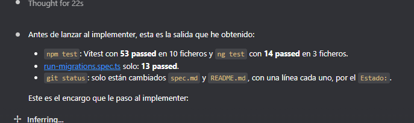

# 000-skeleton — Fase 6 (2026-11-22, sesión 08)

## Objetivo y fase
Fase 6, spec `000-skeleton`, puerta 5 (implementación) con `/sdd-implement`. Había que implementar T-22: los tests de C-40 y C-41 y el nombre del test de C-39, en `run-migrations.spec.ts`. Es la tarea nueva de la puerta 4 rehecha tras el cambio de requisitos; la spec estaba en `Planificada`.

## Prompts clave
> /sdd-implement 000-skeleton

> Confirmo T-22 y el Estado a En implementación

> Apruebo T-22. La segunda llamada de C-41 se queda: es redundante, pero deja explícito que no sale el
> error de R-32, que es justo lo que decide la #4. La captura fase-6-000-t22-resultado.png es mía.
> Marca [x] y sus seis casillas, deja MEMORY.md en ≤ 50 líneas → /sdd-session → commit; enséñame wc -l
> y git log -1.

> /sdd-session 6 000-skeleton

## Qué propuso la IA
- **Propuesta de tarea.**
  - Leyó `spec.md`, cuyo `Estado:` literal era `- **Estado:** Planificada`, junto con `tasks.md`, el README de specs y `run-migrations.spec.ts`.
  - Propuso T-22, la única pendiente (T-00 a T-21 en `[x]`; depende de T-08, hecha).
  - Propuso también pasar el `Estado:` a `En implementación` al empezarla, en `spec.md` y en el README a la vez. Motivo: es la primera tarea de esta vuelta, y así lo dice la regla de la puerta 5 de `sdd` y de `/sdd-flow`.
  - Avisó de que las casillas de C-25 (T-18) y C-18 (T-20) que siguen sin marcar son del revisor en la puerta 6.
- **Antes de lanzar al implementer, tras la confirmación del autor:**
  - Cambió el `Estado:` en los dos ficheros.
  - Ejecutó `npm test`: 53 en Vitest y 14 en `ng test`, en verde. Solo `run-migrations.spec.ts`: 13.
  - Ejecutó `git status` y `git diff --stat`: solo `spec.md` y el README, con una línea cada uno.
- **Encargo del implementer.**
  - Contenido:
    - las Decisiones 2026-11-22 #1, #3 y #4, literales;
    - la decisión del autor de la puerta 3 sobre dónde se prueban C-40 y C-41;
    - la indicación del autor al aprobar la puerta 3;
    - el principio 3;
    - las rutas a leer;
    - la fila literal de T-22 con sus seis «Hecho cuando»;
    - la salida literal de los tests, sin los códigos ANSI;
    - que T-22 no tiene build propio;
    - los límites: solo `run-migrations.spec.ts` y la línea `Estado:` de T-22.
  - Lo enseñó y lo lanzó tal cual.
- **Retorno del implementer:**
  - «Tarea terminada», con T-22 en `[~]`.
  - Título «(D-03)» cambiado a «(C-39)».
  - Test de C-40: ruta inexistente y `user_version` = 1, con el mensaje de D-15 con 1 y 0; `user_version` sigue en 1.
  - Test de C-41: `0001_a` + `0003_c` y `user_version` = 5, con el mensaje de R-31 y no el de R-32; `user_version` sigue en 5 y no se crean las tablas.
  - Los dos tests llevan el comentario «Test de comportamiento existente» y pasaron a la primera, sin fase roja, como dice la excepción de la tarea.
  - 15 tests en `run-migrations.spec.ts` y 55 + 14 en `npm test`.
  - Comprobación extra con `tsc --noEmit` sobre `apps/api/tsconfig.json`: código de salida 0.
  - Sin desviaciones ni bloqueos. Señaló que la captura sin seguimiento no era suya.
- **Comprobación de la sesión principal:**
  - `git status` y `git diff --stat`: el implementer solo cambió `run-migrations.spec.ts` y la línea `Estado:` de T-22.
  - Volvió a ejecutar los tests: 55 + 14, y 15 en `run-migrations.spec.ts`.
  - Observó que la segunda llamada a `runMigrations` en el test de C-41 es redundante, aunque no es un fallo. Ofreció quitarla en otra vuelta del implementer si el autor lo pedía.
- **Tras la aprobación del autor:**
  - Marcó `[x]` en T-22 y en sus seis casillas.
  - Añadió a T-22, sin que se lo pidieran, una línea con la aprobación literal del autor sobre C-41, como en T-15 y T-20, y ofreció quitarla.
  - Actualizó dos frases de `MEMORY.md`, que sigue en 50 líneas.
  - Comprobó que en `spec.md` no queda ninguna celda `(pendiente de /sdd-session)` por sustituir: la única aparición está en el texto literal de la Decisión 2026-11-22 #5.
  - Propuso el mensaje del commit.

## Qué corregí y por qué
- No hubo correcciones a las propuestas.
- Sobre la observación de la segunda llamada de C-41, el autor decidió mantenerla: «es redundante, pero deja explícito que no sale el error de R-32, que es justo lo que decide la #4».

## Decisiones tomadas
- **T-22 y `Estado: En implementación` al empezarla:** confirmados por el autor. El `Estado:` se cambió en `spec.md` y en el README.
- **Segunda llamada de C-41:** se mantiene, por el motivo de la #4. La aprobación literal está en T-22.
- **T-22 aprobada:** `[x]` en la tarea y en sus seis casillas.
- **Orden de cierre:** `MEMORY.md` en ≤ 50 líneas → `/sdd-session` → commit.
- **Commit:** el de cierre de esta sesión.

## Capturas
- 

Solo se enlazan las de esta sesión; las demás `fase-6-000-*` son de sesiones anteriores.

## Pendiente para la siguiente sesión
- **Puerta 6 de la spec 000 con `/sdd-validate`:**
  - Al empezar, `Estado:` pasa a `En revisión`.
  - El revisor recibe en el encargo:
    - la salida literal de tests y build, `git status` y `git diff --stat`;
    - la auditoría Lighthouse, porque hay vistas;
    - `review.md` entre las rutas a leer.
  - Comprueba las casillas que le tocan: C-25 (T-18) y C-18 (T-20).
