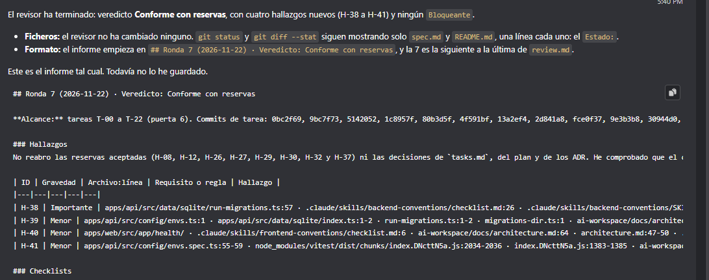
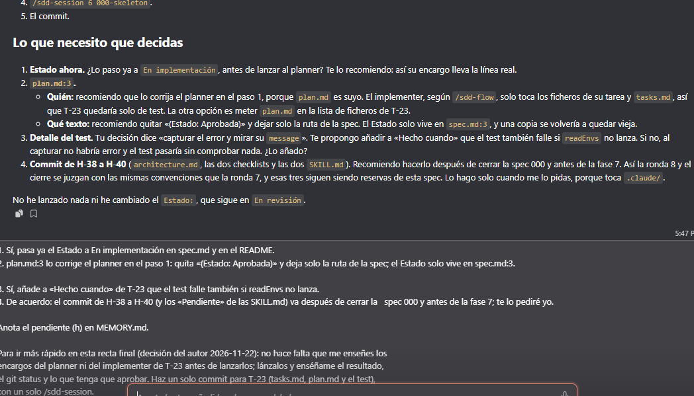
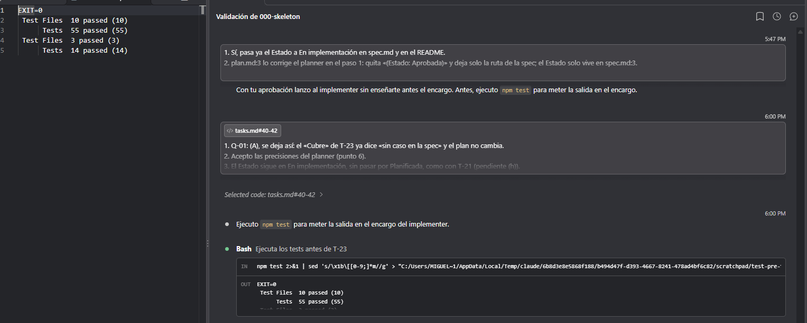
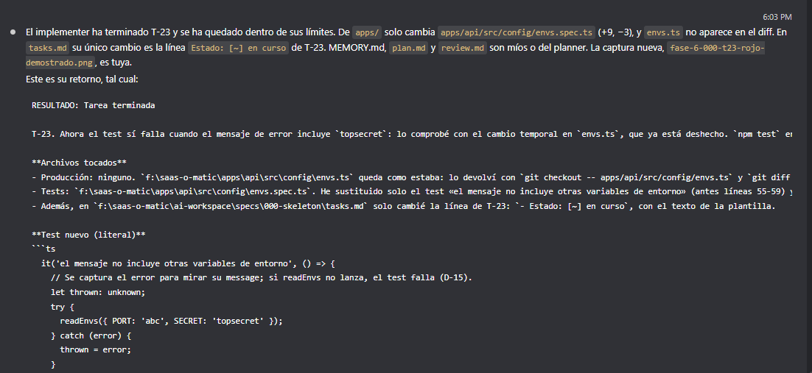

# 000-skeleton — Fase 6 (2026-11-22, sesión 09)

## Objetivo y fase
Fase 6, spec `000-skeleton`: puerta 6 (validación) con `/sdd-validate 000-skeleton`. La ronda 7 del revisor sale `Conforme con reservas`. Por decisión del autor se hace una tarea nueva, T-23, para corregir H-41 antes de cerrar: puerta 4 ampliada con el planner y puerta 5 con el implementer, en un solo commit.

## Prompts clave
- Arranque: `/sdd-validate 000-skeleton`.
- Paso a `En revisión`: elección del autor en el cuadro de opciones: «Sí, pásalo ahora (Recomendada)».
- Aprobación del encargo del revisor (ronda 7):
  > Apruebo el encargo. Añade mi petición para esta puerta, literal: "Revisa la implementación completa de la spec 000 frente a la spec, el plan y las tareas, con las checklists de backend y frontend. Comprueba las dos casillas que son tuyas: C-25 (T-18) y C-18 (T-20). Las reservas que ya acepté (H-08, H-12, H-26, H-27, H-29, H-30, H-32 y H-37) y las decisiones registradas en tasks.md y en los ADR no se reabren, salvo que el código las contradiga." Con eso, lánzalo.
- Decisiones sobre la ronda 7:
  > 1. Sí, guarda la ronda 7 tal cual al final de review.md.
  > 2. Decisiones del autor 2026-11-22 sobre la ronda 7:
  > - H-41 se corrige antes de cerrar: el test de envs.spec.ts:55-59 debe comprobar de verdad que el  mensaje no incluye otras variables (capturar el error y mirar su message), y el implementer demuestra  que ahora sí falla con un cambio temporal en el código que haga que el mensaje incluya 'topsecret', y  luego lo deshace. Es una tarea nueva, T-23, solo de test; la spec vuelve a En implementación para  hacerla, y después una ronda 8 del revisor limitada a T-23. Corrige también con ella la nota de  plan.md:3.
  >
  > - H-38, H-39 y H-40 los acepto como reservas de la spec 000: el código cumple la spec, y el fallo está
  >   en el texto de las convenciones y de architecture.md, que están por debajo de la spec. Los corrijo en
  >   un commit aparte, autorizado por mí, antes de la fase 7:
  >   · H-38: la casilla «Todo SQL usa parámetros» vale, como SKILL.md:22, para el SQL con datos; excepción:
  >     los PRAGMA, que SQLite no admite con parámetros, con valores generados por el código.
  >   · H-39: en architecture.md, los módulos node:* se permiten en config, data, infrastructure,
  >     presentation y app; domain y packages/pricing no importan ninguno.
  >   · H-40: la regla de las cuatro carpetas pasa a «se crean solo las que la funcionalidad usa»
  >     (architecture.md:64, SKILL.md:13 y la checklist).
  >   En ese commit van también los «Pendiente» ya decididos de las dos SKILL.md.
  > Dime cómo encaja T-23 en el método (puertas 4 y 5) antes de lanzar nada.
- Respuestas sobre cómo encaja T-23:
  > 1. Sí, pasa ya el Estado a En implementación en spec.md y en el README.
  > 2. plan.md:3 lo corrige el planner en el paso 1: quita «(Estado: Aprobada)» y deja solo la ruta de la spec; el Estado solo vive en spec.md:3.
  >
  > 3. Sí, añade a «Hecho cuando» de T-23 que el test falle también si readEnvs no lanza.
  > 4. De acuerdo: el commit de H-38 a H-40 (y los «Pendiente» de las SKILL.md) va después de cerrar la   spec 000 y antes de la fase 7; te lo pediré yo.
  >
  > Anota el pendiente (h) en MEMORY.md.
  >
  > Para ir más rápido en esta recta final (decisión del autor 2026-11-22): no hace falta que me enseñes los
  > encargos del planner ni del implementer de T-23 antes de lanzarlos; lánzalos y enséñame el resultado,
  > el git status y lo que tenga que aprobar. Haz un solo commit para T-23 (tasks.md, plan.md y el test),
  > con un solo /sdd-session.
- Aprobación de la puerta 4 ampliada:
  > 1. Q-01: (A), se deja así: el «Cubre» de T-23 ya dice «sin caso en la spec» y el plan no cambia.
  > 2. Acepto las precisiones del planner (punto 6).
  > 3. El Estado sigue en En implementación, sin pasar por Planificada, como con T-21 (pendiente (h)).
  > 4. Apruebo la puerta 4 ampliada: T-23 y plan.md:3 tal como están.
  > Lanza al implementer de T-23 sin enseñarme el encargo. Que dé la salida literal del rojo con el cambio
  > temporal y de la vuelta a verde.
- Aprobación de T-23:
  > Apruebo T-23. La casilla 2 la acepto sin demostrarla con un segundo cambio: es evidente por el código
  > (si readEnvs no lanza, thrown queda en undefined y toBeInstanceOf(Error) falla) y no compensa otra
  > vuelta del implementer. La captura fase-6-000-t23-rojo-demostrado.png es mía. Marca [x] y sus seis
  > casillas, deja MEMORY.md en ≤ 50 → lanzo /sdd-session → commit único; enséñame git log -1.

## Qué propuso la IA
- **Preparación:** comprobó que T-00 a T-22 estaban en `[x]`, que la spec estaba en `En implementación` y que solo quedaban abiertas C-25 y C-18, a cargo del revisor. Preguntó antes de pasar a `En revisión`.
- **Plan en modo planificación:** cambiar el `Estado:`, sacar la evidencia del día, enseñar el encargo, lanzar al revisor y parar.
- **Evidencia:**
  - `npm run verify`: en verde, 55 + 14.
  - Lighthouse en el 4200, en escritorio y móvil: Accesibilidad 100, Buenas prácticas 100 y SEO 90; solo falla `meta-description`.
  - Al parar `npm run dev`, los procesos hijos seguían escuchando. El clasificador denegó PowerShell; la IA comprobó en la salida de `dev` que eran los suyos y terminó los árboles con `taskkill /T /F`.
  - `git status`: solo `spec.md` y el README.
- **Encargo del revisor:** se enseñó entero. Como petición del autor llevaba la fila #1 de la spec y la invocación. Se lanzó con la línea añadida por el autor.
- **Ronda 7:** se enseñó tal cual. La IA marcó H-38 a H-40 como choques de fuentes o huecos que decide el autor, y la guardó en `review.md` (+158 líneas, sin tocar las rondas anteriores).
- **Cómo encaja T-23:**
  - No es un cambio de requisitos y no reabre las puertas 1 a 3.
  - Es un hueco del método: el pendiente (h).
  - Secuencia propuesta: Estado, planner, implementer, ronda 8 y cierre.
  - Cuatro preguntas con recomendación: Estado ya; `plan.md:3`, quién y qué texto; que el test falle si `readEnvs` no lanza; cuándo hacer el commit de las convenciones.
- **Encargo del planner:** la IA añadió tres cosas sin que las pidiera el autor y se lo dijo después: la nota «Cambios tras la ronda 7», las reservas al día y la declaración de skills y modelo.
- **Retorno del planner:** `Con dudas` (Q-01, con recomendación (A)), con precisiones propias. Solo cambió `tasks.md` y `plan.md`.
- **Implementer:**
  - Encargo con la salida previa de `npm test` (55 + 14).
  - Resultado: test nuevo que captura el error y mira su `message`; rojo con un cambio temporal en `envs.ts`, ya deshecho, y vuelta a verde.
  - De `apps/` solo cambia `envs.spec.ts`.
  - La IA avisó de que la casilla 2 no se había visto fallar.
- **Cierre de T-23:** `[x]` y sus seis casillas, aprobación literal en T-23, y MEMORY.md al día en 50 líneas.

## Qué corregí y por qué
- **Encargo de la ronda 7:** añadí mi petición literal para la puerta. Motivo: (no registrado).
- **Proceso de la recta final:** los encargos del planner y del implementer de T-23 se lanzan sin enseñármelos, y T-23 va en un solo commit con un solo `/sdd-session`, en lugar del commit propio de la puerta 4 que proponía la IA. Motivo: «Para ir más rápido en esta recta final».
- **Casilla 2 de T-23:** la acepto sin un segundo cambio temporal. Motivo: «es evidente por el código […] y no compensa otra vuelta del implementer».
- **Capturas:** doy por descartadas las tres que faltan. Motivo: (no registrado).

## Decisiones tomadas
- **Estado:** `En revisión` al empezar la puerta 6. Tras la ronda 7 vuelve a `En implementación` y no pasa por `Planificada` (como con T-21, pendiente (h)).
- **Ronda 7:** `Conforme con reservas`, guardada en `review.md`. C-25 y C-18 cumplen.
- **H-41:** se corrige con T-23 antes de cerrar.
- **H-38, H-39 y H-40:** reservas. Sus textos los corrige un commit aparte, que pedirá el autor tras cerrar la spec y antes de la fase 7, junto con los «Pendiente» de las dos `SKILL.md`.
- **`plan.md:3`:** sin «(Estado: Aprobada)», solo con la ruta de la spec.
- **Q-01 del planner:** (A), sin fila del test de D-15 en la tabla de tests sin caso.
- **Precisiones del planner:** aceptadas.
- **Puerta 4 ampliada:** aprobada.
- **T-23:** aprobada. 55 + 14 tests en verde.
- **Ronda 8:** limitada a T-23. Su encargo se enseña antes de lanzarlo.
- Commit: el de cierre de esta sesión.

## Capturas
- 
- 
- 
- 
- Anunciadas y no existentes: `fase-6-000-puerta-6-estado-en-revision.png`, `fase-6-000-puerta-6-choque-sql-pragma.png` y `fase-6-000-t23-un-solo-commit.png`.

## Pendiente para la siguiente sesión
- Ronda 8 del revisor, limitada a T-23, con el encargo enseñado antes. El `Estado:` pasa a `En revisión` al empezar.
- Cierre de la spec 000 con la aprobación escrita del autor, que nombre cada reserva: H-08, H-12, H-26, H-27, H-29, H-30, H-32, H-37, H-38, H-39, H-40 y las nuevas. Después, `Estado: Cerrada`, MEMORY.md, `/sdd-session` y commit.
- Commit aparte del autor con los textos de H-38 a H-40 y los «Pendiente» de las `SKILL.md`, antes de la fase 7.
- Pendiente (h) del método: añadirlo a `sdd` y a `/sdd-flow`.
