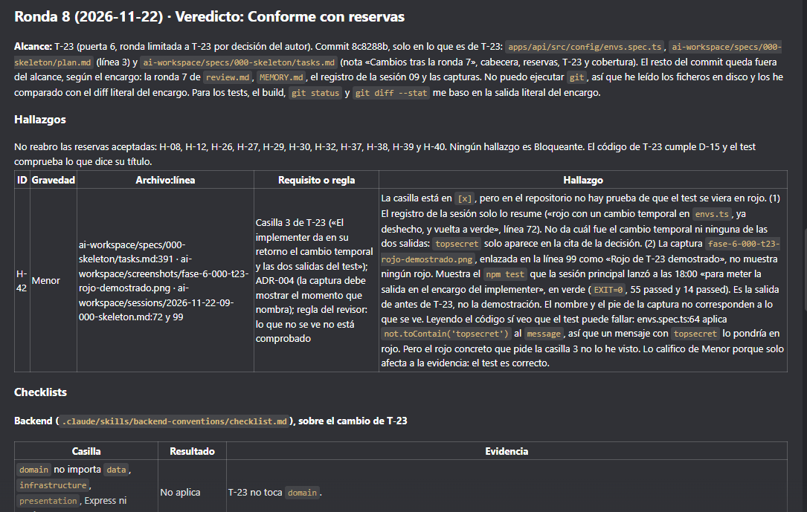
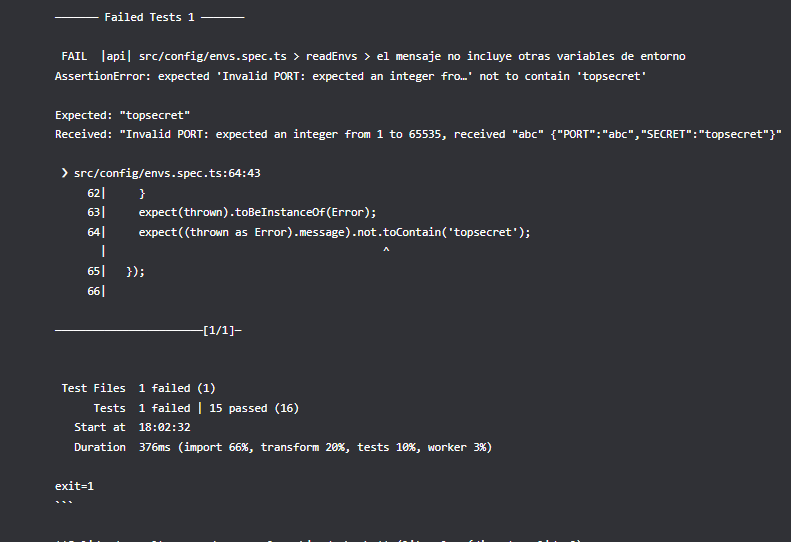

# 000-skeleton — Fase 6 (2026-11-22, sesión 10)

## Objetivo y fase
Fase 6, spec `000-skeleton`: puerta 6 (validación) con `/sdd-validate 000-skeleton`. Ronda 8 del revisor, limitada a T-23, y cierre de la spec con la aprobación escrita del autor, que nombra cada reserva.

## Prompts clave
- Arranque: `/sdd-validate 000-skeleton`.
- Respuesta al encargo de la ronda 8:
  > Apruebo En revisión, usa /sdd-validate 000-skeleton y Lighthouse no aplica
- Decisiones sobre la ronda 8 y aprobación del cierre:
  > 1. Sí, guarda la ronda 8 tal cual al final de review.md.
  > 2. H-42: lo acepto como reserva y, además, completo la evidencia en este cierre: 
  > (a) copia en el  registro de esta sesión, literales, el cambio temporal de envs.ts y las dos salidas del test (rojo y vuelta a verde) que dio el implementer en su retorno;
  >  (b) sustituyo la captura fase-6-000-t23-rojo-demostrado.png por una que muestre ese rojo (la guardo yo con el mismo nombre).
  >    Las tres capturas anunciadas que faltan (estado-en-revision, choque-sql-pragma y t23-un-solo-commit)
  >    se descartan porque su contenido ya consta en review.md y en las decisiones literales de tasks.md.
  > 3. Aprobación del autor, puerta 6 (cierre de la spec 000-skeleton), literal: "Acepto como reservas
  >    H-08, H-12, H-26, H-27, H-29, H-30, H-32, H-37, H-38, H-39, H-40 y H-42, y apruebo el cierre de la
  >    spec 000-skeleton. Mi motivo: las de la ronda 4 y H-37 siguen con el motivo que di al aprobar la
  >    puerta 2; H-38, H-39 y H-40 no son fallos del código, que cumple la spec, sino del texto de las
  >    convenciones y de architecture.md, y los corrijo en un commit aparte antes de la fase 7; H-42 es
  >    Menor, solo afecta a la evidencia, y la completo en este cierre."
  > Pon Estado: Cerrada en spec.md y en el README. En MEMORY.md (≤ 50 líneas): las reservas como
  > pendientes y, ya que cerramos, la limpieza pendiente: «Estado actual» sin el diario de tareas (el
  > detalle está en tasks.md y en las sesiones). Enséñame el diff de MEMORY.md antes de /sdd-session.
- Corrección del diff de MEMORY.md:
  > El diff de MEMORY.md está bien, con una corrección: quita el pendiente (3) («sustituir la captura»),
  > porque estará hecho antes del commit y MEMORY.md describe el estado tras el commit. Ya está sustituida
  > la captura fase-6-000-t23-rojo-demostrado.png por la del rojo (aparece como modificada en git status).
  > Lanzo /sdd-session
- Sobre la carpeta de evidencia de T-00:
  > que es F:\tmp-r09

  > puede borrarse?

  > Sí, bórrala y quita el pendiente (3) de MEMORY.md

## Qué propuso la IA
- **Preparación:**
  - Comprobó que la spec estaba en `En implementación`, con T-00 a T-23 en `[x]`.
  - `npm run verify` en verde (`EXIT=0`, 55 + 14), árbol limpio y `git show --stat` de `8c8288b` (el commit de T-23).
  - Sacó el diff de T-23 (`envs.spec.ts` y `plan.md:3`) para el revisor, que no puede ejecutar `git`.
- **Encargo de la ronda 8:** se enseñó antes de lanzarlo, con tres preguntas:
  - el paso a `En revisión`;
  - la petición literal, porque el autor solo había escrito el comando;
  - Lighthouse: propuso «No aplica», porque T-23 no toca `apps/web`.
- **Lanzamiento:** con la aprobación del autor, `Estado: En revisión` en `spec.md` y en el README. `git status` y `git diff --stat` se repitieron y el revisor se lanzó con el encargo enseñado, completado con las tres respuestas.
- **Ronda 8:**
  - Al volver, `git status` y `git diff --stat` solo mostraban las dos líneas `Estado:`: el revisor no tocó nada.
  - El informe se enseñó tal cual: `Conforme con reservas`, H-41 resuelta y H-42 nueva (`Menor`: el rojo de T-23 no tenía evidencia en el repositorio y la captura mostraba un `npm test` en verde).
  - Se guardó al final de `review.md` con la sección «Aprobación del autor» y sus palabras literales. Las rondas anteriores no se tocaron.
- **H-42 (a):** el retorno del implementer de T-23 era de la sesión 09 y no estaba en esta conversación. La IA lo recuperó de su transcrito local (`agent-a16bc5f4d2a202c72`, la entrada de la herramienta que entrega el informe). Partes literales:
  - Cambio temporal en `envs.ts` (ya deshecho):
    ```diff
    -      throw new Error(`Invalid PORT: expected an integer from 1 to 65535, received "${rawPort}"`);
    +      throw new Error(`Invalid PORT: expected an integer from 1 to 65535, received "${rawPort}" ${JSON.stringify(env)}`);
    ```
  - Salida en rojo con el cambio temporal (literal sin códigos ANSI, código de salida 1):
    ```
     RUN  v5.1.1 F:/saas-o-matic

     ❯ |api| src/config/envs.spec.ts (16 tests | 1 failed) 18ms
       ❯ readEnvs (16)
         × el mensaje no incluye otras variables de entorno 7ms

    ⎯⎯⎯⎯⎯⎯⎯ Failed Tests 1 ⎯⎯⎯⎯⎯⎯⎯

     FAIL  |api| src/config/envs.spec.ts > readEnvs > el mensaje no incluye otras variables de entorno
    AssertionError: expected 'Invalid PORT: expected an integer fro…' not to contain 'topsecret'

    Expected: "topsecret"
    Received: "Invalid PORT: expected an integer from 1 to 65535, received "abc" {"PORT":"abc","SECRET":"topsecret"}"

     ❯ src/config/envs.spec.ts:64:43
         62|     }
         63|     expect(thrown).toBeInstanceOf(Error);
         64|     expect((thrown as Error).message).not.toContain('topsecret');
           |                                           ^
         65|   });
         66|

    ⎯⎯⎯⎯⎯⎯⎯⎯⎯⎯⎯⎯⎯⎯⎯⎯⎯⎯⎯⎯⎯⎯⎯⎯[1/1]⎯


     Test Files  1 failed (1)
          Tests  1 failed | 15 passed (16)
       Start at  18:02:32
       Duration  376ms (import 66%, transform 20%, tests 10%, worker 3%)

    exit=1
    ```
  - Salida de vuelta a verde, con el cambio deshecho (literal, código de salida 0):
    ```
    envs.ts sin cambios

     RUN  v5.1.1 F:/saas-o-matic


     Test Files  1 passed (1)
          Tests  16 passed (16)
       Start at  18:02:39
       Duration  382ms (import 80%, tests 10%, transform 6%, worker 3%)

    exit=0
    ```
- **Cierre:**
  - `Estado: Cerrada` en `spec.md` y en el README.
  - Comprobación de capturas: la de la ronda 8 ya existía; la del rojo seguía siendo la antigua (81 659 bytes, 18:01), y la IA avisó.
- **MEMORY.md:**
  - «Estado actual» sin el diario de tareas: la línea 8 pasa a un resumen de la spec cerrada.
  - Reservas reescritas como pendientes, con H-42 y el motivo de las capturas descartadas.
  - Un aprendizaje sobre copiar la evidencia literal en el momento.
  - Diff enseñado antes de `/sdd-session`; sigue en 50 líneas.
- **Error de la IA, corregido:** al reescribir con Node, el `\t` de `F:\tmp-r09` se escribió como un tabulador. Se vio al quitar el pendiente (3) y se corrigió.
- **`F:\tmp-r09`:** la IA explicó qué era: proyecto npm temporal de T-00 (R-09), con `c10.cjs`, `api.ts` y `node_modules`, cuya evidencia ya está en la sesión 2026-11-21-02 y en los tests. Recomendó borrarla y pidió confirmación antes.

## Qué corregí y por qué
- **H-42:** lo acepto como reserva y completo la evidencia en el cierre: el retorno literal en este registro y la captura sustituida. Las tres capturas que faltan de la sesión 09 se descartan. Motivo: «su contenido ya consta en review.md y en las decisiones literales de tasks.md».
- **MEMORY.md, pendiente (3) («sustituir la captura»):** quitado. Motivo: «porque estará hecho antes del commit y MEMORY.md describe el estado tras el commit».
- **`F:\tmp-r09`:** borrada, y quitado su pendiente de MEMORY.md. Motivo: (no registrado).

## Decisiones tomadas
- **Estado:** `En revisión` al empezar la puerta 6; `Cerrada` tras la aprobación escrita del autor (en `spec.md` y en el README).
- **Encargo de la ronda 8:** petición literal `/sdd-validate 000-skeleton` y Lighthouse «No aplica».
- **Ronda 8:** `Conforme con reservas`, guardada en `review.md`. H-41 resuelta.
- **Reservas aceptadas al cerrar:** H-08, H-12, H-26, H-27, H-29, H-30, H-32, H-37, H-38, H-39, H-40 y H-42, con la aprobación literal al final de `review.md`.
- **Capturas de la sesión 09** `fase-6-000-puerta-6-estado-en-revision.png`, `fase-6-000-puerta-6-choque-sql-pragma.png` y `fase-6-000-t23-un-solo-commit.png`: descartadas.
- **MEMORY.md:** «Estado actual» sin el diario de tareas, y las reservas como pendientes.
- **`F:\tmp-r09`:** borrada.
- Commit: el de cierre de esta sesión.

## Capturas
- 
- 

## Pendiente para la siguiente sesión
- **Commit aparte del autor, antes de la fase 7:** los textos de H-38 a H-40 (casilla de SQL, `node:*` en `architecture.md`, regla de las cuatro carpetas) y los «Pendiente» ya decididos de las dos `SKILL.md`.
- **Sesión nueva:** comprobar con `/context` que `CLAUDE.md` sigue importando la constitución.
- **Mejoras del método pendientes en MEMORY.md**, entre ellas (f), (g) y (h): añadirlas a `sdd` y a `/sdd-flow`.
- **Fase 7:** specs 001 a 007, según el reparto de `ai-workspace/specs/README.md`.
