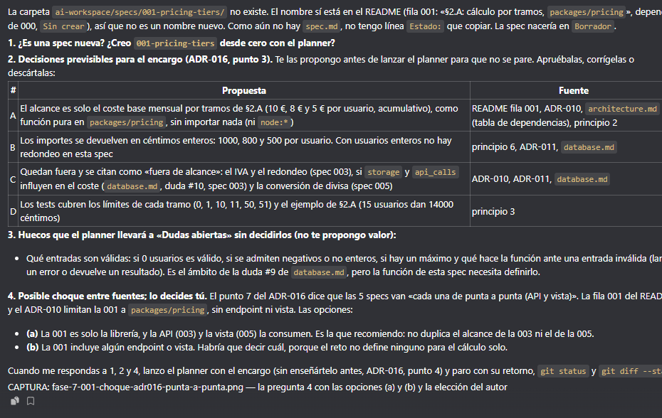
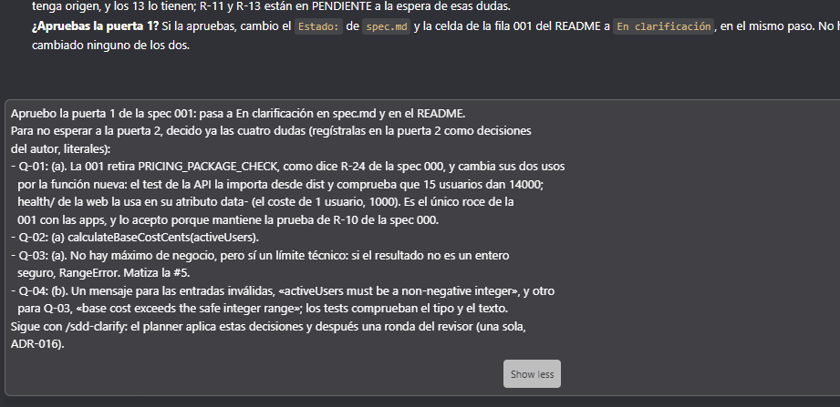
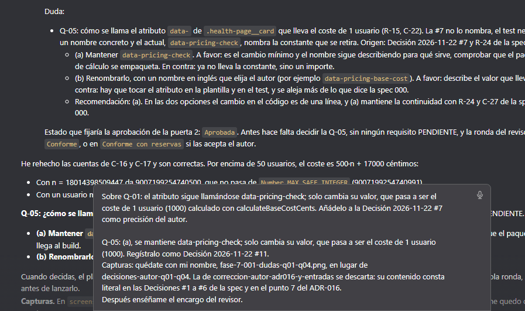
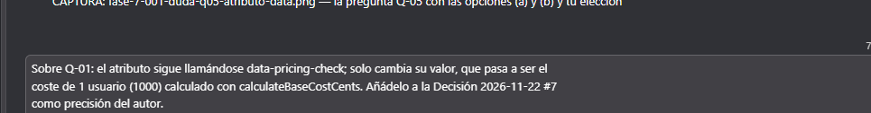
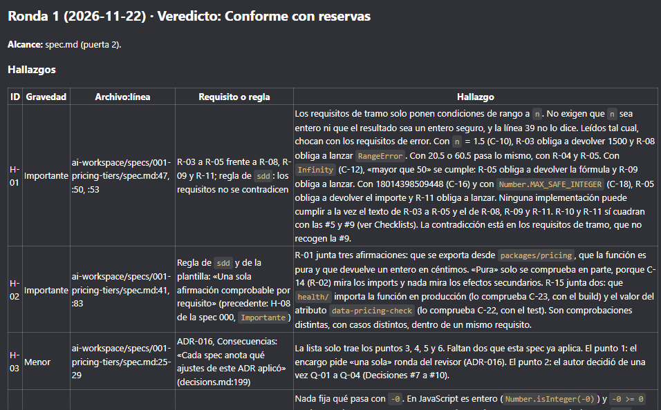
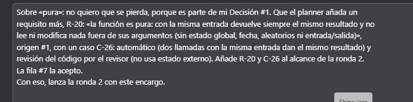
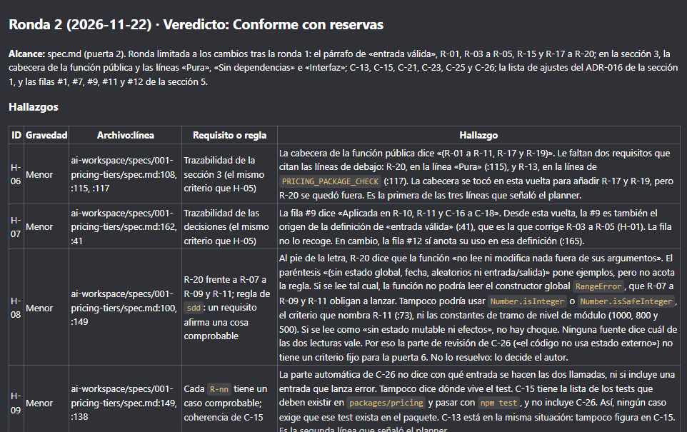
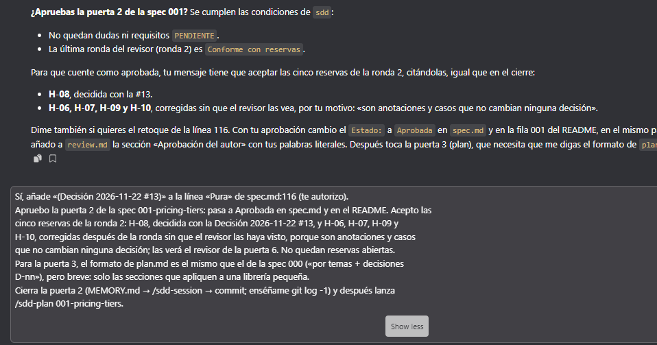

# 001-pricing-tiers — Fase 7 (2026-11-22, sesión 11)

## Objetivo y fase
Fase 7. En la spec `001-pricing-tiers` se llevan dos puertas: la 1 (spec), con `/sdd-spec`, y la 2 (clarificación), con `/sdd-clarify`. Al terminar, la spec queda en `Aprobada` y lista para la puerta 3 (plan).

## Prompts clave
Invocación inicial: `/sdd-spec 001-pricing-tiers` (puerta 1, siguiendo `.claude/commands/sdd-flow.md`).

Respuesta del autor a la propuesta de la puerta 1:
> 1. Sí, spec nueva: crea 001-pricing-tiers con el planner; nace en Borrador.
> 2. Apruebo A, B, C y D tal cual.
> 3. Los huecos de entrada los decido ya (regístralos como decisiones del autor en la petición): "0 usuarios   es válido y cuesta 0 (el tramo 1 del §2.A va de 0 a 10 usuarios); solo se admiten enteros mayores o iguales que 0: con un negativo, un no entero o un valor no finito, la función lanza un RangeError con mensaje en inglés; no hay máximo en esta spec. Validar lo que escribe el usuario es cosa de la API (spec 003), con Zod."
> 4. (a): la 001 es solo la librería; la consumen la API (003) y la vista (005). El «de punta a punta» del punto 7 del ADR-016 se refiere a las specs fusionadas (004 y 005): corrige esa frase del ADR-016 para que lo diga, y anótalo en esta spec. 
>
> Lanza el planner.

Aprobación de la puerta 1 y decisiones de Q-01 a Q-04:
> Apruebo la puerta 1 de la spec 001: pasa a En clarificación en spec.md y en el README.
> Para no esperar a la puerta 2, decido ya las cuatro dudas (regístralas en la puerta 2 como decisiones
> del autor, literales):
> - Q-01: (a). La 001 retira PRICING_PACKAGE_CHECK, como dice R-24 de la spec 000, y cambia sus dos usos
>   por la función nueva: el test de la API la importa desde dist y comprueba que 15 usuarios dan 14000;
>   health/ de la web la usa en su atributo data- (el coste de 1 usuario, 1000). Es el único roce de la
>   001 con las apps, y lo acepto porque mantiene la prueba de R-10 de la spec 000.
> - Q-02: (a) calculateBaseCostCents(activeUsers).
> - Q-03: (a). No hay máximo de negocio, pero sí un límite técnico: si el resultado no es un entero
>   seguro, RangeError. Matiza la #5.
> - Q-04: (b). Un mensaje para las entradas inválidas, «activeUsers must be a non-negative integer», y otro
>   para Q-03, «base cost exceeds the safe integer range»; los tests comprueban el tipo y el texto.
> Sigue con /sdd-clarify: el planner aplica estas decisiones y después una ronda del revisor (una sola,
> ADR-016).

Precisión sobre Q-01 y decisión de Q-05:
> Sobre Q-01: el atributo sigue llamándose data-pricing-check; solo cambia su valor, que pasa a ser el
> coste de 1 usuario (1000) calculado con calculateBaseCostCents. Añádelo a la Decisión 2026-11-22 #7
> como precisión del autor.
>
> Q-05: (a), se mantiene data-pricing-check; solo cambia su valor, que pasa a ser el coste de 1 usuario
> (1000). Regístralo como Decisión 2026-11-22 #11.
> Capturas: quédate con mi nombre, fase-7-001-dudas-q01-q04.png, en lugar de
> decisiones-autor-q01-q04. La de correccion-autor-adr016-y-entradas se descarta: su contenido consta
> literal en las Decisiones #1 a #6 de la spec y en el punto 7 del ADR-016.
> Después enséñame el encargo del revisor.

Corrección de la línea 92 antes de la ronda 1:
> Antes de lanzar, corrige spec.md:92 para que nombre data-pricing-check (te autorizo; es aplicar la
> Decisión #11 también en la sección 3), y añádelo al encargo como «aplicado por la sesión principal con
> el OK del autor». Después lanza el revisor con este encargo y enséñame su informe tal cual.

Tras la ronda 1:
> 1. Sí, crea review.md con la ronda 1 tal cual.
> 2. H-01 y H-02: corrígelos con el planner como propones, sin cambiar ninguna decisión.
> 3. H-04: (a). Decisión del autor 2026-11-22 (#12): "-0 es una entrada válida y la función devuelve 0, no
>    -0, con un caso que lo comprueba con Object.is." Motivo: cuadra con «0 usuarios es válido y cuesta 0»
>    (#5).
> 4. H-03 y H-05: que el planner los arregle en la misma vuelta (son de una línea), en lugar de dejarlos
>    como reservas.
> Después enséñame el encargo de la ronda 2, limitada a estos cambios.

Lanzamiento de la ronda 2:
> Lanza el revisor con ese encargo

Corrección sobre «pura», que llegó con la ronda 2 ya en marcha:
> Sobre «pura»: no quiero que se pierda, porque es parte de mi Decisión #1. Que el planner añada un
> requisito más, R-20: «la función es pura: con la misma entrada devuelve siempre el mismo resultado y no
> lee ni modifica nada fuera de sus argumentos (sin estado global, fecha, aleatorios ni entrada/salida)»,
> origen #1, con un caso C-26: automático (dos llamadas con la misma entrada dan el mismo resultado) y
> revisión del código por el revisor (no usa estado externo). Añade R-20 y C-26 al alcance de la ronda 2.
> La fila #7 la acepto.
> Con eso, lanza la ronda 2 con este encargo.

Tras la ronda 2:
> 1. Sí, guarda la ronda 2 tal cual en review.md.
> 2. H-08: (a). Decisión del autor 2026-11-22 #13: "«Pura» en R-20 significa sin estado mutable ni
>    efectos: la función puede usar los globales estándar e inmutables del lenguaje (RangeError,
>    Number.isInteger, Number.isSafeInteger) y constantes del propio módulo, pero no estado mutable,
>    fecha, aleatorios ni entrada/salida. Es el criterio de la revisión de C-26." Mi texto de R-20 no
>    cambia; la #13 lo precisa.
> 3. H-06, H-07, H-09 y H-10: (1), que el planner los corrija en la misma vuelta que la #13 (C-21 puede
>    comprobar que la función tiene un solo parámetro; C-26 con una entrada válida y otra que lanza, y
>    C-13 y C-26 en la lista de C-15). Anota que el revisor no ha visto estos cambios: son anotaciones y
>    casos que no cambian ninguna decisión.
> Después pídeme la aprobación de la puerta 2.

Aprobación de la puerta 2:
> Sí, añade «(Decisión 2026-11-22 #13)» a la línea «Pura» de spec.md:116 (te autorizo).
> Apruebo la puerta 2 de la spec 001-pricing-tiers: pasa a Aprobada en spec.md y en el README. Acepto las
> cinco reservas de la ronda 2: H-08, decidida con la Decisión 2026-11-22 #13, y H-06, H-07, H-09 y
> H-10, corregidas después de la ronda sin que el revisor las haya visto, porque son anotaciones y casos
> que no cambian ninguna decisión; las verá el revisor de la puerta 6. No quedan reservas abiertas.
> Para la puerta 3, el formato de plan.md es el mismo que el de la spec 000 («por temas + decisiones
> D-nn»), pero breve: solo las secciones que apliquen a una librería pequeña.
> Cierra la puerta 2 (MEMORY.md → /sdd-session → commit; enséñame git log -1) y después lanza
> /sdd-plan 001-pricing-tiers.

## Qué propuso la IA
- **Puerta 1, antes de lanzar el planner** (ADR-016, punto 3):
  - Cuatro decisiones previsibles:
    - A: alcance de función pura en `packages/pricing`.
    - B: importes en céntimos enteros.
    - C: fuera de alcance el IVA, el redondeo, `storage`, `api_calls` y la divisa.
    - D: tests de los límites 0, 1, 10, 11, 50 y 51 y del ejemplo de 15 usuarios.
  - Los huecos de entrada, como duda abierta.
  - Un posible choque entre el punto 7 del ADR-016 («cada una de punta a punta») y la fila 001 del README con el ADR-010. Recomendó (a): la 001, solo la librería.
- Entró en modo plan y propuso los pasos: corregir el ADR-016, lanzar el planner y comprobar los límites con `git status`. El autor lo aprobó.
- Antes de lanzar el planner, comprobó que `PRICING_PACKAGE_CHECK` la usan la API y `health/`, y pidió al planner que lo dejara como duda en vez de decidirlo.
- **Retorno del planner en la puerta 1:** «Con dudas», con Q-01 a Q-04 y una recomendación en cada una. La sesión principal comprobó la cita de R-24 de la spec 000.
- **Q-05:** la abrió el planner (nombre del atributo `data-`). La sesión principal recomendó (a), mantener `data-pricing-check`.
- **Encargo de la ronda 1**, enseñado antes de lanzarlo. La sesión principal señaló la línea 92 (atributo sin nombre) como observación del planner que no se había aplicado.
- **Ronda 1:** veredicto `Conforme con reservas`.
  - H-01 y H-02, Importante: choque entre los tramos y los errores; R-01 y R-15 son compuestos.
  - H-03 a H-05, Menor.
  - La sesión principal recordó que el punto 1 del ADR-016 obliga a otra ronda si hay algo Importante. Propuso corregir H-01 y H-02 y recomendó (a) para `-0` (H-04).
- **Tras la primera corrección:** avisó de que «pura» había salido de R-01 y de que el planner había cambiado la fila #7 sin que se le pidiera.
- **Primera ronda 2:** la paró sin resultado al llegar la corrección del autor sobre «pura», para no revisar una spec sin R-20.
- **Ronda 2:** veredicto `Conforme con reservas`, con H-06 a H-10, todos Menor. H-01 a H-05, resueltos. Recomendó (a) para H-08 y (1), corregir en una vuelta, para el resto, con la nota de que el revisor no los ve.
- **Cierre de la puerta 2:**
  - recomendó añadir «(Decisión 2026-11-22 #13)» a la línea «Pura»;
  - señaló el nombre mal escrito de la captura de la ronda 2 (`… ronda-2.png .png`);
  - pidió la aprobación de la puerta 2 nombrando las cinco reservas.

## Qué corregí y por qué
- **Choque del ADR-016.** Elegí (a) y pedí corregir la frase del punto 7: «de punta a punta» se refiere a las specs fusionadas (004 y 005).
- **Huecos de entrada.** Los decidí antes de la puerta 2, en lugar de dejarlos como duda.
- **Atributo `data-`.** La IA dejó abierto si se renombraba. Precisé que se mantiene `data-pricing-check` y que solo cambia su valor.
- **Línea 92.** Pedí corregirla antes de la ronda 1, para aplicar la #11 también en la sección 3.
- **H-03 y H-05.** Pedí corregirlos en la misma vuelta, en vez de dejarlos como reservas, «son de una línea».
- **«Pura».** No quise que se perdiera al partir R-01, porque es parte de la Decisión #1. Pedí R-20 y C-26.
- **Fila #7.** Acepté el cambio de trazabilidad que el planner hizo sin que se le pidiera.
- **Nombres de capturas.** Me quedé con mi nombre `fase-7-001-dudas-q01-q04.png` y descarté `correccion-autor-adr016-y-entradas` (motivo en «Capturas»).

## Decisiones tomadas
- Decisiones 2026-11-22 de la spec 001, literales en la sección 5 de `spec.md`:
  - #1 a #4: las opciones A a D.
  - #5: huecos de entrada.
  - #6: la 001 es solo la librería, con la corrección del punto 7 del ADR-016.
  - #7: retirar `PRICING_PACKAGE_CHECK` y sustituir sus dos usos, con la precisión sobre `data-pricing-check`.
  - #8: `calculateBaseCostCents(activeUsers)`.
  - #9: `RangeError` si el resultado no es un entero seguro.
  - #10: los dos mensajes en inglés, que los tests comprueban por tipo y texto.
  - #11: se mantiene `data-pricing-check`, con valor 1000.
  - #12: `-0` es una entrada válida y devuelve `0`.
  - #13: qué significa «pura» en R-20.
- **ADR-016, punto 7**, corregido en `ai-workspace/docs/decisions.md` por la sesión principal, a petición del autor.
- **La spec al final de la sesión:**
  - 20 requisitos, 27 casos de prueba y Q-01 a Q-05 decididas.
  - `review.md` con dos rondas, las dos `Conforme con reservas`, y la «Aprobación del autor» de la puerta 2. No queda ninguna reserva abierta.
- **Estados.** La spec pasó de `Borrador` a `En clarificación` y de ahí a `Aprobada`, en `spec.md` y en la fila 001 del README.
- **Formato de `plan.md` para la puerta 3:** el de la spec 000, «por temas + decisiones D-nn», pero breve.
- **Ajustes del ADR-016 aplicados:** puntos 1 a 6, anotados en la sección 1 de la spec.
- Commit: el de cierre de esta sesión.

## Capturas

- Anunciada y no existente: `fase-7-001-correccion-autor-adr016-y-entradas.png`. La descartó el autor porque su contenido consta literal en las Decisiones #1 a #6 de la spec y en el punto 7 del ADR-016.
- Anunciada con otro nombre: `fase-7-001-decisiones-autor-q01-q04.png`, que se guardó como `fase-7-001-dudas-q01-q04.png` por elección del autor.

## Pendiente para la siguiente sesión
- **Al guardar este registro**, sustituir el marcador `(pendiente de /sdd-session)` de las filas #1 a #13 de `spec.md` por `sessions/2026-11-22-11-001-pricing-tiers.md`, con tu OK.
- **Commit de cierre**, autorizado por ti. Antes, `git diff` de cada fichero; después, enseñarte `git log -1`.
- **Puerta 3:** `/sdd-plan 001-pricing-tiers`, con el formato «por temas + decisiones D-nn» breve. La lanzas tú.
- **`MEMORY.md` tiene 51 líneas**, una más que el límite habitual de 50. Está pendiente decidir si se funde la línea de la fase 7.
- **La puerta 6 tiene que revisar** H-06, H-07, H-09 y H-10, corregidos sin que los viera el revisor (aprobación del autor), y la línea «Pura» de la sección 3, retocada después de la ronda 2.
