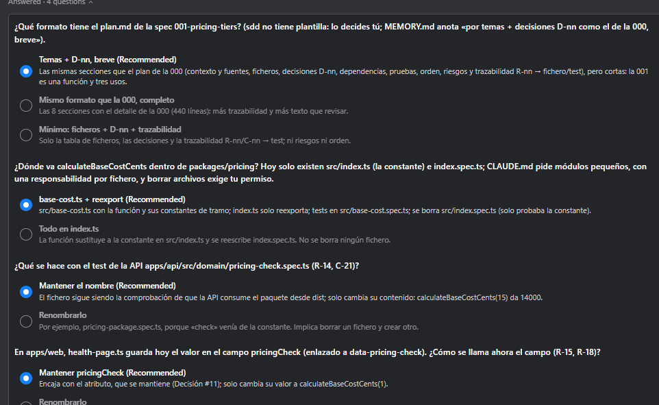
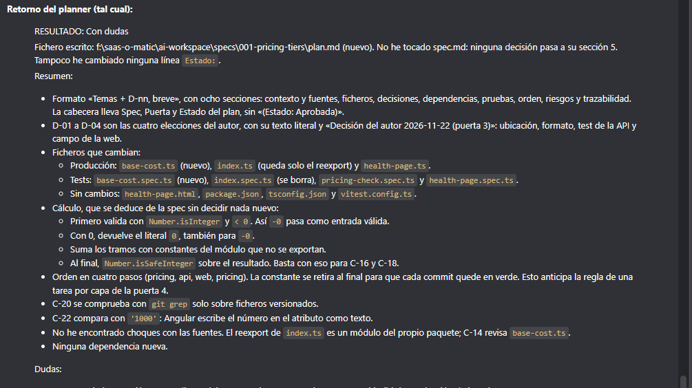
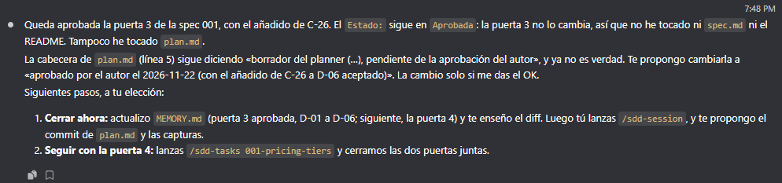

# 001-pricing-tiers — Fase 7 (2026-11-22, sesión 12)

## Objetivo y fase
Fase 7, spec `001-pricing-tiers`, puerta 3 (plan) con `/sdd-plan`. La spec estaba en `- **Estado:** Aprobada` y sin `plan.md`, así que tocaba la puerta 3. El objetivo era redactar `plan.md` con el planner y obtener la aprobación del autor. Al cerrar, el `Estado:` sigue en `Aprobada` (tabla «Estado al pasar» de `sdd`).

## Prompts clave
Invocación de la puerta 3:
> /sdd-plan 001-pricing-tiers
> Puerta 3 (plan). Argumentos de este comando: 001-pricing-tiers (la spec, `NNN-nombre`). Si falta, pregúntame cuál: no elijas, aunque solo haya una.

Respuestas del autor en el cuadro de opciones (formato y decisiones de plan que se podían prever, ADR-016, puntos 2 y 3):
> Formato: "Temas + D-nn, breve (Recommended)"
> Ubicación: "base-cost.ts + reexport (Recommended)"
> Test API: "Mantener el nombre (Recommended)"
> Campo web: "Mantener pricingCheck (Recommended)"

Decisión sobre P-01 y la comprobación de los errores, con el encargo de la segunda vuelta:
> P-01: elijo (a), buscar en la salida del build el mensaje literal `activeUsers must be a non-negative integer`.
> Motivo: C-23 pide que el build «empaqueta la función (como C-27 de la spec 000)», y C-27 se comprobó buscando en la salida del build (T-18 de la 000). El mensaje no es un detalle de implementación: lo fijan R-07 a R-09 y la Decisión 2026-11-22 #10, así que solo cambiaría con un /sdd-change, y la búsqueda cambiaría con él. (b) no demuestra lo que pide C-23, y (c) no añade nada, porque los dos mensajes están en la misma función.
>
> Además, en C-09 a C-12, C-16, C-18 y C-19, una sola forma de comprobar el error: capturarlo y comprobar `instanceof RangeError` y `message` con igualdad exacta (`toBe`), como el test de D-15 tras la T-23 de la 000. Motivo: `toThrow('…')` solo comprueba que el mensaje contiene el texto, y R-16 pide el texto literal.
>
> Vuelve a lanzar al planner con mis dos decisiones literales para que, solo en plan.md:
> 1. P-01 pase a D-05 y lo segundo a D-06, las dos como «Decisión del autor 2026-11-22 (puerta 3)», y desaparezca «Pendiente del autor».
> 2. D-05, «Cómo se aplica»: el comando de la T-18 de la 000 (`Get-ChildItem -Path apps\web\dist\web -Recurse -File | Select-String -Pattern '…'`, sin `-SimpleMatch`), con el mensaje en lugar de `pricing-package-ok`.
> 3. Queden al día las filas de C-09 a C-12, C-16, C-18, C-19 y C-23 (sección 5), el riesgo 4 (sección 7) y la frase de la sección 1 que cita D-01 a D-04.
>
> Límites: ni spec.md ni el README; el Estado: sigue en Aprobada; nada fuera de plan.md.
>
> Enséñame el retorno del planner, el diff de plan.md y `git status`. NO apruebes la puerta 3: espera mi aprobación.

Aprobación de la puerta 3:
> Acepto el añadido de C-26 y apruebo la puerta 3

Cierre:
> OK a la cabecera; actualiza MEMORY.md y enséñame el diff

## Qué propuso la IA
- **Estado y puerta:** comprobó que la spec estaba en `Aprobada` y sin `plan.md`, y que por tanto tocaba la puerta 3. Lo hizo en modo plan, sin cambiar nada.
- **Preguntas antes de lanzar:** preguntó el formato de `plan.md`, como exige `/sdd-flow`. En el mismo cuadro propuso tres decisiones de plan que se podían prever, cada una con una opción recomendada:
  - dónde va la función (`src/base-cost.ts` con reexport, o todo en `index.ts`);
  - si se renombra el test de la API `pricing-check.spec.ts`;
  - si se renombra el campo `pricingCheck` de `health-page.ts`.
- **Plan de la puerta:** dejó escrito el encargo del planner con las cuatro elecciones literales y las «Rutas a leer» acotadas. El autor lo aprobó al salir del modo plan.
- **Captura anunciada:** `fase-7-001-plan-formato-y-decisiones.png`.
- **Primera vuelta del planner** (Opus 5.5): devolvió «Con dudas».
  - `plan.md` nuevo, de 145 líneas, con D-01 a D-04.
  - P-01: cómo comprueba C-23 que el build de la web empaqueta la función. Opciones: (a) buscar un mensaje, (b) basta el build y C-22, (c) buscar los dos mensajes. Recomendaba (a).
  - Límites: `git status` y `git diff --stat` mostraron solo `plan.md` y una captura del autor.
- **Sesión principal tras la primera vuelta:** enseñó el retorno tal cual y recomendó también (a), porque mantiene la técnica de D-08 y es la única opción barata que demuestra lo que pide C-23.
- **Segunda vuelta:** continuó al mismo planner (no uno nuevo) con las dos decisiones literales del autor. Devolvió «Completado»:
  - `plan.md` pasa a 156 líneas, con D-05 y D-06.
  - El comando copiado de `000-skeleton/tasks.md:322`.
  - Las filas de C-09 a C-12, C-16, C-18, C-19 y C-23, el riesgo 4 y la sección 1 al día.
- **Cambios del planner que no pedía el encargo:** la sesión principal señaló cuatro:
  - la cabecera;
  - las filas de R-16 y R-18 en la sección 8;
  - el apartado «Cómo se calcula», movido de sitio;
  - la parte automática de C-26, que usa la forma de D-06.

  Consideró coherentes los tres primeros, preguntó por el cuarto porque amplía D-06, y comprobó que la nota sobre `-SimpleMatch` viene de la T-18 de la 000.
- **Diff:** como `plan.md` no está en git, no había diff de la segunda vuelta; la sesión principal enseñó las líneas cambiadas.
- **Tras la aprobación:** propuso cambiar la cabecera de `plan.md` (con OK del autor) y el orden de cierre: `MEMORY.md`, luego `/sdd-session`, luego commit.

## Qué corregí y por qué
- **P-01:** elegí (a) y añadí una segunda decisión (D-06): cada `RangeError` se comprueba capturándolo, con `instanceof` y `message` con `toBe`. Motivo: `toThrow('…')` solo comprueba que el mensaje contiene el texto, y R-16 pide el texto literal.
- **Comando de D-05:** el de la T-18 de la 000, sin `-SimpleMatch`.
- **Añadido del planner a C-26:** lo acepté.
- **Captura anunciada:** la guardé como `fase-7-001-plan-decisiones-autor.png`, no con el nombre anunciado. En `/sdd-session` elegí (a): darla por esa misma captura, sin renombrarla.

## Decisiones tomadas
- **Puerta 3 de la spec 001 aprobada el 2026-11-22.** El `Estado:` sigue en `Aprobada`: no cambian ni `spec.md` ni el README.
- **Decisiones del autor de la puerta 3, en `plan.md`:**
  - D-01: `src/base-cost.ts` con reexport en `index.ts`; se borra `index.spec.ts`.
  - D-02: formato «Temas + D-nn, breve».
  - D-03: se mantiene el nombre de `pricing-check.spec.ts`.
  - D-04: se mantiene `pricingCheck`.
  - D-05: C-23 busca el mensaje `activeUsers must be a non-negative integer` en la salida del build de la web, con el comando de la T-18 de la 000.
  - D-06: cada `RangeError` se captura y se comprueba con `instanceof RangeError` y `message` con `toBe`, también en la parte automática de C-26.
- **Cabecera de `plan.md`:** «aprobado por el autor el 2026-11-22 (con el añadido de C-26 a D-06 aceptado)».
- **`MEMORY.md`:** línea de la fase 7 al día; siguiente, la puerta 4. Sigue en 51 líneas.
- **Ajustes del ADR-016 aplicados:**
  - Punto 2: dudas en bloque, en un solo cuadro.
  - Punto 3: decisiones previsibles propuestas antes de lanzar.
  - Punto 4: encargo del planner sin enseñarlo antes en el chat; constaba en el plan aprobado al salir del modo plan.
  - Punto 5: rutas acotadas.
  - Punto 6: planner con Opus.
- **Commit:** el de cierre de esta sesión.

## Capturas
- La captura anunciada, `fase-7-001-plan-formato-y-decisiones.png`, se da por `fase-7-001-plan-decisiones-autor.png`, guardada por el autor con ese nombre (elección (a) en `/sdd-session`).

## Pendiente para la siguiente sesión
- Puerta 4 de la spec 001 con `/sdd-tasks 001-pricing-tiers`: `tasks.md` con cada R-01 a R-20 cubierto. El orden de construcción de `plan.md` va en cuatro pasos (pricing, api, web, pricing) y retira la constante al final.
- Tras la aprobación de la puerta 4, el `Estado:` pasa a `Planificada`.
